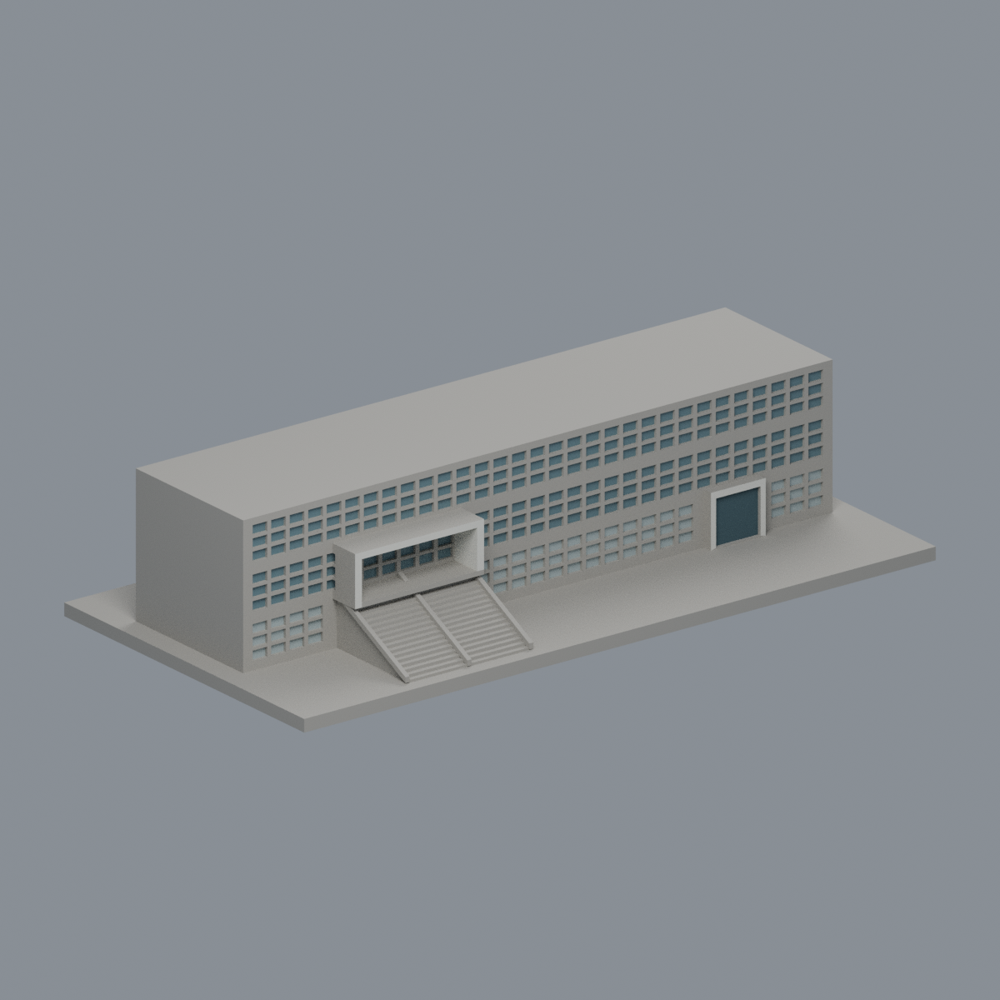
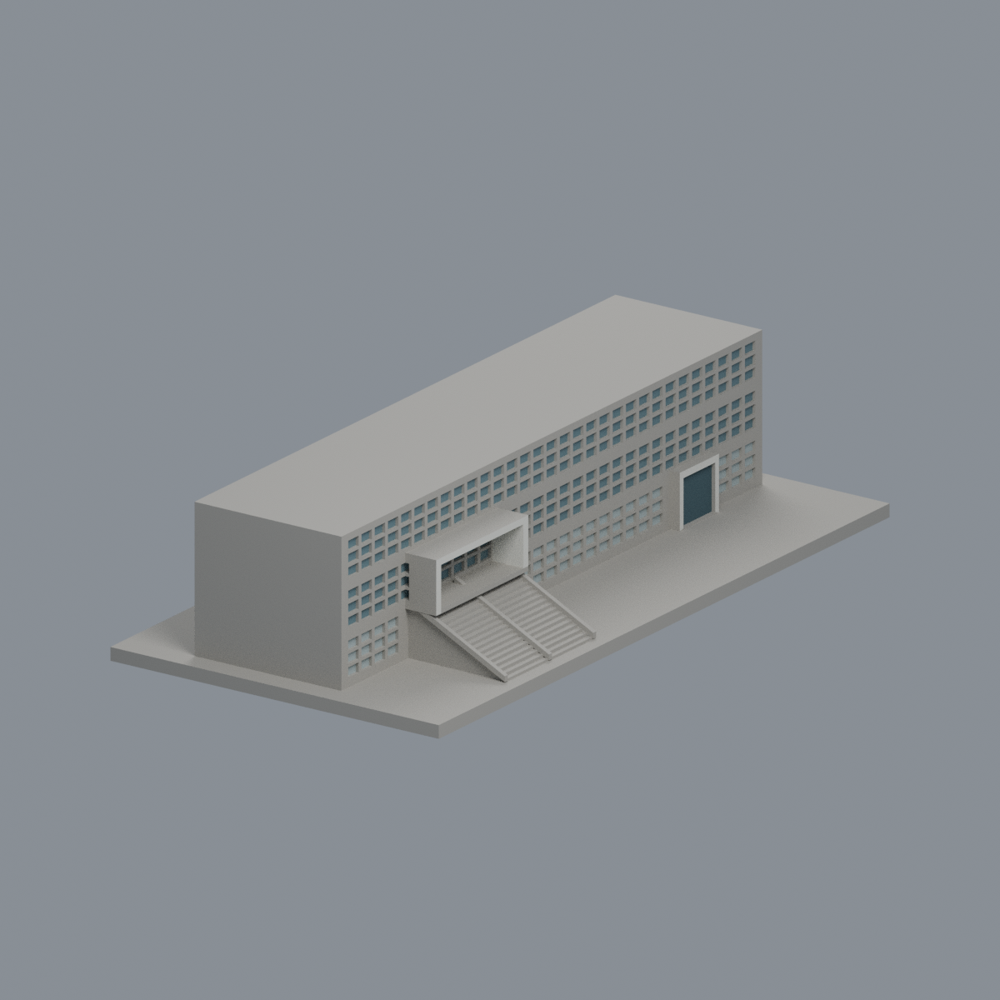
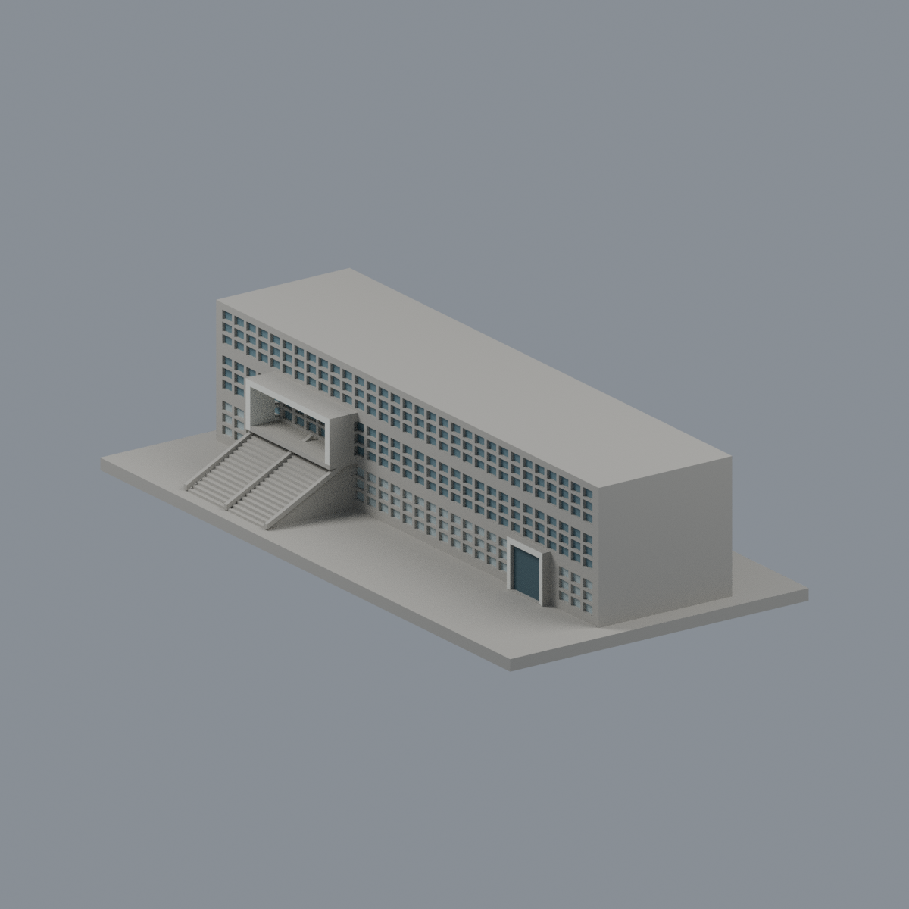
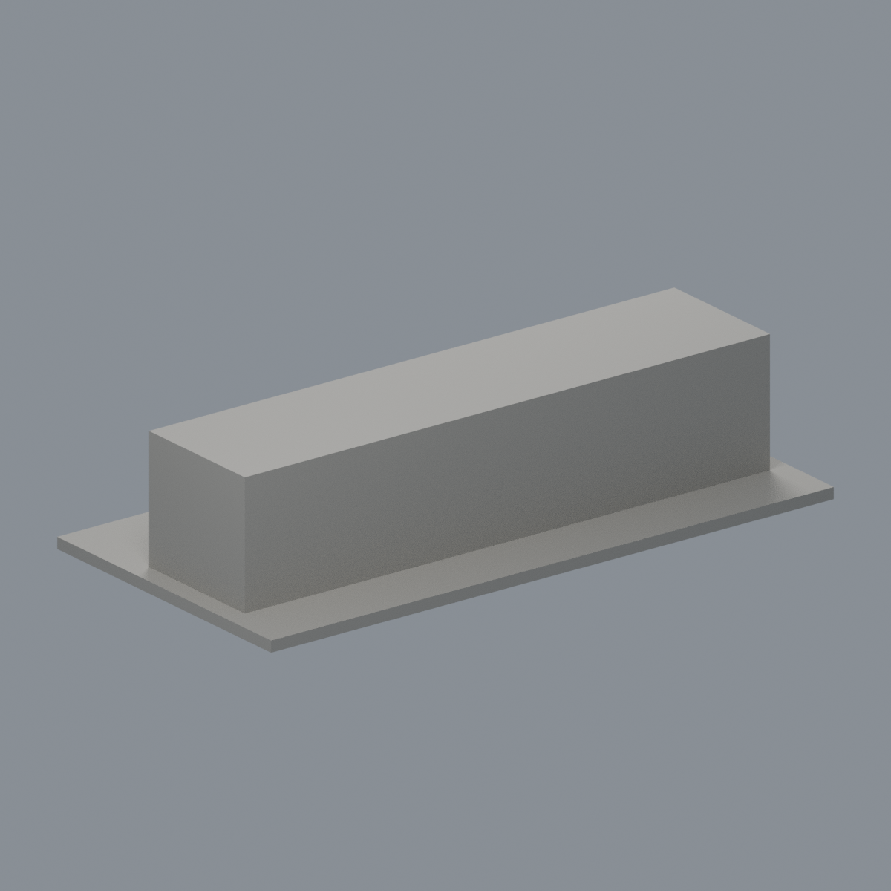
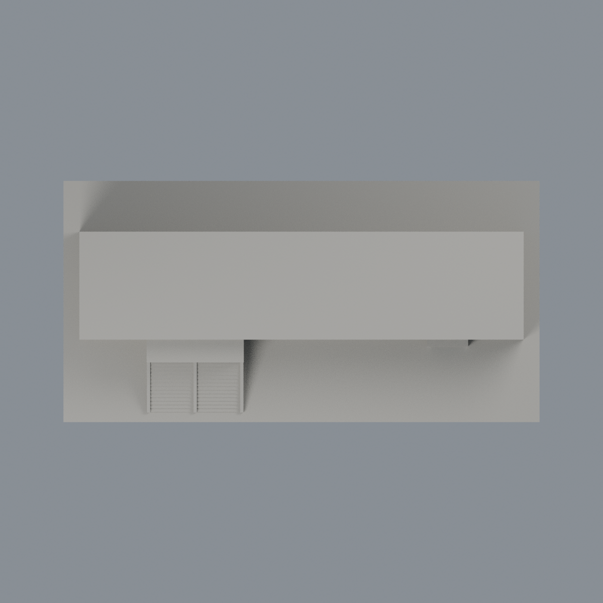

# 成大未來館現存前棟：限域外觀

僅既有模型 **511 面 / 2030.7200518417367 mm²** 使用來源支持的非透明顏色代理，其餘 **4533 面維持未查證中性**。不是整樓上色、實測材質或2026現況普查。

- [五材質3MF](ncku-future-venue-front-appearance.3mf) · [可編輯Blend](scene.blend) · [重建原始碼ZIP](rebuild-source.zip)
- [前](previews/front.png) · [左](previews/left.png) · [右](previews/right.png) · [後](previews/rear.png) · [頂](previews/top.png)
- [同角度單色對照](previews/mono-front.png) · [來源及限制](SOURCES.md) · [授權](LICENSE-NOTICE.md)

| 模型預覽 | 模型預覽 | 模型預覽 |
| :---: | :---: | :---: |
| 前  | 左  | 右  |
| 後  | 頂  | 同角度單色對照  |

372上中窗背、120淺色低窗背、2次入口門背、17突出白色U框正面。全部三點位於各個有限平面矩形並驗證實際叉積法線；白框同材質角面重疊只計一次。5044原三角形坐標、順序、朝向及STL bytes完整不變。大牆／共面細框、側背、屋頂、底座、實心梯側與底、主入口底梁、次門門檻及未選reveals保持中性，不補玻璃／窗櫺，不復原已拆T形後翼。

## 非製造修復／非可直接列印
原製造QA完整保留為歷史記錄：validation passed=true；170個0.2mm截面；34薄層形態開運算無大於1%損失、最大0.000683504635691893。形態運算不是全域壁厚保證；本次沒有重跑歷史製造QA、沒有完整自交／切片／實體列印驗證。原約28mm入口跨度可能需支撐，0.6/0.9mm格框可能簡化。前棟深度、背頂、階數與三子列窗仍為原粗略模型，不是全樓geometry升級。

## 重建
安裝 source/requirements.txt；本目錄上層需原 model.stl，執行 source/build_appearance.py、source/verify_exchange.py，再以 Blender 執行 source/render_appearance.py 與 source/verify_scene.py。測試包含strict 3MF零警告、真材質修改存讀、Blend真頂點及真材質修改存讀、交付Blend重開重繪；解包原始碼clean重建3MF/map/palette/五張PNG完全一致，Blend只主張語義一致。

## 2026-11-14 有限外觀修正（重新建置交付版）

# Bounded portal interior return appearance

Only18 neutral faces to existing3 #E3E3DA/.78; original5 shaders unchanged, current529colored/4515neutral.

Only left cheek14, right cheek2 and top underside2 complete domains:18 originally neutral faces to existing material3 #E3E3DA/.78. Bottom floor8 faces explicitly excluded, along with stairs, rear glazing, outer frame/front, whole walls. Original5 shader values unchanged; front_only material id is historical, current scope separately described.

Original portal box8 deep has exposed7.2 depth y-19.2..-12; left cheek retains three original window-cut notches. Coarse width/depth/proportions are proxies, not survey; thin columns and luminaires not modeled. No geometry repair, splitting, filling notches, or stair recolor.

Current official source0 original-pixel portal crop and source2 museum panorama show white inner cheeks/top underside distinct from rear glazing; do not extend this to bottom floor. Source0/1 complete1600 reduced views inspected, not claimed full original-pixel inspection; source0 crop at original pixels and source2 supplied2400x940 full view inspected. Nativefront1200 fully inspected.

source0 PNG CreationTime2024:08:02 13:56:43 is self-reported creation metadata, not verified exposure date; no timezone offset/EXIF. source1 no capture metadata. Fresh source2 EXIF DateTime contains non-date bytes, no valid capture-date claim; Photoshop software does not date exposure. Page/report dates not shutter dates.

Both original PNG image requests succeeded GET200; page0 GET200, page1 GET503 and not read as page content. Museum report/image retrieved separately as recorded. No access-limit bypass or historical-image reuse asserted.

Historical QA and source classifier/renderer retained bytes; current reports separate. Five native views1200 CPU32; mono-front remains historicalQA. Original11 archive has historical README difference. No originalOBJ or root checksum. New complete verifier/source requirements included. Original geometry/manufacturing limitations retained.

# Public reference links

- https://material.ncku.edu.tw/action.php?id=3058&part=e&download
- https://material.ncku.edu.tw/action.php?id=3057&part=e&download
- https://material.ncku.edu.tw/picture.php?/3058
- https://material.ncku.edu.tw/picture.php?/3057
- https://web.ncku.edu.tw/p/404-1000-293070.php?Lang=zh-tw
- https://web.ncku.edu.tw/var/file/0/1000/img/198982232.jpg

Sources0/2 show white portal inner cheeks/top underside. PNG0 CreationTime is unverified creation metadata, not exposure date. Source1 has no capture metadata; source2 malformed DateTime does not establish capture. Page1 request503, both PNG image requests200. No private photos/hashes redistributed.

現版共 5 個顯示材質（含未知中性色）。上方原材質數、面域與QA描述為歷史版本，僅由本節有限範圍更新。本版是重新建置，不是尋回遺失草稿；不新增幾何或擴充補色範圍。

本節提及原ZIP/QA/校驗數目屬歷史記錄，不是現版ZIP清單。現版ZIP僅含原STL、必要舊建置與渲染程式、三支現版包裝／驗證程式、requirements-current.txt與本README及授權說明（如原有）。完整來源研究、照片、私人審核與廣泛校驗清單不公開。PUBLIC-MODEL-SHA256SUMS僅核當前交付產品；原QA不替代當前驗證。

現版命令：`python -B appearance/source/build_current.py`、`python -B appearance/source/verify_current.py`、`blender -b -t 4 --python-exit-code 1 --python appearance/source/render_current.py`。依requirements-current.txt安裝必要依賴。直接執行舊builder會重建歷史配色。包裝程式僅執行固定本地舊程式，新增材質時只替換新材質粗糙度運算；寫模型、材質、場景、原視角PNG與當前本地QA。歷史報告先保存再還原；原不存在時只刪該次產生的舊名報告。不進行網路或憑證操作。

本案ZIP另含既有公開source/source-selection.json，為原分類器必要的面域/幾何數值輸入；不是私人來源照片或審核清單。mono-front.png維持歷史版本，非現版五視角重渲結果。
