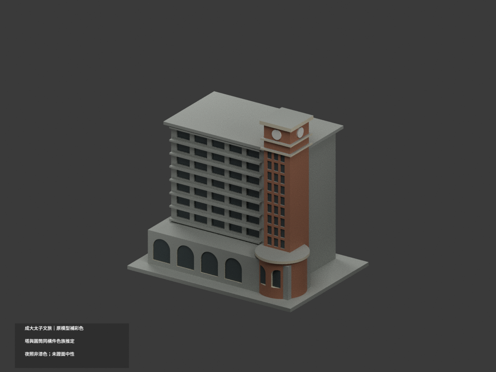
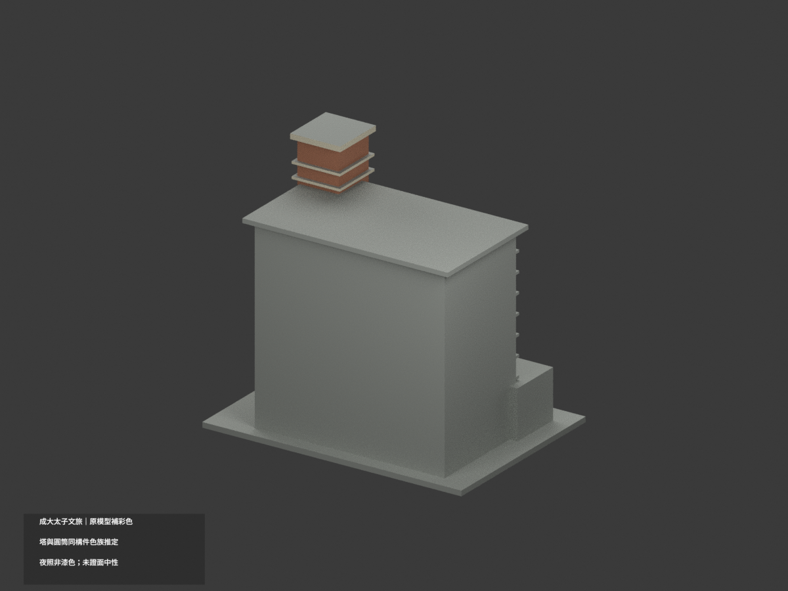
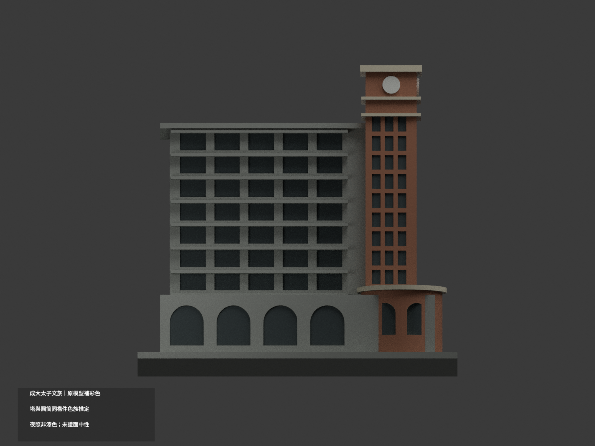
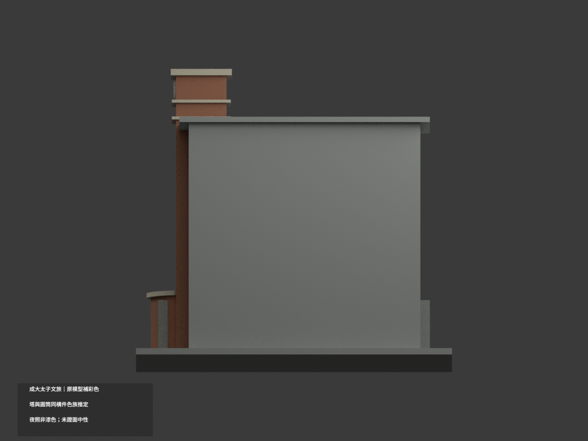
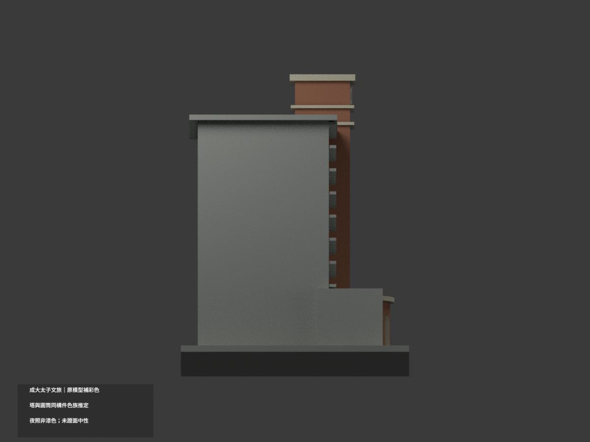
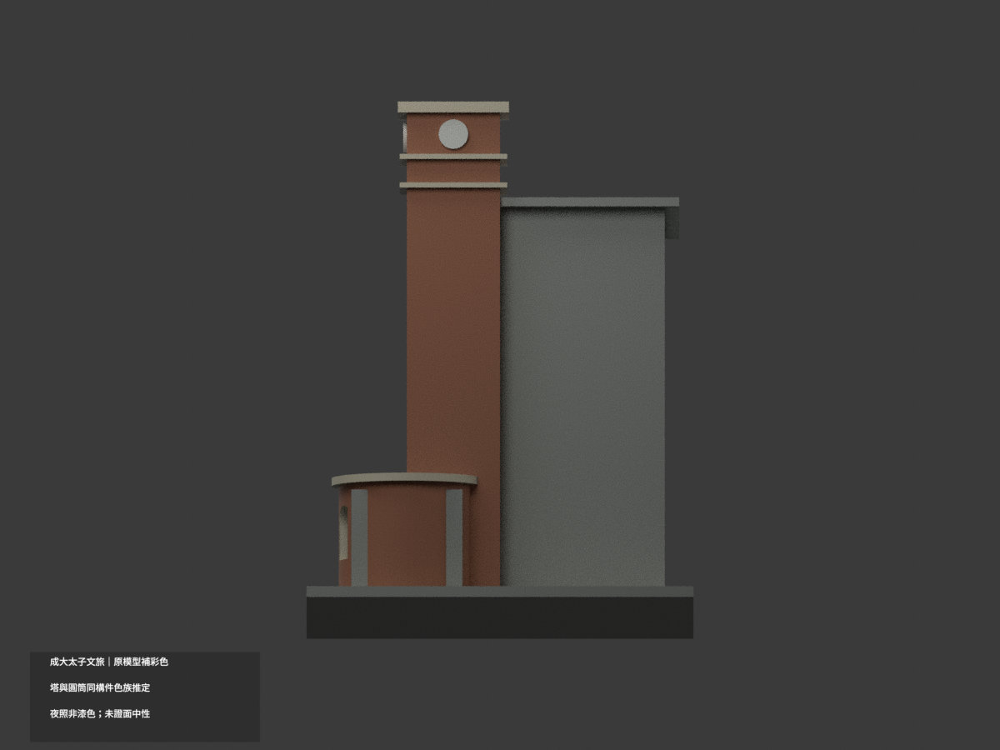
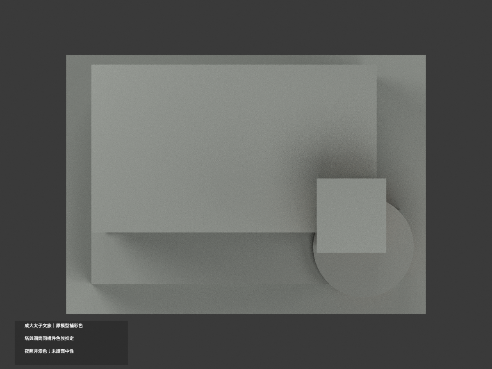
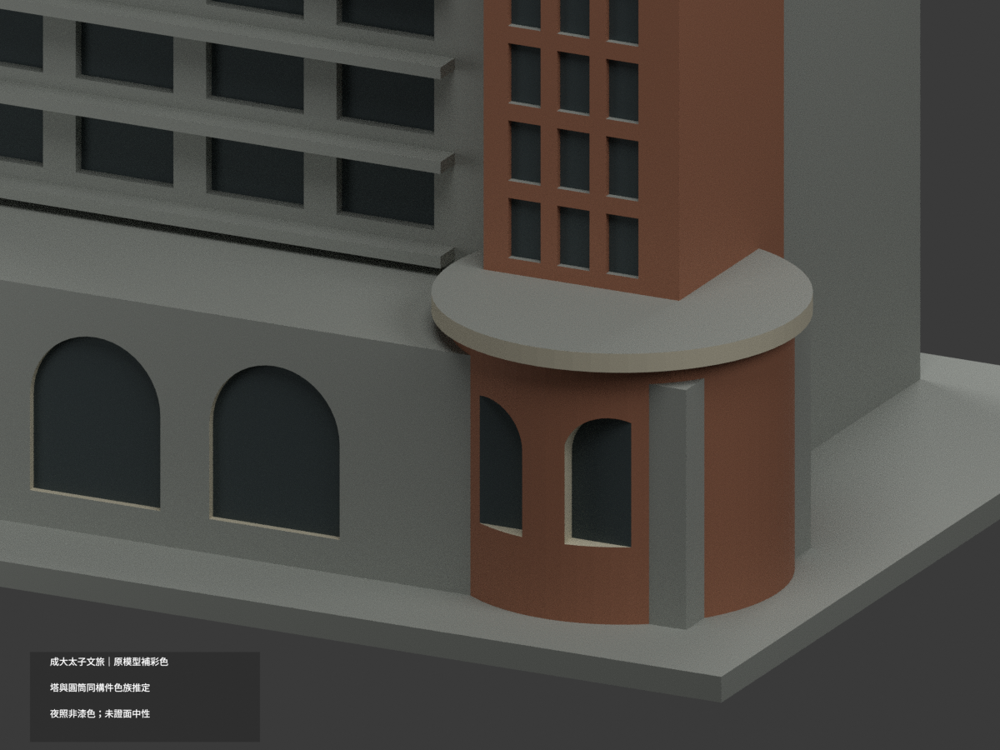
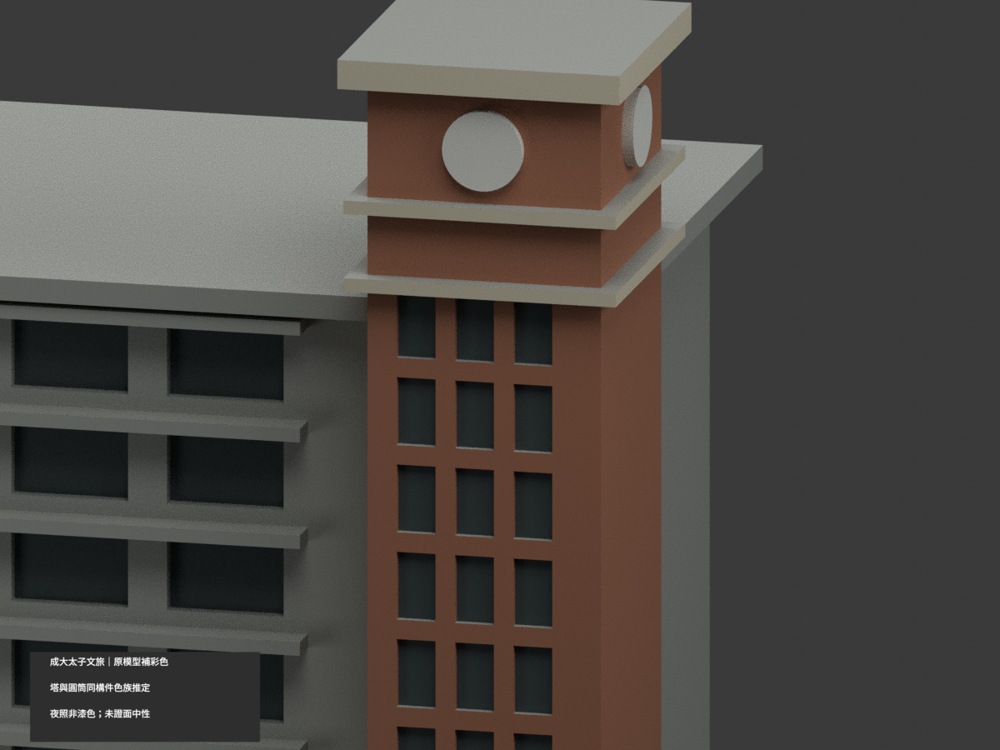
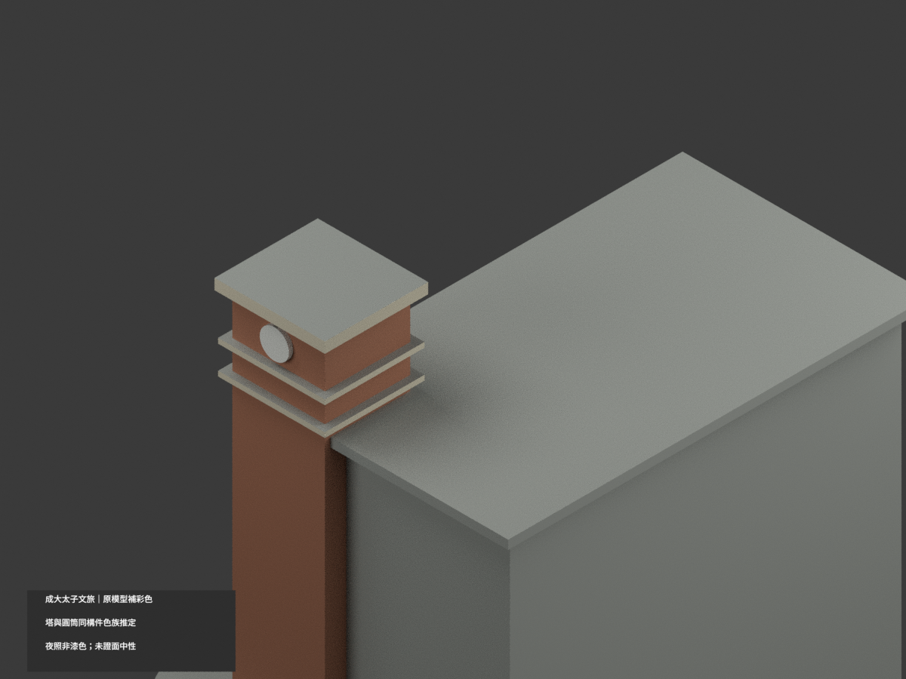

# 國立成功大學｜太子文旅：原幾何補彩色

## 彩色模型預覽

**同一項目材色更新（count_delta = 0）：鐘塔與圓筒裙樓採同構件磚色族連續的有界推定，不是全周精測色。僅夜照對位之長窗面牆與樓帶、未知側後／屋面保中性；夜景黃光不當白日漆色。**

| 正面斜視 | 背面斜視 | 正面 |
|---|---|---|
|  |  |  |
|  |  |  |
|  |  |  |
|  |  |  |

## 材質範圍與限制

原 2802 三角面、頂點座標、STL 與建模原碼均不變。不新增窗格、鐘數字、商標、建築或貼圖，不借旁學舍色彩。材色更新不背書原簡化模型的尺寸與逐窗精度。

- 日景支持鐘塔與圓筒磚色族；夜景僅支持其前角位置。圓筒全周同色是明示同構件連續推定，不是每個方向已有日照照片。
- 原鐘面淺白，原塔冠帶及圓筒簷冠垂直邊淺灰米；水平屋皮未證，保中性。沒有新增鐘面細節。
- 既有拱洞內壁可淺色、凹底深陰影；原拓撲沒有獨立外白拱環，不切三角湊圈，也不聲稱精確白圈寬度。
- 原長陽台立面只有匹配夜照，牆／樓帶保中性，凹底只通用陰影，非黃色照明或全數玻璃。日景另一矩形裙樓不能直接套入前拱廊色帶。原矩形裙樓與圓筒相交後露出的直條灰面維持中性，不當新柱或真實材料分界。
- 未對位矩形裙樓、主體平側後、屋頂與底座保中性，並非真實現場油漆。色票為光照下近似色族，非量測色票。
- 兩照2016-06-24為上傳日，不是已確定拍攝年，不稱2026現況或同年精測外觀。

## 交付、重建與驗證

`model.stl` 不含色且保留原bytes；`build_model.py` 未改。原包沒有OBJ，不虛稱提供。新增 `appearance.3mf` 五基本材質逐面指派、`scene.blend` 實際shader、`color-mesh.npz` 原幾何和面材質。五材質外觀不是已驗證四色／多耗材切片專案；未實際列印，未執行切片器驗證。

```sh
python build_model.py
python colorize_model.py
python export_appearance.py
python validate_color.py
blender -b -t 3 --python render_color.py
blender -b --python-exit-code 1 --python verify_color_scene.py
```

使用原 requirements 與 Blender 4.3.2。隔離重建目錄保留、不自動刪除。新QA見 COLOR-FORMAT-GEOMETRY-QA、SCENE-QA、DELIVERY-QA、SOURCE-VISUAL-QA。七張全景有完整模型邊界檢查，三張細景刻意裁切。原 validation／截面／薄特徵及 previews、render_preview.py 保留單色歷程，不是本次彩色重建入口。

## 色源與權利

- [成大素材網：日景1689](https://material.ncku.edu.tw/picture.php?/1689)
- [成大素材網：夜景1692](https://material.ncku.edu.tw/picture.php?/1692)

照片作者：計網中心行政與諮詢組－陳永川，來源成大素材網。原圖／頁面只私人保存，原圖不隨模型公開、不貼於網格。保留素材網非商業利用及署名要求，公開模型不代表原照可依專案license再授權；不保證商用權利已清。精確來源紀錄見 COLOR-SOURCE-REGISTER.json。

## 原始模型說明與限制

以下保留原文，材色與場景入口以新段落優先；原單材圖不當本次彩色成果。

# 國立成功大學｜太子文旅（原成大會館）

## 模型預覽

| 模型預覽 | 模型預覽 | 模型預覽 |
| :---: | :---: | :---: |
|  |  |  |

第四批外觀近似模型；校區：勝利校區。最長邊150 mm（含底座），各模型獨立比例。尺寸：150 × 108 × 140 mm。


## 公開來源及像素查核

- [校方校友中心地理位置](https://alumni.ncku.edu.tw/p/412-1004-2202.php?Lang=zh-tw)：確認原成大會館為勝利校區太子文旅；不取室內資料建模。
- [校方素材網：成大會館日景](https://material.ncku.edu.tw/picture.php?/1689)：已檢視日景像素：角落高鐘塔、圓弧低樓、拱窗與上層屋簷。
- [校方素材網：成大會館夜景](https://material.ncku.edu.tw/picture.php?/1692)：已檢視另一角度夜景像素：長立面窗格、塔身玻璃直帶、拱廊與圓角量體。

## 本件範圍、保留與近似

只作照片中的鐘塔主樓及相連低層圓角裙樓，旁邊太子學舍等其他樓棟不合併計數。保留高鐘塔、水平冠帶、圓形鐘面、重複窗帶、底層大拱與圓角端部。鐘面以圓盤近似，沒有刻數字或品牌標誌；玻璃和拱廊改成淺凹。側後立面、完整屋頂及深度證據不足，採素面實體與簡單平頂；圓角裙樓分段64面，非原建築測量。

## 交付與重建

- `model.stl`：毫米單位，與底座合成的單一實體。最長邊為 150 mm（含底座）；各棟獨立縮放，不適合直接拼成等比例校園。
- `build_model.py`：完整可攜參數化原始程式，無外部貼圖、私有路徑或參考照片依賴。
- `scene.blend`：由交付 STL 匯入，只有一個建築網格，可在 Blender 編輯頂點；細部參數請修改 Python 後重建。
- `previews/front.png`、`rear.png`、`elevation.png`：由實際交付 STL 產生。
- `validate_model.py`、`validation.json`：可重跑的幾何與重建驗證。

建議 Python 3.12，在虛擬環境執行：

```sh
python -m pip install -r requirements.txt
python build_model.py
blender -b -t 2 -P render_preview.py
python validate_model.py
```

已使用 Blender 4.3.2。驗證器在獨立臨時目錄重建 STL 並比較 SHA-256，讀取 Blender 場景的網格後比較三角形幾何。它檢查原始二進位 STL 儲存法線、面積、封閉性、邊恰有兩面、頂點連結為單一環、表面只有一個連通分量、正體積、底面位於 Z=0、最長邊 150 mm。單一封閉表面也排除獨立藏在內部的空腔殼；沒有宣稱完成所有自交的窮舉檢測。

## 製作原則與限制

這是依公開照片觀察製作的外觀近似收藏模型，不是測繪、修復、工程或精確 BIM 資料。牆身為實體，門窗、拱廊通常改成淺凹浮雕；不含室內、設備或安全配置。屋頂、深度、窗距及後側比例沒有測量基準，不能視為實際尺寸。原始參考照片未收錄、未重新授權或隨套件發布。來源權利屬原作者／校方；原創模型與程式可沿用儲存庫授權，不涵蓋外部參考照片。

## 列印說明

底座平貼平台，Z 軸向上。可從 0.4 mm 噴嘴、0.16–0.20 mm 層高、3 道外牆與 12–18% 填充開始試切片；這是設定建議，並非已測參數。小於約 0.8 mm 的淺浮雕可能因噴嘴或縮放消失。STL 是封閉實體，切片器仍會依填充率產生內部填充。

未實體試印、未執行切片器列印驗證，沒有保證免支撐。請依下列模型特有支撐需求檢查切片預覽。

塔頂冠帶、屋簷、鐘面小凸起和低樓圓簷有懸垂，建議局部支撐。塔身較高，底座需貼平並留意床面附著；不得以封閉模型推定免支撐。

## 抽樣逐層截面檢查

`validate_sections.py` 以0.20 mm間距抽樣實際STL，檢查平面交線每個節點度數為2及無零長線段。接近頂點平面時向下避開0.0173 mm，結果見 `cross_sections.json`。這不是切片器、支撐或實體列印驗證。

查核日期：2026-10-13。


## 整合版截面與薄特徵補充驗證

本整合版使用固定共同邊方向後插值的 `validate_sections.py` 與 [0.2 mm 截面結果](cross_sections.json)，避免同一邊浮點方向差異造成假斷環。原始 STL 幾何未修改。舊截面程式有閉合斷言，既有通過結果不代表曾有破面；此處以新版重跑結果為準。

另提供 `check_thin.py` 與 [新增 0.8 mm 薄特徵輔助篩查](thin-feature-check.json)：每 1 mm 水平取樣，先確認輪廓閉合與有效，再作半徑 0.4 mm 形態開運算。這不是切片器、完整壁厚分析或實體試印，尖屋頂、銳角也會造成損失，不能據此宣稱無支撐或列印成功。執行前請安裝 requirements.txt。
