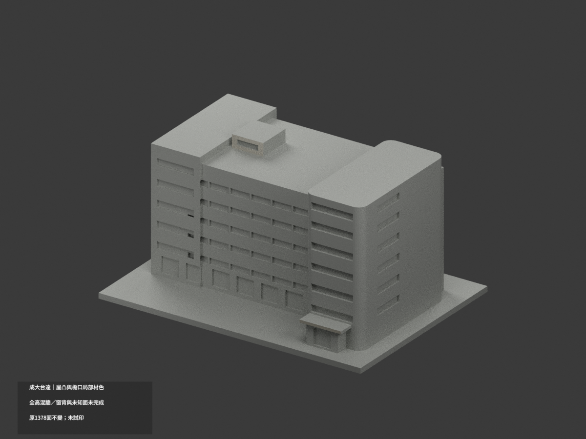
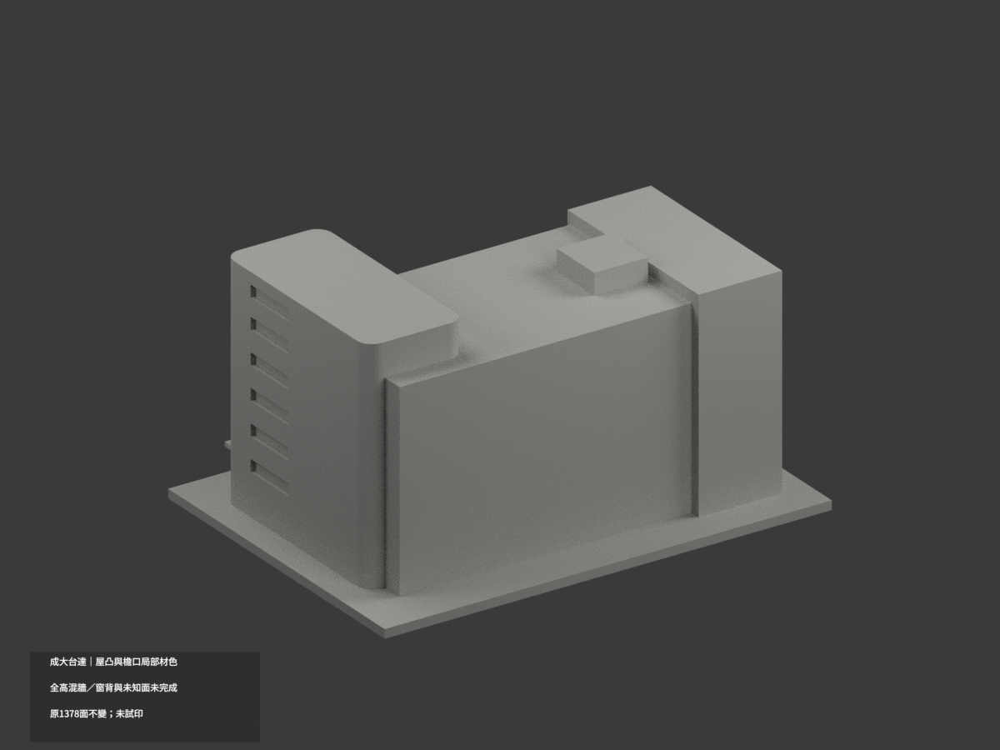
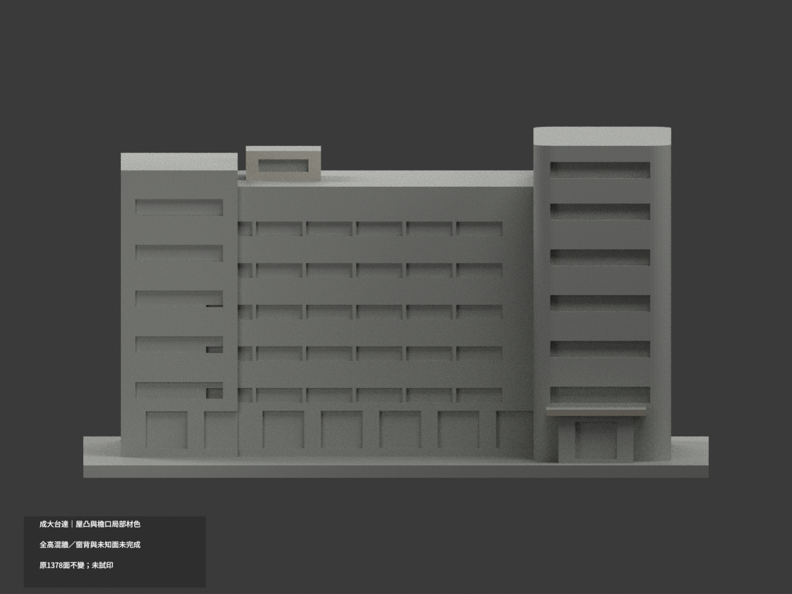
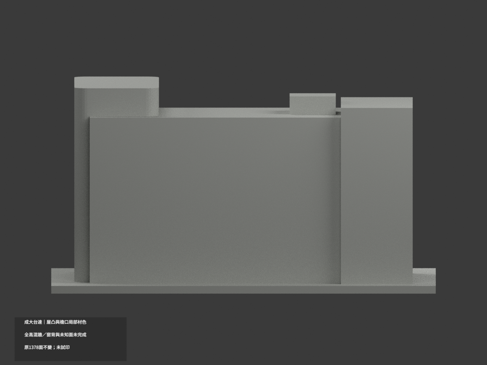
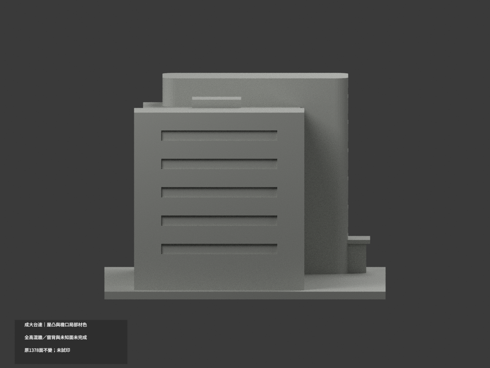
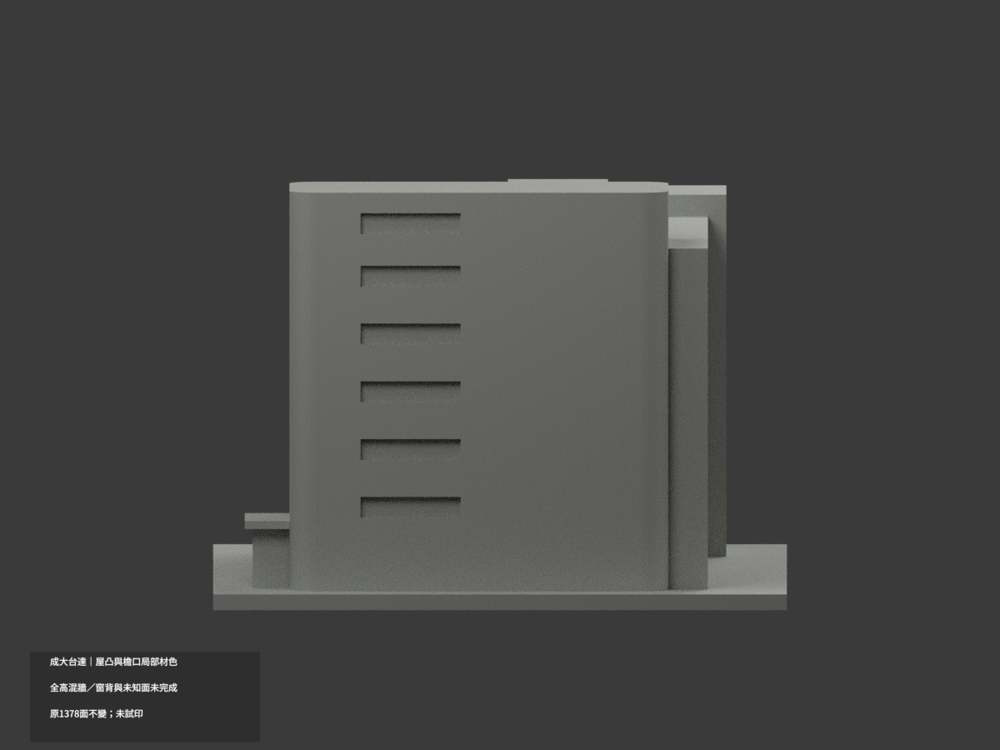
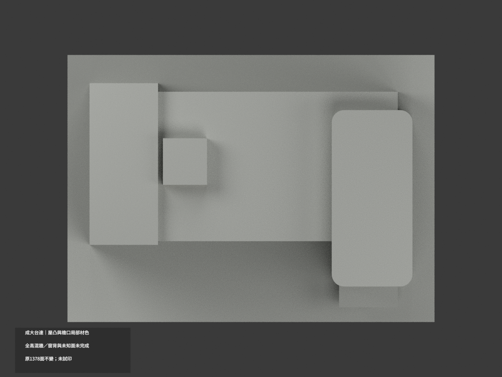
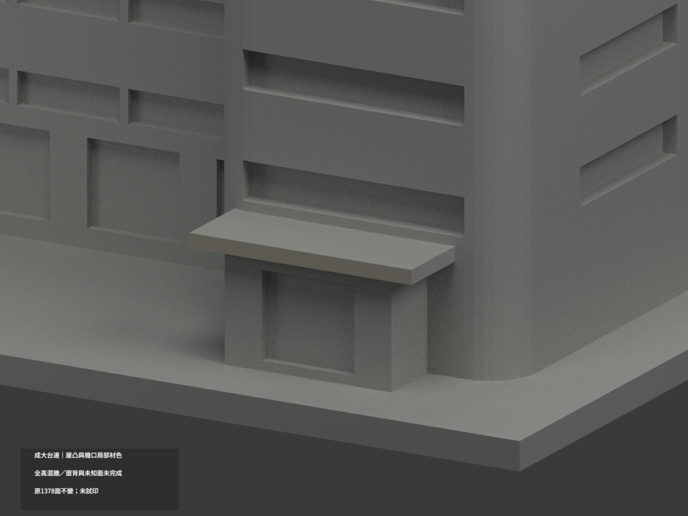
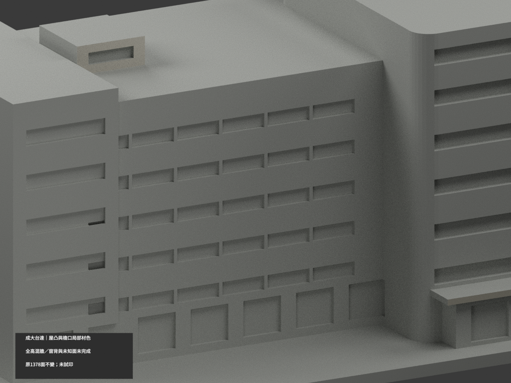
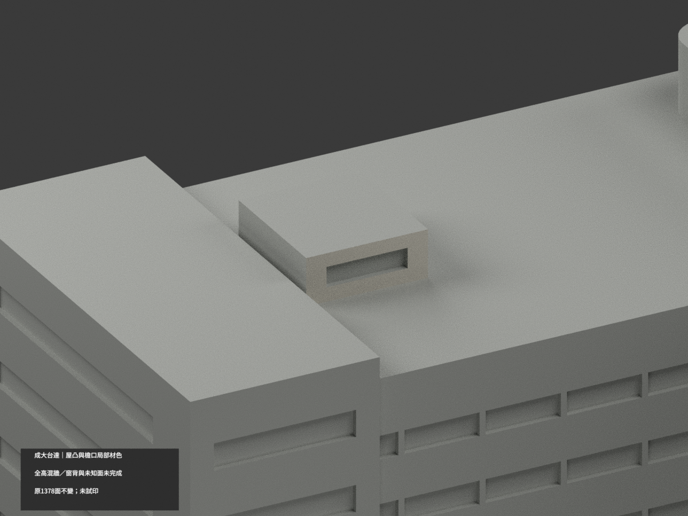

# 成大台達大樓｜屋凸與入口檐口局部材色

**全高混牆、窗背與未知面未完成分色。** `partial_color_incomplete=true`、`fully_colored_exterior=false`。只有屋凸前牆與入口檐口少量有據面補色，不是全館完成。

| 總覽 | 背側 | 正面 |
|---|---|---|
||||
||||
||||
||||

## 材色範圍
同 `delta-building` 原項目，same-item、count_delta=0。原1378三角面及STL/build_model.py字節完全不變，不切面、加構件、修改原幾何。原公開包無OBJ；不假稱保留未存在的原件。
- 屋凸真前壁 y1.5，8個原面近似暖白，不包括凹縫背板、側面或頂面。
- 入口獨立雨庇前fascia y−48.5，2面淺石灰，不包括雨庇頂底或入口柱／框。
- 其餘1368面中性：全高外牆上白／底灰石無分面，故全連續牆保中性；不得用z門檻挑曲面三角塗上白。窗背混細框／玻璃／內部反光也不整黑藍。
- 全共面連通域同材，無任意三角楔。未知側後、水平屋面、入口體、地台及凹口返面中性。色界是證據範圍，不是新增真實材接縫。
- 不新增水景、倒影、植栽、人物、樓梯或欄杆；本次補色不追認原近似幾何精度。

## 來源／日期與權利
台達基金會公開照片；Flickr頁稱Taken2015-11-04／posted2015-11-24，這是頁面記錄，**未獨立驗證拍攝日期，不稱現況精測**。只採公開外觀材色。
原照私人保存、不公開、不作貼圖；未確認CC或再散布授權，不保證商用。HEX只是展示色族，非校準色票。

## 格式與列印
[原STL](model.stl) · [材色3MF](appearance.3mf) · [Blender](scene.blend) · [原說明](ORIGINAL-MONOCHROME-README.md)
150×109mm照片近似展示底座，非精測比例。STL不含色；3MF與Blender真逐面材質。三材質標籤不是驗證過的三色／四色耗材切片，**未實際列印**，無切片工具路徑。

## 重建與 QA
原 `build_model.py` → `colorize_model.py` → `export_appearance.py` → `validate_color.py`；Blender執行 `render_color.py` 與 `verify_color_scene.py`。
原字節與三角multiset、閉合正體積、3MF材號、完整隔離原build＋color重建、scene重開、十圖1200×900與圖文hash核對。程序不代替人工來源判讀。
原單色previews/render/validation保留歷程，不當新材色QA；無刪除原件。
