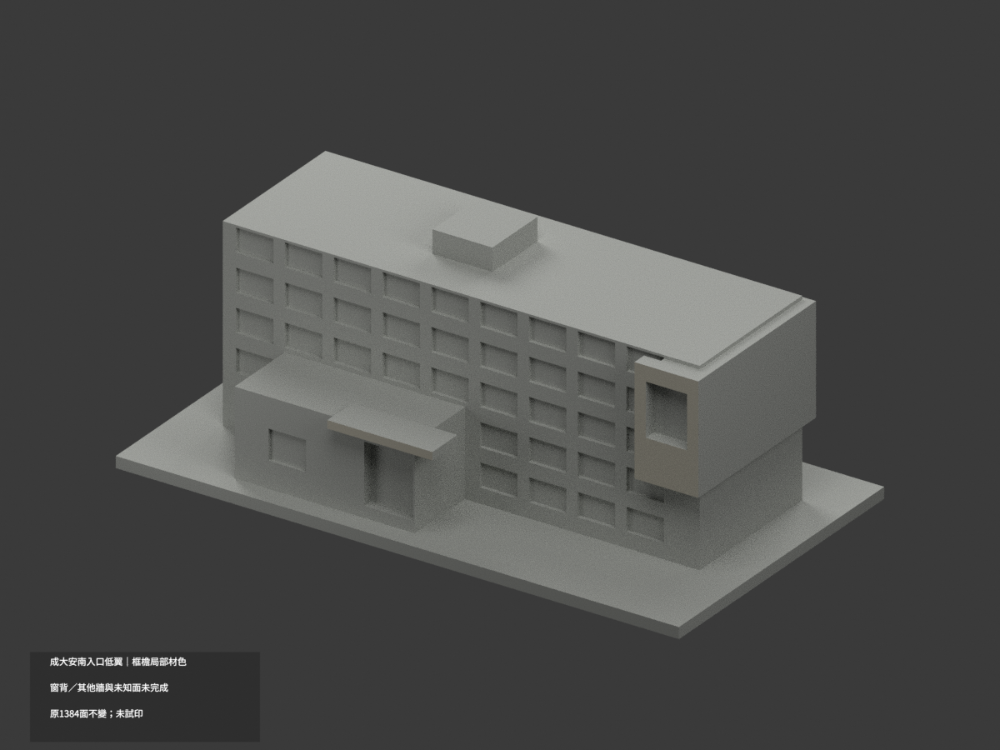
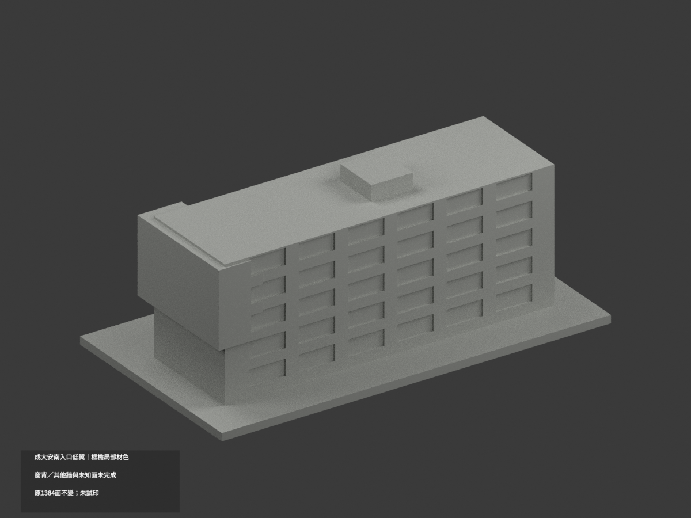
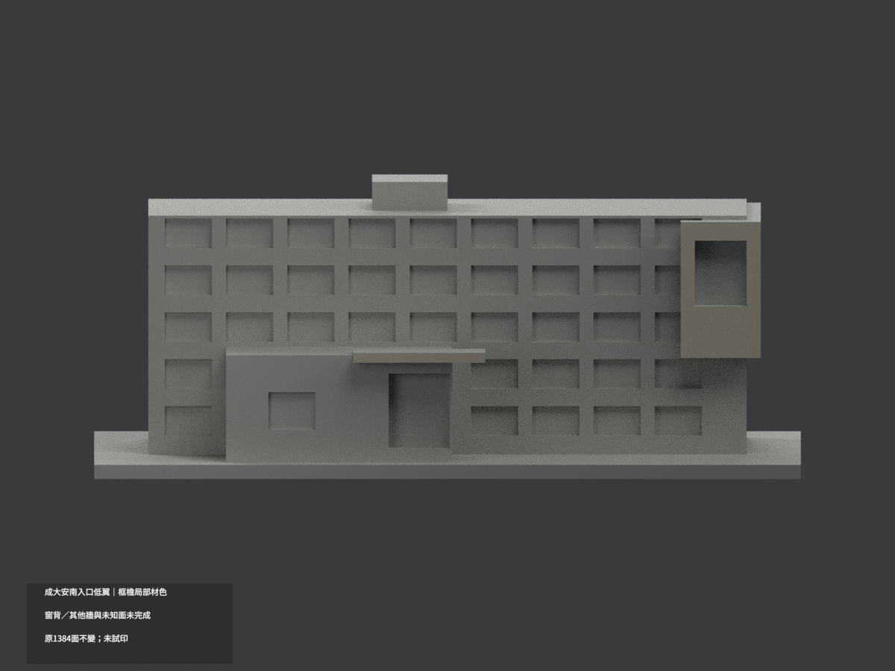
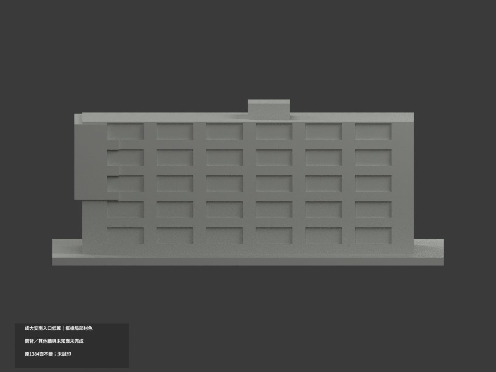
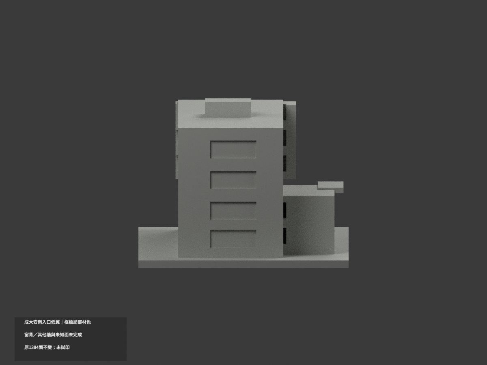
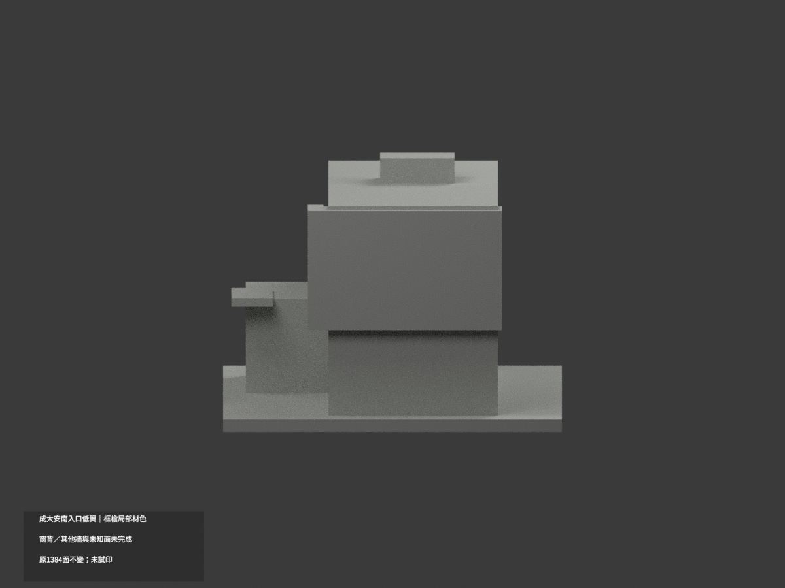
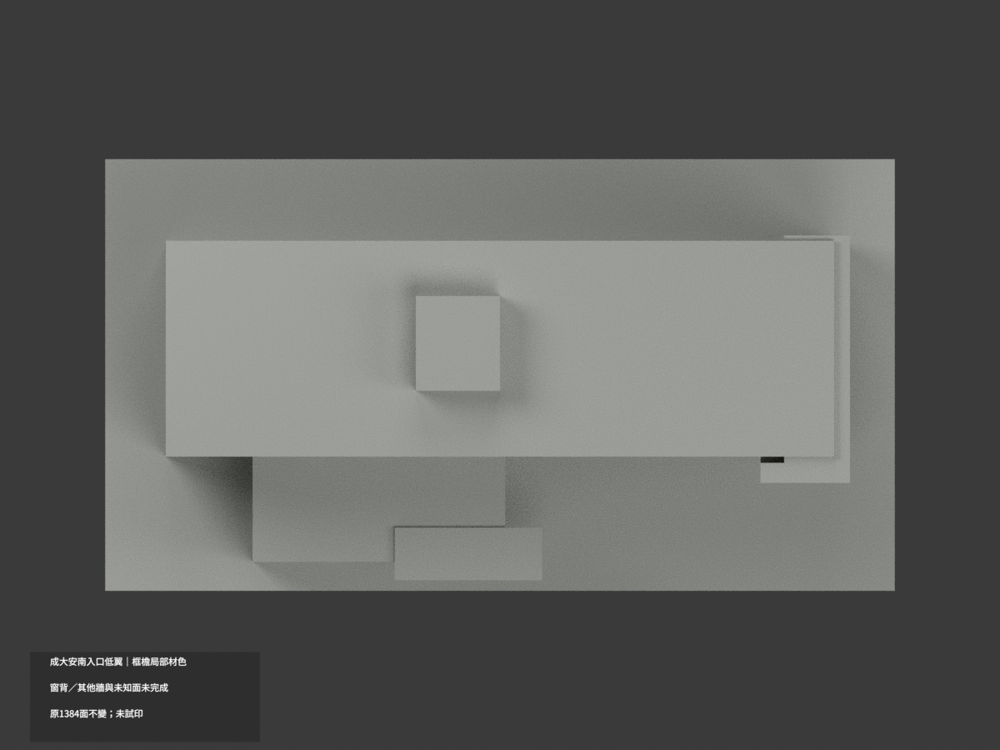
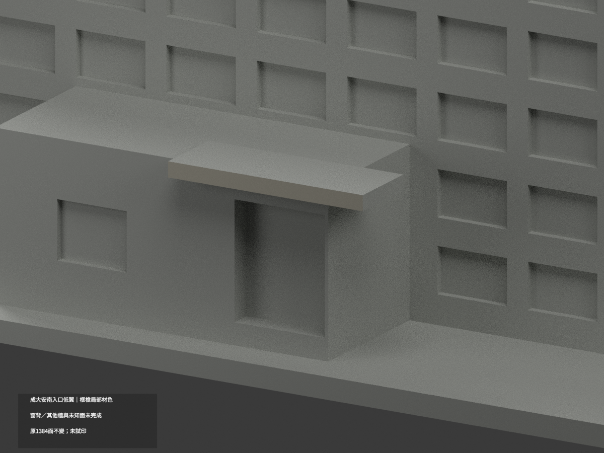
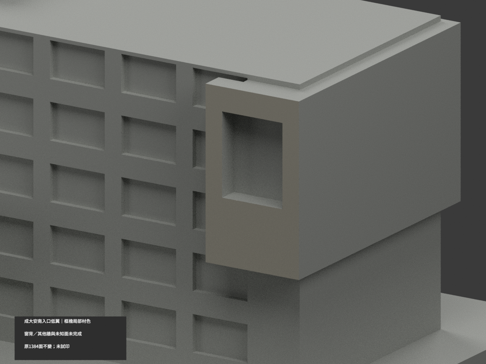
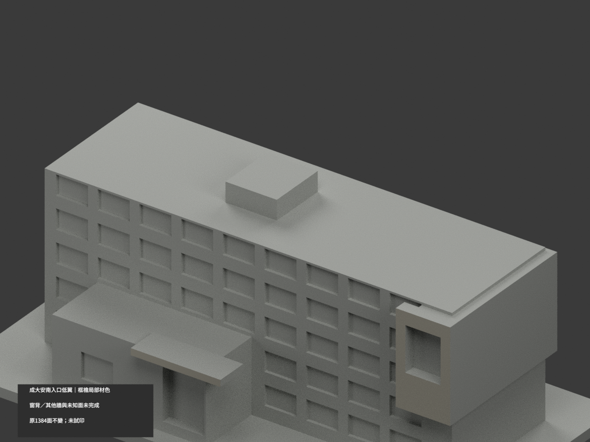

# 成大安南研究總中心入口低翼｜框檐局部材色

**窗背、其他牆與未知面未完成分色。** `partial_color_incomplete=true`、`fully_colored_exterior=false`。只有右上端框與入口前檐少量有據面補灰，非全複合體或整翼全色完成。

| 總覽 | 背側 | 正面 |
|---|---|---|
||||
||||
||||
||||

## 材色範圍
同 `research-center-entry-wing` 原項目，same-item、count_delta=0。**原1384三角面、STL與build_model.py字節不變**；無切面／新孔／新增幾何。原公開包沒有OBJ，不聲稱保留未存在原件。
- 真右上突出框前平面 y−20.5，8個原面暖灰；僅完整外框面，不含窗／開口背面與側返。
- 獨立入口帽前fascia y−39，2個原面同暖灰，不染上皮、底面或入口柱牆。
- 其餘1374面中性：長主體牆、所有混玻璃／框／欄與反光背板、招牌所在低入口牆、屋頂與屋凸、側後與基座。
- 共面連通域同材，0候選撤色，無任意假斜楔。色／中性界是證據與原拓撲範圍，非真實材接縫。
- 不包含共享庭院、橋、後高翼與曲屋頂，不新增文字、人物、植栽；補色不替原粗幾何重新背書。

## 來源／日期與權利
建築師作品頁日景view4，僅大門側低翼外觀。影像拍攝日期未知，網址November2018不是獨立拍攝日證明；不使用view3/5高翼、不以夜景校色、不取室內照。
原照私有保存，不公開或作貼圖；未確認CC／再散布授權，不保證商用。HEX是近似材色族，非校準色票或現況精測。

## 格式與列印
[原STL](model.stl) · [材色3MF](appearance.3mf) · [Blender](scene.blend) · [原說明](ORIGINAL-MONOCHROME-README.md)
150×82mm照片近似展示底座，非精測比例。STL不含色，3MF與Blender真逐面材質。兩材質標籤不是已驗證兩色／四色耗材切片；**未實際列印**，無切片路徑。

## 重建與 QA
原 `build_model.py` → `colorize_model.py` → `export_appearance.py` → `validate_color.py`；Blender執行 `render_color.py` 與 `verify_color_scene.py`。
原字節與三角multiset、閉合正體積、3MF面材、完整隔離原build＋color重建、scene重新開啟、十圖1200×900與圖文hash均核；程序不取代人工來源判讀。
原單色previews/render/validation全保留歷程，不冒稱新QA，沒有刪除原檔。
