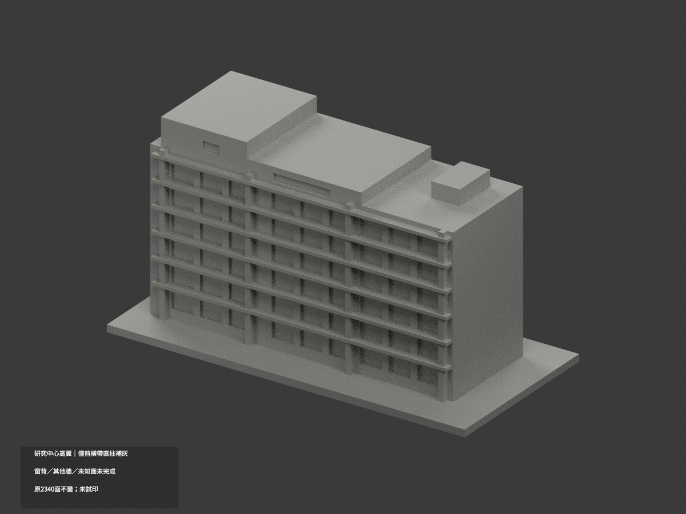
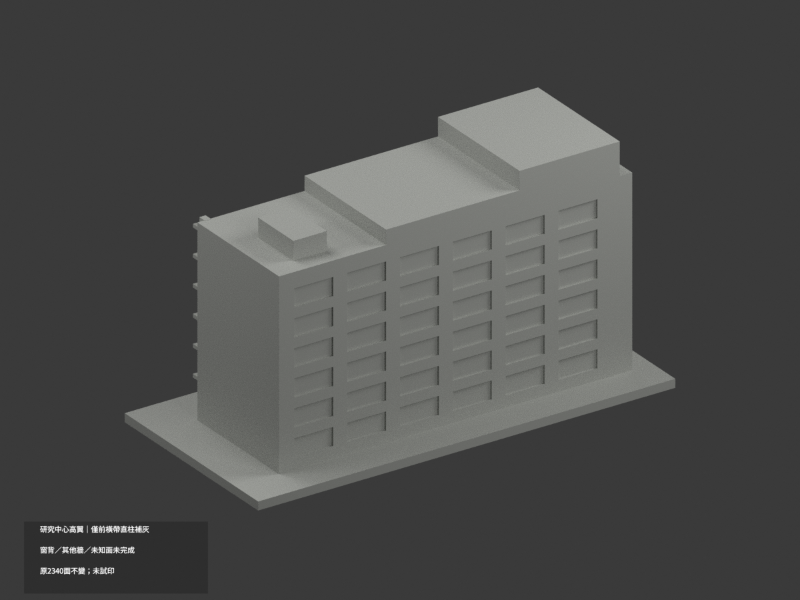
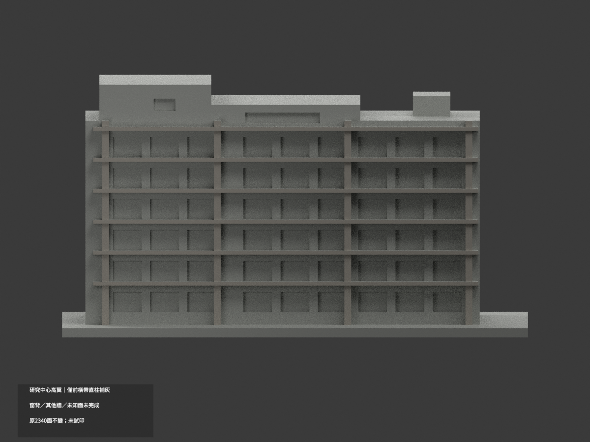
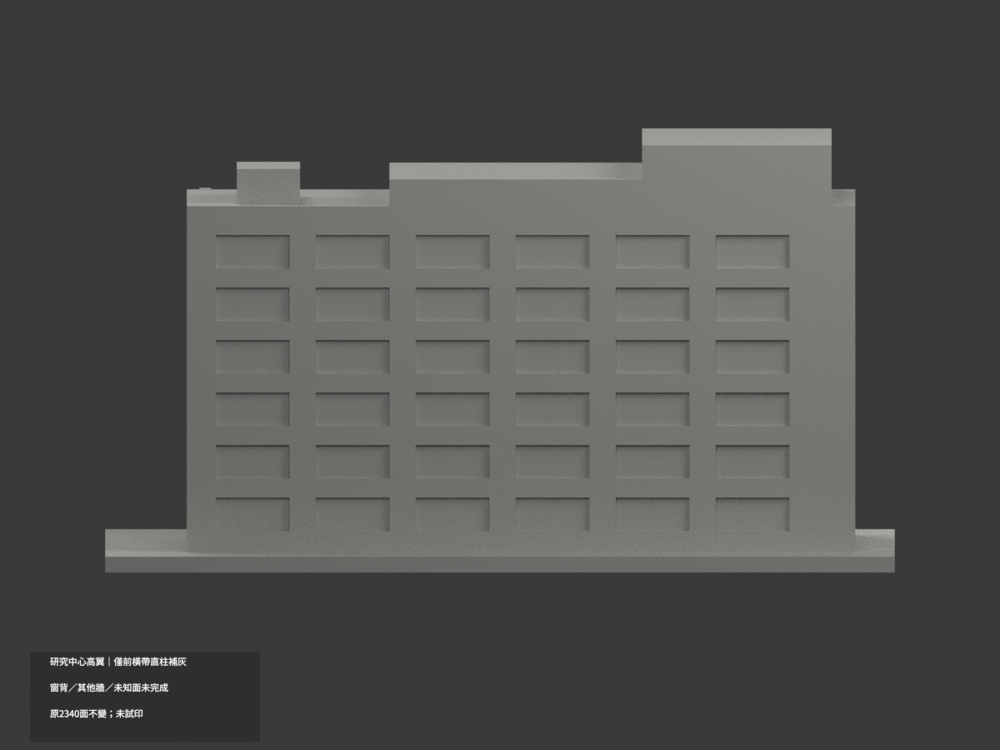
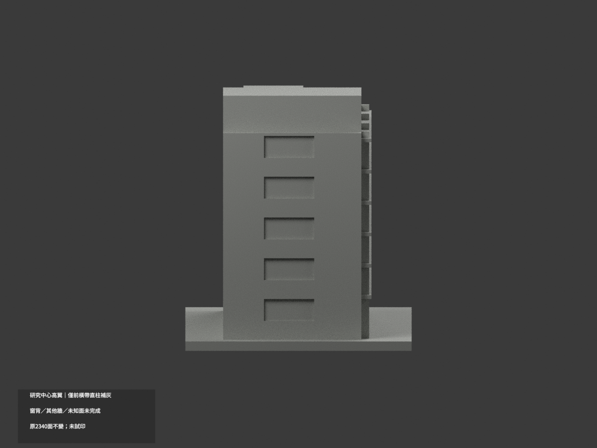
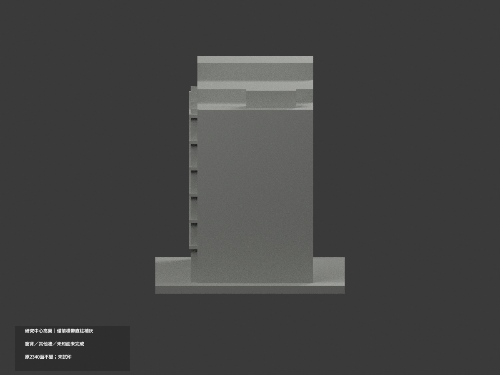
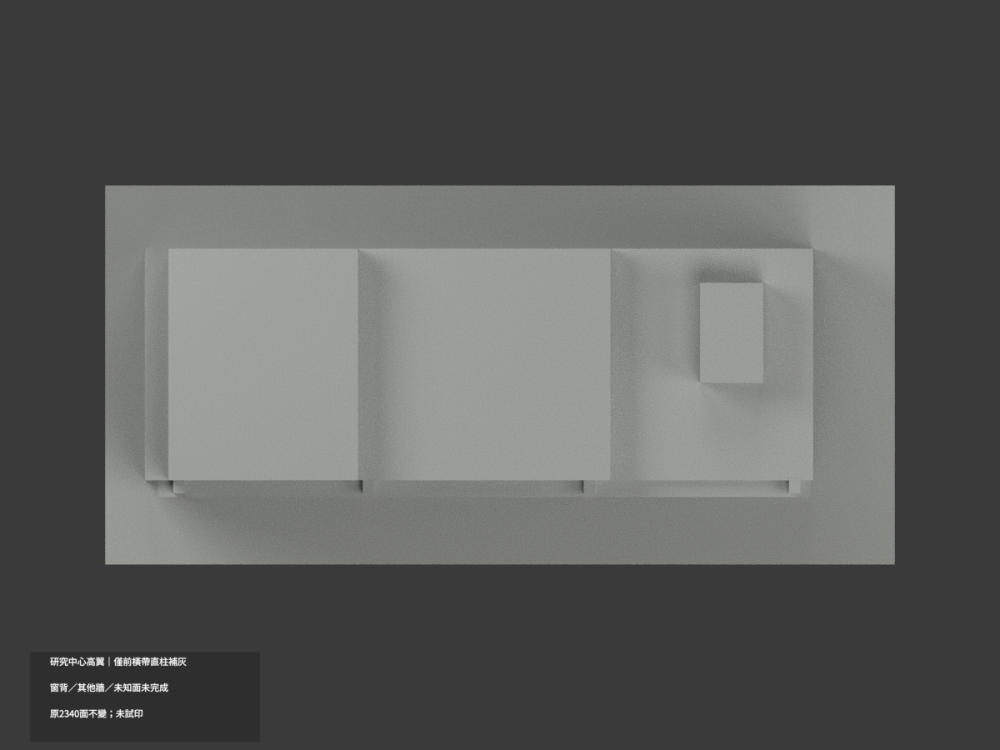
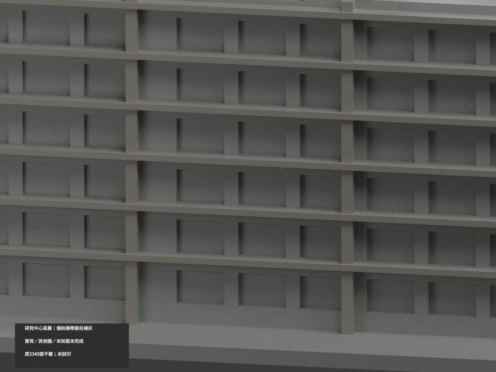
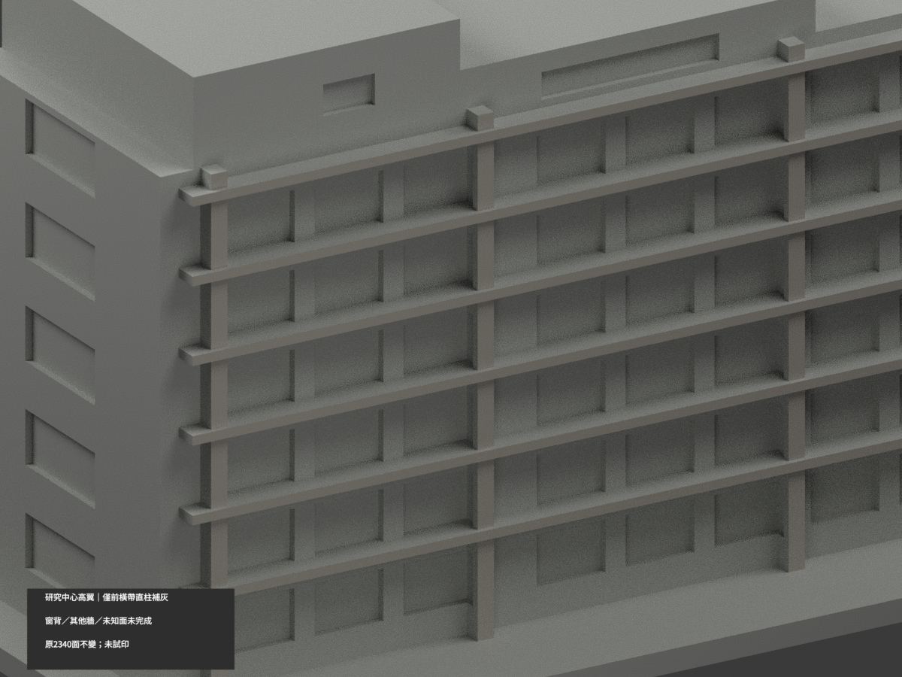
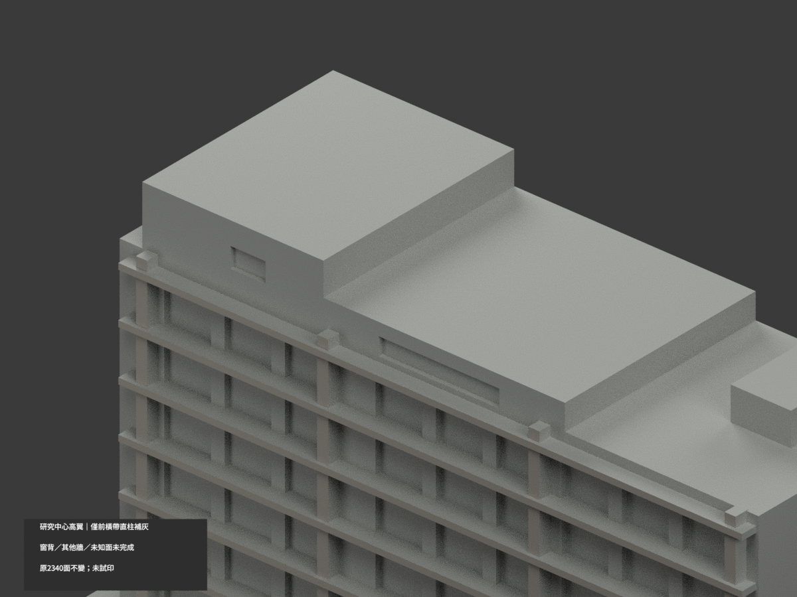

# 成大安南研究中心高翼｜局部參考補灰

**局部補色未完成：僅高翼前凸橫帶與直柱暖灰；窗背、其他牆與未知面未完成。** `partial_color_incomplete=true`、`fully_colored_exterior=false`。同項目`research-center-high-wing`／`count_delta=0`，不新增套數。**只高翼，不是完整研究中心，不含低翼、橋或共用曲面雨庇。**

| 前斜視 | 後斜視 | 正面 |
|---|---|---|
|  |  |  |
|  |  |  |
|  |  |  |
|  | | |

## 材色範圍

六道真前凸橫帶y=-23.2的12三角，加四道原結構柱正向面y=-22.5的56三角，共68面為低飽和暖灰石／混凝土色族。其餘2272面未知中性，**不是實景灰色證明**。

實際原plane及原box投影聯集重新求域，未盲抄source index。612共面連通域全部同材，不centroid切色、不按高度截混材牆。柱前完整原域包含基部但不擴張至牆面；橫帶側／底、柱側返皆未推色。

原窗洞背板混窗框、玻璃、欄杆、實板與反光，全部中性，不能全黑／藍；結構後方主牆、屋突前、側背、端槽、屋頂、基座亦中性。日光照僅取暖灰色族，不採黃昏偏粉或夜燈當材色，不把洞陰影當黑面漆。

原2340三角、坐標、尺寸、STL／build字節完全不變，沒有新增室內或整個園區。原建築是近似外觀，補色不追認幾何、不稱現況完整實測。

## 來源與權利

施文華建築師[研究總中心作品頁](https://joeshih.com/portfolio/國立成功大學研究總中心行政暨研究大樓)之日景3/5作材料族來源；view4只支持整個建築群關係，不擴張本包範圍。夜景2不採燈色、室內1不使用。照片拍攝日期未獨立證實，URL的2018路徑不是拍攝日。URL/hash、GO2243/獨審2242見`COLOR-SOURCE-REGISTER.json`。

未確認CC授權，照片私存、不隨公開包或貼圖；來源權利不被repo license取代，不保證商用。材色是展示近似，不是色票校準。

## 檔案與重建

`appearance.3mf`含2展示材，`scene.blend`有實際面材與相機，`color-mesh.npz`為原三角及material index。STL無色且原字節不變；原公開包與原build均只有STL、無OBJ，不聲稱保留不存在OBJ。

依`requirements.txt`執行`python colorize_model.py`、`python export_appearance.py`、`python validate_color.py`；Blender執行`render_color.py`及`verify_color_scene.py`。完整原build+color隔離重建目錄保留不自動刪。原件另私存；`ORIGINAL-MONOCHROME-README.md`、舊`previews/`及舊QA是單色歷程，非本次材色QA。

## QA與列印限制

原STL／三角multiset、封閉正體積、3MF索引與隔離重建見`COLOR-*QA.json`；重開見`SCENE-QA.json`；10張1200×900圖及三欄/hash見`DELIVERY-QA.json`。人工視看另交父終審。

**未實際列印。** 2展示材非已驗證四色工程，材料映射、支撐、薄細部強度與切片另驗，不保證直接多料成功。
