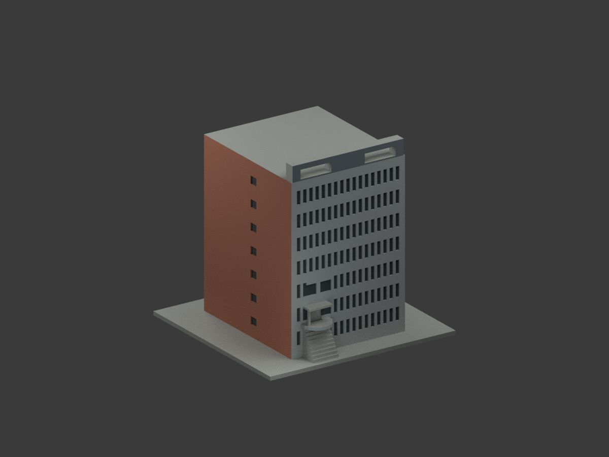
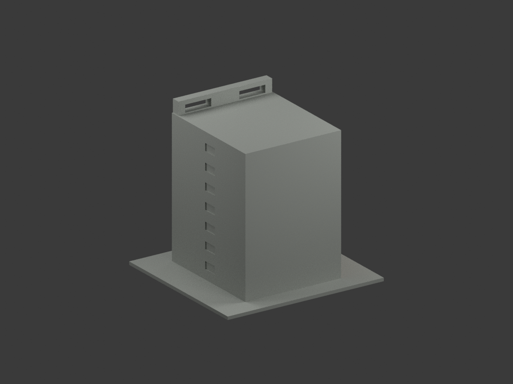
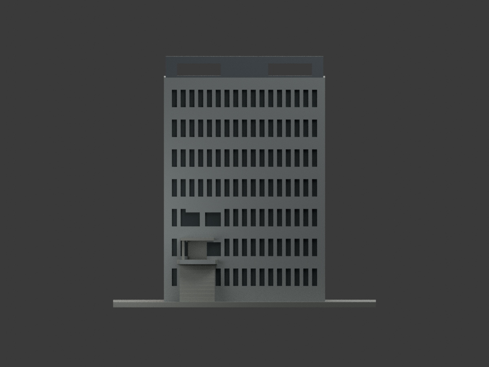
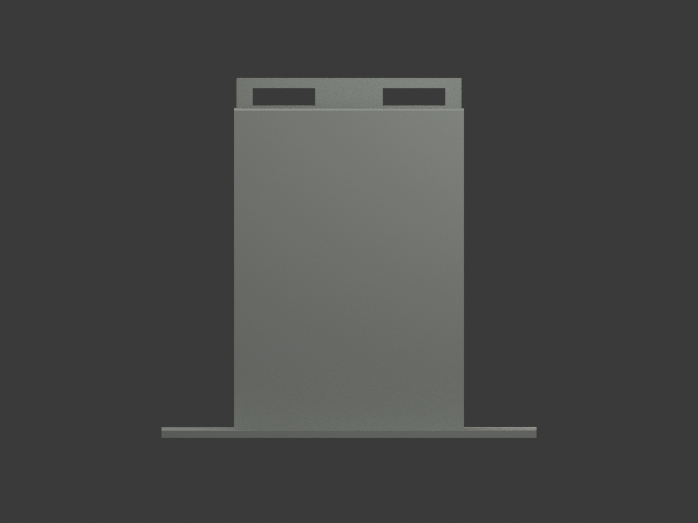
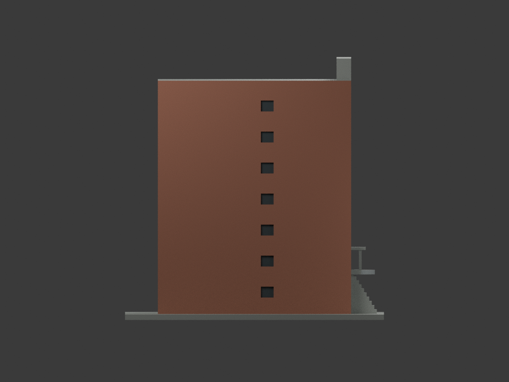
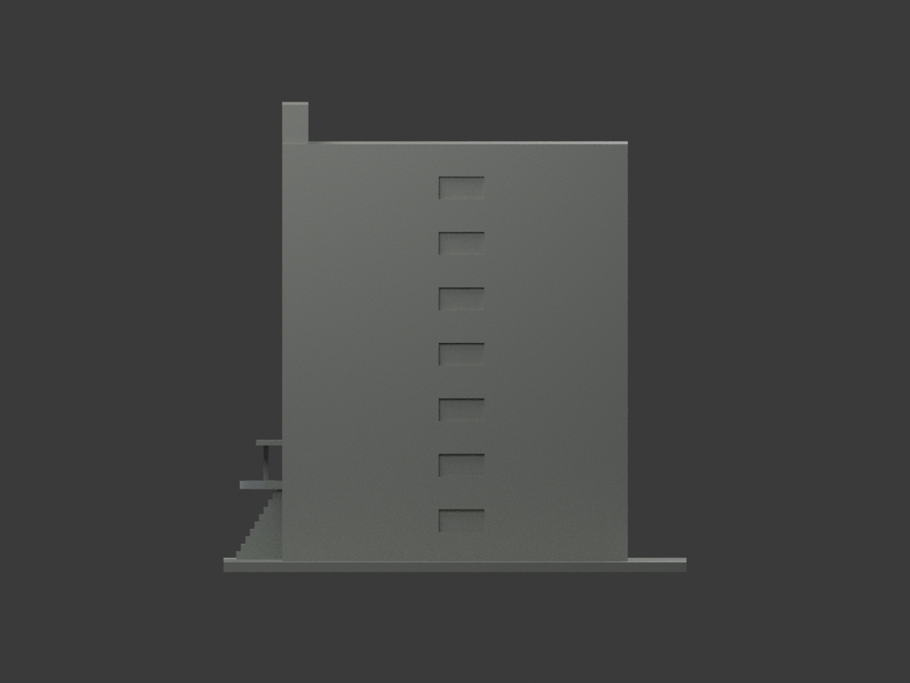
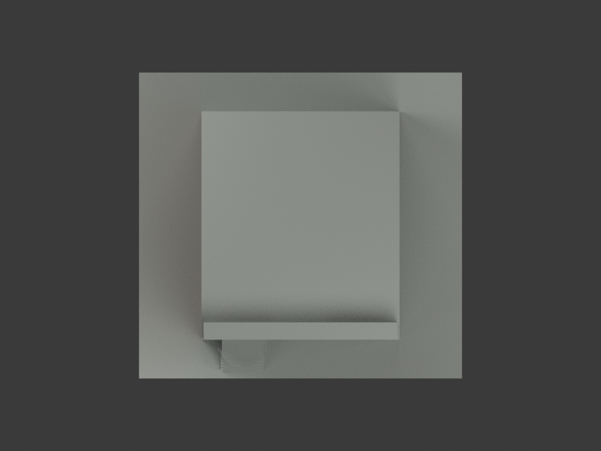
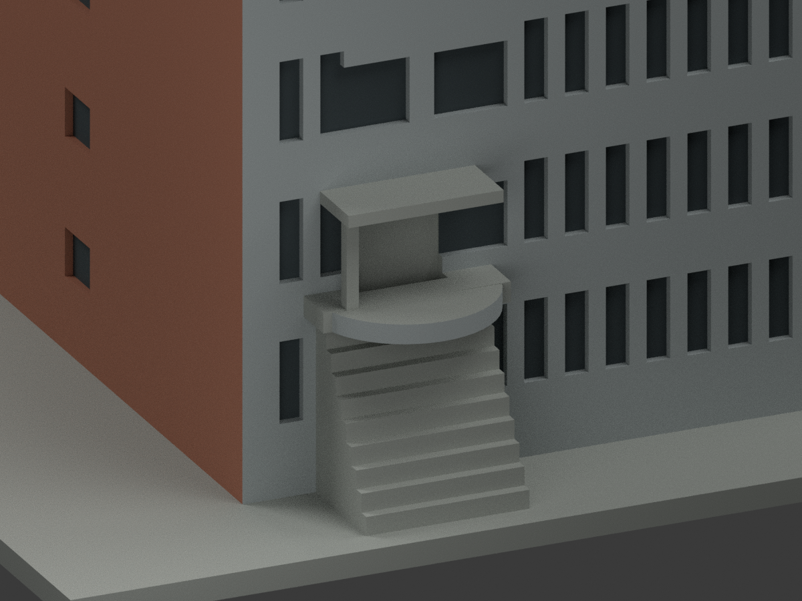
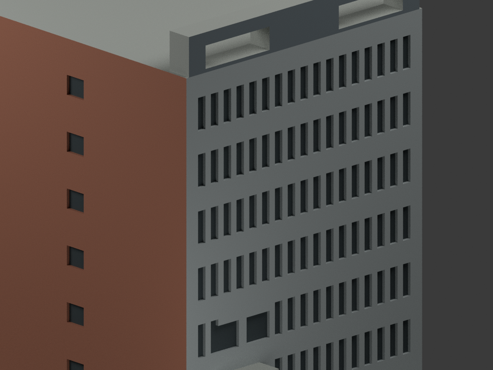
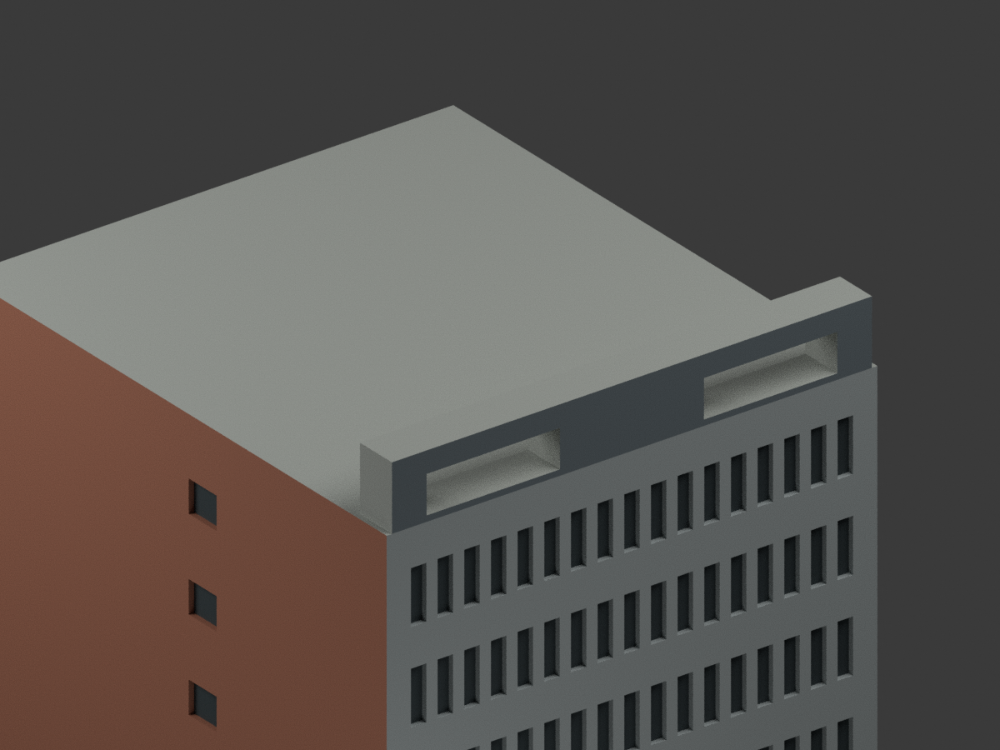

# 成大資訊高棟B006｜圓平台前薄立邊有限補色

局部補色未完成。原1912配色保持，新增圓平台前薄立邊40原三角、20完整facet，共1952配色、500中性、2452原三角。48gon原圓柱中心(-27,-55)、r11、z24.6..27，只取前露26..45facet、全頂點y<=-58.5；不切三角或新增幾何。原五palette逐項不變，沿用名義灰族index1 #A9B0B0；其歷史名稱front gray grid保留，本次額外薄沿另列。

新取得計網中心官方電子報圖庫IMG_0747-1.jpg(1800×1200)，可清楚分辨高曲欄、其下薄灰沿與更下白色板狀底腹。IMG_0742-1全幅交核位置，CIIS官方位置照補入口關係但不作逐面色樣。本次只對應原薄圓平台外露垂直薄沿，不把未建高欄板/欄杆概化成原薄板。原2.4mm厚度/r11/位置皆粗模型近似，不因材色獲測量或幾何認證。

不取頂面、白板底（真實有板縫/燈具，原未建）、後側、其餘側邊、階梯、上小簷、小柱、磚前廊/鄰棟長樓/連橋。未選入口仍中性，不能因本次解除一處證據缺口就認證其他粗構件。兩舊素材3827/1948原hash吻合；新照片拍攝日未獨驗，不稱2026新照或現況。灰碼只是有限色族，不是校準漆色；不將底腹陰影取作深漆。

原3個混材連通共面域（face adjacency，normal dot>.999999）所有面/材索引精確保持，無新增混域，不稱全域共面一致。46原檔逐Git blob核，原STL/build與工程aliases不變，無原OBJ。五展示材非已驗多料切片、未實體試印。來源照片/裁切私人保存，不公開貼圖、不推定商用權。ROUND-EDGE來源QA固定pending-final快照，最終獨審另檔。以下原說明及入口全中性為歷史範圍，本次只上述40面例外。

## 原版說明與工程限制

# 國立成功大學｜資訊高棟 B006：原幾何補彩色

## 彩色模型預覽

**同一項目材色更新（count_delta = 0），保留原 2452 三角面；僅有證正面與單一磚短端補近似色，入口、另一端、背面及屋面保中性。不是現況精測或全館精確色彩復原。**

| 正面斜視 | 背面斜視 | 正面 |
|---|---|---|
|  |  |  |
|  |  |  |
|  |  |  |
|  |  |  |

## 材色範圍與限制

- 官方日景與正面照對位支持左短端（原座標 x = −46）磚紅／棕紅色族、前灰格及較深灰頂框前面；另一短端 x = +46 不因正面兩側露出磚邊就整片塗磚。
- 只給原離散窗凹底通用深灰陰影，非新增連續玻璃幕牆或精確玻璃色。頂框保持原兩孔近似形狀，不補照片其他柱格。
- 原附外階、圓平台、入口小簷與柱被遮蔽，均保中性，不借前景理化長樓、連橋或大坡道色彩。B006 高棟不包含這些鄰接建物。
- 水平屋面、後面、未知端面與展示底座中性；中性不是現場真漆。照片夕光／偏藍只證色族，並非校準色票。上傳日期不等於拍攝日，不宣稱同一年精確全館外觀。
- 不增刪頂點、三角面或構件，不畫新磚紋／白線，不以本次補彩背書舊近似幾何。原大三角無法對應細邊界時採完整面中性或一致粗化，不切新面湊色。

## 格式、重建與驗證

原 `model.stl` 與 `build_model.py` 位元組保持不變；STL 不含材色。`appearance.3mf` 使用五個基本材質及逐三角指派；`scene.blend` 有實際 shader，`color-mesh.npz` 保存原頂點與面。五材質不是已驗證四色／多耗材切片專案；未實際列印，未執行切片器驗證。原包未提供 OBJ，本次也不虛稱交付 OBJ。

```sh
python build_model.py
python colorize_model.py
python export_appearance.py
python validate_color.py
blender -b -t 6 --python render_color.py
blender -b --python-exit-code 1 --python verify_color_scene.py
```

沿原 requirements 安裝 NumPy、trimesh、manifold3d，另使用 Blender 4.3.2。隔離重建保留、不刪除。新 QA 見 COLOR-FORMAT-GEOMETRY-QA.json、SCENE-QA.json、DELIVERY-QA.json 與 INDEPENDENT-COLOR-VISUAL-QA.json。舊 previews、驗證檔與 render_preview.py 保留為單色歷程，不能當本次材色重建入口。三細景為刻意局部構圖，其餘七全景有完整模型邊界檢查。

## 公開來源與權利

- [成大素材網資訊館日景](https://material.ncku.edu.tw/picture.php?/1948)
- [成大素材網資訊高棟正面](https://material.ncku.edu.tw/picture.php?/3827)

原照片、網頁與私人核圖不隨模型公開，沒有貼圖。保留成大素材網非商業利用及署名要求、照片作者權利；本專案公開不代表原照自由再授權或商用權利已清。詳 COLOR-SOURCE-REGISTER.json。

## 原模型說明與歷程

以下保留原說明；本次材色檔／場景入口以本文新段落優先，舊單色圖為歷程。

# 國立成功大學｜資訊大樓高棟

## 模型預覽

| 模型預覽 | 模型預覽 | 模型預覽 |
| :---: | :---: | :---: |
|  |  |  |

第七批；成功校區。尺寸 150 × 142 × 143 mm，最長邊150 mm含底座，各件比例獨立。


## 公開來源及像素檢視

- [校方GIS：資訊大樓外觀](https://db.nckumap.ncku.edu.tw/nckugis/public/uploadfiles.htm?action=listImg&q=36314)：檢視細直窗格、高屋頂框洞、不同尺寸窗區及外部入口階梯。
- [校方GIS：資訊大樓近角](https://db.nckumap.ncku.edu.tw/nckugis/public/uploadfiles.htm?action=listImg&q=36315)：檢視上層入口與圓角平臺；旁邊長樓未當作本高棟。
- [校方素材網：2026外觀](https://material.ncku.edu.tw/picture.php?/3827)：檢視2026年上傳正面遠景，確認高棟灰色窗格及頂框保留。
- [校方素材網：側面](https://material.ncku.edu.tw/picture.php?/1948)：檢視紅磚短端少量窗與長面窗格；此照片較早，背面現況未逐處核實。
- [校方公開GIS建物範圍圖](https://nckumap.ncku.edu.tw/map.php)：只使用外部輪廓圖層gis_base及公開建物識別B006；未使用樓層室內平面或設備資料。
- [2026/1/30校方財產清冊](https://prop-oga.ncku.edu.tw/var/file/59/1059/img/4743/218075103.pdf)：交叉核對校區與財產碼R1A-23-0，財產筆數不等於完整單棟數。

## 建模範圍與近似

本件只作校方GIS B006所辨識的資訊大樓高棟及貼接外部入口階梯。R1A-23-0財產名是「資訊暨理化實驗大樓」，本件不能宣稱該筆整個複合體完成，旁邊長條理化樓與兩棟之間連橋未納入。保留狹長直窗、低層較大窗區、頂部兩組矩形框洞及階梯圓角平臺。依公開外框估計主體深度，細小折角未逐一復刻；入口雨棚簡化，鋼製細欄杆省略。完整背面未取得，採素面而非虛構精細背窗。屋頂平台沒有建設備或室內。

## 交付與重建

- `model.stl`：毫米單位，與底座合成的單一實體。最長邊為 150 mm（含底座）；各棟獨立縮放，不適合直接拼成等比例校園。
- `build_model.py`：完整可攜參數化原始程式，無外部貼圖、私有路徑或參考照片依賴。
- `scene.blend`：由交付 STL 匯入，只有一個建築網格，可在 Blender 編輯頂點；細部參數請修改 Python 後重建。
- `previews/front.png`、`rear.png`、`elevation.png`：由實際交付 STL 產生。
- `validate_model.py`、`validation.json`：可重跑的幾何與重建驗證。

建議 Python 3.12，在虛擬環境執行：

```sh
python -m pip install -r requirements.txt
python build_model.py
blender -b -t 2 -P render_preview.py
python validate_model.py
```

已使用 Blender 4.3.2。驗證器在獨立臨時目錄重建 STL 並比較 SHA-256，讀取 Blender 場景的網格後比較三角形幾何。它檢查原始二進位 STL 儲存法線、面積、封閉性、邊恰有兩面、頂點連結為單一環、表面只有一個連通分量、正體積、底面位於 Z=0、最長邊 150 mm。單一封閉表面也排除獨立藏在內部的空腔殼；沒有宣稱完成所有自交的窮舉檢測。

## 製作原則與限制

這是依公開照片觀察製作的外觀近似收藏模型，不是測繪、修復、工程或精確 BIM 資料。牆身為實體，門窗、拱廊通常改成淺凹浮雕；不含室內、設備或安全配置。屋頂、深度、窗距及後側比例沒有測量基準，不能視為實際尺寸。原始參考照片未收錄、未重新授權或隨套件發布。來源權利屬原作者／校方；原創模型與程式可沿用儲存庫授權，不涵蓋外部參考照片。

## 列印說明

底座平貼平台，Z 軸向上。可從 0.4 mm 噴嘴、0.16–0.20 mm 層高、3 道外牆與 12–18% 填充開始試切片；這是設定建議，並非已測參數。小於約 0.8 mm 的淺浮雕可能因噴嘴或縮放消失。STL 是封閉實體，切片器仍會依填充率產生內部填充。

未實體試印、未執行切片器列印驗證，沒有保證免支撐。請依下列模型特有支撐需求檢查切片預覽。

頂部框洞的水平跨梁、入口平臺和小雨棚需局部支撐；階梯加厚連至主體。

## 截面閉合檢查

`validate_sections.py` 以0.20 mm間距抽樣實際STL水平截面，檢查閉合、節點度數及零長線段。結果見 `cross_sections.json`，不能當成切片路徑、支撐效果或實體試印驗證。

查核日期：2026-10-13。


## 整合版截面與薄特徵補充驗證

本整合版使用固定共同邊方向後插值的 `validate_sections.py` 與 [0.2 mm 截面結果](cross_sections.json)，避免同一邊浮點方向差異造成假斷環。原始 STL 幾何未修改。舊截面程式有閉合斷言，既有通過結果不代表曾有破面；此處以新版重跑結果為準。

另提供 `check_thin.py` 與 [新增 0.8 mm 薄特徵輔助篩查](thin-feature-check.json)：每 1 mm 水平取樣，先確認輪廓閉合與有效，再作半徑 0.4 mm 形態開運算。這不是切片器、完整壁厚分析或實體試印，尖屋頂、銳角也會造成損失，不能據此宣稱無支撐或列印成功。執行前請安裝 requirements.txt。
