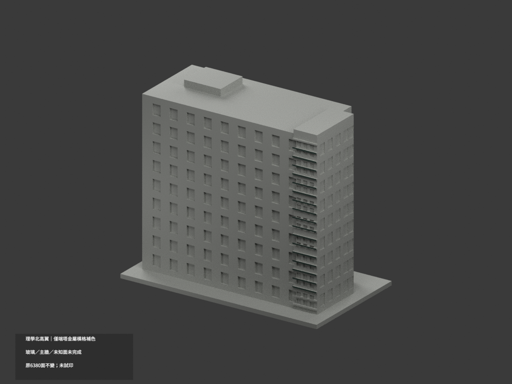
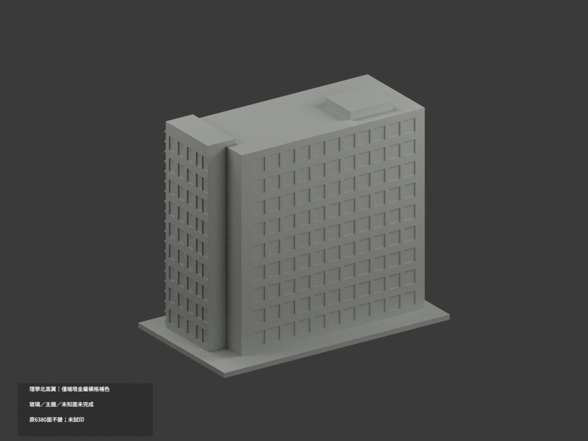
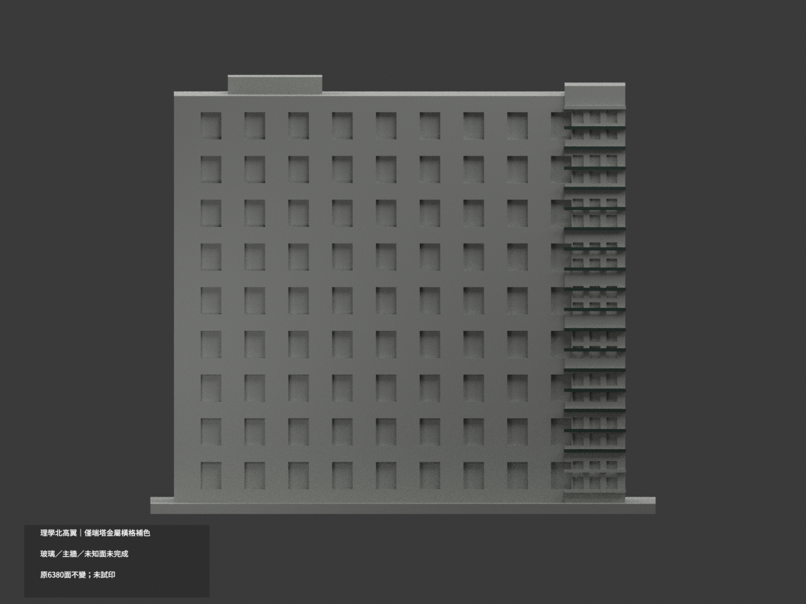
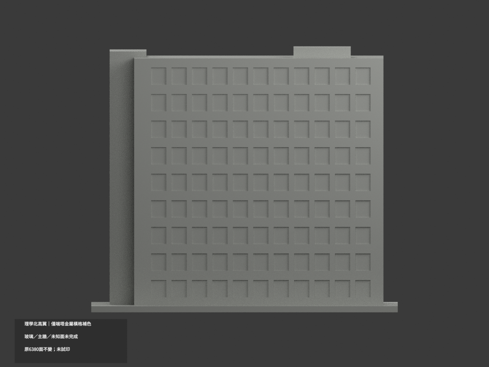
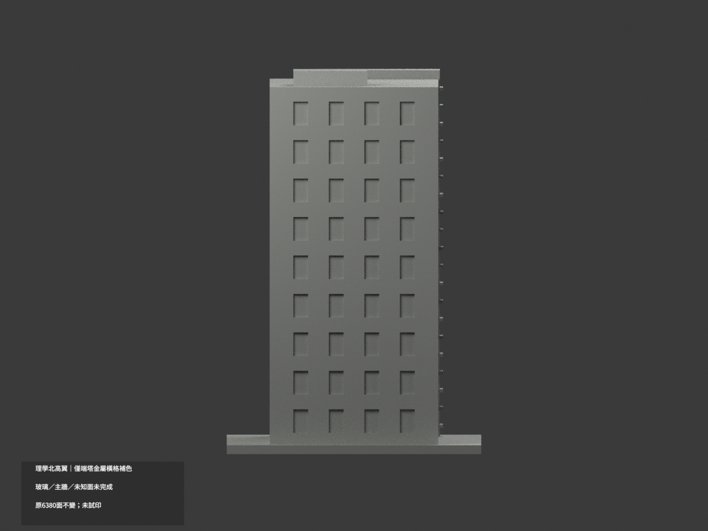
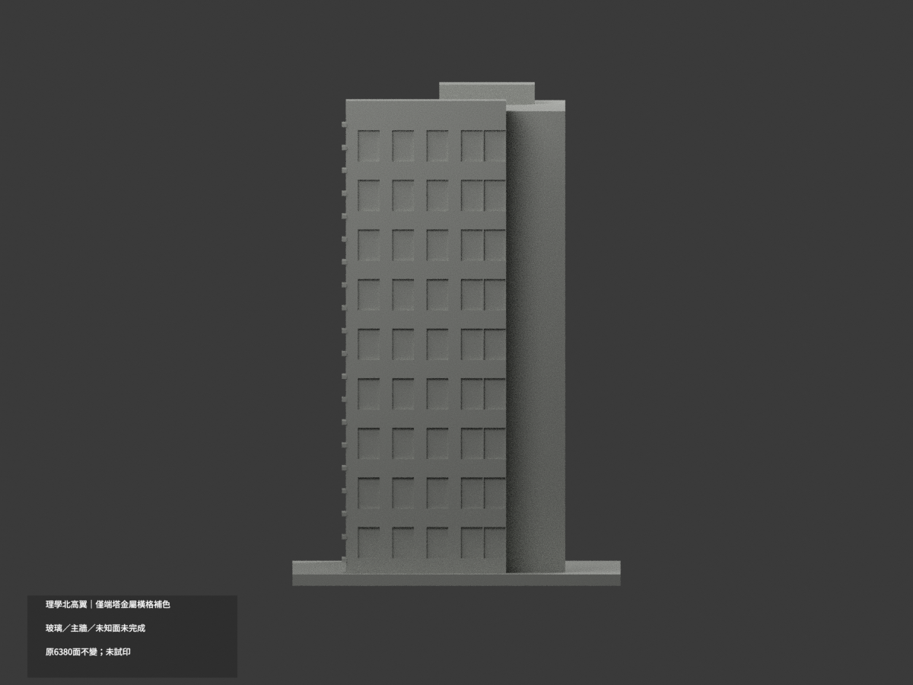
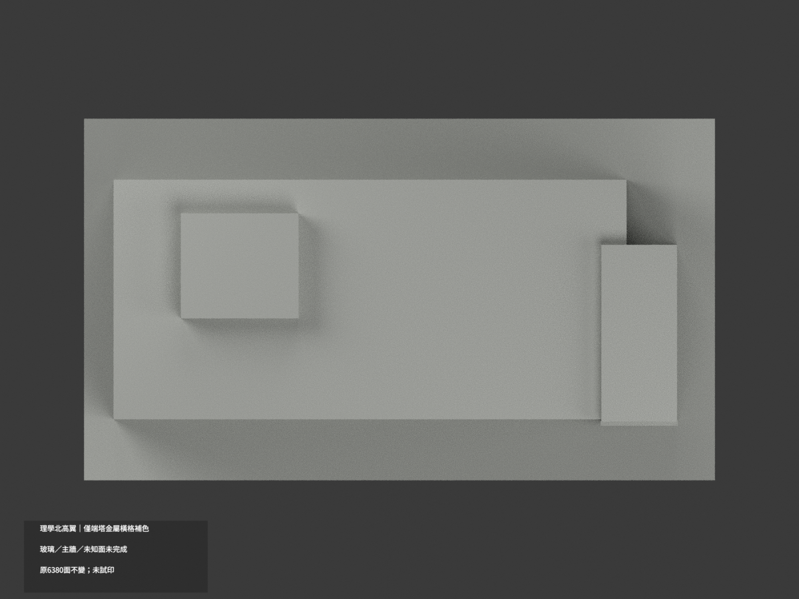
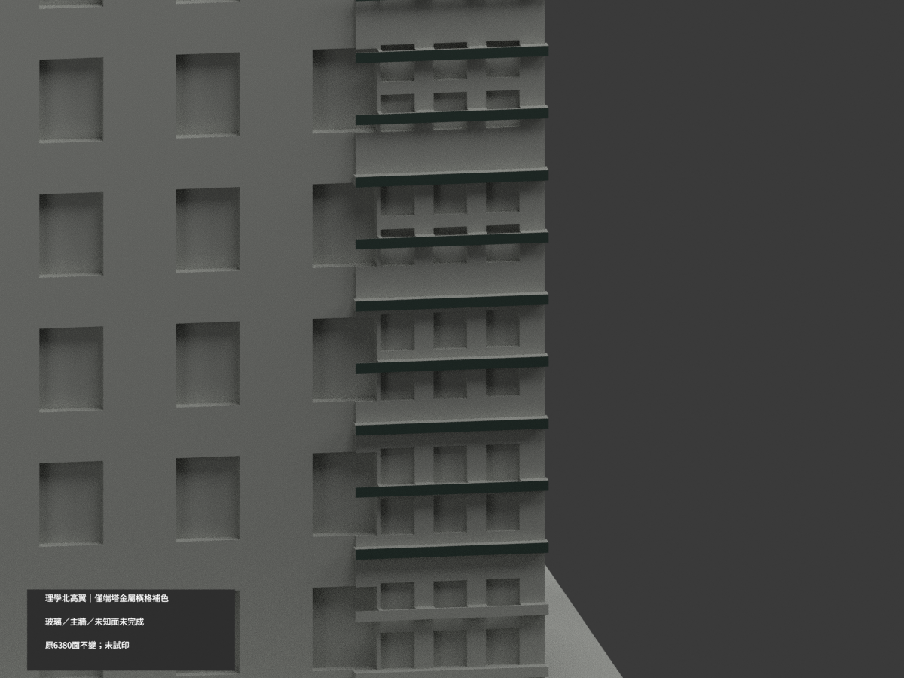
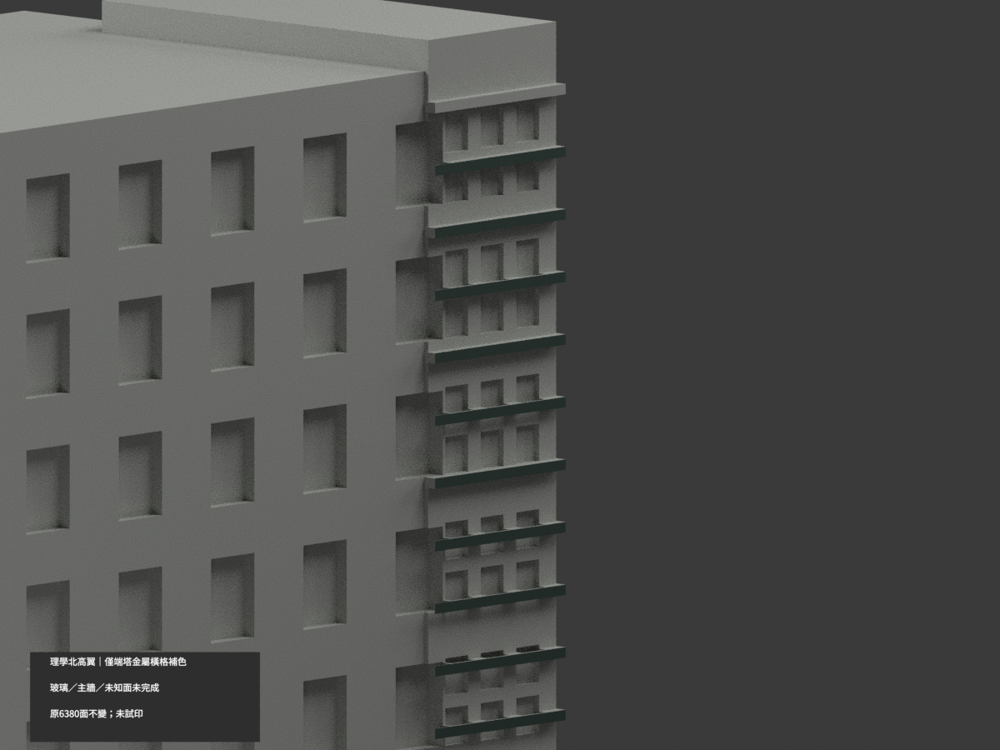
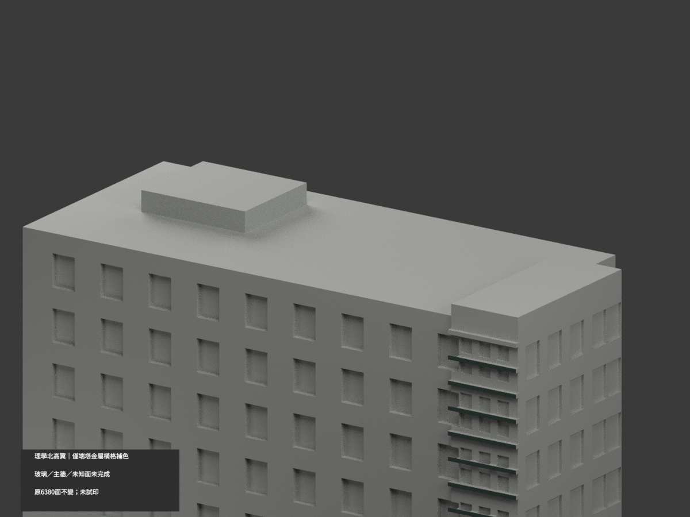

# 成大理學北高翼｜端塔橫格局部參考補色

**局部補色未完成：僅北棟玻璃端塔局部金屬橫格暗灰綠；玻璃、主牆與未知面未完成。** `partial_color_incomplete=true`、`fully_colored_exterior=false`。同項目`science-north-high-wing`／`count_delta=0`，不新增套數。只原高翼，不加入共享低層連接大廳。

| 前斜視 | 後斜視 | 正面 |
|---|---|---|
|  |  |  |
|  |  |  |
|  |  |  |
|  | | |

## 材色範圍

只原17個完整橫格正面y=-30.05、x47.8..66.2，z18、24…114至各z+1；每格2三角／面積18.4，共34面暗灰綠金屬族。其餘6346面未知中性，**不是實景灰色證明**。

逐構件真矩形全頂點與面積核驗，全部1794共面連通域材色一致；不盲抄index，不挑混面三角、不生成斜楔。底部z6/12與頂z120整格未充分證實故保中性，並非真實不同材色；所有格側／頂／底不自動推色。

玻璃包含天空樹影、內部白樓梯欄、樓板和框，不全藍／綠。底層y=-29塔壁及寬剩餘條不是已證金屬梃，完整中性。主牆有腰基底、布條、遮蔽且原無分界，不能分高度染色；側背、屋頂、屋突、地面未知。不套未確定北南位置的建築師中庭照片，不新增樓梯或設備。

原6380三角、坐標、尺寸、STL與build字節不變；既有近似幾何不因色審獲追認，不稱2026全館精測或全部完成。

## 來源與權利

[成大素材網官方照片2466](https://material.ncku.edu.tw/picture.php?/2466)的外部日照作有限材色來源，署名成大素材網。**官方圖URL為2020/05/01，不是舊巢狀文字誤寫2024；URL及檔名日期未獨立認證拍攝日。** 2018建成資訊也不是拍攝日期。原GO不改寫歷史，必讀`COLOR-SOURCE-REGISTER.json`綁定的日期勘誤2249；GO2248及獨審2247原hash保留。

成大素材網非商業與署名條款保留；原照私存不隨模型公開、不作貼圖，不能沿repo license宣稱自由商用。材色只是近似族群，非實測色票。

## 檔案與重建

`appearance.3mf`含2展示材，`scene.blend`有實際面材與相機，`color-mesh.npz`保留原三角及material index。STL自身無色且原字節保留；原包及原build無OBJ，不聲稱有原OBJ。

依`requirements.txt`執行`python colorize_model.py`、`python export_appearance.py`、`python validate_color.py`；Blender執行`render_color.py`及`verify_color_scene.py`。完整原build+color隔離重建目錄保留不自動刪。原件私存；`ORIGINAL-MONOCHROME-README.md`、舊`previews/`與舊QA皆單色歷程，非本次色審QA。

## QA與列印限制

原STL／三角multiset、封閉正體積、3MF索引及隔離重建見`COLOR-*QA.json`；重開見`SCENE-QA.json`；10張1200×900圖及三欄/hash見`DELIVERY-QA.json`。人工視看另交父終審。

**未實際列印。** 2展示材非驗證過四色工程；切片、材料映射、支撐與薄部強度另驗，不保證直接多料成功。
