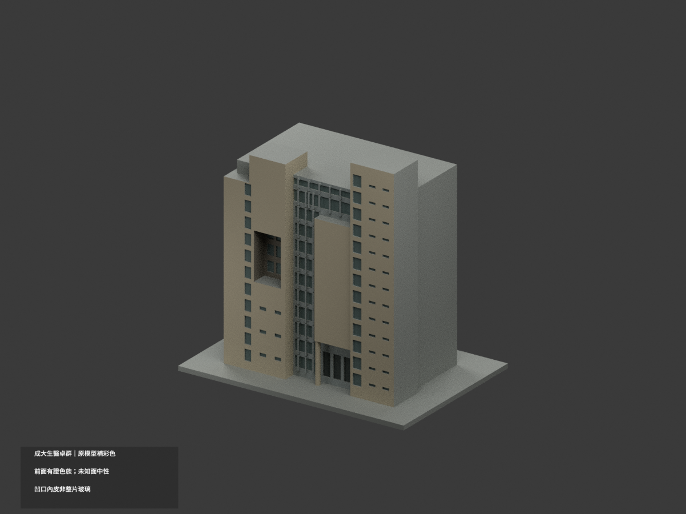
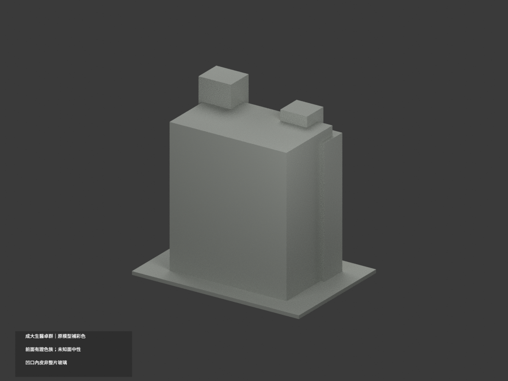
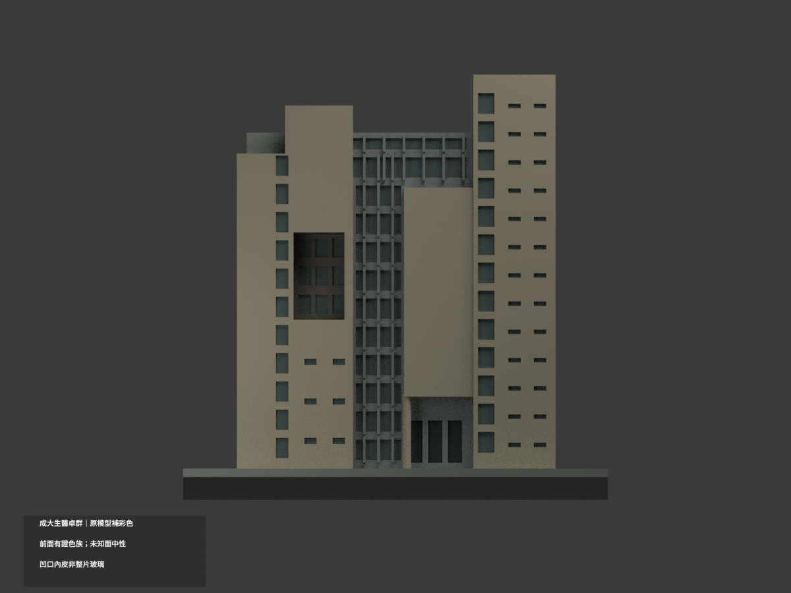
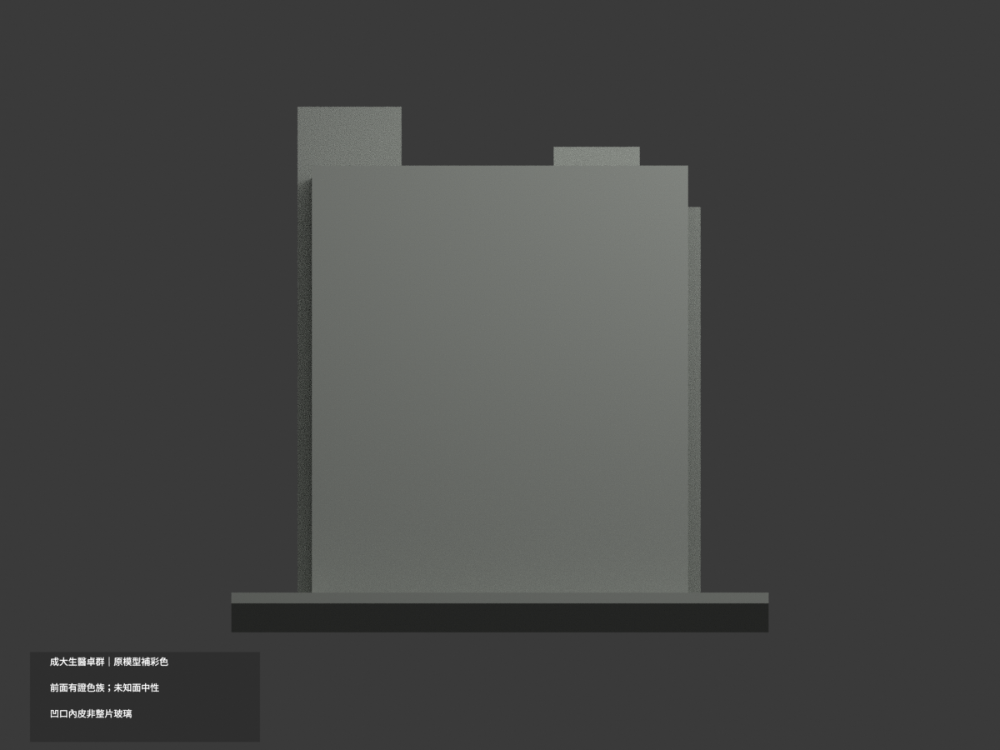
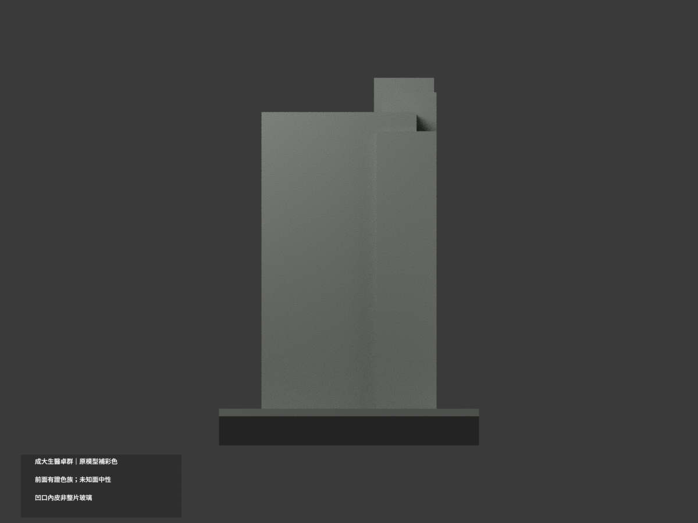
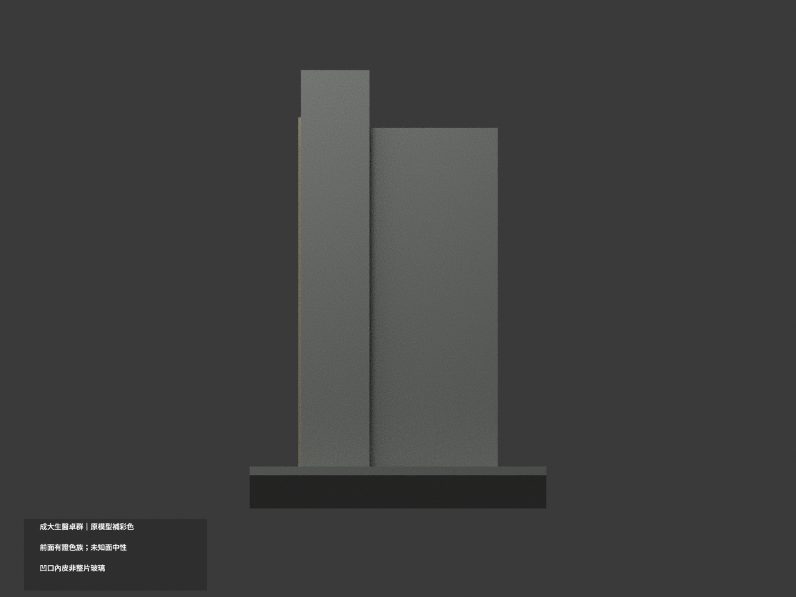
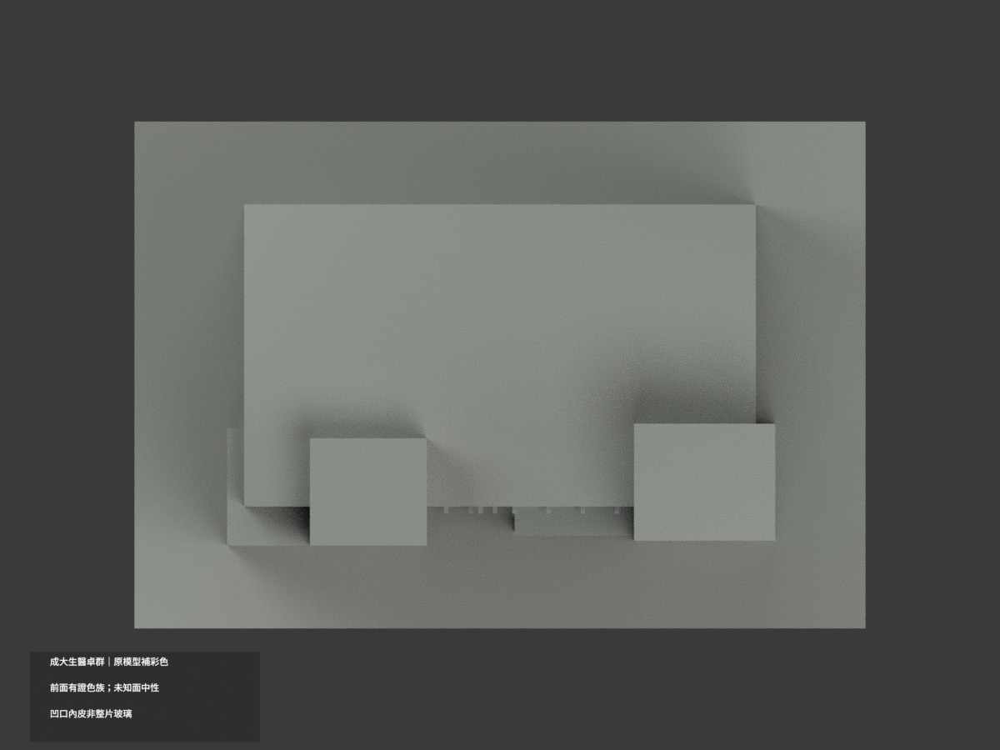
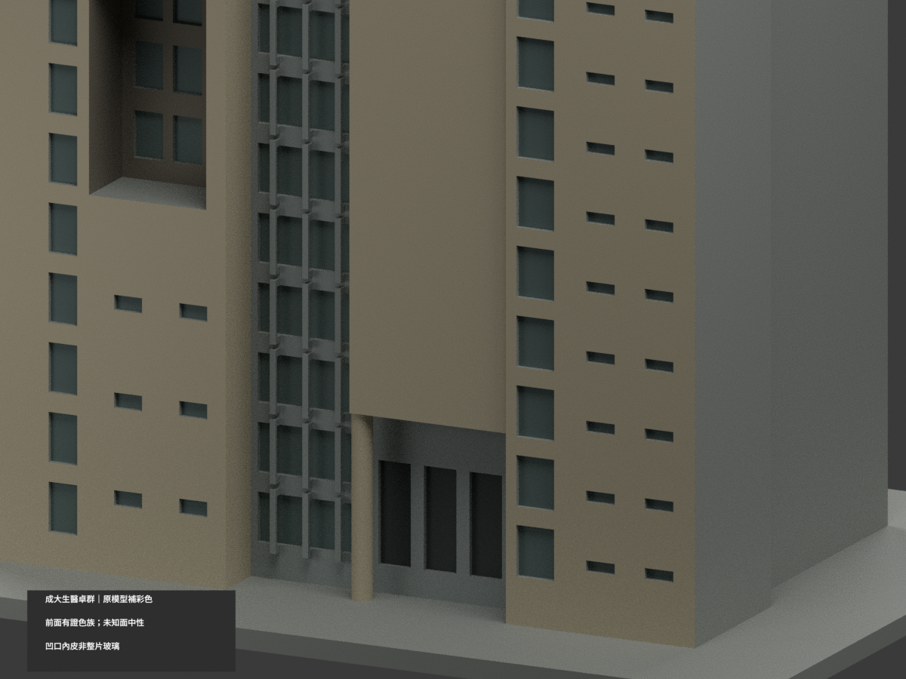
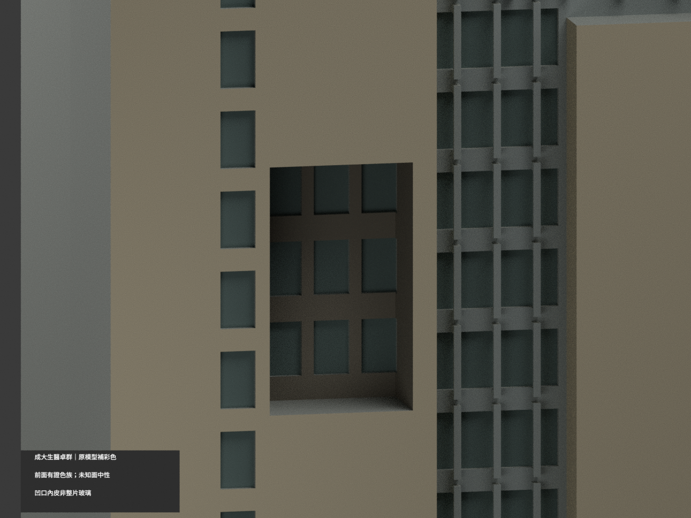
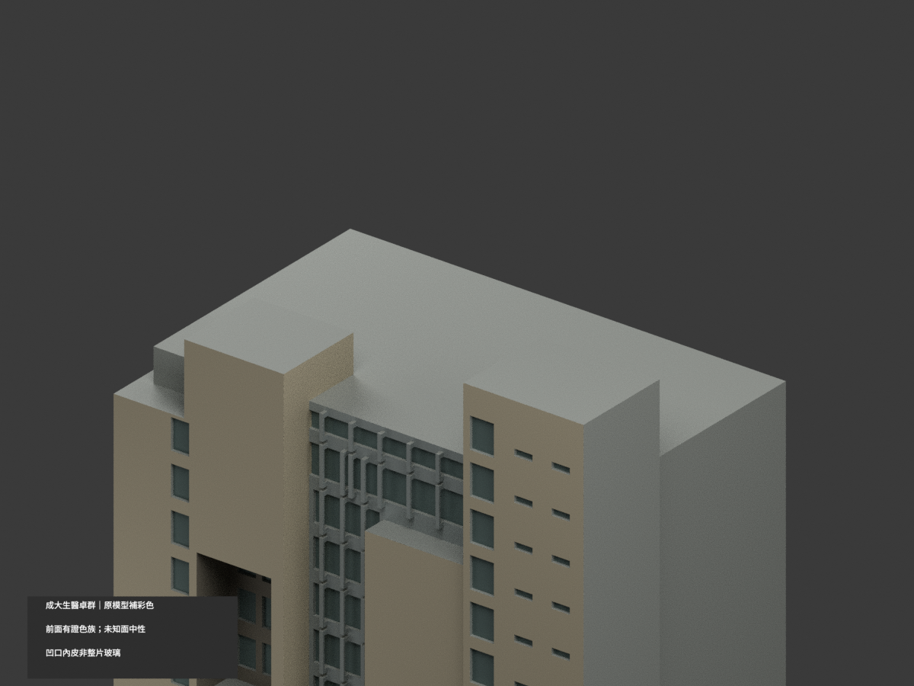

# 國立成功大學｜生醫卓群大樓：原幾何補彩色

## 彩色模型預覽

**同一項目材色更新（count_delta = 0），只為照片重疊的正面及唯一對位返面補近似色族；不是完整四面材質調查。左高凹口內皮是遮陰實牆，不是整片黑玻璃；未知側後與屋面中性。**

| 正面斜視 | 背面斜視 | 正面 |
|---|---|---|
|  |  |  |
|  |  |  |
|  |  |  |
|  |  |  |

## 材質範圍與限制

保留原 3166 三角面、全部頂點與原比例；不增窗格、標字、雕塑、設備或相鄰醫院量體。原粗化尺寸、樓層、逐窗位置不因補彩而獲精確認證。

- 正面左右階梯實牆、右高塔及入口高屏暖米灰；只照片2925可對應的左突出塊右返面延用此色，不按構件名稱把所有側背一起染色。
- 中央既有窗間平面與原凸梃銀灰，避免越界染到前凸入口實牆。照片細窗格在舊模型沒有對應面，不新增。
- 原中央／狹長／小窗凹底分別灰綠；不把所有窗間牆變成連續玻璃。左高凹口的內壁、頂內面與背景實皮用暗暖灰表達遮陰，九個既有小窗另分灰綠，沒有整口亮玻璃或黑色空洞。
- 原下入口柱及屏框淺色，三下窗凹底通用深陰影，不新增精細入口配件。
- 大水平屋面、屋頂退台、完整背面、未對位外側及底座中性，不是真實現場漆色。陰影與反光只為視覺解讀，非校準色票。
- 三張照片上傳日2023-09-21，不當確定拍攝日，亦不主張2026現況。

## 格式與重建

原 `model.stl` 及 `build_model.py` bytes不變；原包沒有OBJ。STL不含彩色。`appearance.3mf` 指派六基本材質，`scene.blend` 有實際shader，`color-mesh.npz` 保原三角座標。六材質外觀不是已驗證四色／多耗材切片專案；未實際列印、未執行切片器驗證。

```sh
python build_model.py
python colorize_model.py
python export_appearance.py
python validate_color.py
blender -b -t 3 --python render_color.py
blender -b --python-exit-code 1 --python verify_color_scene.py
```

沿原requirements與Blender4.3.2。隔離重建保留不刪。新QA見 COLOR-FORMAT-GEOMETRY-QA、SCENE-QA、DELIVERY-QA、SOURCE-VISUAL-QA；七全景有完整邊界檢查，三細景刻意局部構圖。原validation／截面／薄特徵／previews與render_preview.py保留單色歷程，不當本次彩色重建入口。

## 來源與權利

- [成大素材網正面2933](https://material.ncku.edu.tw/picture.php?/2933)
- [成大素材網正面2934](https://material.ncku.edu.tw/picture.php?/2934)
- [成大素材網左返面2925](https://material.ncku.edu.tw/picture.php?/2925)

作者：計網中心教學科技組－陳怜吟；來源成大素材網。保留非商業利用及署名條款；原照與網頁私人保存，原圖不隨模型公開、不貼於模型，也不以儲存庫license再授權。公開模型不保證商用權利已清。來源hash與適用範圍見 COLOR-SOURCE-REGISTER.json。

## 原始模型說明與限制

原文保留如下，材色及重建入口以新段落優先；舊單材圖不是本次彩色成果。

# 國立成功大學｜生醫卓群大樓

## 模型預覽

| 模型預覽 | 模型預覽 | 模型預覽 |
| :---: | :---: | :---: |
|  |  |  |

第四批外觀近似模型；校區：成杏校區。最長邊150 mm（含底座），各模型獨立比例。尺寸：150 × 104 × 143.9 mm。


## 公開來源及像素查核

- [校方素材網：全景與位置標籤](https://material.ncku.edu.tw/picture.php?/2933)：已檢視全高外觀像素，校方標為成杏校區生醫卓群大樓。
- [校方素材網：正面較寬角度](https://material.ncku.edu.tw/picture.php?/2934)：已檢視高低量體、右側窄長玻璃帶與成對狹窗、中央大玻璃區。
- [校方素材網：中段及入口](https://material.ncku.edu.tw/picture.php?/2927)：已檢視左側高位大凹口、中央大片實牆与下方入口退縮。
- [校方素材網：左側斜角](https://material.ncku.edu.tw/picture.php?/2925)：已檢視左側階梯高差及深凹口側壁，沒有以室內或設備資訊建模。

## 本件範圍、保留與近似

只作生醫卓群大樓本棟，不含成大醫院其他樓棟、周邊低屋或獨立公共藝術。保留不對稱高低立面、右側全高塔狹窗、中央逐層玻璃窗格及屏牆上方橫展窗帶、左側深凹口及入口上方實牆屏。大凹口做成約10.5 mm深的開放凹部，保留背牆三層窗格，入口屏牆以實體柱連到主體。窗距、層數節奏與比例為照片推估；照片主要涵蓋同一立面及近側角度，沒有完整背面或屋頂證據，後側和屋頂以素面封閉量體簡化，不主張四面皆可還原。

## 交付與重建

- `model.stl`：毫米單位，與底座合成的單一實體。最長邊為 150 mm（含底座）；各棟獨立縮放，不適合直接拼成等比例校園。
- `build_model.py`：完整可攜參數化原始程式，無外部貼圖、私有路徑或參考照片依賴。
- `scene.blend`：由交付 STL 匯入，只有一個建築網格，可在 Blender 編輯頂點；細部參數請修改 Python 後重建。
- `previews/front.png`、`rear.png`、`elevation.png`：由實際交付 STL 產生。
- `validate_model.py`、`validation.json`：可重跑的幾何與重建驗證。

建議 Python 3.12，在虛擬環境執行：

```sh
python -m pip install -r requirements.txt
python build_model.py
blender -b -t 2 -P render_preview.py
python validate_model.py
```

已使用 Blender 4.3.2。驗證器在獨立臨時目錄重建 STL 並比較 SHA-256，讀取 Blender 場景的網格後比較三角形幾何。它檢查原始二進位 STL 儲存法線、面積、封閉性、邊恰有兩面、頂點連結為單一環、表面只有一個連通分量、正體積、底面位於 Z=0、最長邊 150 mm。單一封閉表面也排除獨立藏在內部的空腔殼；沒有宣稱完成所有自交的窮舉檢測。

## 製作原則與限制

這是依公開照片觀察製作的外觀近似收藏模型，不是測繪、修復、工程或精確 BIM 資料。牆身為實體，門窗、拱廊通常改成淺凹浮雕；不含室內、設備或安全配置。屋頂、深度、窗距及後側比例沒有測量基準，不能視為實際尺寸。原始參考照片未收錄、未重新授權或隨套件發布。來源權利屬原作者／校方；原創模型與程式可沿用儲存庫授權，不涵蓋外部參考照片。

## 列印說明

底座平貼平台，Z 軸向上。可從 0.4 mm 噴嘴、0.16–0.20 mm 層高、3 道外牆與 12–18% 填充開始試切片；這是設定建議，並非已測參數。小於約 0.8 mm 的淺浮雕可能因噴嘴或縮放消失。STL 是封閉實體，切片器仍會依填充率產生內部填充。

未實體試印、未執行切片器列印驗證，沒有保證免支撐。請依下列模型特有支撐需求檢查切片預覽。

左側高位凹口上緣、入口大屏牆下緣與門廊跨距必須支撐。全高約143.9 mm，需注意塔身穩定及平台附著。

## 抽樣逐層截面檢查

`validate_sections.py` 以0.20 mm間距抽樣實際STL，檢查平面交線每個節點度數為2及無零長線段。接近頂點平面時向下避開0.0173 mm，結果見 `cross_sections.json`。這不是切片器、支撐或實體列印驗證。

查核日期：2026-10-13。


## 整合版截面與薄特徵補充驗證

本整合版使用固定共同邊方向後插值的 `validate_sections.py` 與 [0.2 mm 截面結果](cross_sections.json)，避免同一邊浮點方向差異造成假斷環。原始 STL 幾何未修改。舊截面程式有閉合斷言，既有通過結果不代表曾有破面；此處以新版重跑結果為準。

另提供 `check_thin.py` 與 [新增 0.8 mm 薄特徵輔助篩查](thin-feature-check.json)：每 1 mm 水平取樣，先確認輪廓閉合與有效，再作半徑 0.4 mm 形態開運算。這不是切片器、完整壁厚分析或實體試印，尖屋頂、銳角也會造成損失，不能據此宣稱無支撐或列印成功。執行前請安裝 requirements.txt。
