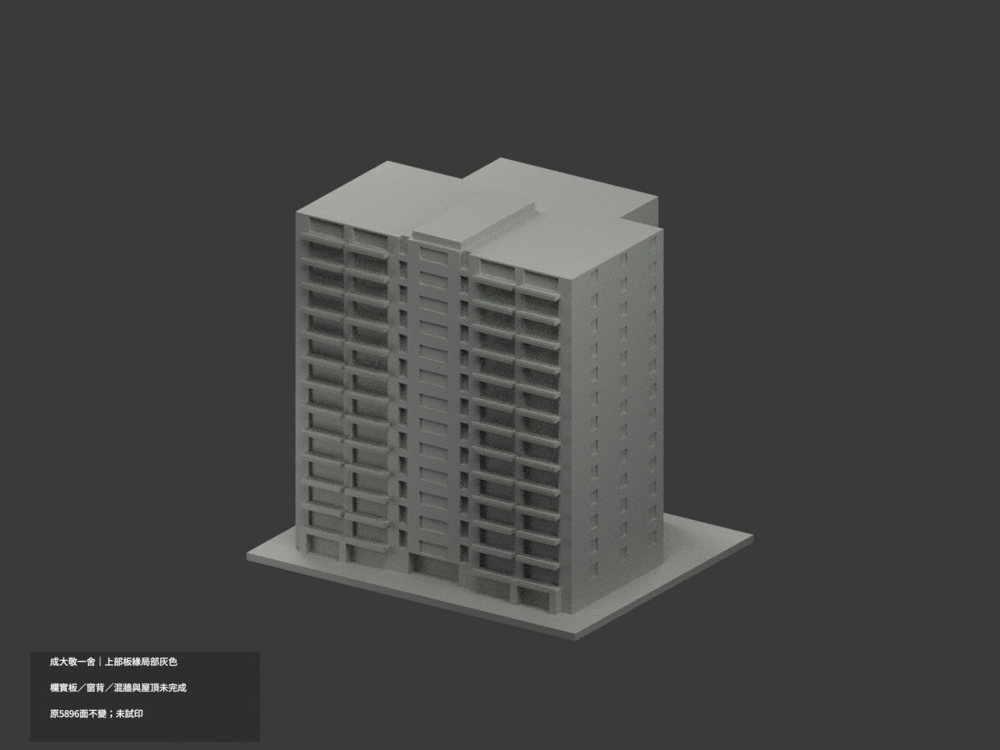
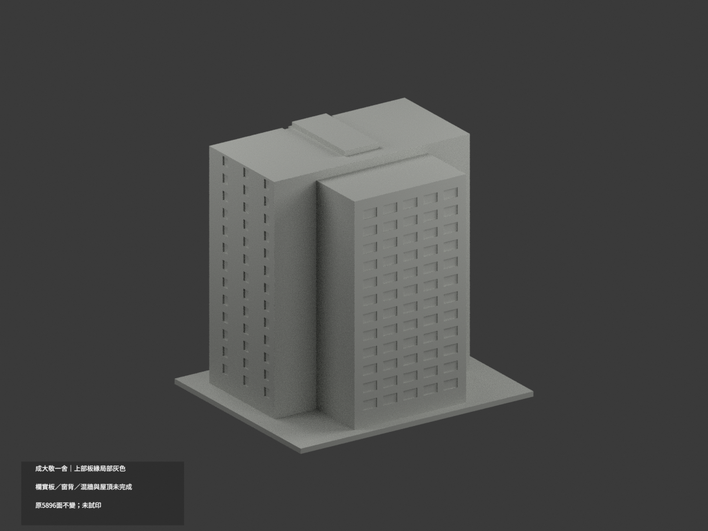
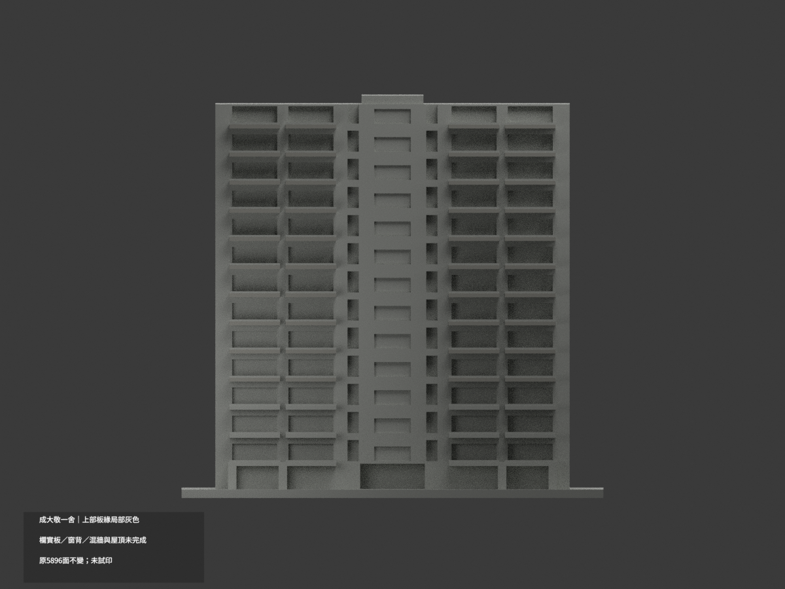
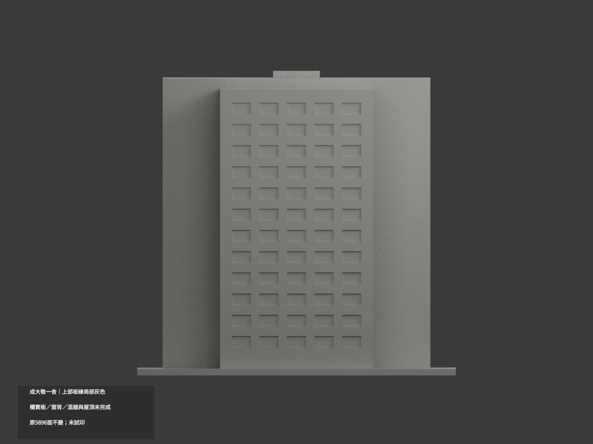
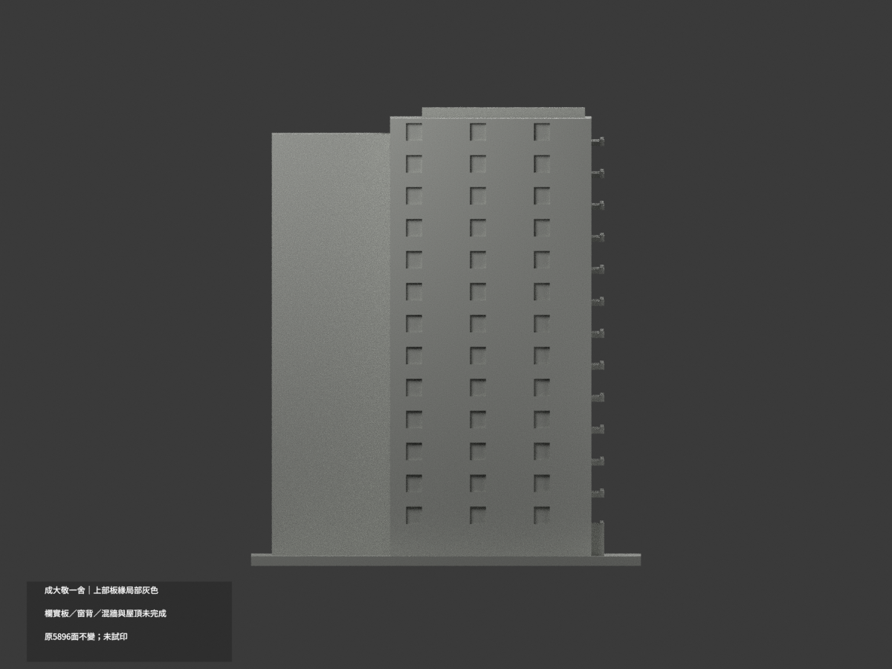
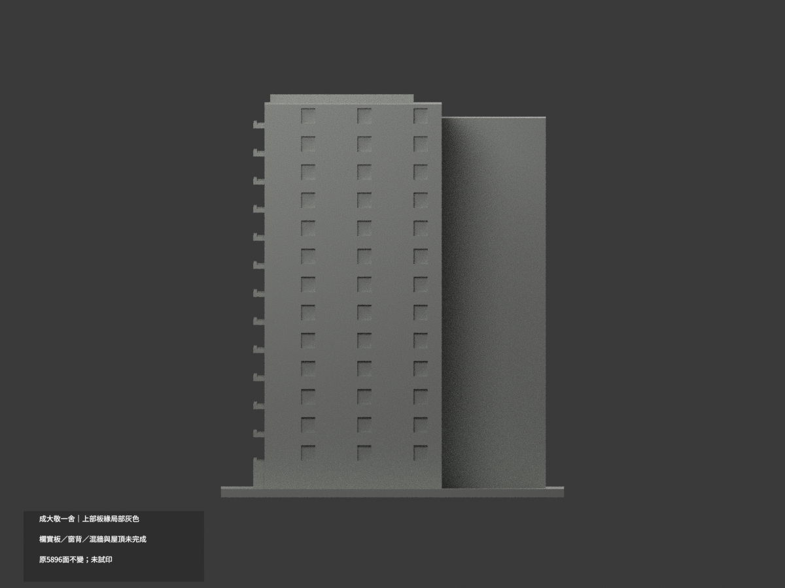
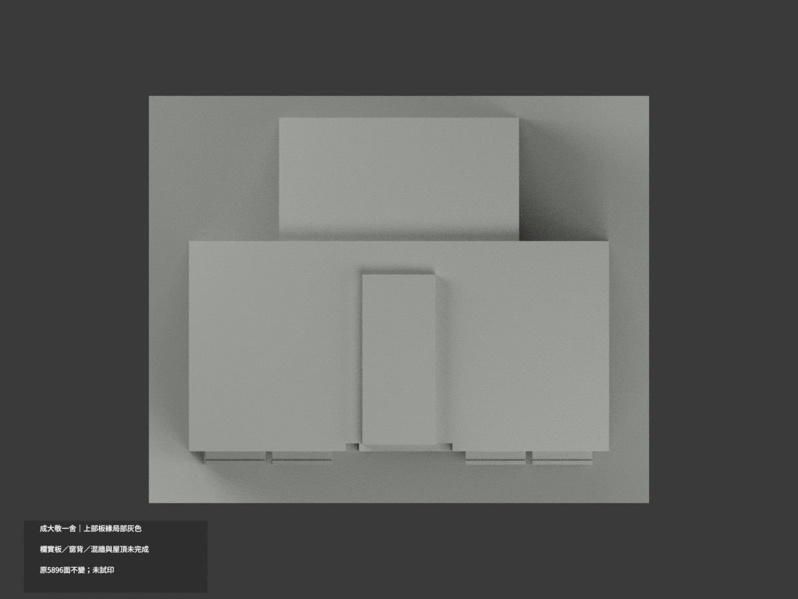
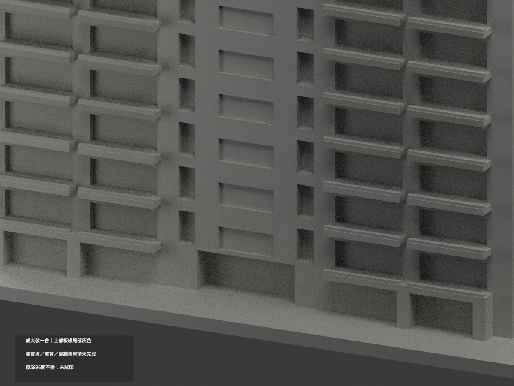
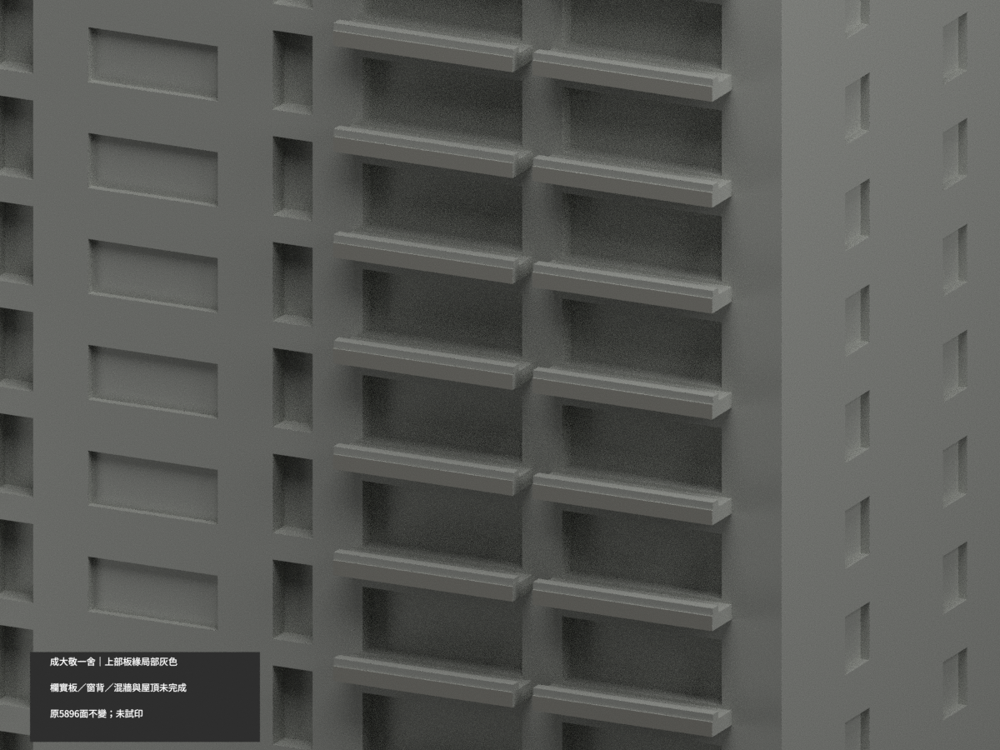
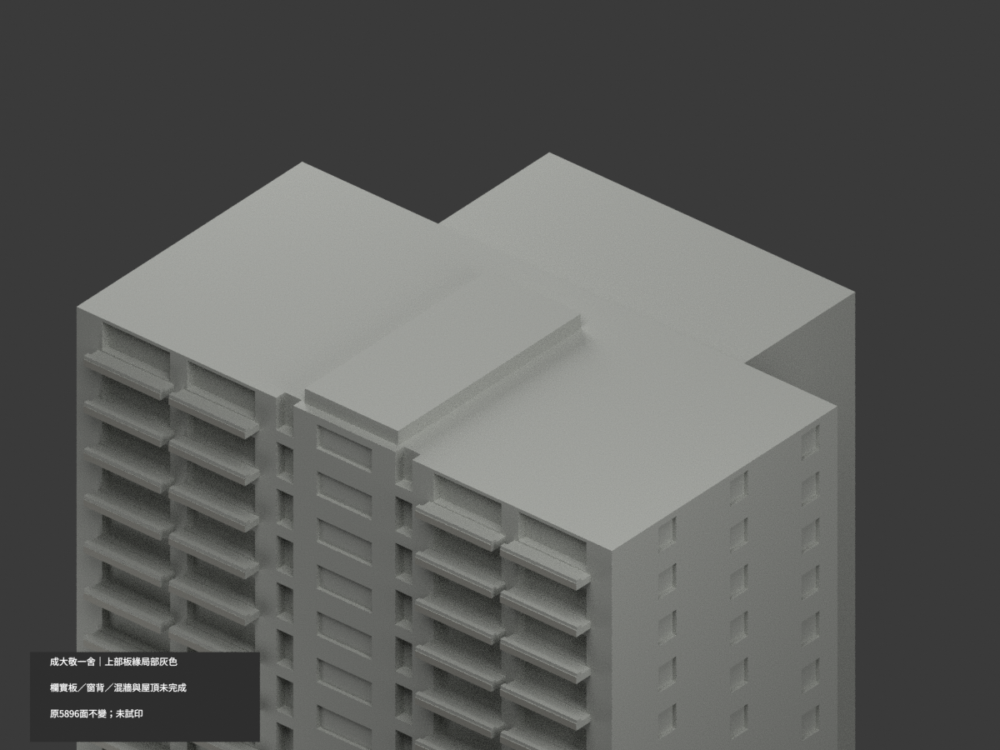

# 成大敬一舍｜上部陽臺板緣局部灰色

**欄代實板、窗背、混材主牆與屋頂未完成分色。** `partial_color_incomplete=true`、`fully_colored_exterior=false`。只在上部可證的原陽臺板前緣補灰，不是整棟全色完成。

| 總覽 | 背側 | 正面 |
|---|---|---|
||||
||||
||||
||||

## 材色範圍
同 `ching-yeh-first-dormitory` 原項目，same-item、count_delta=0。**原5896三角面、STL與build_model.py字節不變**；不切面／新孔／新增幾何。原公開包沒有OBJ，不聲稱保留未存在原件。
- 原模型十個上部tier zz43..133、四列x−49/−29/29/49的板緣外向面 y−49.5，40完整矩形／80原三角面灰色。
- 原最低三tier zz13/23/33因樹遮維持中性；欄杆的粗化實板y−49.35不是板緣，不染灰冒充已核。
- 其餘5816面中性：混磚／基座大牆、窗背的框玻璃簾與反光、屋頂與中央屋凸、側後、各板上／下／側面、入口與地面柱。
- 連通共面域同色，0候選撤色，無假斜楔。色／中性界是證據範圍與原拓撲限制，不是真實材接縫。
- 原13-tier近似保持，不宣稱每層精測或用補色追認原幾何。

## 來源／日期與權利
成大宿舍官方相簿物理第10頁外觀照片；2024相簿版本／出版背景不是已驗拍攝年。只採外部影像，不用室內資料。影像中遮蔽下層不延推。
原照私有保存，不公開／貼圖；未確認CC／再散布授權，不保證商用。HEX只近似灰色族，非校準色票、精確現況或全年代復原。

## 格式與列印
[原STL](model.stl) · [材色3MF](appearance.3mf) · [Blender](scene.blend) · [原說明](ORIGINAL-MONOCHROME-README.md)
150×122mm照片近似展示底座，非精測比例。STL不含色；3MF與Blender真逐面材質。兩材質標籤不是已驗證兩色／四色耗材切片；**未實際列印**，無切片路徑。

## 重建與 QA
原 `build_model.py` → `colorize_model.py` → `export_appearance.py` → `validate_color.py`；Blender執行 `render_color.py` 與 `verify_color_scene.py`。
原字節／三角multiset、閉合正體積、3MF面材、完整隔離原build＋color重建、scene重開、十圖1200×900及圖文hash皆核，程序不取代來源人工判讀。
原單色previews/render/validation保留歷程，不冒稱新QA，原檔沒有刪除。
