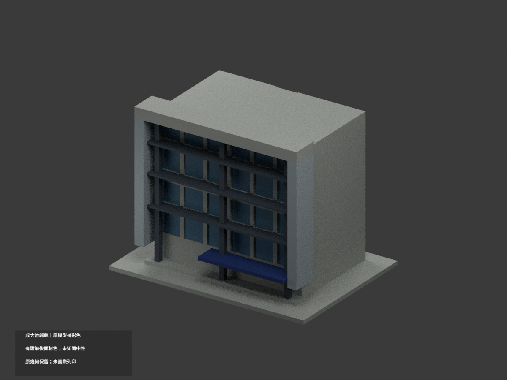

# 國立成功大學・自強校區

## 模型圖鑑

| 模型 | 模型 | 模型 |
|---|---|---|
| **國立成功大學｜啟端館**  [正面](buildings/chi-duan-building/preview.png) · [背面](buildings/chi-duan-building/rear.png) [說明與來源](buildings/chi-duan-building/README.md) · [STL](buildings/chi-duan-building/model.stl) · [彩色3MF](buildings/chi-duan-building/appearance.3mf) |  |  |

[返回學校總覽](../README.md)

本校區目前收錄 1 件數位外觀近似模型；包含局部段或同一財產不同量體，件數不等於完整建物棟數。各件含底座最長150mm、獨立縮尺。尚未完成全校，未實體試印或進行印表機切片驗證。

## 三欄模型圖鑑

每格是一件不同模型。範圍、來源年代、近似與薄件警示以各件詳頁為準。

## 既有模型彩色更新（不新增套數）

`chi-duan-building` 保持原STL與建模程式位元組，按官方照片為原三角面分材，增加彩色外觀3MF、Blender及十視圖；未核背部／屋面保持中性。不是提高幾何精度或現況測繪，未驗四色耗材映射、切片或實體列印。舊單色previews與QA留存為歷史，不作本次彩材驗證；詳新版README。
