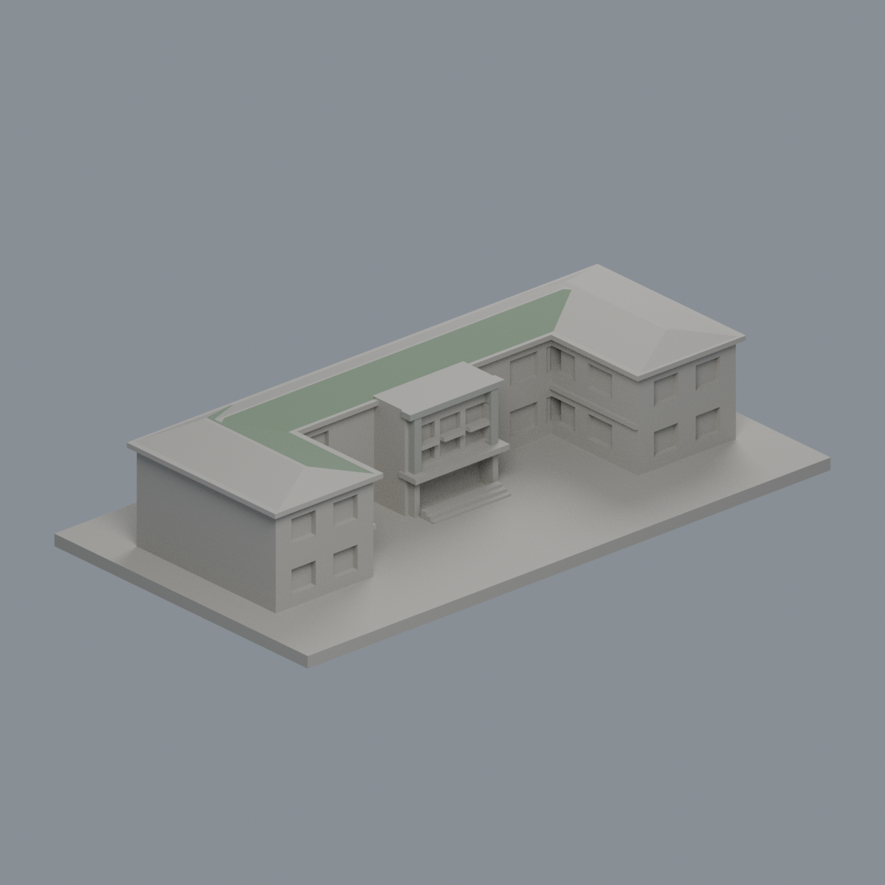
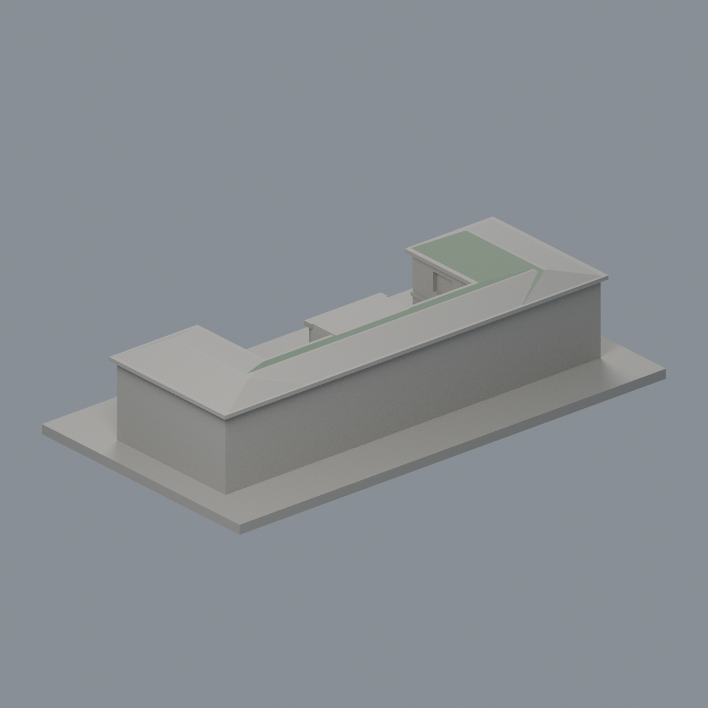
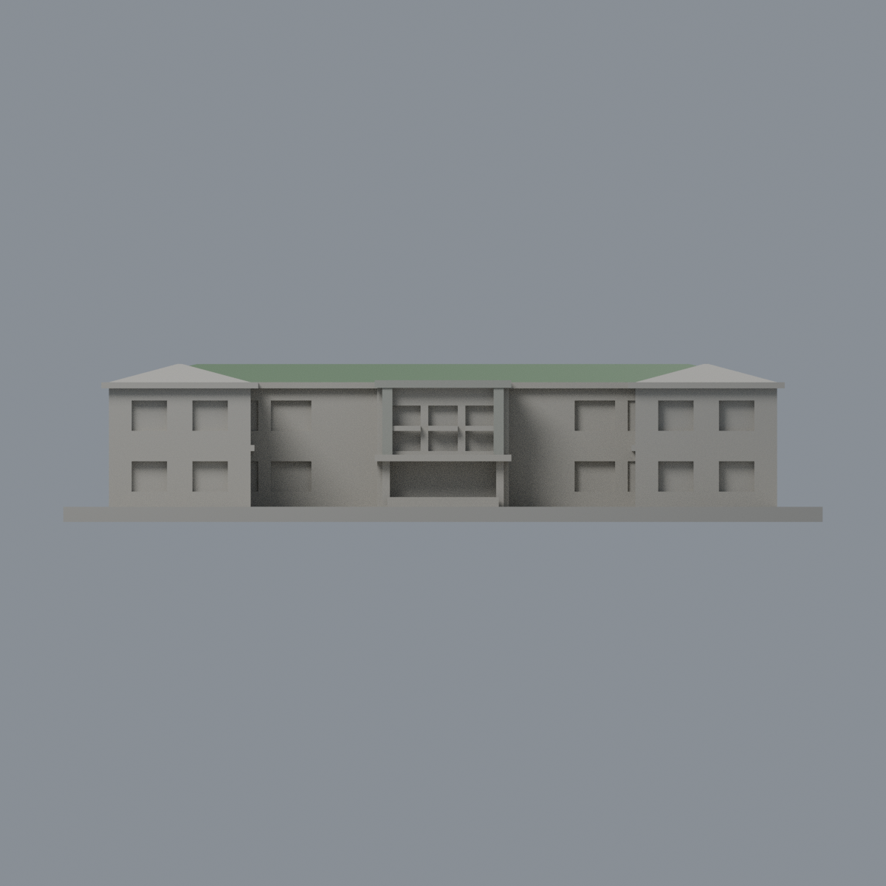
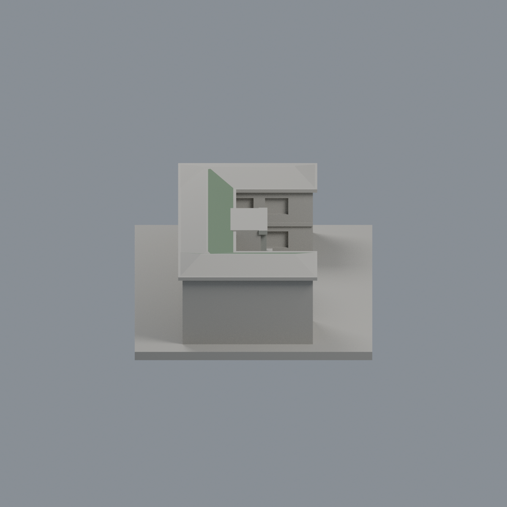
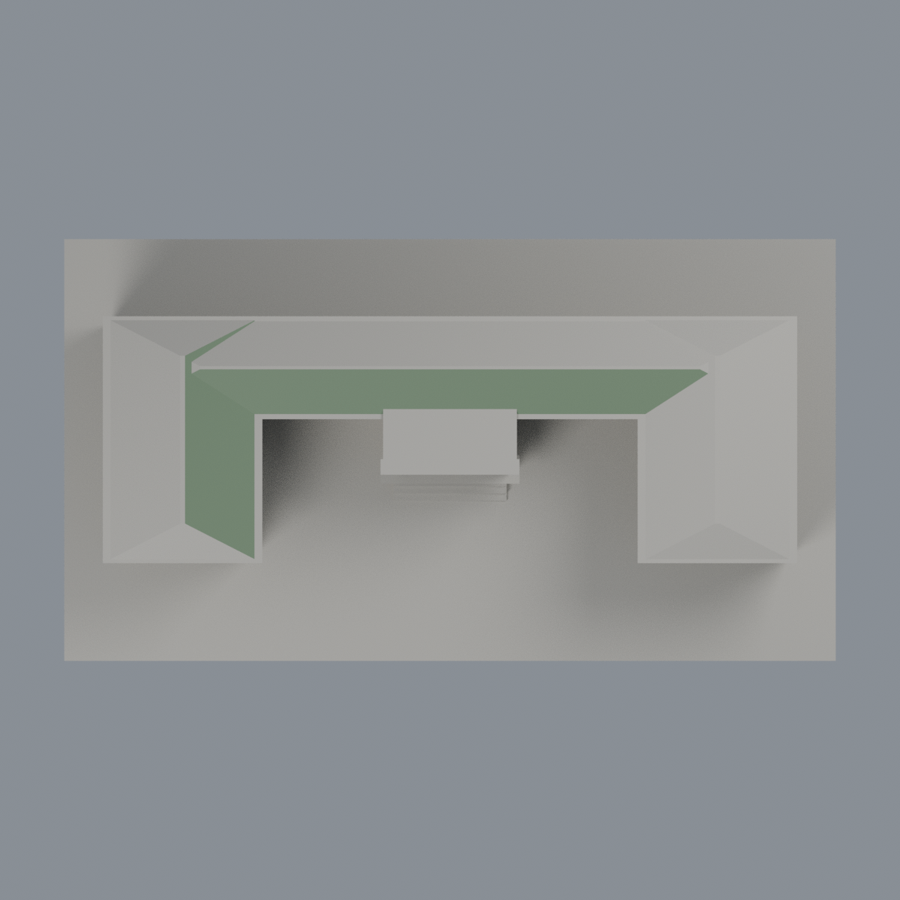

## 本次多面補色：入口上層構件側面推估

在既有入口上層兩外柱與橫簷正面灰洗石代理色基礎上，將 **24 個原中性完整三角面** 延伸同色：左柱側 10 面、右柱側 10 面、橫簷端面 4 面。這是**同構件材料連續性推估，非新側背照片證據或 2026 現況確認**。不擴到下柱、窗凹／窗框、背牆、基部、頂面、底棚或瓦坡；原 19 瓦面與 6 個入口正面彩面不變。原 1,020 面／506 頂點、幾何與面序保留，其他 996 面配色不變；未實體試印。

本次 QA 見 `qa-continuous-walls/`；舊 `qa/` 與 `qa-frame-continuation/` 為歷史版本記錄，下方舊版中性範圍只對上述 24 面更新。現行重建：`python appearance/source/build_continuous_walls.py`；驗證：`python appearance/source/verify_continuous_exchange.py`；渲染：`blender -b --python appearance/source/render_continuous_walls.py`；場景驗證：`blender -b --python appearance/source/verify_continuous_scene.py`。舊分類器僅作基底，直接執行會回復先前版本。新 ZIP 不含任何第三方照片。

# 政大果夫樓：兩個可見瓦坡限域配色

原1020面中，僅主屋朝前庭坡10面、左翼朝前庭內坡9面，合計19個完整原三角面採低飽和灰綠瓦代理 #647B60；其餘1001面採中性 #AAA79F。中性表示未確認，不代表實物均灰色。本件是果夫樓，並非達賢圖書館；不是全棟材質復原或2026現況。

| 模型預覽 | 模型預覽 | 模型預覽 |
| :---: | :---: | :---: |
|  |  |  |

[背視](previews/rear.png) · [正立面](previews/elevation.png) · [側視](previews/side.png) · [俯視](previews/top.png)

| 模型預覽 | 模型預覽 | 模型預覽 |
| :---: | :---: | :---: |
| 背視  | 正立面  | 側視  |
| 俯視  |  |  |

## 來源與選面
親看官方政大記憶網正面、側面原圖（頁圖說2009），及2025入口輔照。正面檔EXIF DateTime為2009:05:08 11:04:05，不能當獨立拍攝時間認證；側面無日期EXIF，年代依官方圖說。2025僅補充觀察，不據此宣稱2009色值持續不變。頁面文字「綠瓦灰牆洗石子外牆」與歷史照片支持灰綠瓦外觀；色值未校色、非儀器測色或指定塗料。

設 t=(z−27.2)/4，epsilon=0.0002mm。每個三角全部三頂點需滿足0≤t≤1及同一精確坡平面/梯形範圍：主坡 y=6+9.7t、|x|≤67.5−18.9t（10面，815.5810mm²）；左內坡 x=−36.5−15.035t、|y−2|≤24−7.68t（9面，425.1106mm²）。總1240.6916mm²。不以重心或包圍盒選面，不切面，不增加頂點。所有屋脊、簷口、其他坡（含背坡、兩翼外坡及右翼內坡）、牆窗、入口和底板均中性，不因相連而擴染。

## 檔案及重建
[彩色3MF](nccu-guofu-appearance.3mf) · [可編輯Blender](scene.blend) · [面映射](face-materials.json) · [色盤](palette.json) · [來源](SOURCES.md) · [權利](LICENSE-NOTICE.md) · [重建ZIP](rebuild-source.zip) · [校驗碼](SHA256SUMS)

保留原STL全部座標、1020三角面序與拓撲，尺寸150×82×31.2mm。原native單Warm stone材質，本次additive不改原件或歷史製造QA。

重建目錄為model.stl及appearance/source/；Python依requirements.txt安裝，執行build_appearance.py、verify_exchange.py、verify_material_boundaries.py，再用Blender 4.3.2+執行render_appearance.py、verify_scene.py。包含strict 3MF零警告、真正單材質編輯存檔重開及Blender同項驗證。乾淨重建3MF/映射/色盤/五PNG逐byte相同，Blend僅語義一致，不宣稱binary決定性。未切片器、多色FFF或實體試印；非工程測繪或施工模型。

## 2026-11-13 有限外觀修正｜模型交付版

原上層兩外柱及頂橫簷前面3完整域共6面0→新2灰洗石表觀族#9A9C94/.88。1020面幾何/面序不變，其餘1014面及原2材保持；原綠瓦19、中性995、新框6。原凸矩形全三角支承，不新增分界；柱寬/橫簷厚為粗代理，微粒/接縫未建，材色非精測。不延下柱/基部/柱側/底棚/窗/字樣底板/階梯/屋瓦。2009與2025僅來源圖說，不證色值不變或現況。

模型、材質、原生視角圖與必要重建程式沿用完成候選，未改幾何或新切材界，不代表全館精確復色、現況或實體試印通過。原來源年代、工程與列印限制仍適用，舊說明與審核僅屬各自版本，本段更新上述局部範圍。

本次只公開模型、必要重建輸入／腳本、預覽與說明；完整來源、比較及研究審核不隨本批交付。根目錄PUBLIC-MODEL-SHA256SUMS僅校驗所列當前產品，舊表不驗證新版。重建ZIP只含必要重建檔與本說明；歷史來源及QA連結指儲存庫既有文件，非ZIP內的新增審核附件。
