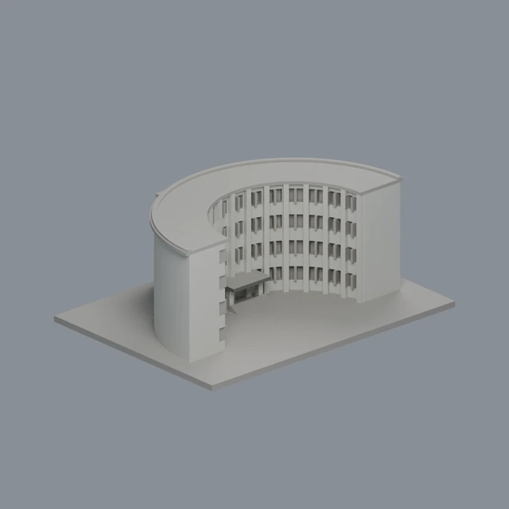
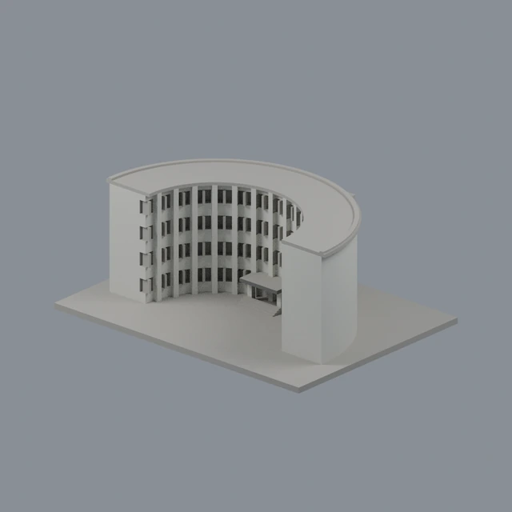
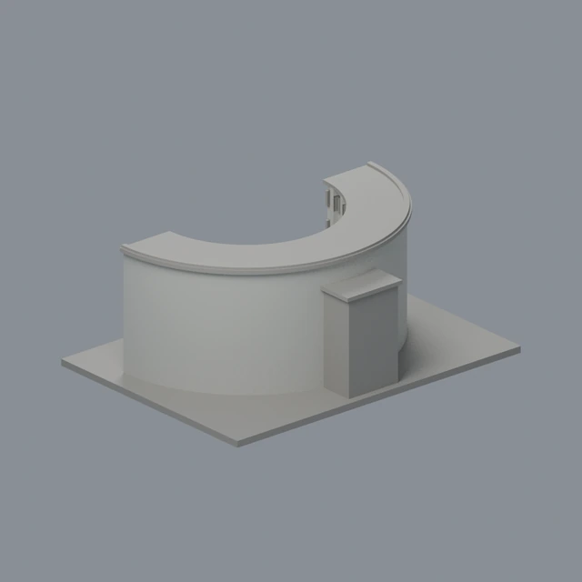
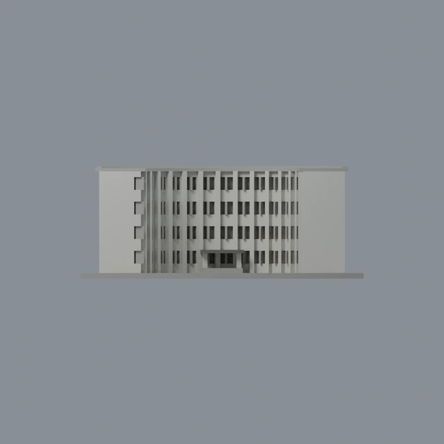
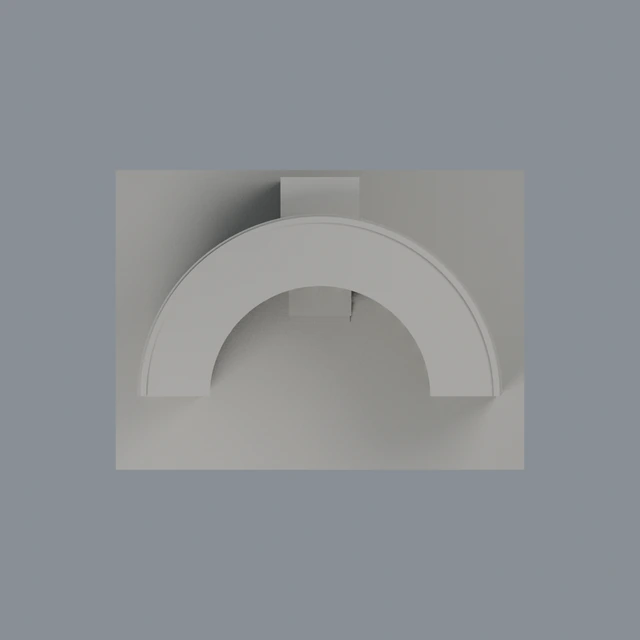

# 政治大學山下校區｜井塘樓｜現行彩色展示

## 模型預覽

| 模型預覽 | 模型預覽 | 模型預覽 | 模型預覽 | 模型預覽 |
| :---: | :---: | :---: | :---: | :---: |
|  正面 |  反向斜視 |  背面 |  正立面 |  頂視 |

五張全尺寸無失真 WebP 由現行三材質 Blender 場景核對重繪，點擊縮圖可放大。既有白牆／前庭柱及灰雨棚立邊共 1,404 面，其他 4,772 面中性；不新增材質或宣稱全樓現況。此處不改幾何或擴大補色。

[現行彩色 Blender](../appearance/scene.blend) · [彩色 3MF](../appearance/nccu-jingtang-appearance.3mf) · [STL](../model.stl) · [渲染驗證](render-proof.json) · [本頁校驗](SHA256SUMS)

[原模型與限制](../README.md) · [原外觀來源與證據](../appearance/README.md)。歷史圖、原 README 與工程資料均未改動。未實體試印。
