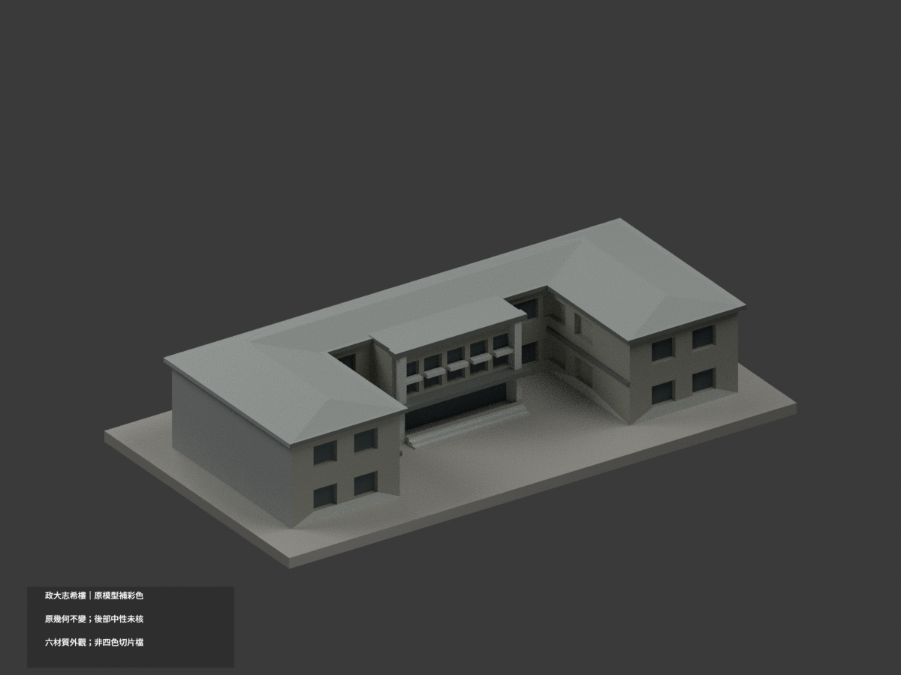
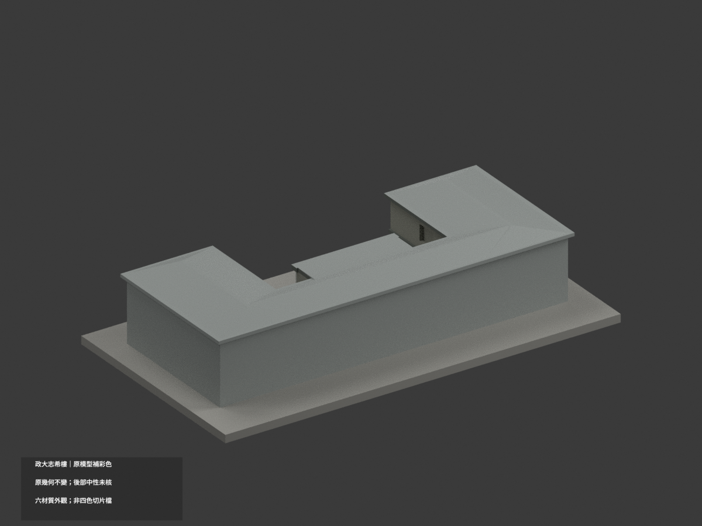
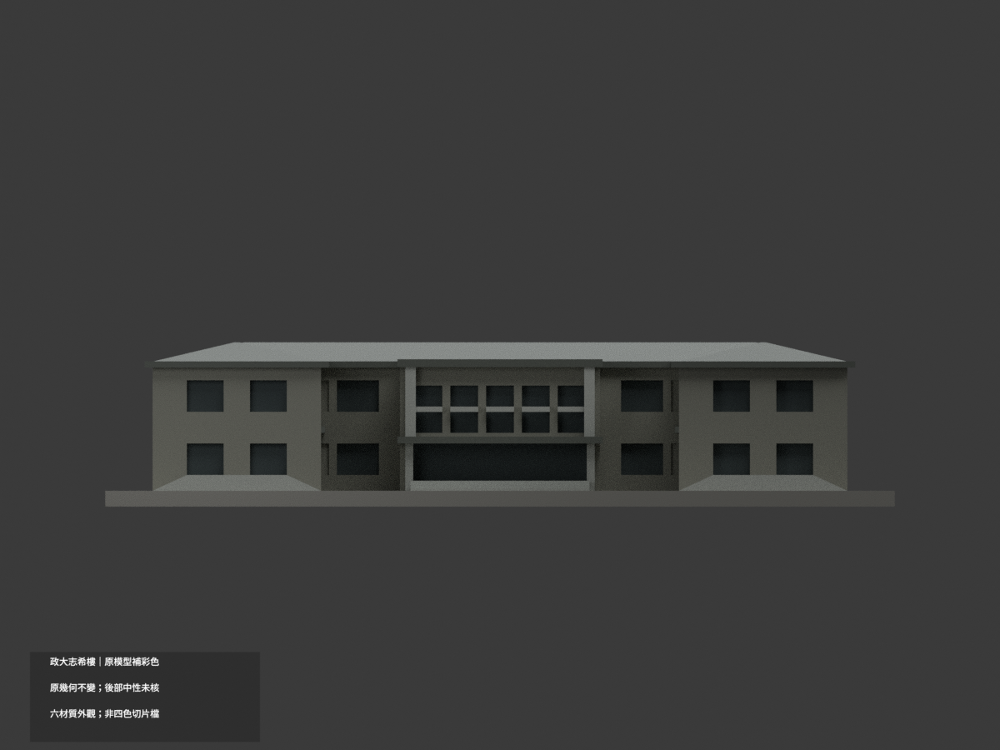
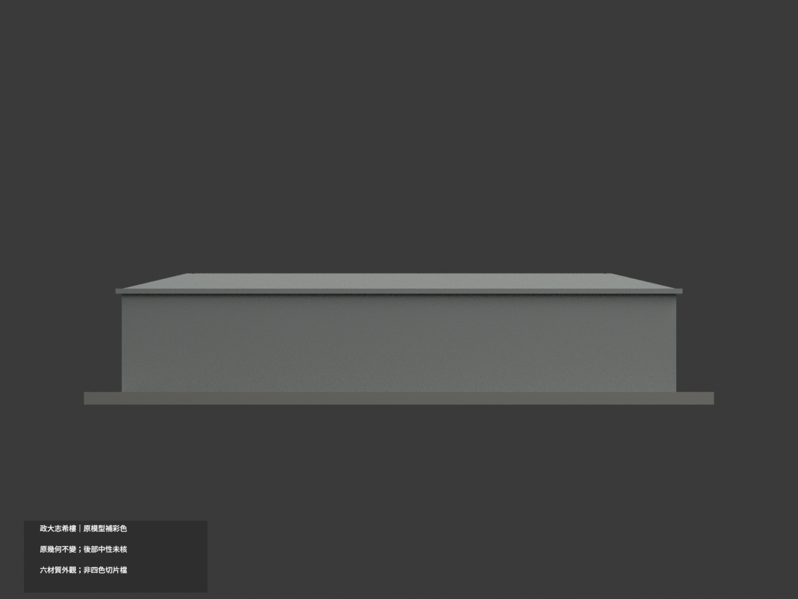
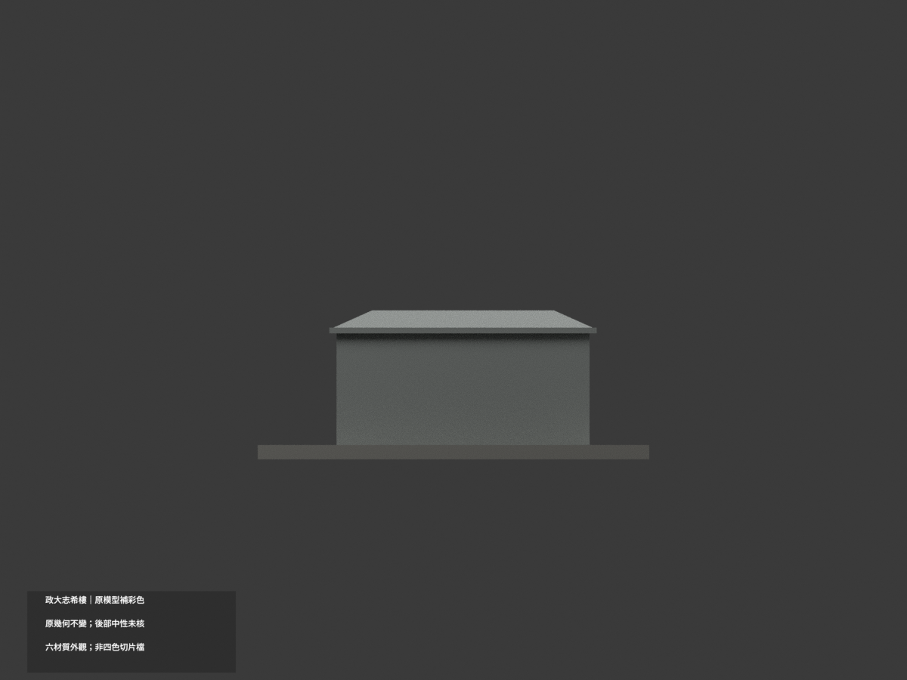
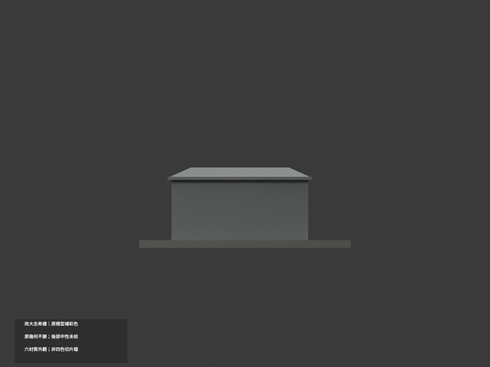
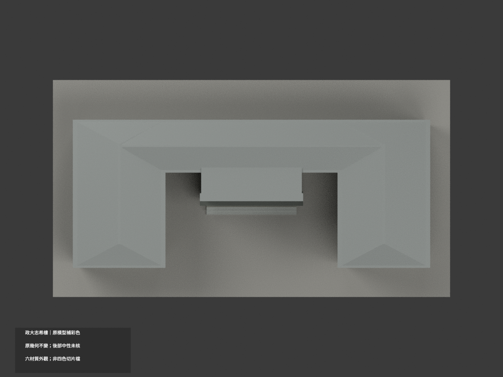
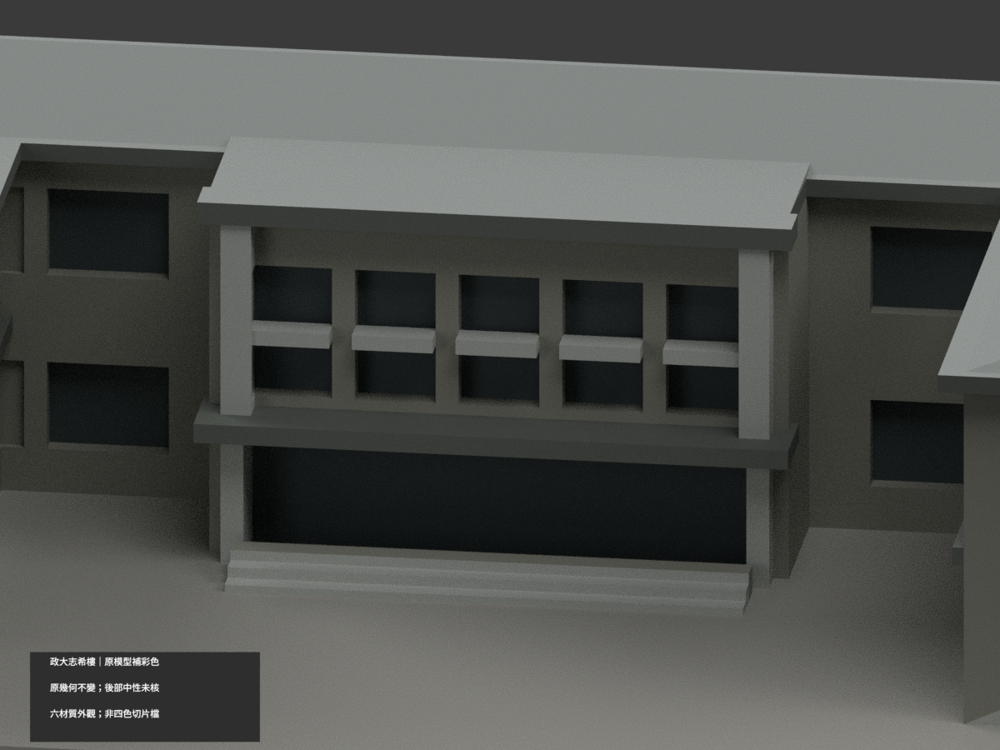
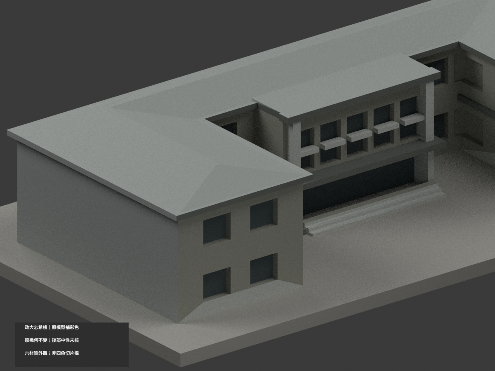
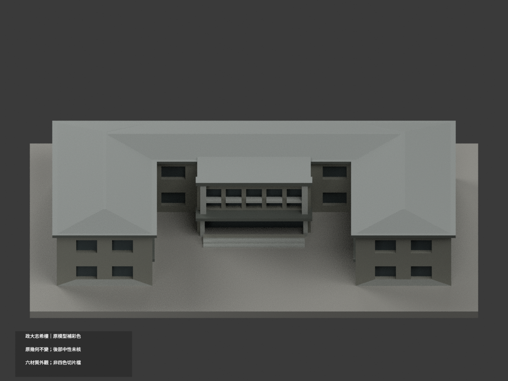

# 政治大學志希樓｜同項目彩色材質更新

## 彩色模型預覽

**原 1026 三角面與 STL 幾何不變，不增加套數。** 依 2021 年表列外觀照片，使用灰洗石子、淺灰框、深灰凹面與檐帶；真實建物本來以灰色系為主，不為顯示「彩色」任意塗成鮮豔顏色。未核屋頂大面與背面保持中性，不聲稱現況測繪。

| 整體 | 反向 | 正面 |
|---|---|---|
|  |  |  |
|  |  |  |
|  |  |  |
|  | | |

## 可用檔案與限制

- `appearance.3mf`：六種逐面基本材質、毫米單位；`scene.blend` 為彩色場景，`appearance-materials.json` 為近似色族。色票不是現場校色數值。
- `model.stl`、`build_model.py` 保持原檔字節。原公開包未附 OBJ，不虛稱保留不存在的原 OBJ。STL 本身不含顏色，不能稱原 STL 已變彩色。
- 六材質外觀 **不是已驗證四色切片檔**；未驗耗材映射、切片器匯入或實際列印。深色窗只是既有凹面示意，不新增門扇／玻璃／室內。
- 2021 表列照片顯示灰鋁玻璃入口，未採未註年官照的較早紅門。照片拍攝年份未知，不將報告日期當拍攝日期。
- 屋頂大面與背部無充分色證；不能由「文化瓦」一詞猜紅瓦。原簡化幾何、空白背面與比例限制全部繼續有效；材色更新不等於幾何精修。
- 原單色 `previews/`、`validation.json` 及原輔助檔保留歷程；原 `render_preview.py` 為舊單色程序，請勿用它覆蓋新版彩色場景。

## 可重現與查核

`python build_model.py` 重建原幾何；`python colorize_model.py` 分材；`python export_appearance.py` 輸出彩色 3MF；`blender -b -P render_color.py` 重渲染。`python validate_color.py` 核原檔、三角座標、3MF 材質及隔離重建，`blender -b -P verify_color_scene.py` 重開查核。保留隔離目錄，不自動刪檔。

## 色彩來源與權利

採[政大官方公開報告](https://osa.nccu.edu.tw/CSRC/files/169362228269a7c8ada230d.pdf)第 37 頁正側外觀照片（表格日期 2021-10-01），僅使用建築外觀，不涉及內部安全配置；[圖書館校史頁](https://nccuwiki.lib.nccu.edu.tw/index.php/志希樓)供身份與材料文字交證。原頁／照片未確認 CC 授權，僅私人參考，不隨模型公開、不貼圖。原創材色遮罩與渲染不重新授權來源照片或建築設計，也不保證商用權利。

## 原模型範圍與限制（仍有效）

# 國立政治大學｜志希樓

## 模型預覽

| 模型預覽 | 模型預覽 | 模型預覽 |
| :---: | :---: | :---: |
| 正面（實際 STL）  | 背面（實際 STL）  |  |

山下校區。本件為依公開實拍與官方平面外輪廓自建的完整建物外觀近似模型，不是測繪、BIM或結構工程資料。

[俯視圖](previews/top.png) · [正立面](previews/elevation.png)

| 模型預覽 | 模型預覽 | 模型預覽 |
| :---: | :---: | :---: |
| 俯視圖  | 正立面  |  |

## 特徵與證據限制

完整C字形二層量體、比果夫樓更深的雙翼、開口前庭、五段高窗中央入口、厚框門面及四坡屋頂。

防災表填表2021-10-01，照片拍攝日期未標；官方館史頁現代照片與早期黑白照片分開使用，黑白照只助核原形。

背立面、屋頂細件與被樹遮挡的局部未有充分現況照片，採留白與保守外輪廓；不是內部或古蹟測繪。

第三方照片/PDF不隨包散布。完整網址、頁碼與各自支持的特徵見 [sources.json](sources.json)。不將來源網頁更新日視為攝影日。

## 3D列印檔案

- [model.stl](model.stl)：毫米，150.0 × 82.0 × 31.2 mm，含底座最長150 mm，各館獨立比例
- [scene.blend](scene.blend)：從交付STL匯入的可編輯網格；形狀與STL經比較一致
- [build_model.py](build_model.py)：獨立參數化重建來源；[requirements.txt](requirements.txt)
- [SHA256SUMS](SHA256SUMS)：逐檔校驗；STL SHA-256：8708e06528a5e6287650b16b1ca37473c3fe9941156243aab04bb27b1024f1b8

底座朝下列印。建議先以0.2 mm層高、0.4 mm噴嘴在自己的切片軟體檢視，確認簷口、雨遮、門楣與深凹窗的支撐需求。細窗框已加粗，仍須依材料、噴嘴及散熱調整。不要把數位QA解讀成免支撐保證。

## 可重現數位QA

1. Python執行 build_model.py 重建模型。
2. Blender背景執行 render_preview.py 生成實際STL正背、正立面、俯視與scene.blend。
3. Python依序執行 validate_model.py、check_contour_validity.py、check_thin_features.py；任何非零退出必須停止交付。

[validation.json](validation.json) 全部checks通過：原始STL法向、繞序、正體積、水密、每邊兩面、vertex link單環、單一連通表面、無分离内腔壳、重建SHA一致、Blend幾何一致與150mm限制。

[contour-validity-check.json](contour-validity-check.json)：以z=0.071mm起、0.2mm逐層，共156层，輪廓degree2闭合、单个與組合Polygon有效；不修補或吞掉invalid。

[thin-feature-check.json](thin-feature-check.json)：0.8mm參考寬度形態opening、1mm取样，最大損失比例0.09708%，超过1%層數0。此為輔助幾何篩檢，不是全面最小壁厚或工具路徑。

尚未做Cura/Prusa实际切片或實體試印，不宣稱保證可印。
