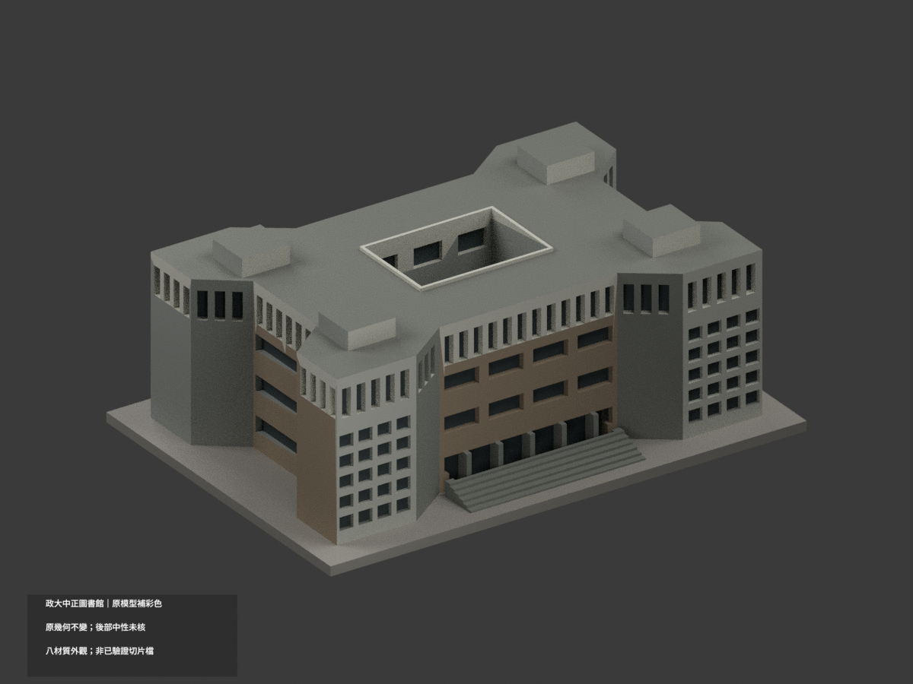
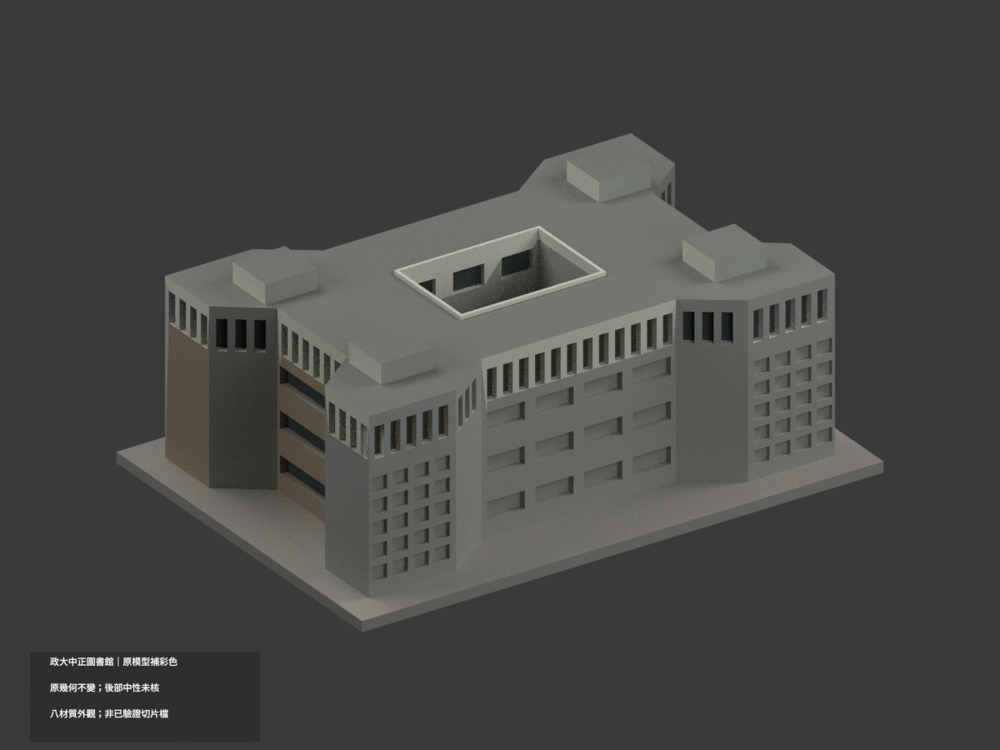
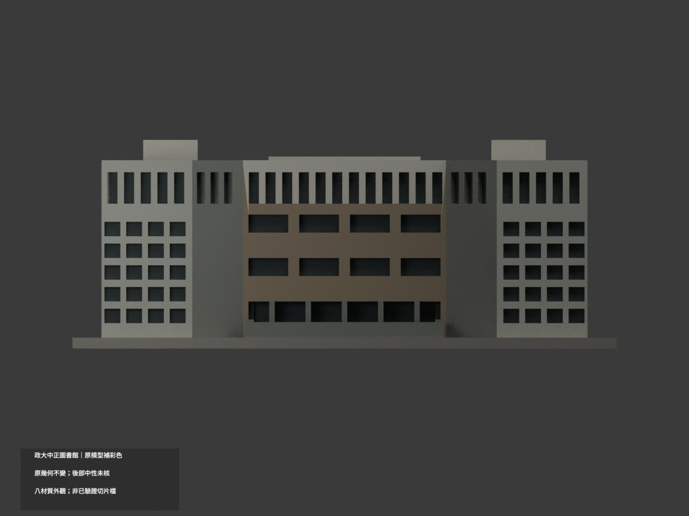
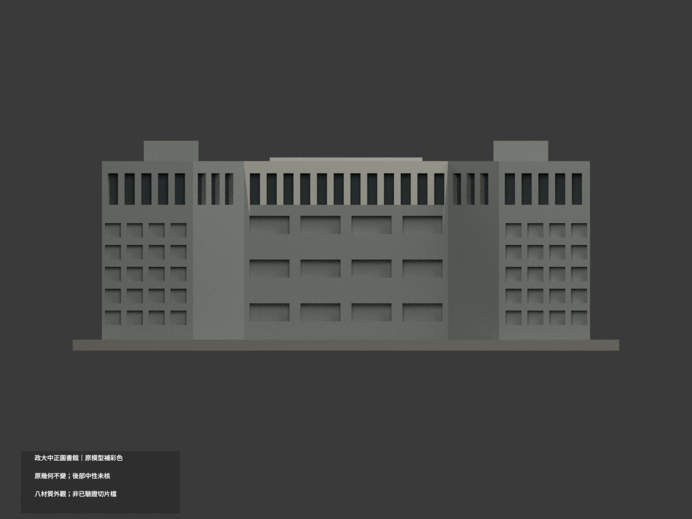
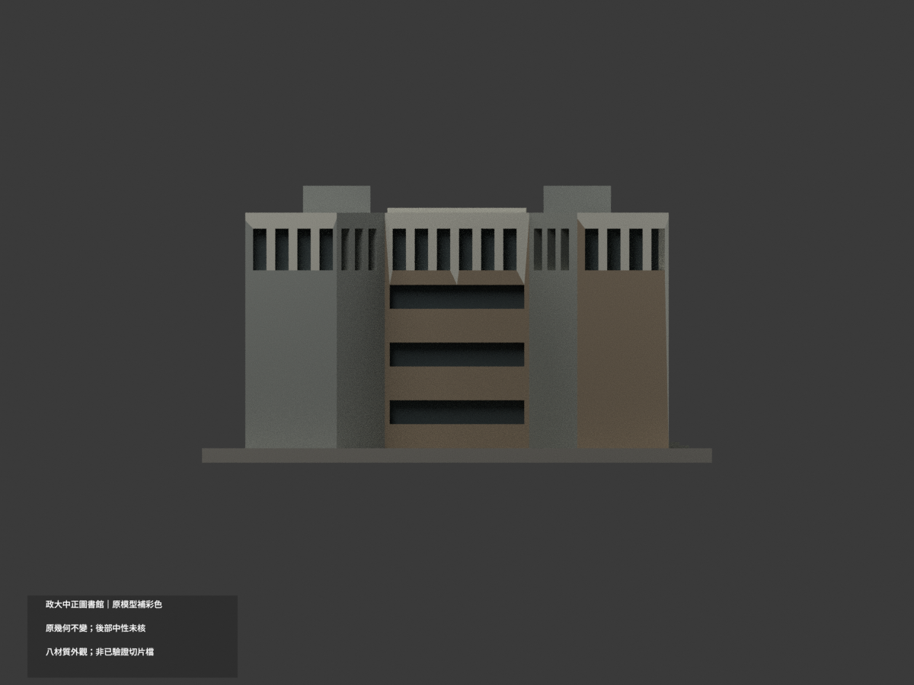
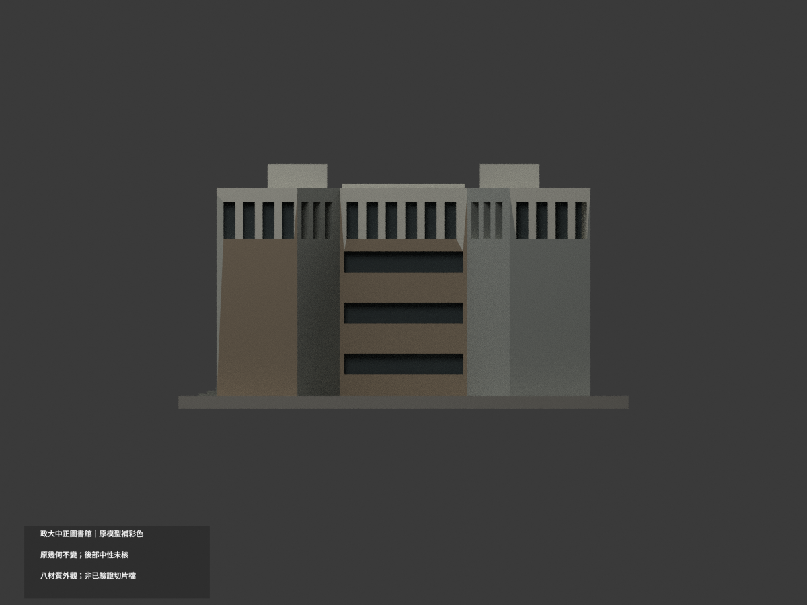
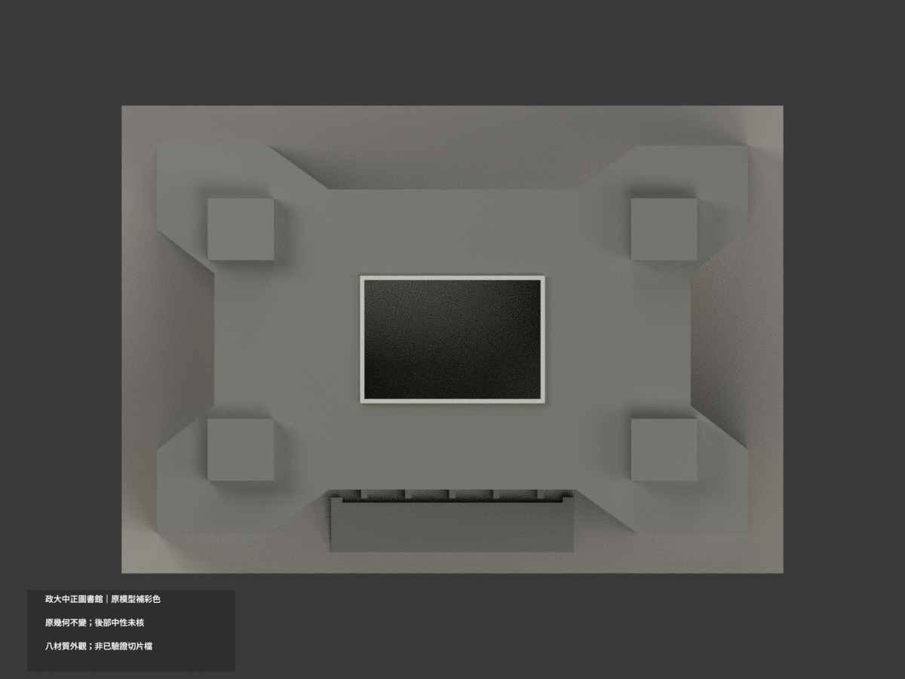
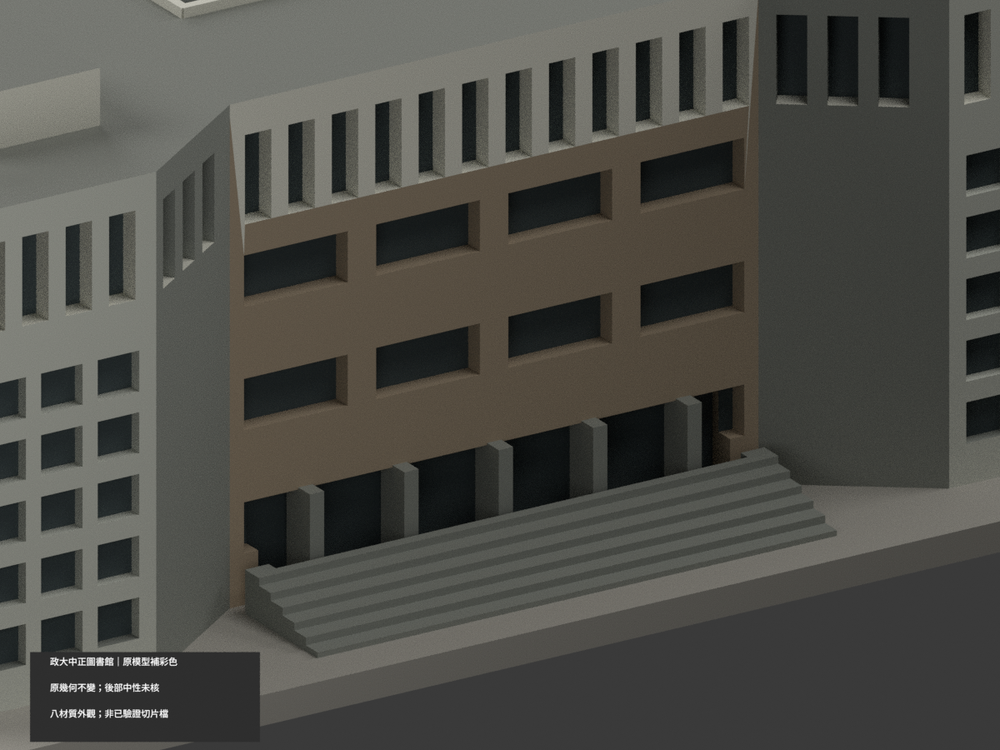
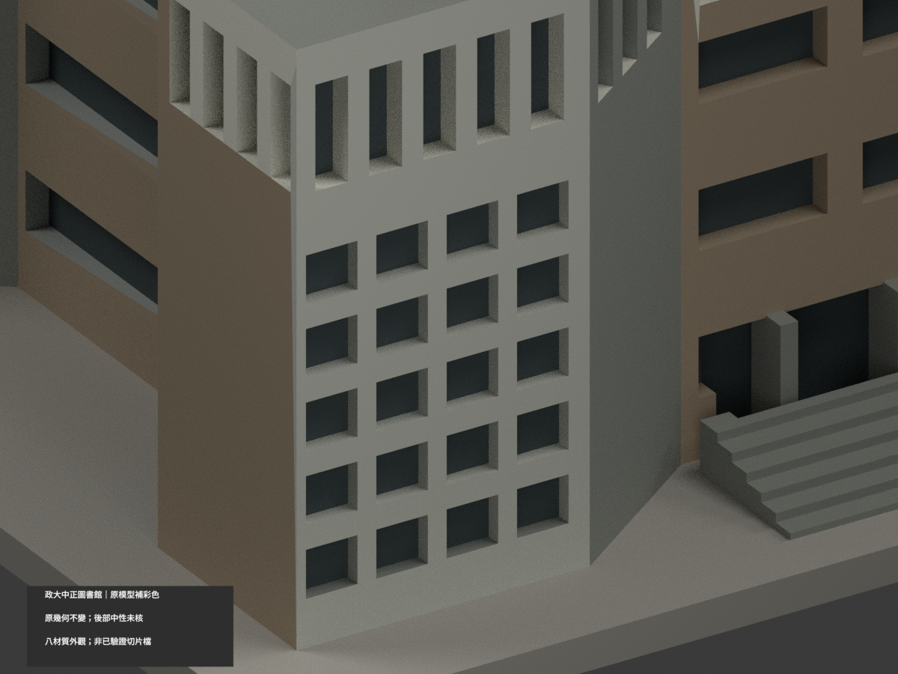
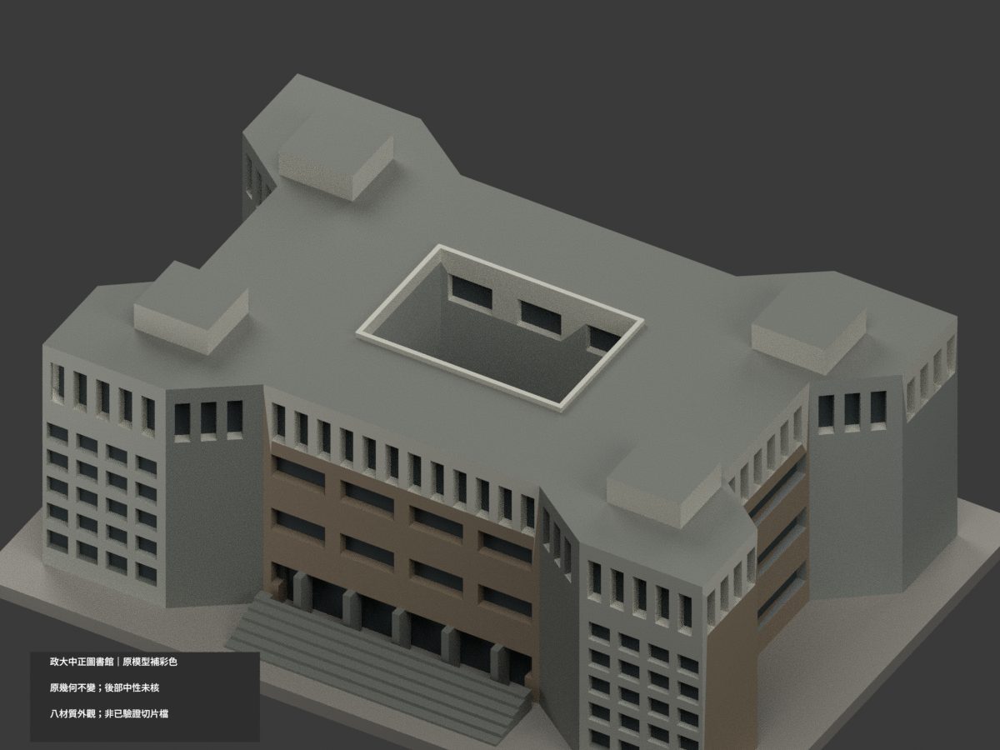

# 國立政治大學中正圖書館｜同項目彩色更新

## 彩色模型預覽

**原幾何不變：150 × 106 × 57.6 mm、3930 三角面，原 STL／建模程式位元組保留；count_delta = 0。** 這是原有照片概化模型增加材質，不是重新測繪或新增一套建築。正面、側面及官方鳥瞰支持近似色族；照片未標拍攝日，不主張 1977 原漆或 2026 精確現況。

| 整體 | 反向 | 正向 |
|---|---|---|
|  |  |  |
|  |  |  |
|  |  |  |
|  |  |  |

## 材質解讀與限制

- 可見中下層實體窗間帶灰米褐、上部直片及檐口米白、既有入口柱與階灰色、角部原有格柵框灰白，真正既有窗凹底／格柵凹底深灰示意。
- 官方鳥瞰直接支持大片平屋面與現有四個屋突頂的灰色族、部分淺色天井壁／屋緣。**不能把所有屋頂都標成未知，也不以照片新增省略的設備或細部。** 未辨識屋突背向面、低後立面及深處天井面保中性未核。
- 兩側主要橫窗面採照片可見的同類立面色族概化，不是每面獨立色度測量。原模型只在部分角面具有格槽，沒有格槽的面不畫棋盤假格柵。
- 原程式最後旋轉 z 軸 90°：分色時僅反算 `pre_x = export_y`、`pre_y = -export_x`，匯出座標不變。入口原 x=-34 對應匯出 y=-34，不誤把旋前座標當現座標。
- HEX 是展示近似，不是校準反射率、材料化學成分或原漆色碼；窗以不透明深色表面表示，不保證玻璃透光。未加入字樣、旗幟、招牌、紋理貼圖或未建的窗格／柱。
- **斜肩牆及角格柵主面含跨越實景上下材色界線的長三角形**，不能不切幾何就精確表現橫向變色。本次斜肩整個既有平面採灰色概化、前角格柵主面從底至頂同淺灰，真凹槽另深色；這不是整面灰漆的實測證明，亦未精確分出該局部的上白／下褐界線。
- 原網格三角面限制細小材色界線；原始輪廓、立面與屋頂簡化不會因彩色渲染變成精測模型。

## 彩色檔與列印差別

[appearance.3mf](appearance.3mf) 為毫米單位八種基本材質逐面指派；[appearance-materials.json](appearance-materials.json) 列材色及面數。[scene.blend](scene.blend) 是同三角幾何的彩色場景。[model.stl](model.stl) 保持原檔（原遠端包未含 OBJ，不宣稱已保存原 OBJ），**STL 本身不含顏色**。

八材質外觀不等於已驗證四色耗材切片檔；未驗切片器匯入／耗材對應、換色、支撐或實際列印，**未實際列印**。不聲稱這個基本材質 3MF 已能在特定印表機直接四色列印。

## 重現與 QA

依 requirements 安裝後 `python build_model.py`、`python colorize_model.py`、`python export_appearance.py`；`blender -b -P render_color.py` 產生十圖及場景；`python validate_color.py`、`blender -b -P verify_color_scene.py` 查原幾何、3MF、隔離重建及重開。重建資料保留，不自動刪檔。

本次證據為 COLOR-ASSIGNMENT-QA、COLOR-FORMAT-GEOMETRY-QA、SCENE-QA、FRAMING-QA、SOURCE-VISUAL-QA 與 DELIVERY-QA。原 `previews/`、`validation.json`、薄壁／截面檔仍保存，屬舊單色版本歷程，不是本次彩材／列印檢查；舊 render_preview.py 會產生單色，請勿用它覆寫彩色場景。

## 色彩來源與權利

採[政大校史記憶網中正圖書館](https://nccuwiki.lib.nccu.edu.tw/index.php/中正圖書館)正面照（Yu tptw）與鳥瞰照，並以[政大公開校園報告](https://osa.nccu.edu.tw/CSRC/files/169362228269a7c8ada230d.pdf)第 33 頁外觀正／側照片交證。只用建築外觀照片，不重建報告內部用途或配置。表單日期 2021-10-01 不等於個別照片拍攝日。

原 PDF、照片、裁圖與 HTML 僅私人研究，不入公開模型包、也不貼成紋理。未確認這些特定影像具有 CC 授權；公開可看不等於可再授權或商用。模型專案授權不重新授權原照片與建築設計，不保證商業使用權。詳 COLOR-SOURCE-REGISTER.json。

## 原模型說明與限制（繼續有效）

# 國立政治大學｜中正圖書館

## 模型預覽

| 模型預覽 | 模型預覽 | 模型預覽 |
| :---: | :---: | :---: |
| 正面（實際STL）  | 背面（實際STL）  |  |

山下校區。依公開實景與官方平面外輪廓自建的完整建物外觀近似，非测绘、BIM或結構設計。

[俯視](previews/top.png) · [正立面](previews/elevation.png)

| 模型預覽 | 模型預覽 | 模型預覽 |
| :---: | :---: | :---: |
| 俯視  | 正立面  |  |

## 形狀及證據限制

萬壽型／四角突出外輪廓、中央開放天井、頂層連續直向遮陽窗帶、四角網格屏牆、前階及屋頂機房。屋頂形狀另以官方鳥瞰實拍核對。

不把外輪廓或天井填成長方盒。角部網格為有背板凹格，沒有室內房間；背面未覆蓋的窗距、屋頂設備及小型排氣設施簡化。原照片未標攝影日期，並非2026逐點現況。

官方防災表内日期2021-10-01，PDF編成2026-03-04，两者不可當照片拍攝日。來源網址、頁碼與支持特徵見[sources.json](sources.json)。第三方原圖不隨包散布。

入口立面按實拍建4排：地面入口窗帶、上方兩層橫窗、頂層直窗。來源標層有口徑差異：防災資料表稱地面5層，但同文件及館方樓層圖列B1、1F至4F；模型未把B1另加為入口立面的第五排。

## 使用方式

- [model.stl](model.stl)：毫米，150.0 × 106.0 × 57.6 mm；含底座最長150 mm，各館獨立比例
- [scene.blend](scene.blend)：實際STL匯入的可編修網格，已與交付STL幾何比較
- [build_model.py](build_model.py)：獨立參數重建來源；[requirements.txt](requirements.txt)
- [SHA256SUMS](SHA256SUMS)：逐檔雜湊；STL SHA-256為 c7ad8d7559310965da3dcf737fd335d2dba0387e2bd434b5c6d30761ea62b459

底座朝下。可先以0.2 mm層高、0.4 mm噴嘴作切片檢查起點，按自己的材料、機台及冷卻條件決定支撐；深凹入口、柱廊、雨遮、頂層簷口和凹窗頂尤其需檢視。窗框／柱／天井邊緣已加粗連接，不代表不需要支撐。

## Fail-closed數位QA

Python執行build_model.py；Blender背景執行render_preview.py產生實際STL預覽與scene.blend；再依序執行validate_model.py、check_contour_validity.py、check_thin_features.py，任一步非零退出都必須停止交付。

[validation.json](validation.json)全部checks=true：原始STL法向／繞序／正體積、水密、每邊2面、vertex link單一環、單一連通表面且無內腔殼、尺寸、獨立重建SHA、Blend/STL幾何一致。

[contour-validity-check.json](contour-validity-check.json)：固定z=0.071 mm起、0.2 mm層距，共288層，degree2閉合、每個與組合Polygon均有效，遇invalid不修補。

[thin-feature-check.json](thin-feature-check.json)：canonical邊內插，1 mm取樣，以0.8 mm參考寬度形態opening輔助篩檢；最大面積損失0.13274%，大於1%層數0。不是全面最小壁厚或實際工具路徑。

未做Cura/Prusa实际切片或實體試印，不宣稱保證可印或全校完成。
