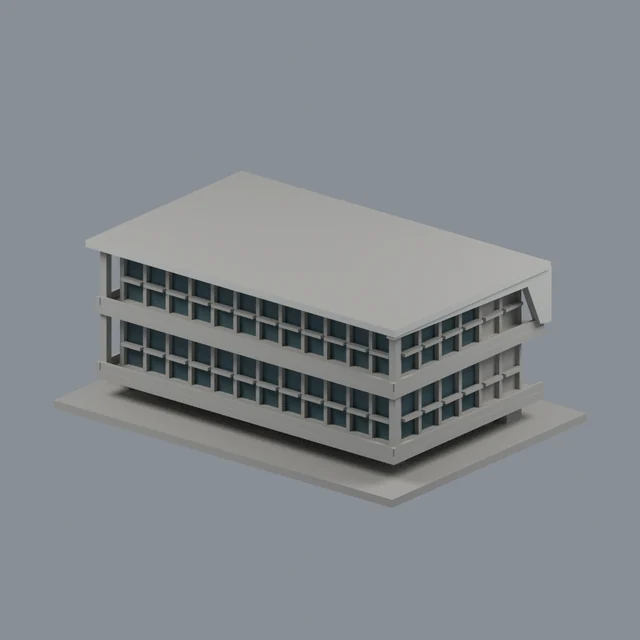
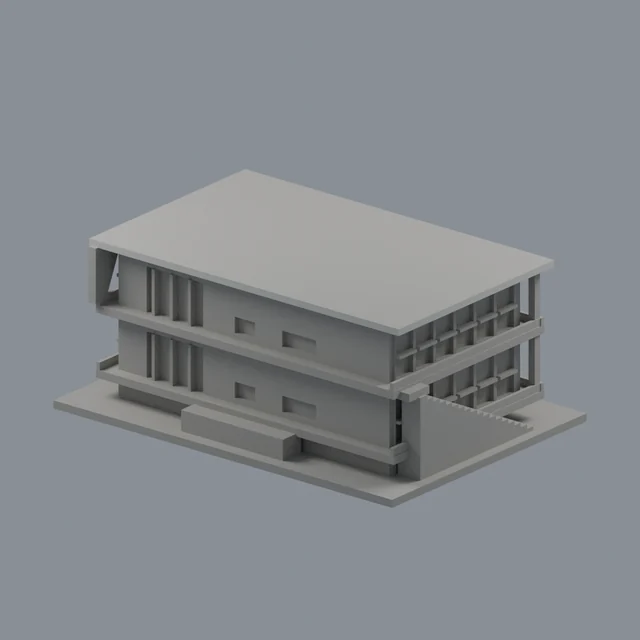
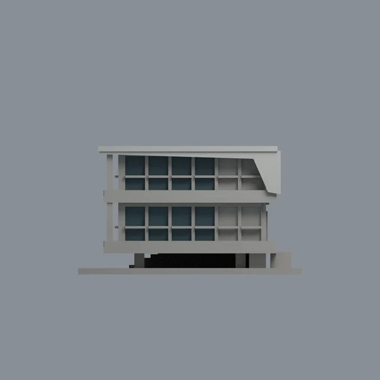
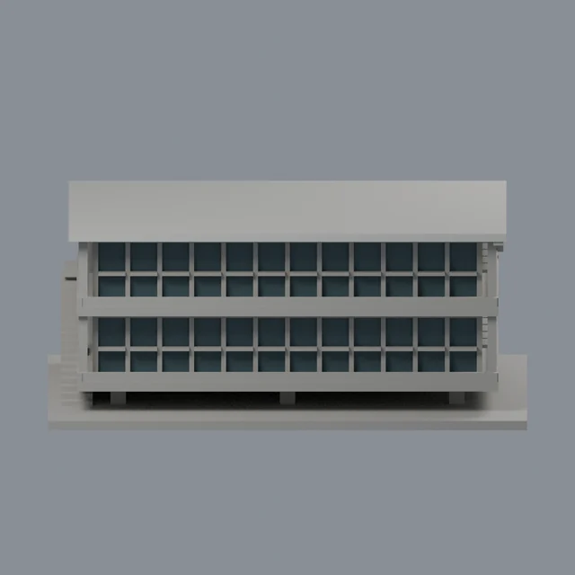
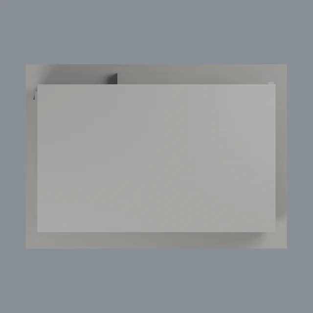

# 政大湖濱悅讀小屋｜現行模型 WebP 預覽

五圖皆以現行三材質模型重新渲染核對，不使用舊單色版。點圖可開啟無損原尺寸 WebP。

| 模型預覽 | 模型預覽 | 模型預覽 |
| :---: | :---: | :---: |
|  前右視角 |  後左視角 |  右立面 |
|  正立面 |  頂視 |  |

[模型說明](../README.md) · [限域材質與來源界線](../appearance/README.md) · [表面色 3MF](../appearance/nccu-lakeside-appearance.3mf) · [可編輯 Blender](../appearance/scene.blend) · [原 STL](../model.stl) · [展示校驗](SHA256SUMS) · [渲染對照](render-proof.json)

只更新展示，原始 PNG、幾何、色材、歷史版本與工程 QA 都保留。只保留現行的限域窗背配色與薄板、折板立面材料延伸。未知窗框、後服務牆、樓梯及基座等不新增配色；中性不代表實物為灰色。不宣稱現況色值或實體試印。
