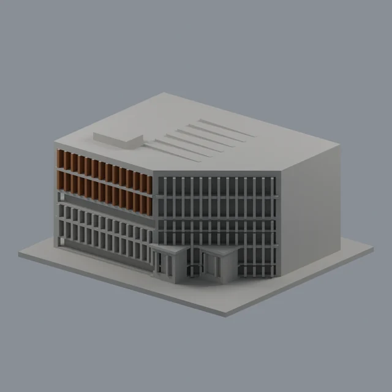
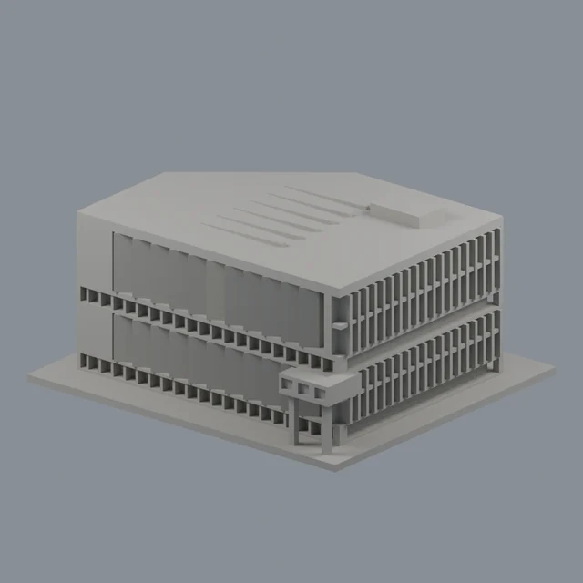
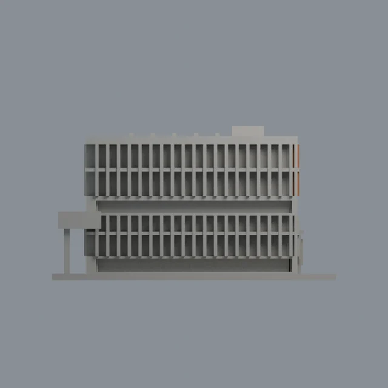
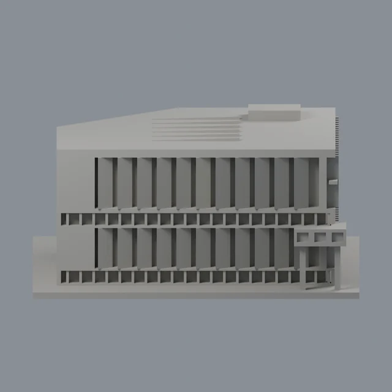
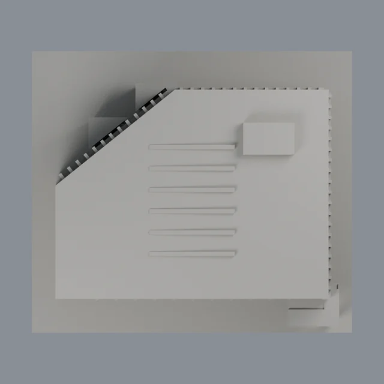

# 政大達賢圖書館主棟｜現行模型 WebP 預覽

五圖皆以現行三材質模型重新渲染核對，不使用舊單色版。點圖可開啟無損原尺寸 WebP。

| 模型預覽 | 模型預覽 | 模型預覽 |
| :---: | :---: | :---: |
|  湖側與遮陽板 |  入口側 |  右立面 |
|  正立面 |  頂視 |  |

[模型說明](../README.md) · [限域材質與來源界線](../appearance/README.md) · [表面色 3MF](../appearance/nccu-seetoo-appearance.3mf) · [可編輯 Blender](../appearance/scene.blend) · [原 STL](../model.stl) · [展示校驗](SHA256SUMS) · [渲染對照](render-proof.json)

只更新展示，原始 PNG、幾何、色材、歷史版本與工程 QA 都保留。保留既有湖側上層直段遮陽板與入口上層斜屏風限域配色。其他側面、下層、屋頂及基座不新增配色；中性不代表實物為灰色。不宣稱現況色值或實體試印。
