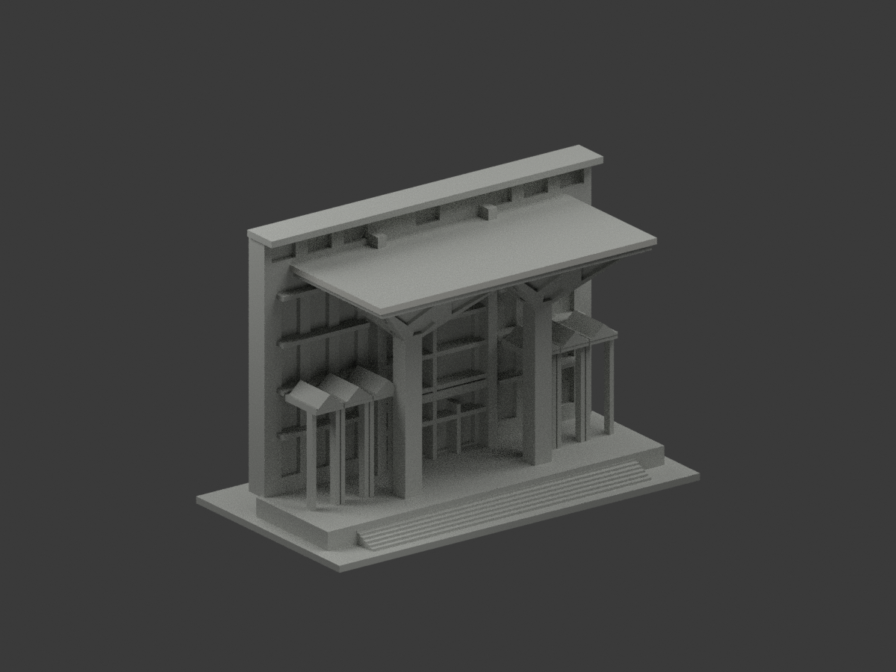
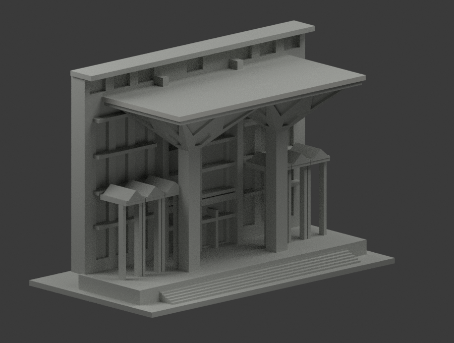
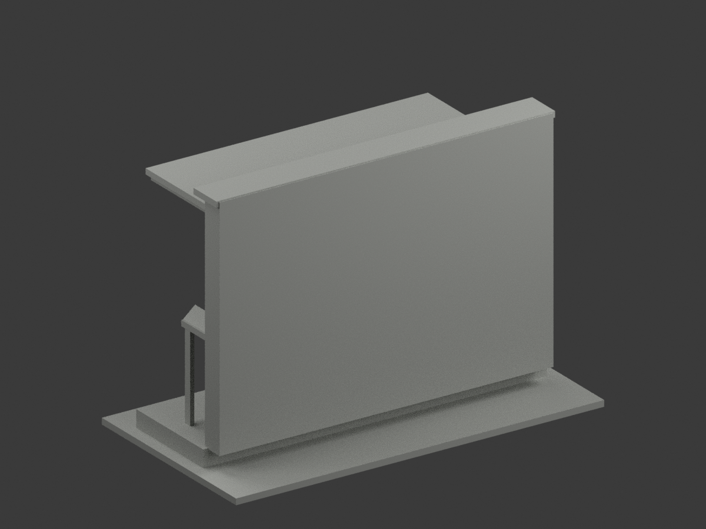
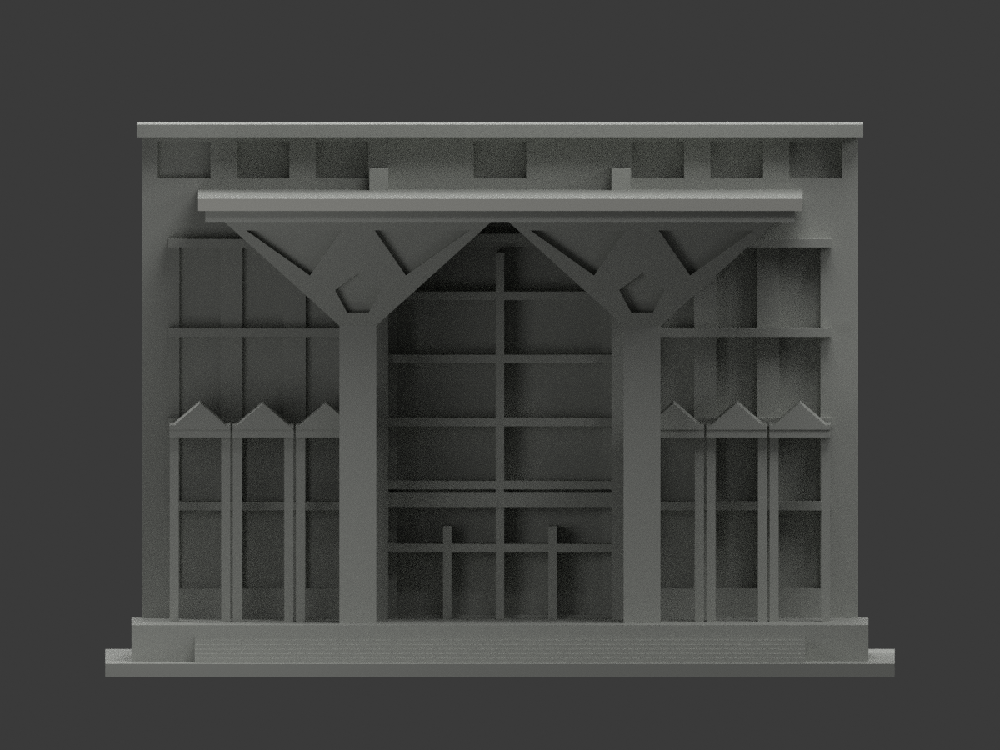
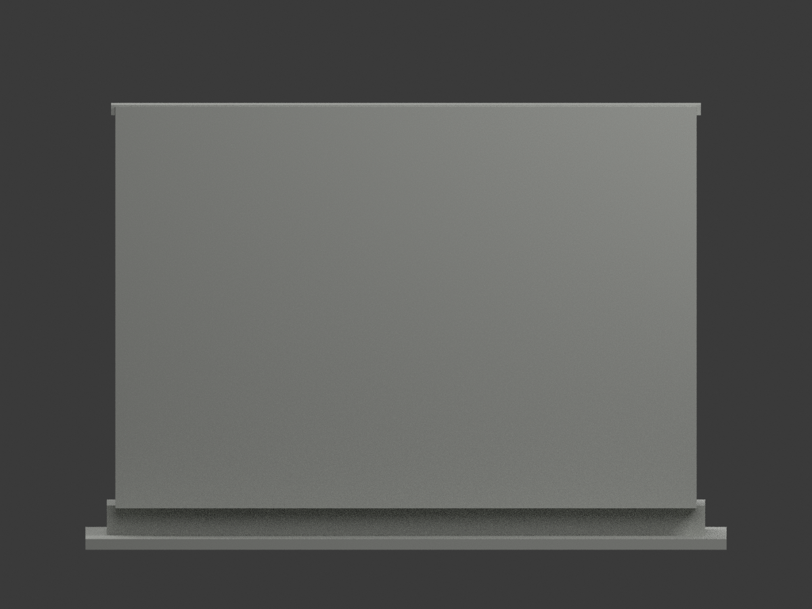
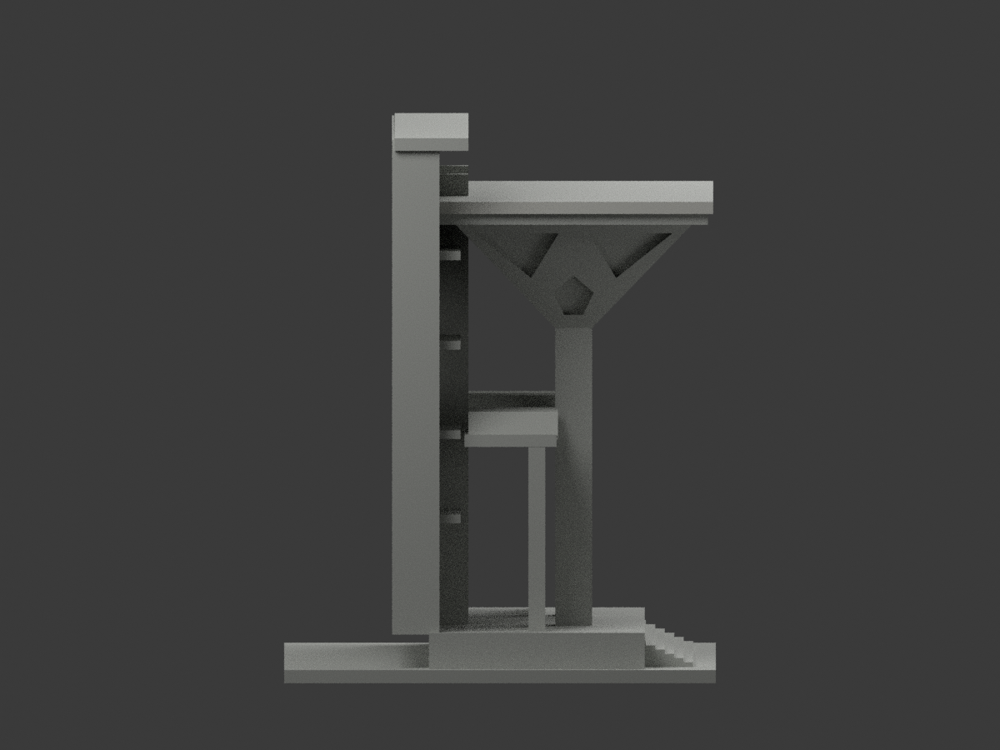
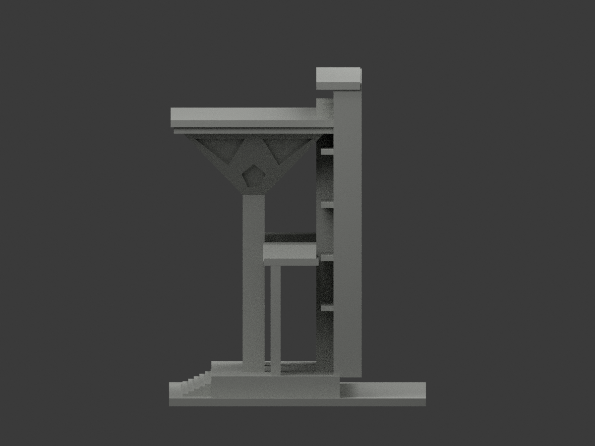
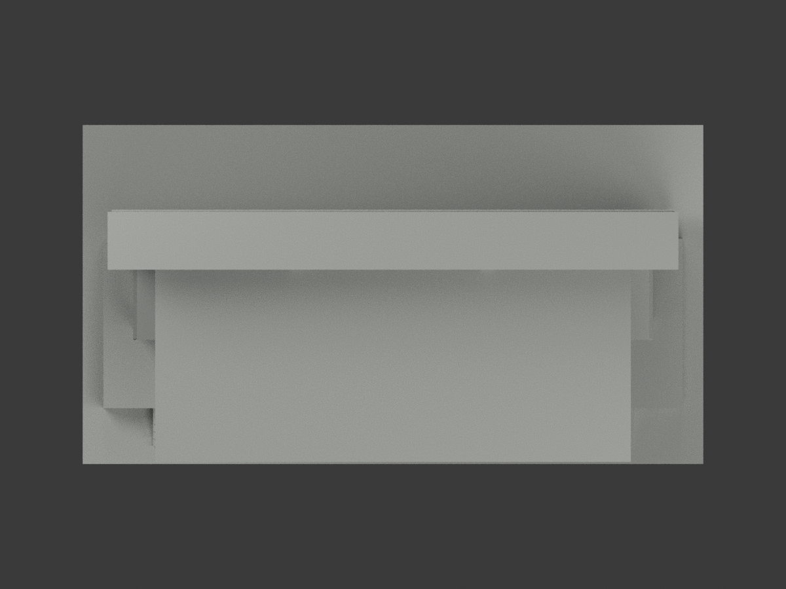

# 暨南國際大學｜圖書資訊暨多功能大樓入口柱廊段

## 模型預覽

| 模型預覽 | 模型預覽 | 模型預覽 |
| :---: | :---: | :---: |
| <br>代表視角 | <br>最新補色細部 | <br>背側斜視 |
| <br>正面 | <br>背面 | <br>西面 |
| <br>東面 | <br>頂視 | |

[現行彩色 3MF](appearance.3mf) · [現行 Blender](scene.blend) · [原幾何 STL（不含色）](model.stl) · [逐面驗證](verification.json) · [渲染證明](render-proof.json) · [SHA-256](SHA256SUMS)

只補原模型最高雨庇左側垂直外緣 2 個完整三角，沿用前緣的淺灰代理色 #CBCBC5；正面原有同色 2 面保持不變，其餘 2,332 面維持原來的未知中性材色。入口柱廊片段，不是整棟圖書館；模型比例非測繪，未試印。

[校史光廊日照實拍](https://www.lib.ncnu.edu.tw/ncnu_his/images/imageslider/lib2.jpg) 可見淺灰前緣繞到左端；受遮處只沿同一薄立帶推估材色，不從陰影或夜景採色。照片日期未知，色值非校色結果。下層邊帶、頂底面、另一側、柱頭、窗、屋頂及人工截斷背面維持原狀。未新增幾何、紋理、文字或第三方原照。全部 1,146 頂點、2,336 三角及 STL 位元不變，材色 3MF 不是切片機分色驗證。

## 固定基準與重建

現行三個模型格式可各自開啟，不需下載舊版。若要重建材色，將[基準 Blender](https://github.com/hplin50643/taiwan-buildings-3d/blob/af356113539d418144e9a229b2397482da02f2a3/%E5%9C%8B%E7%AB%8B%E6%9A%A8%E5%8D%97%E5%9C%8B%E9%9A%9B%E5%A4%A7%E5%AD%B8/%E5%9F%94%E9%87%8C%E6%A0%A1%E5%8D%80/buildings/ncnu-library-entrance-segment/scene.blend)和[基準 3MF](https://github.com/hplin50643/taiwan-buildings-3d/blob/af356113539d418144e9a229b2397482da02f2a3/%E5%9C%8B%E7%AB%8B%E6%9A%A8%E5%8D%97%E5%9C%8B%E9%9A%9B%E5%A4%A7%E5%AD%B8/%E5%9F%94%E9%87%8C%E6%A0%A1%E5%8D%80/buildings/ncnu-library-entrance-segment/appearance.3mf)放在暫存位置，由此資料夾執行：

```sh
blender -b /path/to/baseline/scene.blend -t 4 --python-exit-code 1 -P build_canopy_return.py -- /path/to/baseline/appearance.3mf /tmp/ncnu-current
```

建置工具會核對基準 SHA-256。歷史的[舊刊說明](https://github.com/hplin50643/taiwan-buildings-3d/blob/af356113539d418144e9a229b2397482da02f2a3/%E5%9C%8B%E7%AB%8B%E6%9A%A8%E5%8D%97%E5%9C%8B%E9%9A%9B%E5%A4%A7%E5%AD%B8/%E5%9F%94%E9%87%8C%E6%A0%A1%E5%8D%80/buildings/ncnu-library-entrance-segment/README.md)、[前版校驗](https://github.com/hplin50643/taiwan-buildings-3d/blob/af356113539d418144e9a229b2397482da02f2a3/%E5%9C%8B%E7%AB%8B%E6%9A%A8%E5%8D%97%E5%9C%8B%E9%9A%9B%E5%A4%A7%E5%AD%B8/%E5%9F%94%E9%87%8C%E6%A0%A1%E5%8D%80/buildings/ncnu-library-entrance-segment/SHA256SUMS)、[原深度展示](https://github.com/hplin50643/taiwan-buildings-3d/blob/af356113539d418144e9a229b2397482da02f2a3/%E5%9C%8B%E7%AB%8B%E6%9A%A8%E5%8D%97%E5%9C%8B%E9%9A%9B%E5%A4%A7%E5%AD%B8/%E5%9F%94%E9%87%8C%E6%A0%A1%E5%8D%80/buildings/ncnu-library-entrance-segment/ORIGINAL-DEPTH-PREVIEW-README.md)、[原補色驗證](https://github.com/hplin50643/taiwan-buildings-3d/blob/af356113539d418144e9a229b2397482da02f2a3/%E5%9C%8B%E7%AB%8B%E6%9A%A8%E5%8D%97%E5%9C%8B%E9%9A%9B%E5%A4%A7%E5%AD%B8/%E5%9F%94%E9%87%8C%E6%A0%A1%E5%8D%80/buildings/ncnu-library-entrance-segment/appearance-canopy-return/README.md)均原樣留在固定提交，不是現行模型或圖冊。未重跑早期製造包的整套 QA；[原 STL 驗證](validation.json)及[原截層查核](contour-validity-check.json)只適用於相同 STL。
