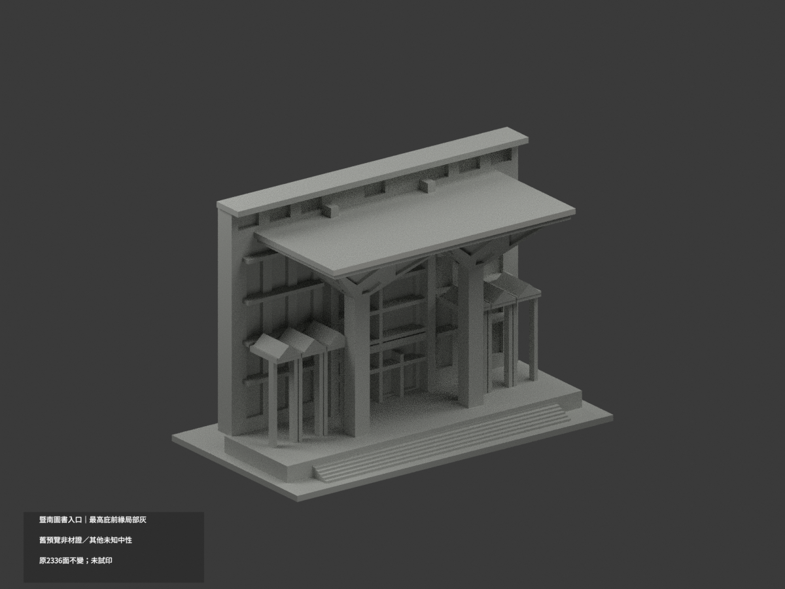
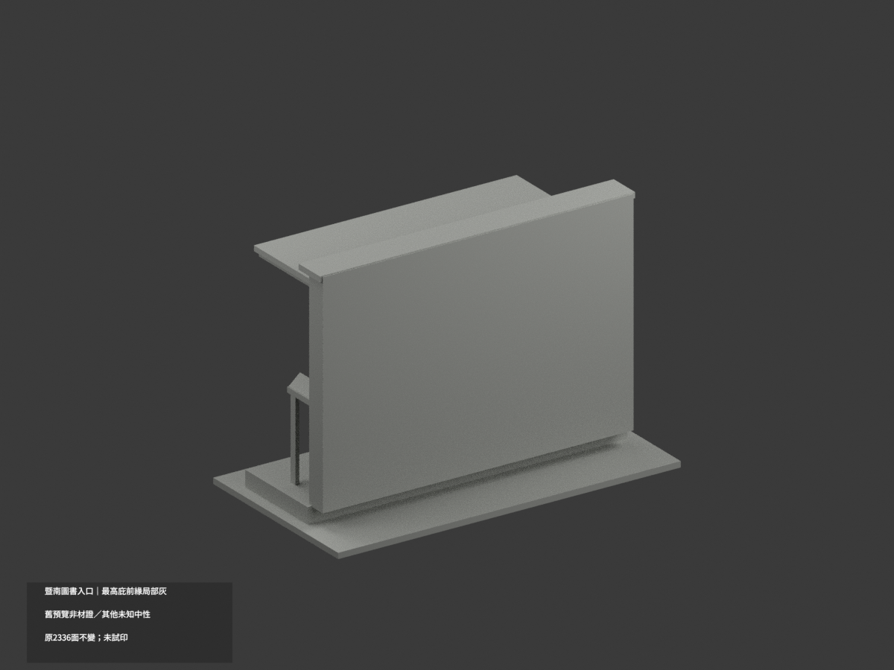
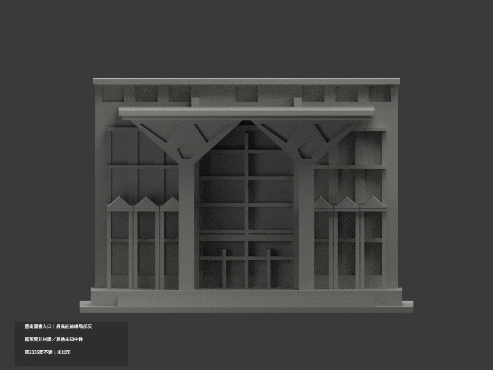
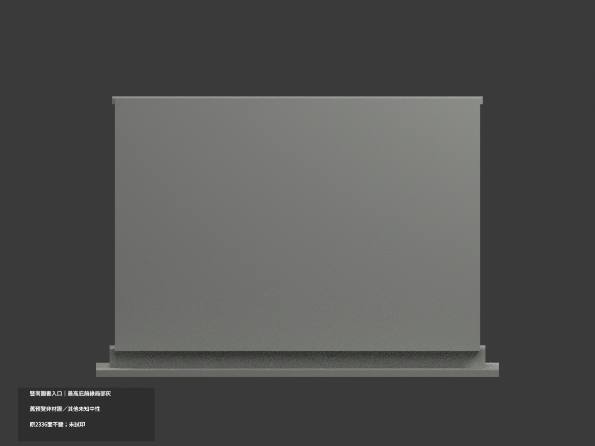
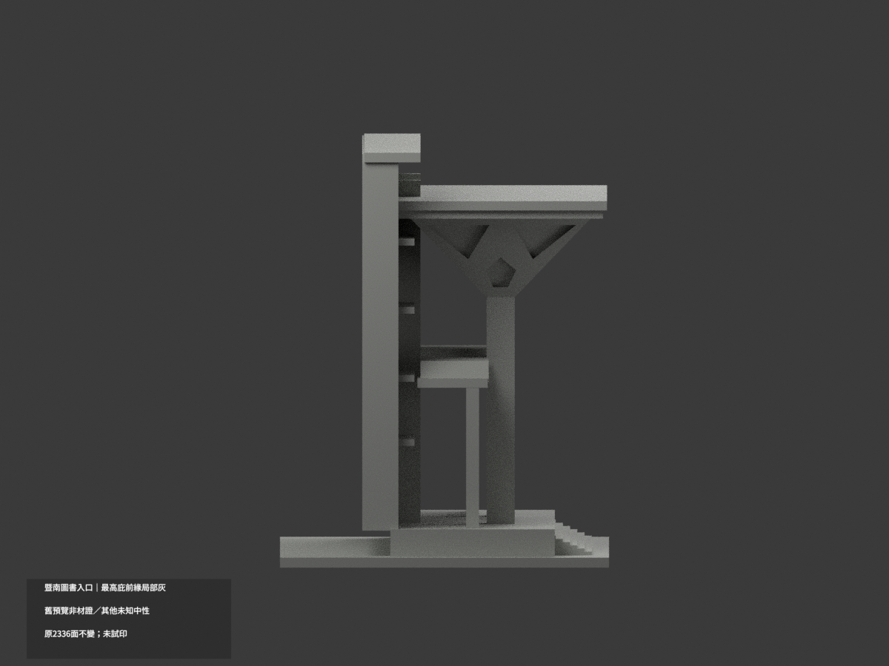
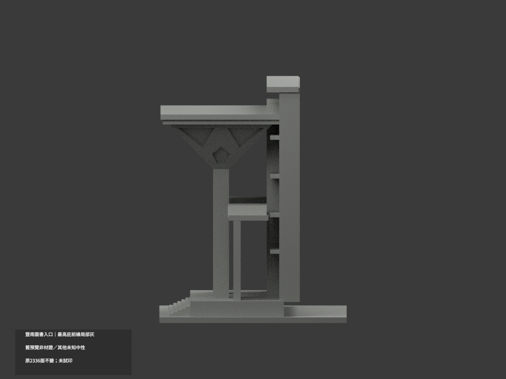
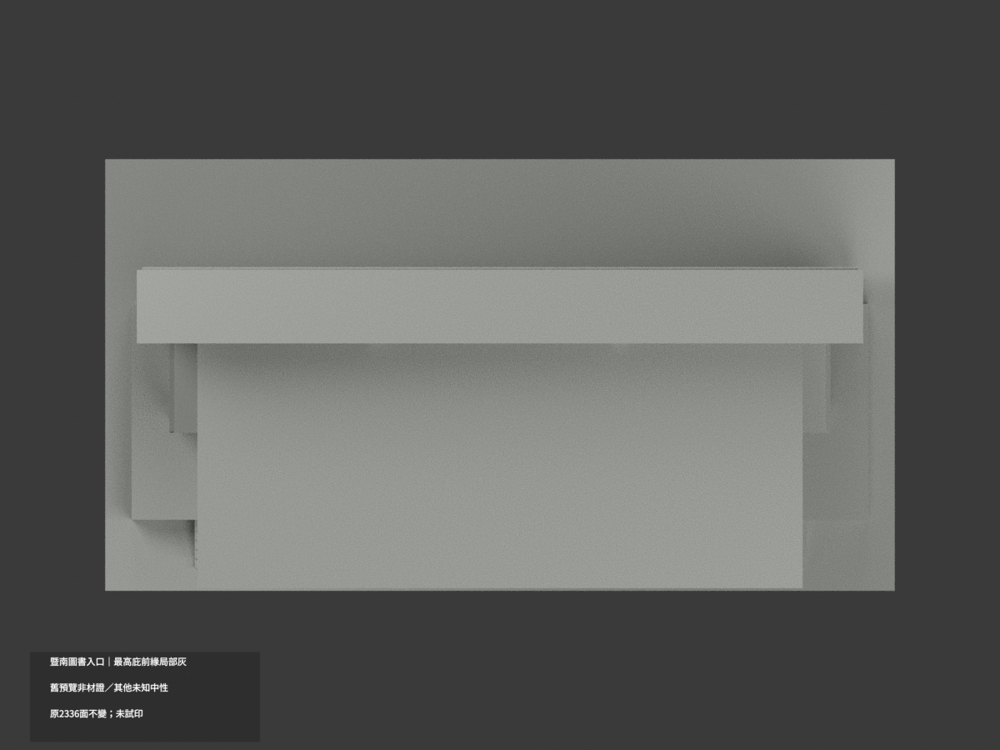
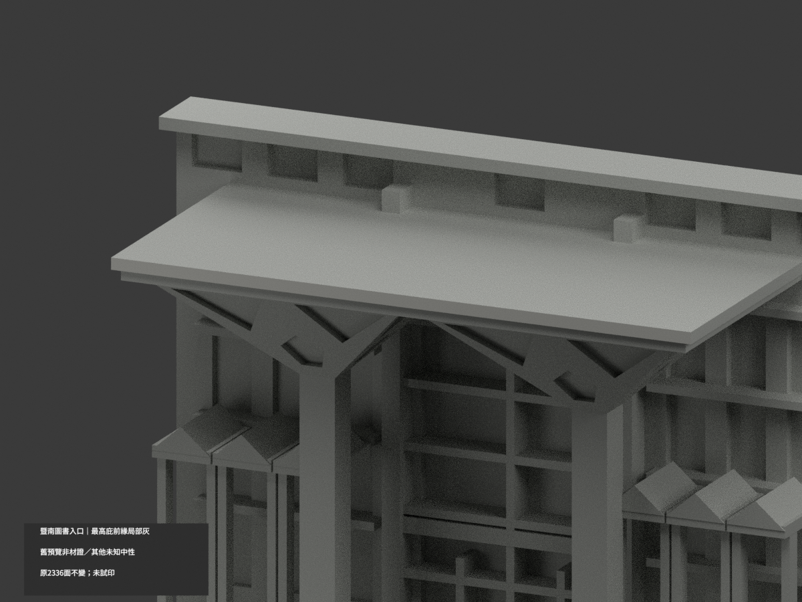
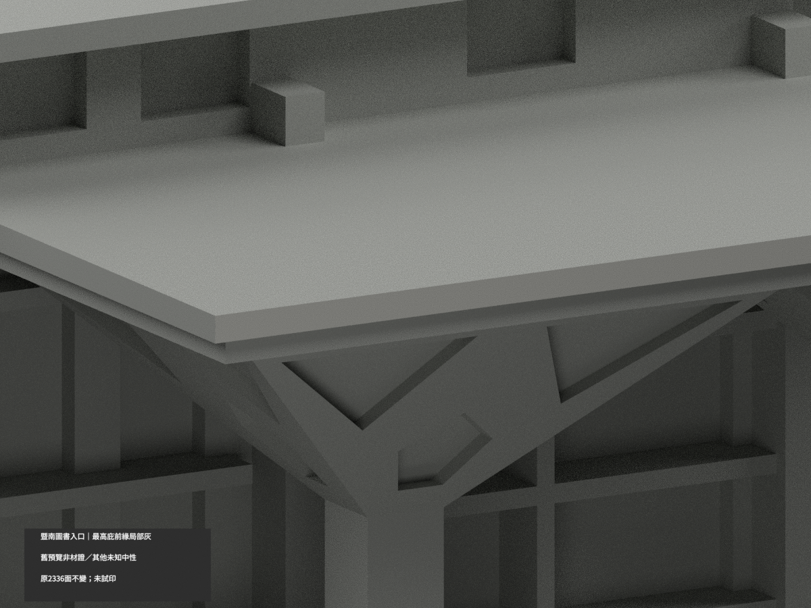
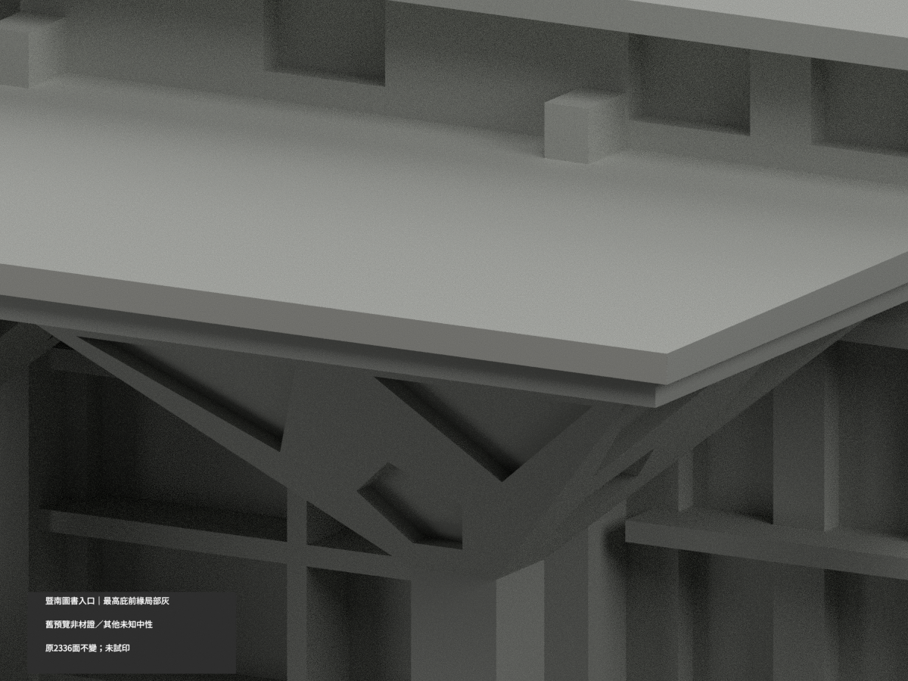

# 暨南圖書入口柱廊段｜最高雨庇前緣局部淺灰

**既有預覽分類色不是實景材質證；其餘未知域尚未完成分色。** partial_color_incomplete=true、fully_colored_exterior=false。僅最高雨庇前緣完整2面名義淺灰，本件不是新發現單色模型，也非全館完整補色。

| 總覽 | 背側 | 正面 |
|---|---|---|
||||
||||
||||
||||

## 材色範圍
同 ncnu-library-entrance-segment 原項目，same-item、count_delta=0。國立暨南國際大學埔里校區圖書資訊暨多功能大樓入口雙柱、柱頭、雨庇及鄰接片段，不是整館；平背/截高牆不是實測完整背立面。原2336三角及STL/build_model.py字節不變，20原件無OBJ。
- 整y=-40.5最高庇前plane恰2三角、單完整連通矩形x±57.5,z88.6..90.9。全3頂點有限域等於整無限面，保Boolean原界，不裁色。
- 其餘2334面中性，包括舊深凹材：下庇陰影窄帶、混石材/金屬套柱、柱頭玻璃框/燈具、金字牌、窗門反光細框、階踏對比、屋頂側底/背截面。

## 既有預覽轉換
原scene已有 Warm stone preview only 與 Recess depth emphasis - preview color only 兩種展示材，不能稱原模型真單色，也不能把深凹分類當實景黑玻璃。此版本僅把有據2面淺灰，其餘未知中性，不增加棟數或改幾何。原scene完整另存 ORIGINAL-DEPTH-PREVIEW-scene.blend，原render_preview.py/previews與原README歷史保留；新scene/新十圖是本次來源限定版本。兩版本不是互相證色，舊檔不刪。

## 來源與日期
親看兩官日照/入口近照，最高前緣由完整遠照證，近照截頂僅支持身份與排除。照片日期未獨立確認，頁/網址時間非capture，不稱2026現況，不用夜燈取色。原照私人保存、不公開、不作紋理、不建人物；未確認CC或再散布授權，不保證商用。

## 格式與列印
[原STL](model.stl) · [逐面材色3MF](appearance.3mf) · [新Blender](scene.blend)
150mm底座為原示意尺寸非測量比例。物件明名 NCNU Library Entrance Segment partial color，獨立核真slug/館名。STL無色，3MF/Blender逐面分材，不是兩色或四色耗材切片驗證，未實際列印。

## 重建與 QA
原build_model.py → colorize_model.py → export_appearance.py → validate_color.py；Blender render_color.py／verify_color_scene.py。完整隔離Shapely2.1.2精確原build＋color重建、原bytes/全三角multiset、共面均一、閉合正體積、3MF面材、scene重開、十圖1200×900與hash。原README/previews/validation保留歷史，不冒新QA，不刪檔。

## English scope
Partial only:2 complete highest canopy front fascia triangles pale gray;2334 neutral. Existing two preview/depth materials are not actual-color certification or a newly discovered monochrome item. Former dark recess classifications become unknown-neutral in the new source-bounded variant. Original scene saved unchanged as ORIGINAL-DEPTH-PREVIEW-scene.blend; original renderer/previews/README retained. Original2336 triangles and20 immutable files unchanged;no originalOBJ. Entrance segment not whole library/surveyed back. Capture dates unknown,not2026. Sameitem/count0/no geometrychanges/no filament test.
