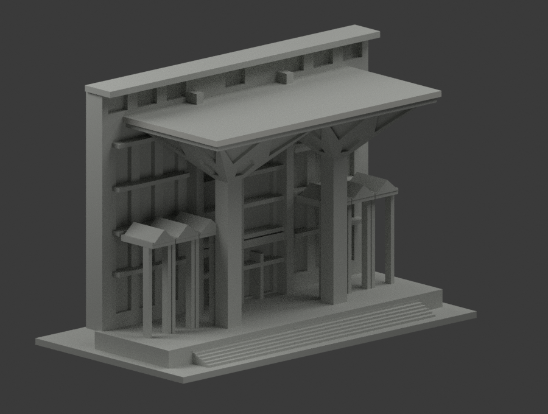

# 暨南國際大學圖資大樓｜入口主雨庇左側外緣補色



[下載彩色 3MF](canopy-return.3mf) · [Blender 場景](canopy-return.blend) · [原模型與代表圖](../README.md) · [逐面核對](verification.json) · [檔案校驗碼](SHA256SUMS)

僅補原模型入口雙層雨庇上層、正面看過去的左側垂直外緣（模型 −X）。兩個原有三角面構成該側完整矩形，沿用原正面淺灰（#CBCBC5）。[校史光廊日照實拍](https://www.lib.ncnu.edu.tw/ncnu_his/images/imageslider/lib2.jpg) 顯示上緣轉角及左側薄立帶與正面相連。靠內端與受遮光處以同一構件的連續材色推定，不從陰影或夜間照明取色。拍攝日期未確認，HEX 不是校準色卡，也不代表現況。

其餘 2,334 個原有面、原兩種材色、幾何、原 STL、代表圖及套件數均不變。雨庇頂面、底面、下層邊帶、另一側、三角折面柱頭、窗與人工截斷面仍維持原狀。不新增窗、文字、貼圖或幾何。這只是圖資大樓入口段，不是整館；參考照未隨包公開，未試印或作切片驗證。

重建（Blender 4.3.2；上層為兩個原始輸入，請另用獨立輸出目錄）：

```sh
blender -b ../scene.blend -t 4 --python-exit-code 1 -P build_canopy_return.py -- ../appearance.3mf ./build-output
```

程式輸出模型、逐面核對與兩張暫用 PNG。公開預覽由 `_render_qa/candidate.png` 以 Pillow `lossless=True, method=6, exact=True` 轉成無失真 WebP；不發布暫用檔。
