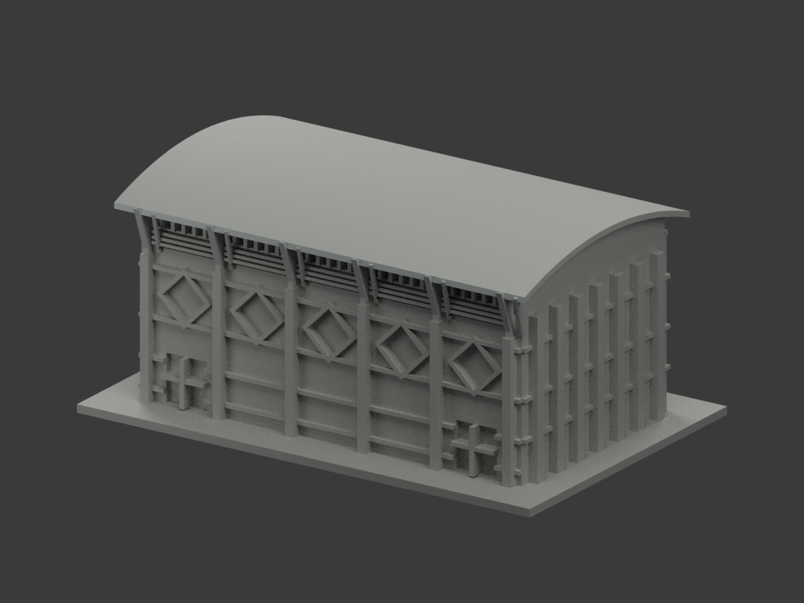
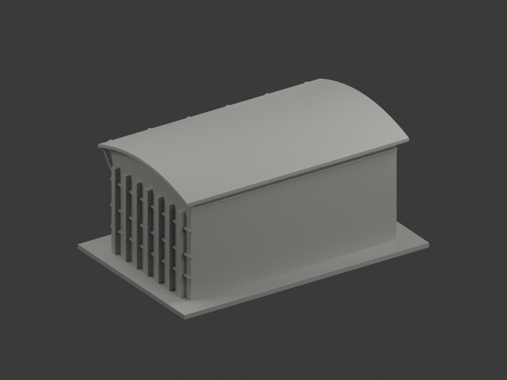
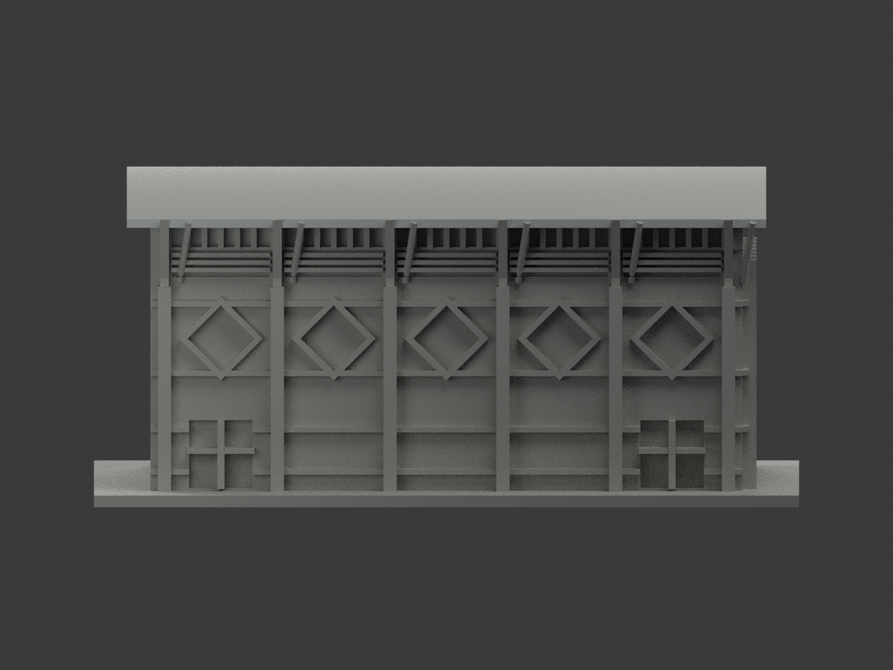
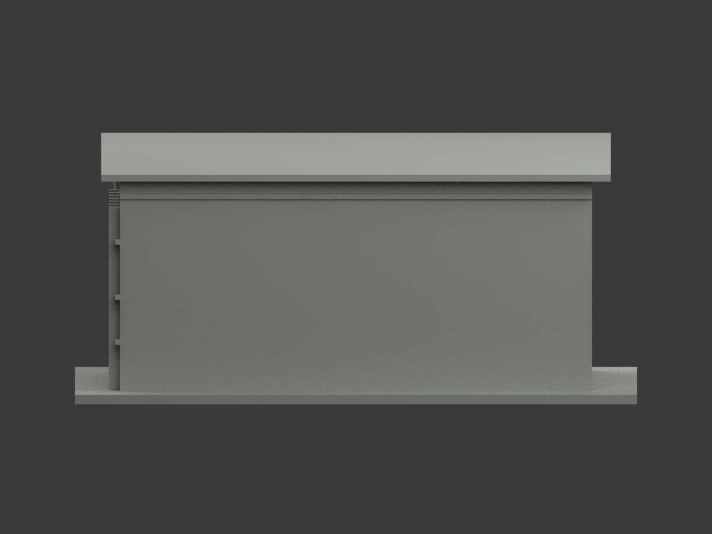
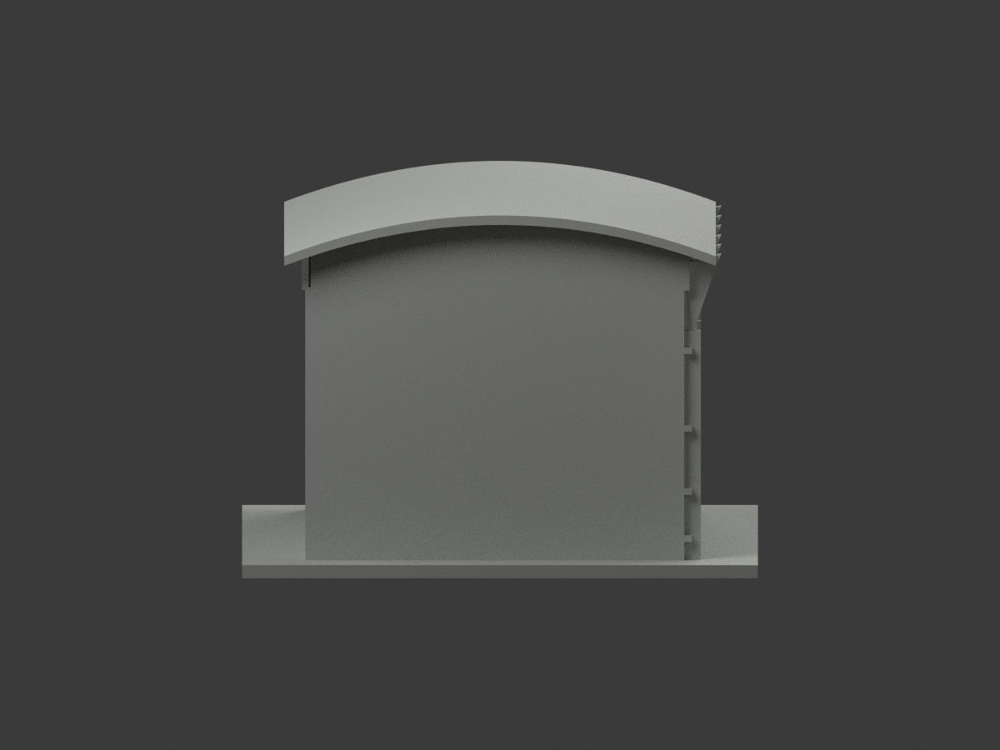
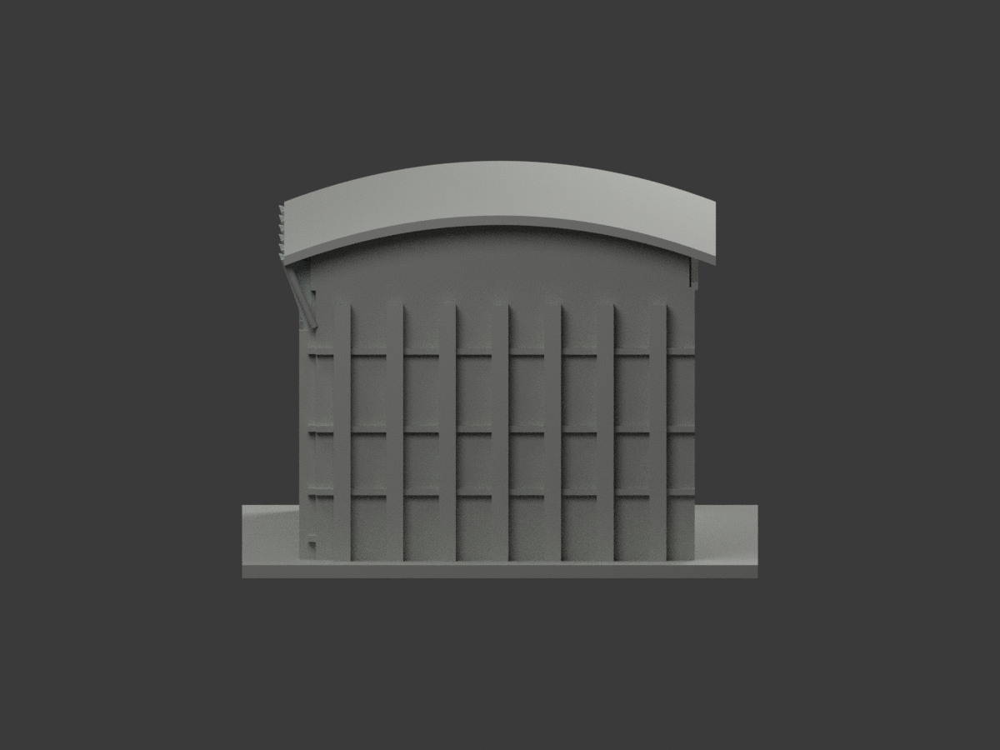
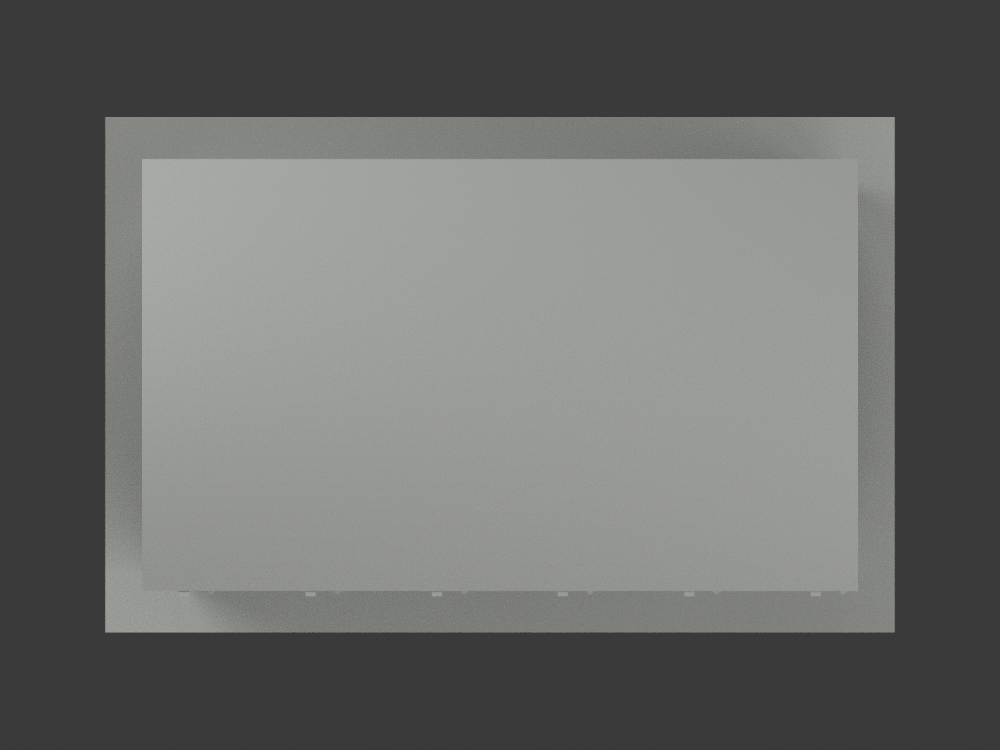
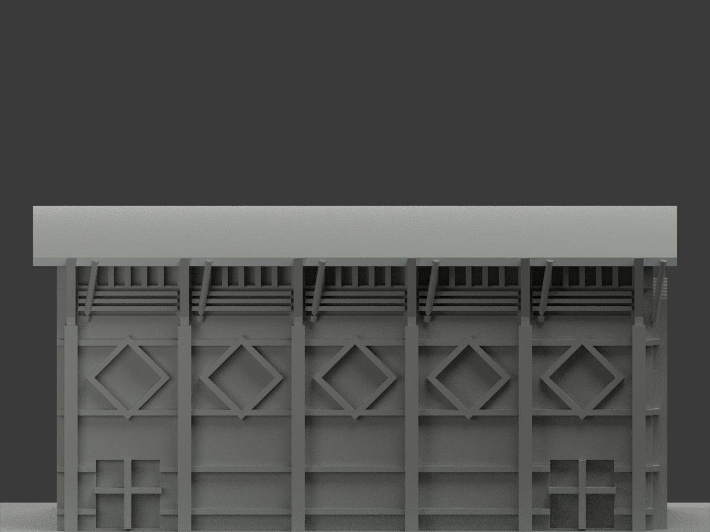
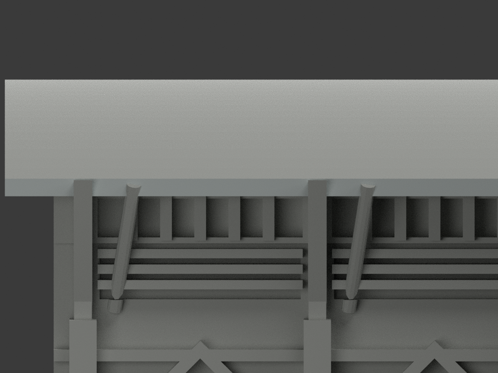
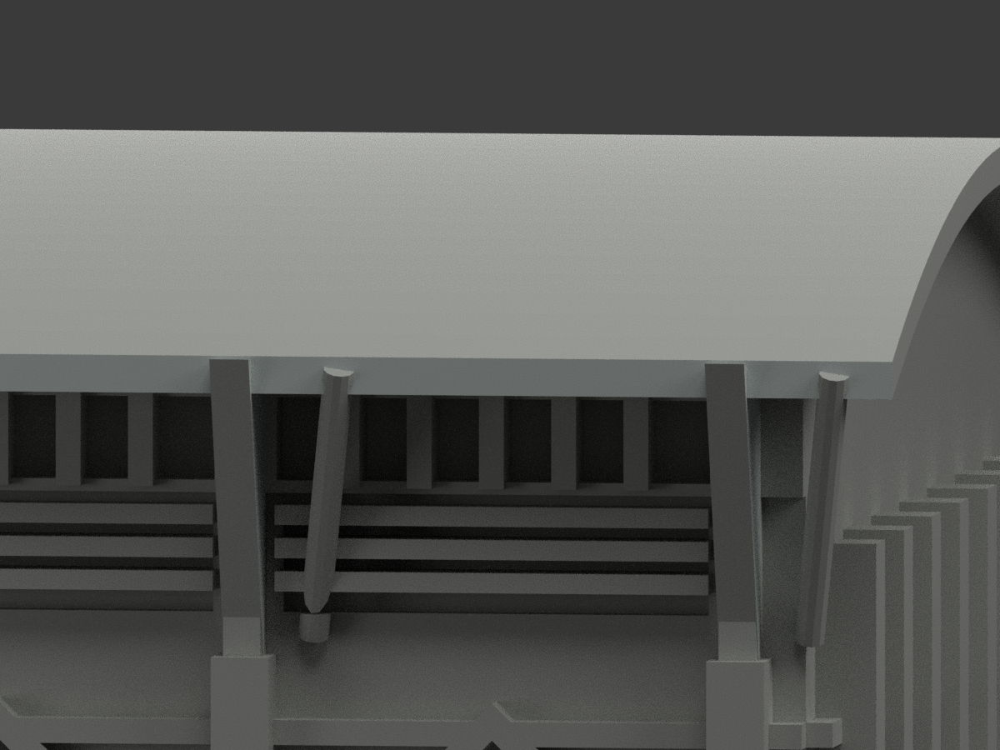

# 暨南大學體育館球類館｜六三角撐可見平側局部淺灰

局部配色未完成。保留原前屋緣62面，新增六三角撐 +X 可見平側42面，共104面配色、4622面未知中性，4726原三角不變。無新增幾何、切面或材界。

## 來源與推定
實看設計單位右斜照片07與原像素裁切，可見六大三角撐平側屬淡白／淺灰色族；01–06為此次另外取得的同作者外觀脈絡，07是原來源再審而非新拍攝。色值沿用原名義淺灰 #C7CECC，非校準或逐像素測色，陰影不當黑材。

原模型三角厚板為實景漸變、帶折邊鋼撐的簡化代理，不能以配色追認接合、厚度或每個頂點位置。只映射可見側完整原平面，不對反側、厚邊或圓拉桿作連續色推定。

六原板中心x=-60,-36,-12,12,36,60；只取 x=中心+0.95 的 +X 平側，所有頂點須在原 yz 三角(-36.5,45.5)、(-42,60.7)、(-35,59)內。每板7面，六完整共面域42面，無混域。布林交界原貌保留，原62屋緣面及其餘指派完全不動。

整屋頂、底腹、反側、厚邊、拉桿、磚灰混牆、反光混框玻璃、後方及基地保持中性。中性不等於實景灰，也不是實際材料邊界。僅五菱窗球類館，不含泳池翼、健身水療或連接入口廳。原屋頂不含後來太陽能板，照片日期未知、網址年月非拍攝日，不宣稱2026現況。

## 十視角
|前斜|後斜|正面|
|---|---|---|
||||
||||
||||
||||

## QA與歷史
本次GUSSET-SIDE-SOURCE-QA、COLOR-ASSIGNMENT、COLOR-FORMAT-GEOMETRY、SCENE及GUSSET-SIDE-SCENE-QA適用候選。原文件與QA原字節保存於qa/gusset-side-previous；原FREEZE及舊獨審僅對舊版有效，不作本次放行。原兩種深度預覽是歷史展示慣例，不宣稱原模型原本無材質或將本次另計建物。原STL/build不變，STL本身無色；未實體試印或驗多料切片。原照片私人研究不公開或貼圖，不推定商用授權。獨立最終審核及凍結另行完成，未發布。

## English limitations
Retain62 fascia faces; add42 original +X planar gusset proxy faces, seven per plate across six complete domains. Total104 colored,4622 neutral,4726 triangles unchanged. Visible pale plate sides supported by architect07, re-examined at native pixels. Detailed steelwork remains simplified; not a joint/depth survey. Reverse sides, thickness, rods, whole underside, mixed walls and glazing unchanged. Nominal existing lightgray not calibrated. Only ball-hall volume; roof lacks later solar panels, not current2026 condition. References private; no print/material assurance.
