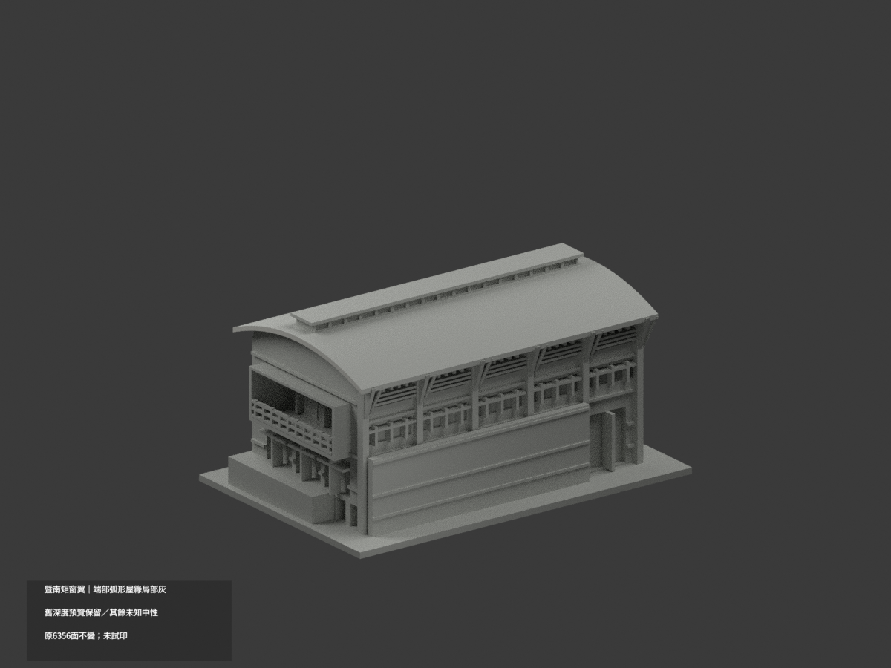
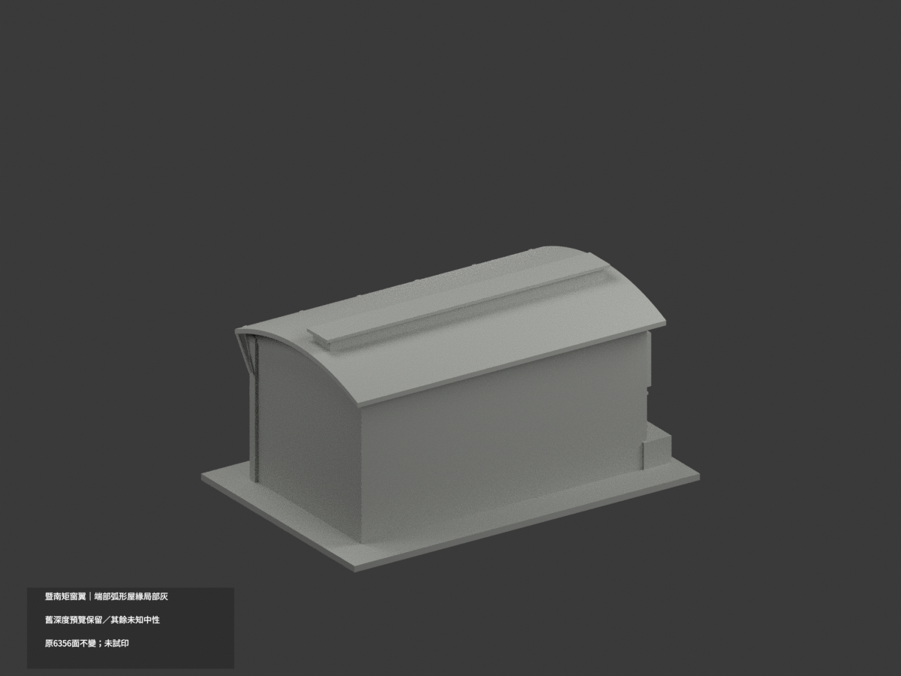
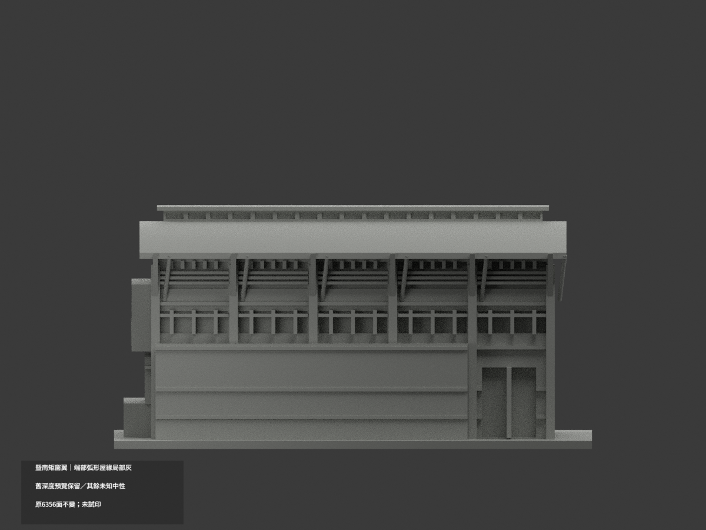
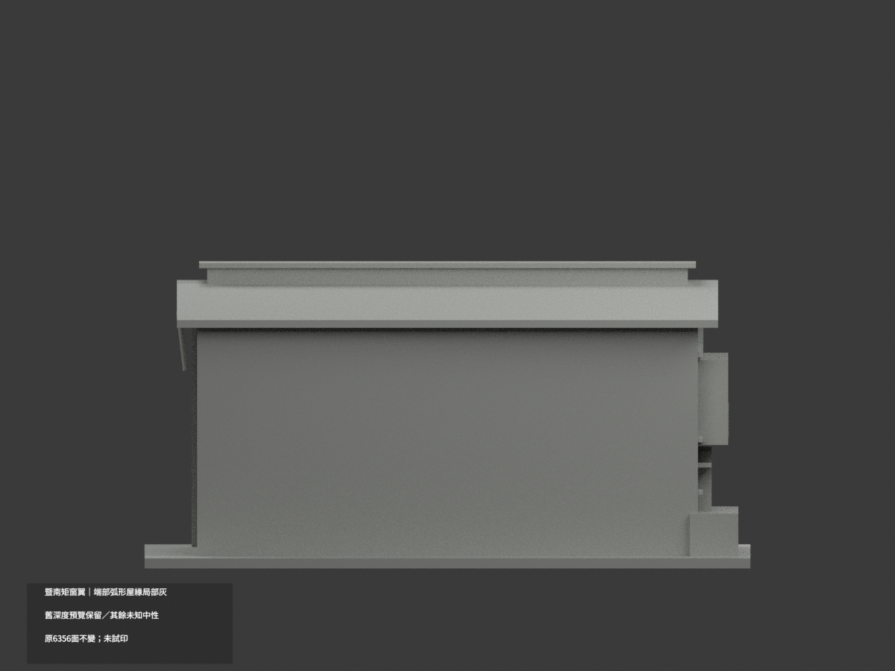
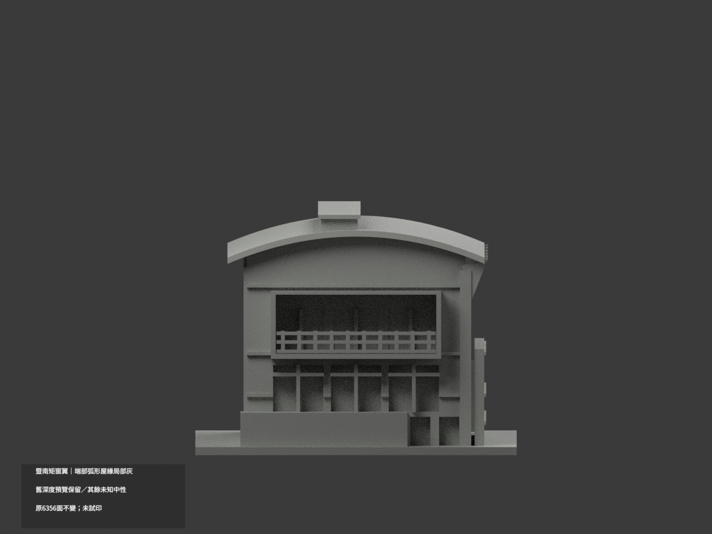
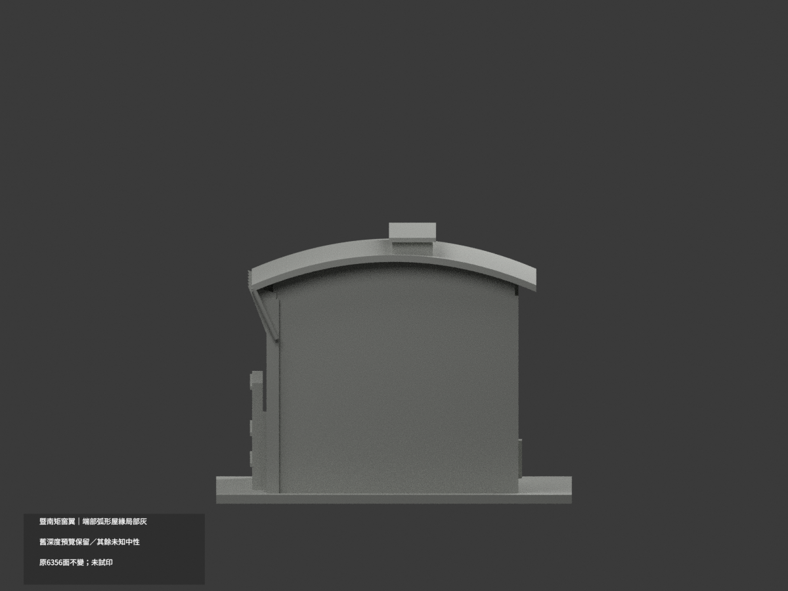
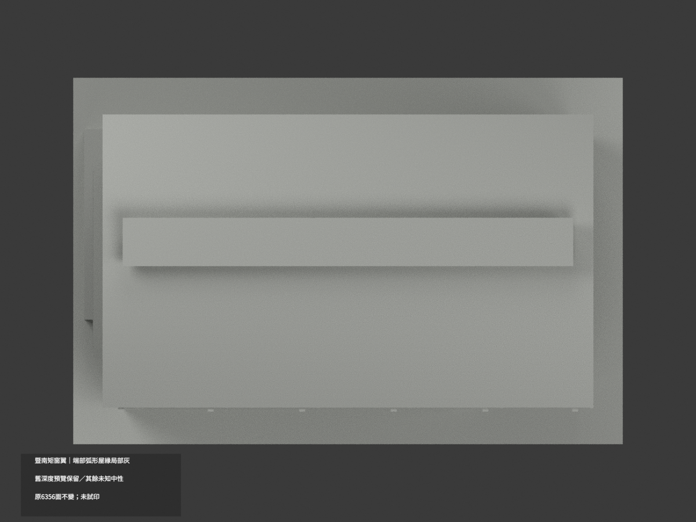
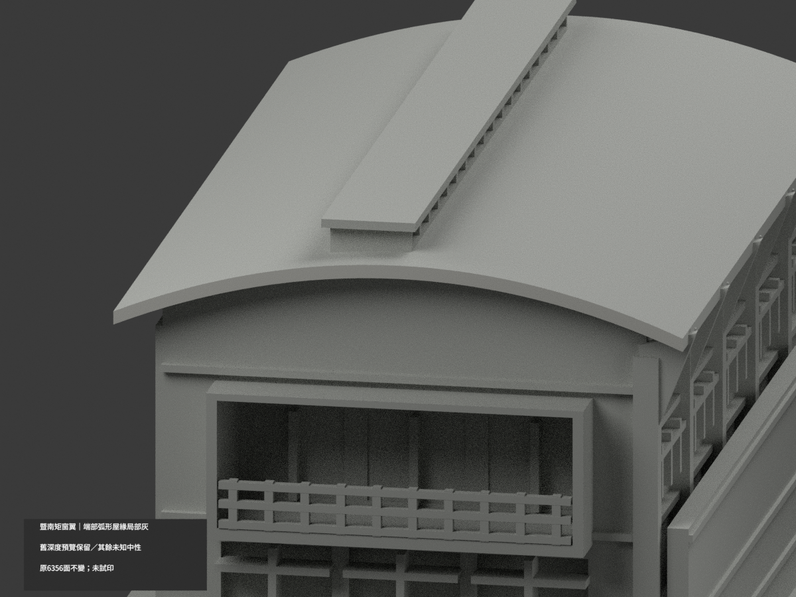
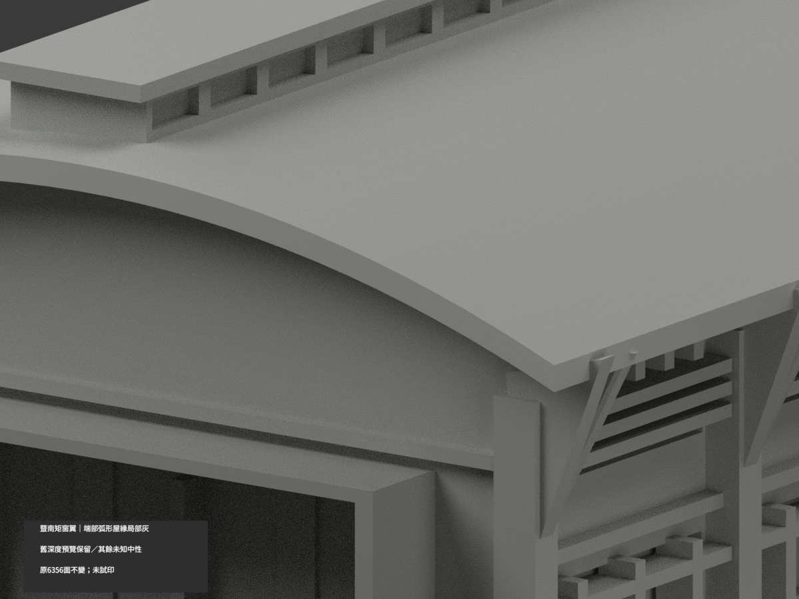
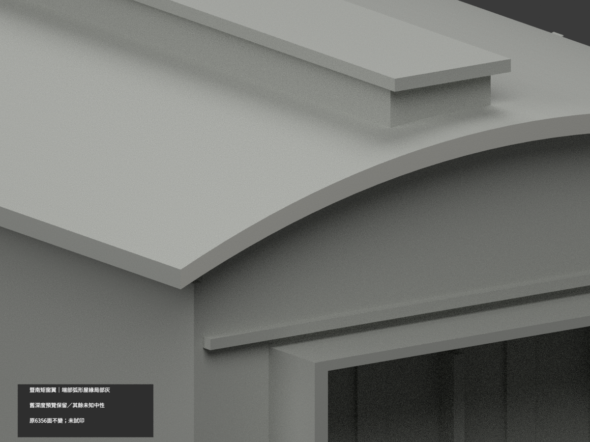

# 暨南體健中心矩窗翼端側片段｜端部弧形屋緣局部淺灰

**既有深度展示色不是實景材質證；其餘未知域尚未完成分色。** partial_color_incomplete=true、fully_colored_exterior=false。僅左端完整弧形屋緣64三角淺灰，不是新發現單色模型，也非全體健中心補色完成。

| 總覽 | 背側 | 正面 |
|---|---|---|
||||
||||
||||
||||

## 材色範圍
同 ncnu-swimming-wing-segment 原項目，國立暨南國際大學埔里校區體育健康中心矩窗翼長側及陽台端片段，不是完整泳館、SPA/室內邊界或全體健中心。same-item、count_delta=0，原6356三角/STL/build_model.py及20原件字節不變，immutable無OBJ，不新增。
- 完整x=-67左端plane64一個連通域；原32段piecewise profile y=-40..40，top樣點61.2+8.5*(1-(y/40)^2)，下緣top-1.9。全3頂點plane/有限插值範圍1e-5核，infiniteplane等於finite，不用normal漏面、不補原端口。
- 其他6292面中性：長前緣右端來源裁切不染；屋上/底/反端、監測窗屋突、混磚灰陽台、字牌布條屏牆、窗門框反光、地面及後/連接切面皆不擴色。

## 既有預覽轉換
原scene兩個depth-preview展示材不能當真實材料色，也不是真單色。新來源限定版本僅64有據面，原深凹黑色分類改未知中性，不是玻璃證色。原scene與README公開另存 ORIGINAL-SOURCE-GAP-scene.blend／ORIGINAL-SOURCE-GAP-README.md，原render_preview.py/previews保留原bytes；新scene/十圖另表本次範圍，全部歷史不刪。

## 來源與日期
親看官方sport-l實照與建築師architect04日照。官方EXIF2012-07-03及修改2013只是元資料，拍攝時鐘未獨立確認；建築師網址2024/08是儲存路徑非capture，2010/2011竣工說法未解不當照片日期，不稱2026現況。原照片私存、不公開不貼圖、不建人，不保證商用/未確認CC。

## 格式與重建
[原STL](model.stl) · [逐面材色3MF](appearance.3mf) · [新Blender](scene.blend)
原150mm底座是示意非測量比例。物件 NCNU Swimming Wing Segment partial color。STL無色；逐面材色3MF/scene非兩色或四色耗材切片驗證，未試印。原build_model.py→colorize_model.py→export_appearance.py→validate_color.py；render_color.py/verify_color_scene.py。隔離Shapely2.1.2原build+color精確重建、全三角multiset/共面均一/原bytes/3MF/scene重開/十圖1200×900/hash，舊QA不冒新驗證。

## English scope
Partial source-gap transition, not a monochrome discovery:64 complete left curved roof-end triangles pale gray;6292 unknown neutral including former depth-only recesses. Original6356 triangles and20 immutable files unchanged;no originalOBJ. Original scene/README aliases and renderer/previews retained. Rectangular-window wing exterior segment,not whole swimming hall or sports center. EXIF2012 metadata unverified,URL2024 not capture,not2026. Sameitem/count0/no geometry changes/no filament test.
