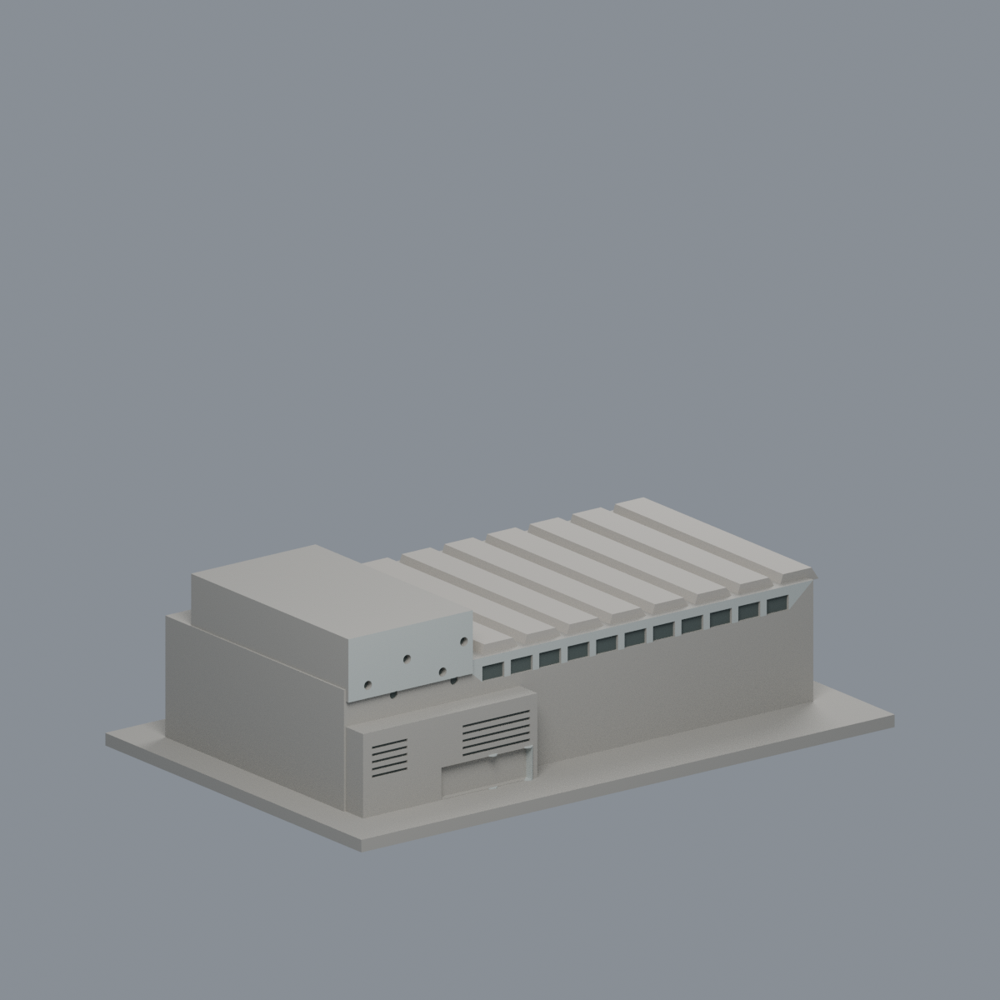
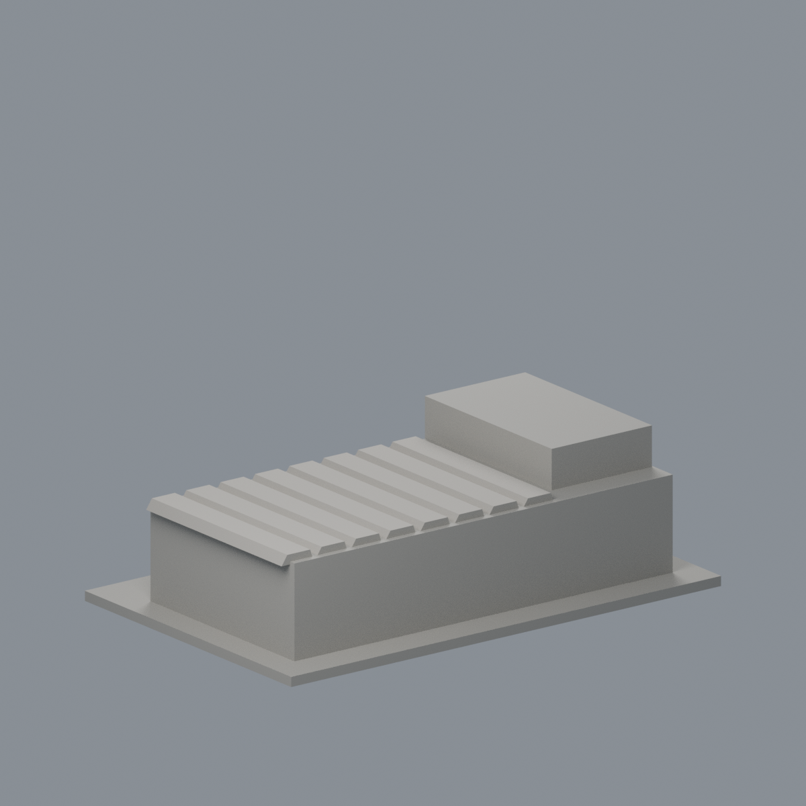
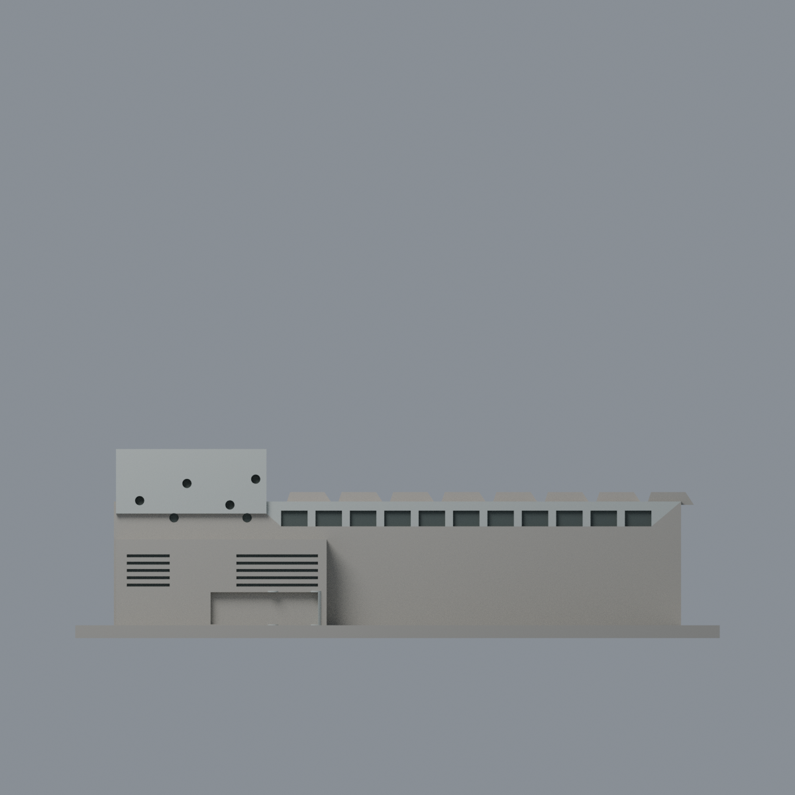
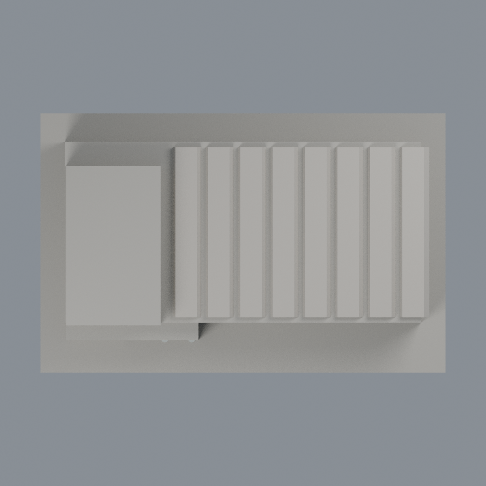

# 清華校友體育館：四材質外觀版

沿用原 **1,308 三角面／656 頂點**，不改原 STL 位元、座標、面序或幾何；這是既有模型外觀改版，不增加模型包數。

| 模型預覽 | 模型預覽 | 模型預覽 |
| :---: | :---: | :---: |
| 正面  | 未知背牆中性／屋頂同系統延伸  |  |
|  |  |  |

[表面色 3MF](nthugym-appearance.3mf) · [可編輯 Blender](scene.blend) · [材質色表](palette.json) · [逐面指派與依據](face-materials.json) · [原 STL](../model.stl)

## 來源與配色邊界

親看清華校友介紹長側照、校方圖書館校史展入口照及建築師 AMBI 斜入口照，對應原生成器與實際單色網格。[校友介紹](https://alumni.site.nthu.edu.tw/p/405-1346-115105,c12416.php?Lang=zh-tw)；[逐照來源、完整解碼與雜湊](qa/source-review.json)。圖書館入口照 EXIF 原始時間記 2013-03-12 16:44:43（相機自報、時區未核定），其餘兩照無原始拍攝欄；圖書館 2025 路徑與修改日不是拍攝日期，不稱 2026 現況。原照片不入包。

- 高入口前面銀灰金屬代理，保留素面，不加條紋、招牌或字樣。長側僅完整落在已見上部的原面採銀灰，下牆被樹遮與混合面中性。
- 原圓窗凹背與離散高窗深灰；原百葉溝槽背深色代表遮蔽而不是玻璃。不新增缺失圓窗外框或百葉微葉片。
- 原入口圓柱銀灰。下入口凸盒同一面跨實景左銀／右褐而未分界，整個混合牆保持中性，不能整塊假染褐色；入口廊背也不當全玻璃。
- 長廳重複屋頂上向面淡暖灰金屬代理，同系統有界延伸；不是 PV。高盒頂、背牆和未知端面中性。原重複屋形、圓窗排列與歷史幾何簡化照舊，不修改它們配合照片。

[原幾何與歷史來源限制](../README.zh-TW.md)

## 重建與核驗

安裝 [依賴](source/requirements.txt)，Blender 使用 4.3.2。由本資料夾上層提供原 model.stl：

1. `python appearance/source/build_appearance.py`
2. `python appearance/source/verify_exchange.py`
3. `blender -b -t 3 --python-exit-code 1 -P appearance/source/render_appearance.py`
4. `blender -b -t 3 --python-exit-code 1 -P appearance/source/verify_scene.py`

[獨立重建 ZIP](rebuild-source.zip)含原 STL、四支程式及依賴，不含第三方照片；不取代原建模腳本。[逐檔 SHA256](SHA256SUMS)

[交換／拓撲 QA](qa/exchange-validation.json)核對原座標與面序、全部面材質、單連通、有向水密邊、頂點 link 單環、正體積與零退化／重複面；lib3mf 嚴格讀取零警告，實際編輯單材質再存讀，其他材質及面指派不變。SDK 六位小數量化誤差另列。

[Blender 存讀與編輯](qa/scene-validation.json) · [渲染記錄](qa/render-manifest.json) · [獨立重建](qa/rebuild-validation.json)

## 製造限制照舊

尺寸仍為 150 × 96 × 44 mm；原 STL、建模程式、場景及歷史 QA 保留。原層檢與薄特徵檢查本次未重跑，不能由材質 QA 代替。

3MF 是同一網格的表面色，不是各材質各自封閉的分色實體、切片專案、噴頭映射或 G-code。切片 GUI、多材料路徑與實體列印未測；柱頭、屋簷、窗框及薄邊仍須評估材料、支撐及拆除風險，沒有保證可印或免支撐。

## 2026-11-14 有限外觀修正｜模型交付版

# 清華校友體育館：限定屋頂前端淺灰族近似

校方長側照 https://alumni.site.nthu.edu.tw/var/file/346/1346/img/2899/856792075.jpg 支持重複屋形前端淺灰族近似；入口照片 https://www.lib.nthu.edu.tw/events/2025/history/image/startingline_15.jpg 及建築師照片 https://ambi.com.tw/upload/image/project/large/iuZtbCtbKZpgSY9.jpg 僅補充身分/其他立面，不冒稱直接屋端證。

僅原第一至第七個屋頂梯形前端14面0→既有pale_warm_gray_roof2 #B5B0A7/.78；其餘1294面及原4材保持。原梯形被host頂31.8截去下段，每域20.02mm²；不含最後跨host端域1292、側坡、背端、底面或入口。原輪廓/八段數量/深度為粗代理，非逐片測繪，不新增板縫/圓窗框/文字或校正幾何；不能依局部淺族認證實際同材料產品或精測色。

入口照EXIF2013相機時間未核實，2025路徑非拍攝年，其餘日期未知，不稱2026現況。原混合銀褐下牆/遮蔽長側牆/未知背面及屋形簡化限制保留。原STL/OBJ、README.zh-TW.md、根hash-manifest.json及舊QA保持；OBJ僅保留、不重建。材質QA不等製造放行或切片/列印測試，原柱頭/屋簷/薄邊支撐風險保持。

模型、材質、原生視角圖與必要重建程式沿用完成候選，未改幾何或新切材界，不代表全館精確復色、現況或實體試印通過。原來源年代、工程與列印限制仍適用，舊說明與審核僅屬各自版本，本段更新上述局部範圍。

本次只公開模型、必要重建輸入／腳本、預覽與說明；完整來源、比較及研究審核不隨本批交付。根目錄PUBLIC-MODEL-SHA256SUMS僅校驗所列當前產品，舊表不驗證新版。重建ZIP只含必要重建檔；若原ZIP含README則同步本說明。歷史來源及QA連結指儲存庫既有文件，非ZIP內的新增審核附件。

現版共有 4 個顯示材質（含未知中性色）；上方舊材質總數、舊中性範圍與 QA 為歷史描述，僅由本節有限範圍更新，非分色實體或製造認證。
