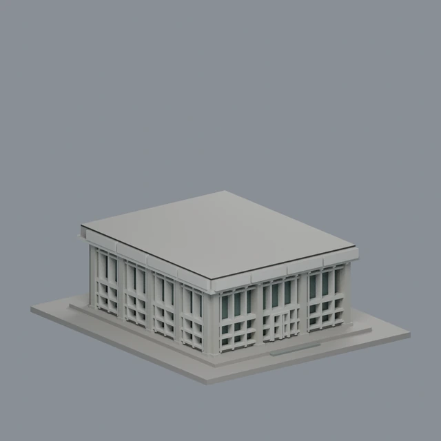
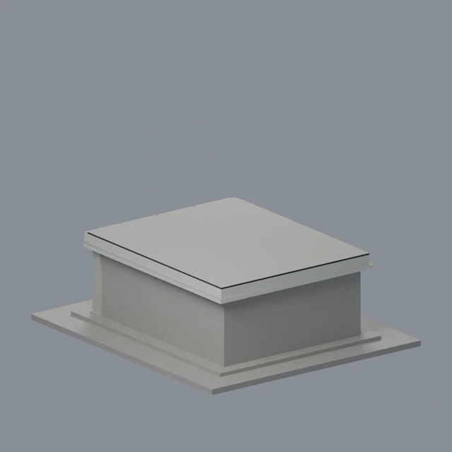
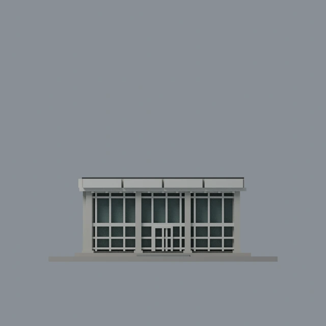
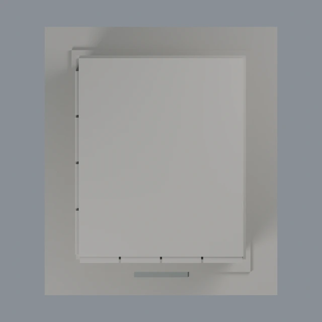

# 清華大學百齡堂前棟（2025 整備前歷史外觀）｜現行彩色展示

## 模型預覽

| 模型預覽 | 模型預覽 | 模型預覽 |
| :---: | :---: | :---: |
|  正面 |  背面 |  正立面 |
|  頂視 | | |

四張全尺寸無失真 WebP 由現行六材質 Blender 場景核對重繪，點擊縮圖可放大。本件是 2025 整備前歷史外觀，不是 2026 現況。保留既有右側與後側各兩張白色簷面與黑灰頂緣三角面，共八面同構件推估，不是側背照片實證。其他未知構件保留既有指派，未擴大補色。幾何與配色未變更。

[現行彩色 Blender](../appearance/scene.blend) · [彩色 3MF](../appearance/nthubailing-appearance.3mf) · [STL](../model.stl) · [OBJ](../model.obj) · [渲染驗證](render-proof.json) · [本頁校驗](SHA256SUMS)

[當前模型校驗](../PUBLIC-MODEL-SHA256SUMS) · [原模型與限制](../README.md) · [原外觀來源與證據](../appearance/README.md)。歷史圖、原 README 與工程資料均未改動。未實體試印。
