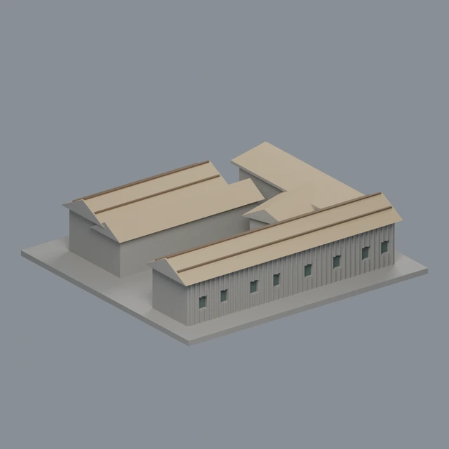
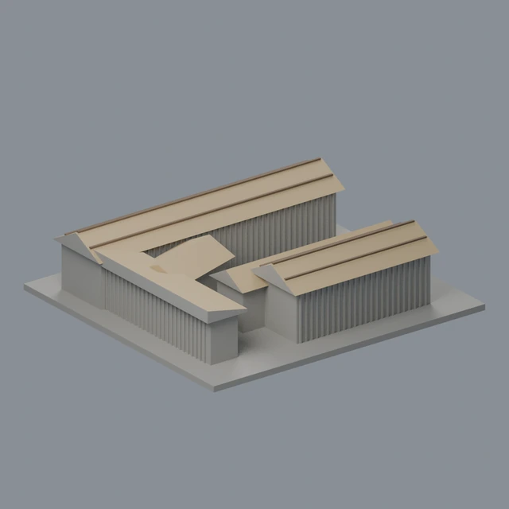
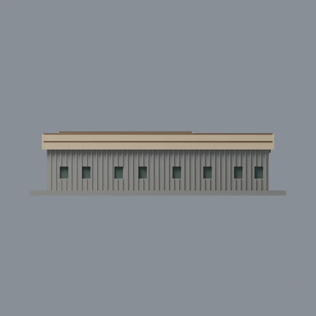
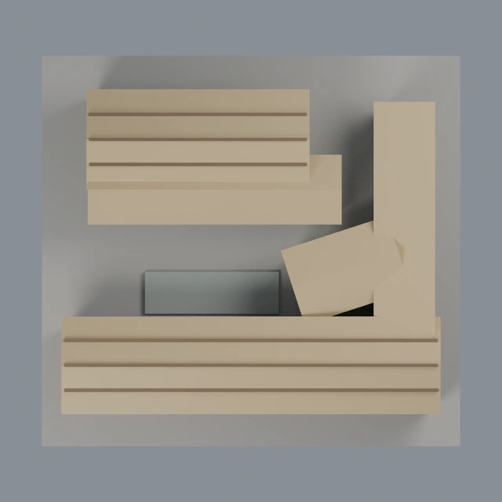

# 清華大學竹屋（原住民族科學發展中心）｜現行彩色展示

## 模型預覽

| 正面 | 背面 | 正立面 |
| :---: | :---: | :---: |
|  |  |  |
|  | | |

四張全尺寸無失真 WebP 由現行五材質 Blender 場景核對重繪，點擊縮圖可放大。保留來源支持的金色竹屋坡、棕色屋脊橫檁與可辨窗面。未分隔窗上深帶和灰色牆腳的跨界牆面、未可靠辨識的側端和後外牆仍保持中性；沒有拓展補色。幾何與配色未變更。

[現行彩色 Blender](../appearance/scene.blend) · [彩色 3MF](../appearance/nthubamboo-appearance.3mf) · [STL](../model.stl) · [OBJ](../model.obj) · [渲染驗證](render-proof.json) · [本頁校驗](SHA256SUMS)

[原模型與限制](../README.md) · [原外觀來源與證據](../appearance/README.md)。歷史圖、原 README 與工程資料均未改動。未實體試印。
