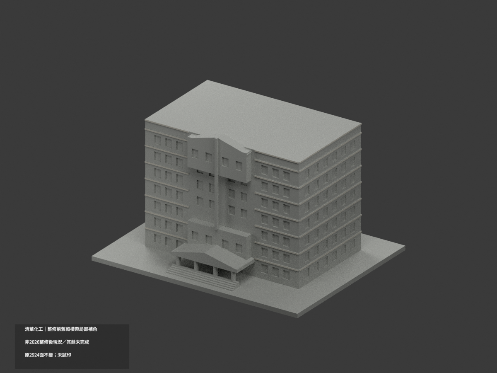
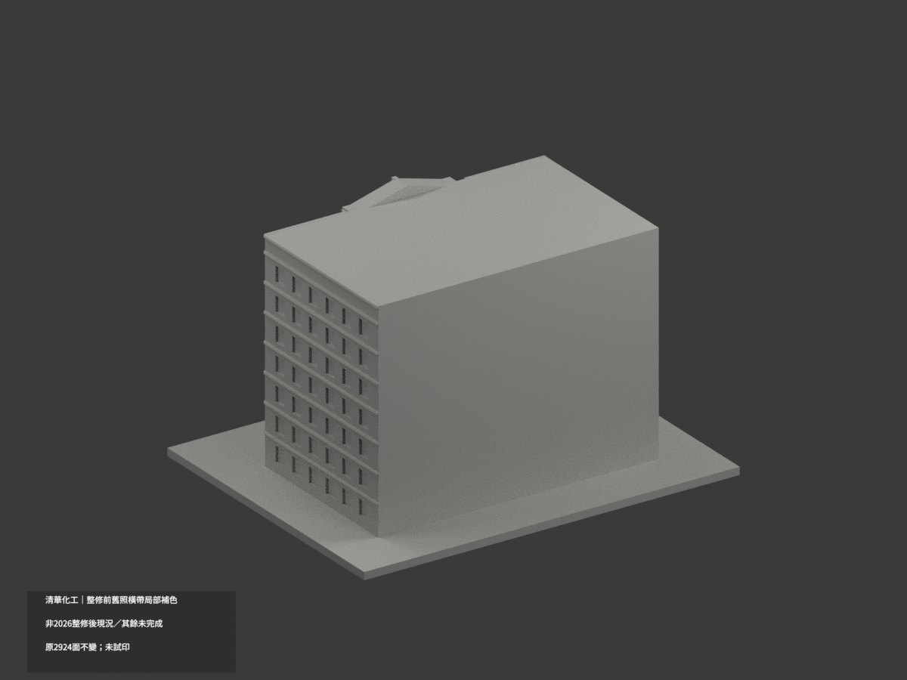
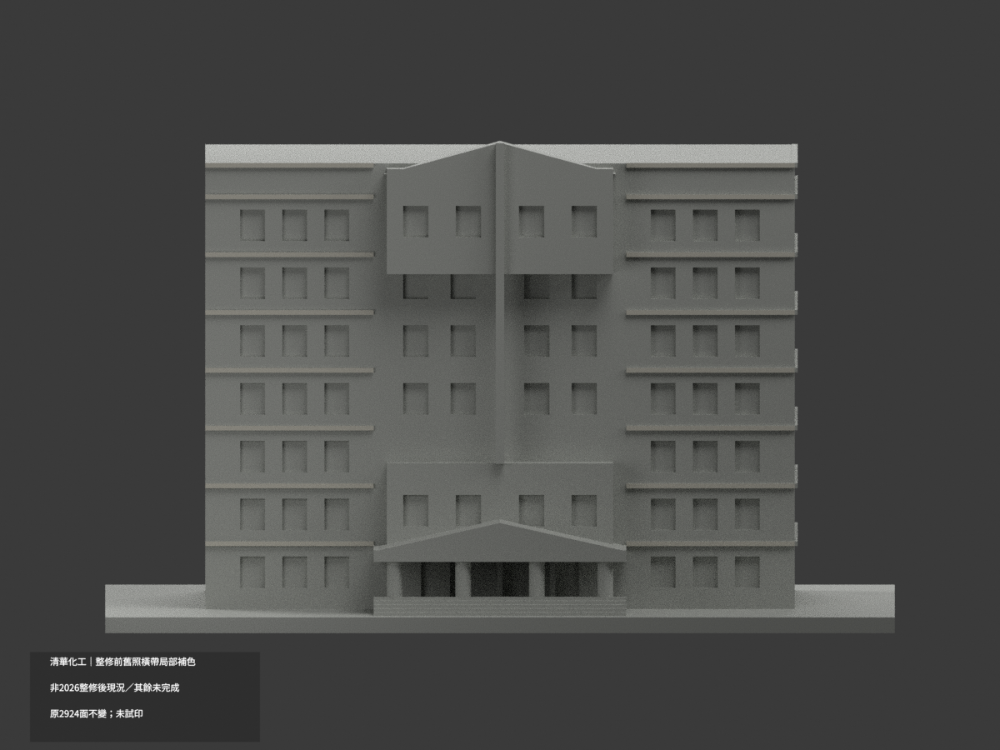
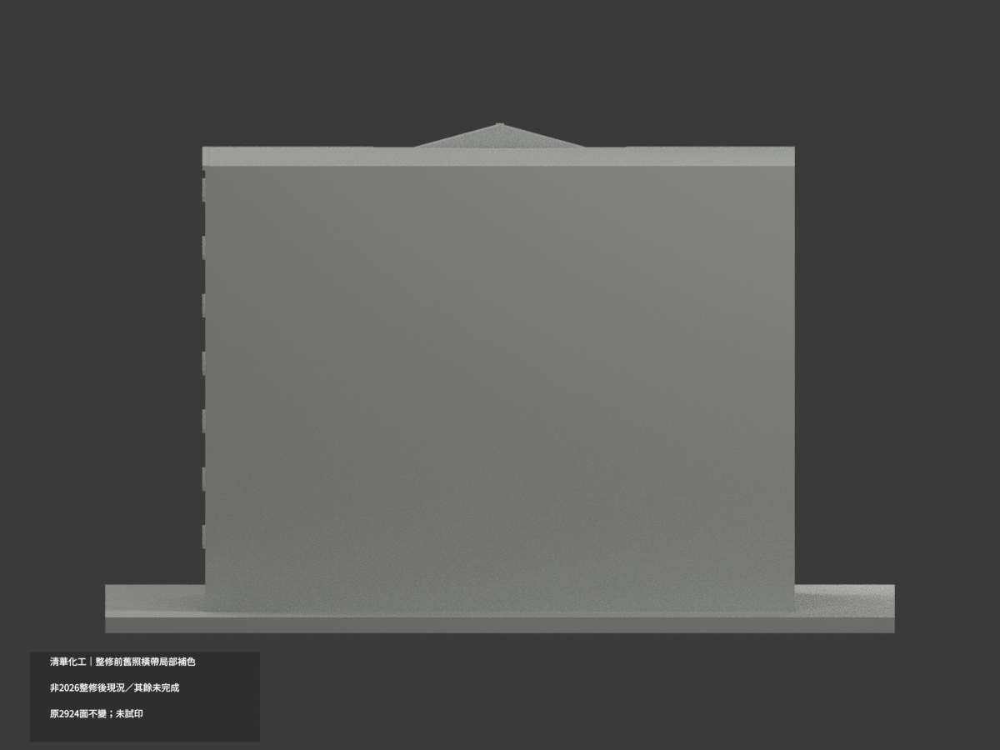
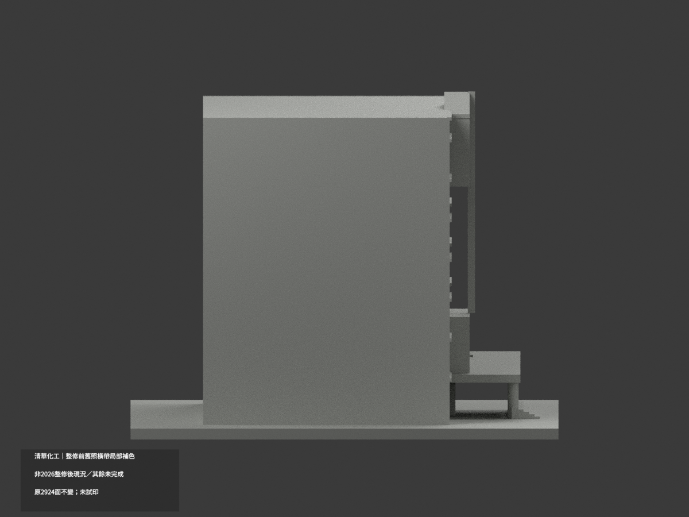
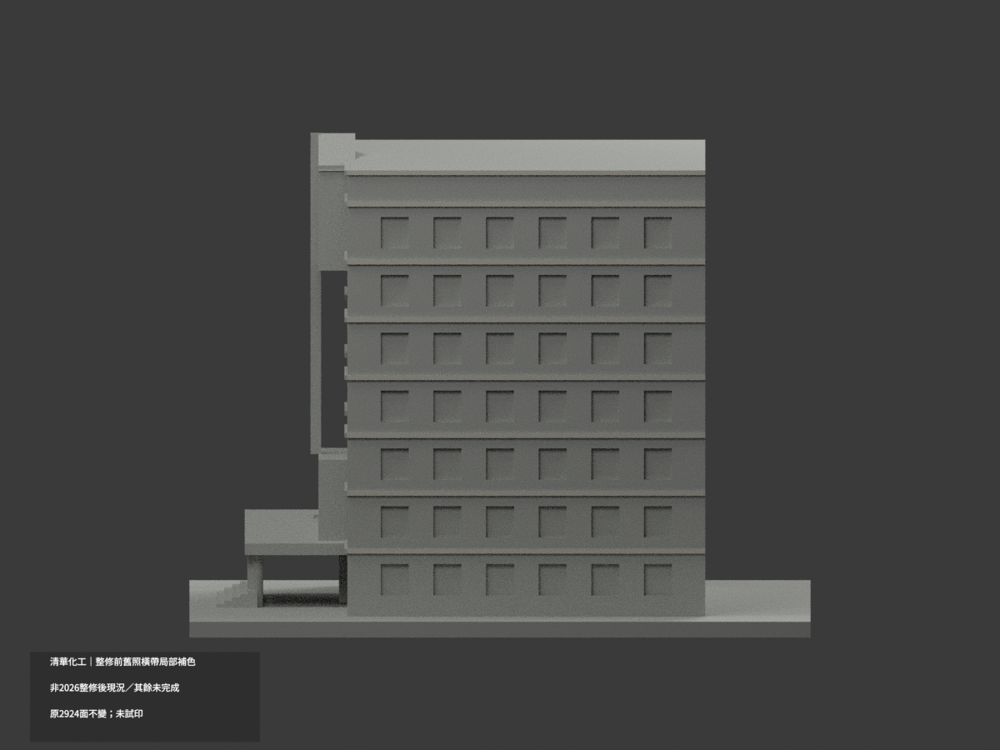
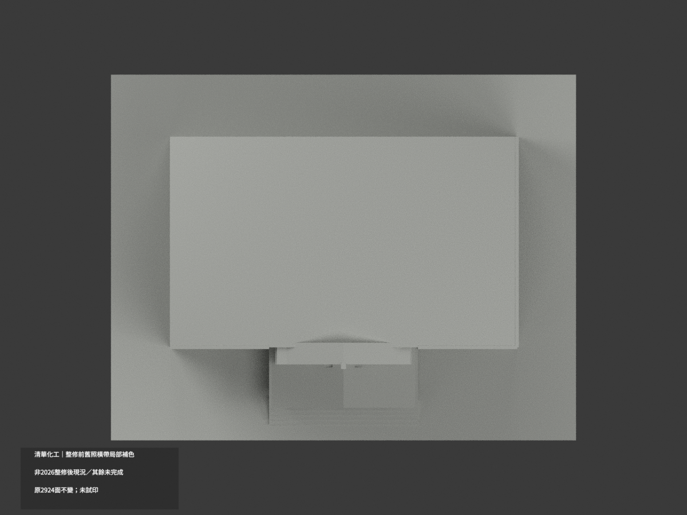
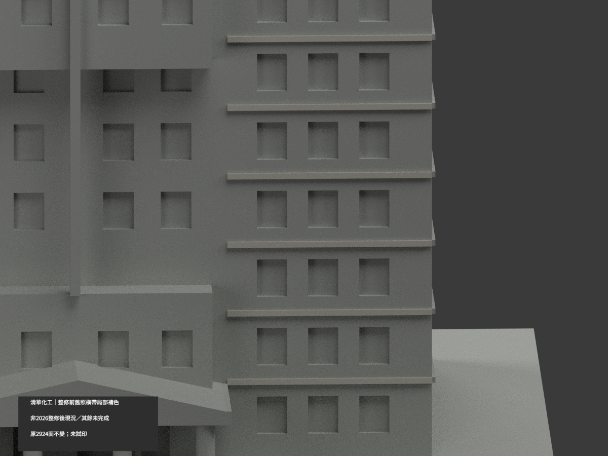
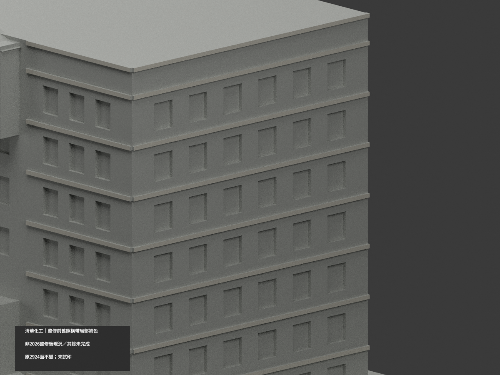
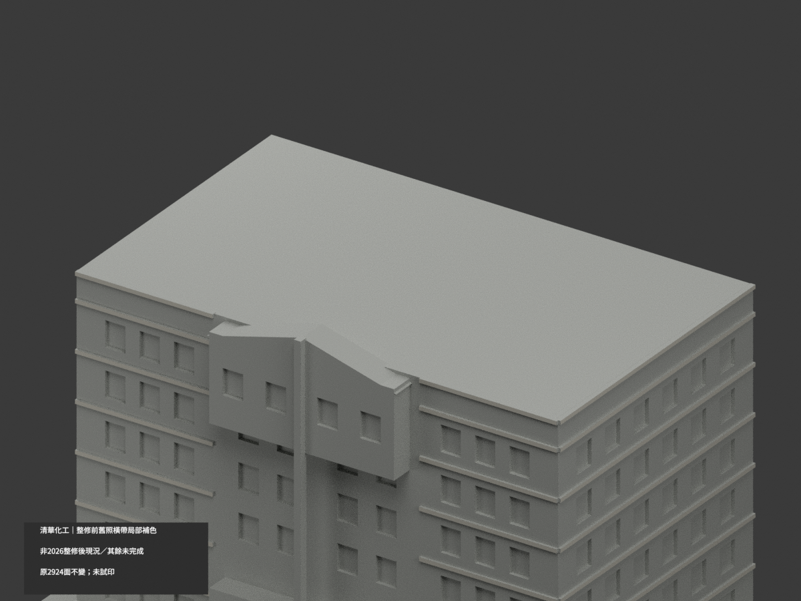

# 清華化工館｜整修前舊照橫帶局部補色

**局部補色未完成：只前／右獨立橫帶淺色；粉牆、玻璃與其餘未知面未完成。整修前舊公開照片外觀近似，非2026整修後現況。** `partial_color_incomplete=true`、`fully_colored_exterior=false`。同項目`nthu-chemical-engineering`／`count_delta=0`，不新增套數、不表示整修工程完工。化工館不是化學館。

| 前斜視 | 後斜視 | 正面 |
|---|---|---|
|  |  |  |
|  |  |  |
|  |  |  |
|  | | |

## 材色範圍

僅16個前橫帶真正外表面（y=-29.55、兩翼x[-56,-24]/[24,56]）與8個右橫帶真正外表面（x=56.55、y[-29,39]），高程z15/26/37/48/59/70/81/87、厚.9。逐原構件完整矩形面積驗證，前34＋右16原三角為暖灰白，其餘2874面未知中性，**不是實景灰色證明**。全部837共面連通域一致，不用剪裁大三角假造材界。

粉色主壁包含未有幾何界的白直帶，不整牆粉色；上山牆白帽混域、入口山牆粉白框混域、全高中央spine近頂深孔無獨立界，全部中性。圓柱柱基柱帽、原簡化階梯磚白帶、窗背玻璃框簾反光亦不一色推定。橫帶頂側底、後左屋面與基座未知中性。前後材色範圍只資料覆蓋，不是真實材料接縫。

原2924三角、坐標尺寸、STL／OBJ／build字節保留，不新增切面或幾何。既有近似幾何不由材色審核追認，不能聲稱現況精測或全色完成。

## 來源、年代與權利

清華官方公開正面與斜側實照僅作色族參考，原照拍攝日期未確定；1993建成年份不是拍攝日。來源URL及SHA見`COLOR-SOURCE-REGISTER.json`。必保留原補充`chemical-engineering-era-clarification.zh-TW.md`：**整修前舊公開照片外觀近似，非2026整修後現況**；2026公告記施工中，不能由預定日期推完工。本次不改原版本/原幾何。

原照私存、不隨模型公開或作貼圖；未見CC不得沿repo license宣稱照片自由商用；HEX是展示近似非色票，未保證商業授權。

## 檔案、重建及 QA

`appearance.3mf`含2展示材，`scene.blend`有實際面材，`color-mesh.npz`保原三角與material index。原STL無色、原OBJ及build字節保留。原單色README另存`ORIGINAL-MONOCHROME-README.zh-TW.md`（及原包有的README），舊previews與QA是歷程不是本次新審。

依`requirements.txt`執行`python colorize_model.py`、`python export_appearance.py`、`python validate_color.py`；Blender跑`render_color.py`與`verify_color_scene.py`。原build+color全隔離重建目錄保留不刪。格式/三角multiset/封閉正體積見`COLOR-*QA.json`，重開`SCENE-QA.json`，10張1200×900圖與hash綁定`DELIVERY-QA.json`，父另人工終審。

**未實際列印。** 2材展示不是已驗四色切片工程；支撐/薄部強度/材料映射另驗。

## English limitations

Partial reference color only: 24 complete original front/right trim surfaces, 50 triangles. All mixed pink walls, glazing, columns, steps and roof remain unverified neutral. Original2924 triangles and STL/OBJ/build bytes unchanged; no new geometry and count_delta0. Pre-renovation public-photo approximation, NOT the renovated2026 condition, NOT evidence of completed construction. Source capture dates unknown. Photographs private, no texture redistribution. Not physically test-printed; display materials are not a validated multicolor slicing job.
