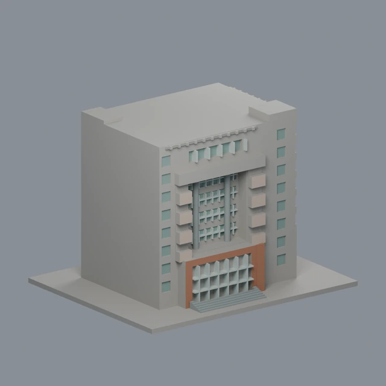
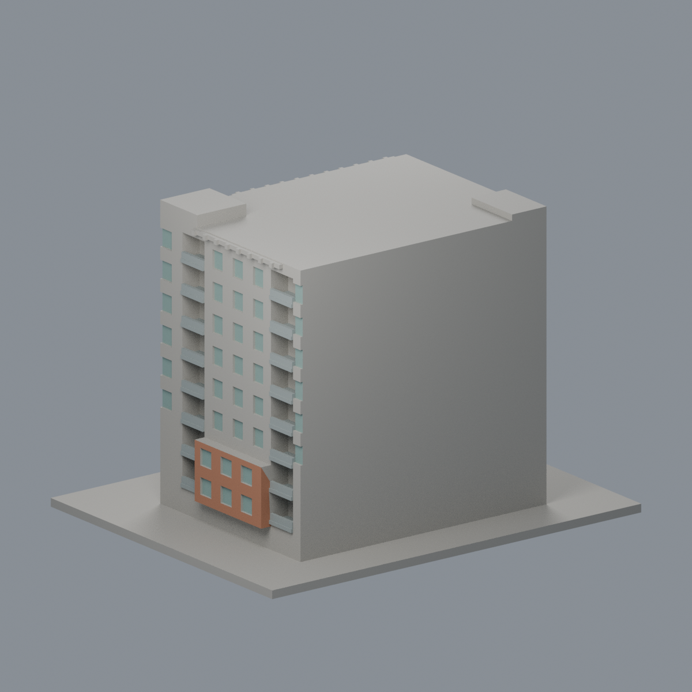
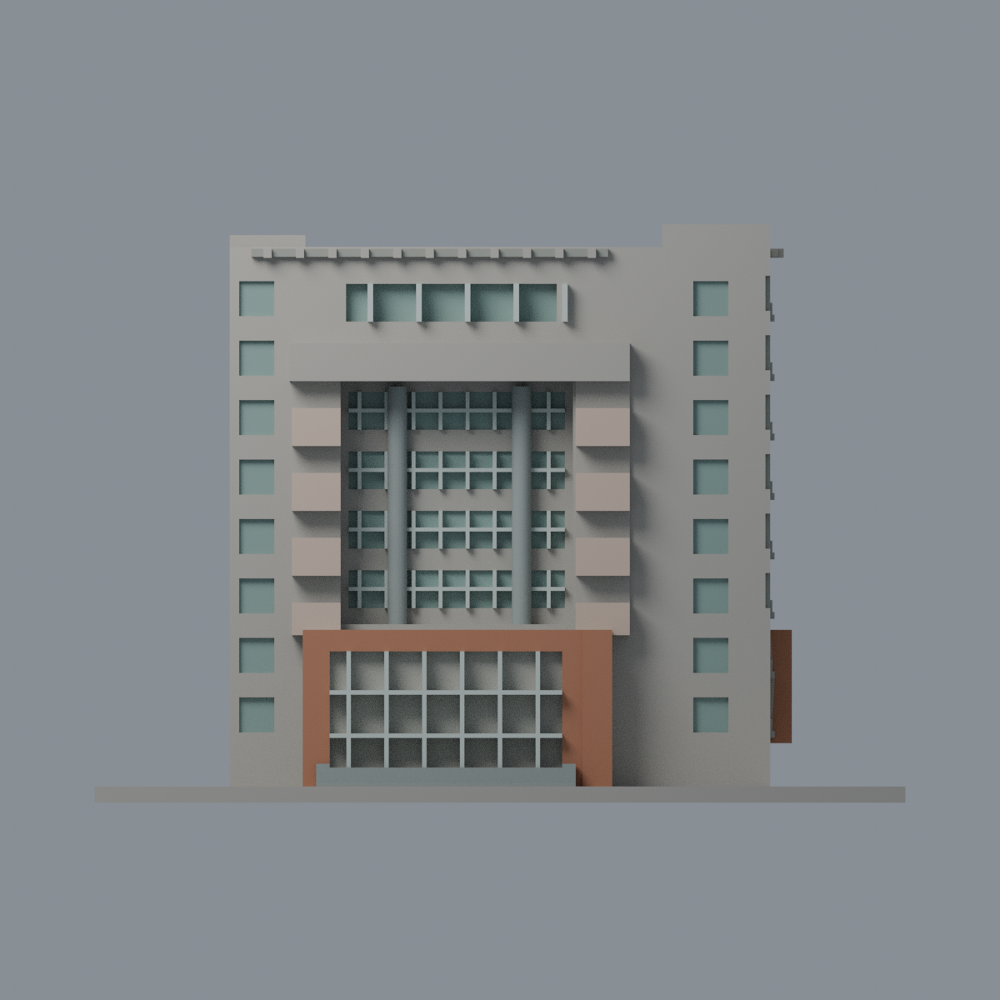
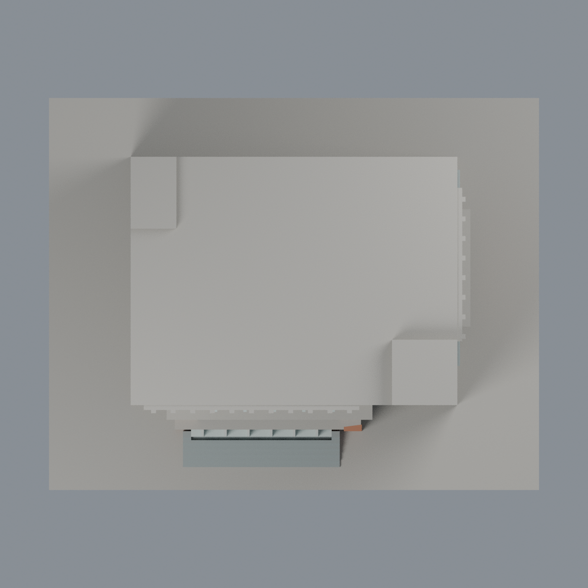

# 國立清華大學台達館｜局部外觀展示

四張原相機 WebP 與現行彩色 PNG 解碼 RGB 完全相同。只改善預覽入口與傳輸，不改既有幾何、配色或製造條件。

|  |  |  |
| :---: | :---: | :---: |
| 正面 | 模型背側 | 正立面 |
|  | | |
| 頂視 | | |

保留原右下凸磚盒前端 12 面、後端 11 面的同構件延續推估，並非端面實景照片復原。未證實的大面積後牆、混材前牆及屋頂仍維持原有中性或局部色界。原薄特徵警戒仍適用；未試印。

[模型與原範圍](../README.md) · [當前材色、來源與重建](../appearance/README.md) · [STL](../model.stl) · [彩色 3MF](../appearance/nthudelta-appearance.3mf) · [可編輯 Blender](../appearance/scene.blend) · [當前產品校驗](../PUBLIC-MODEL-SHA256SUMS)

[展示校驗](SHA256SUMS) · [展示影像核對](RENDER-PROOF.json) · [現行外觀校驗](../appearance/SHA256SUMS)
