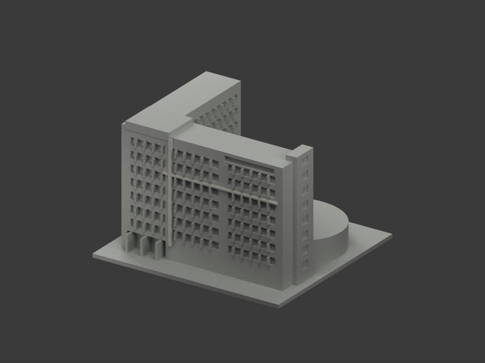
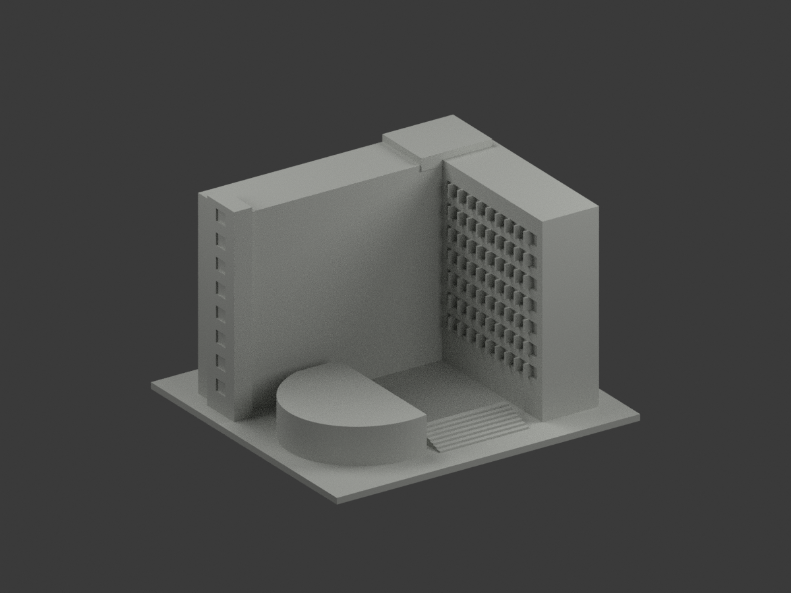
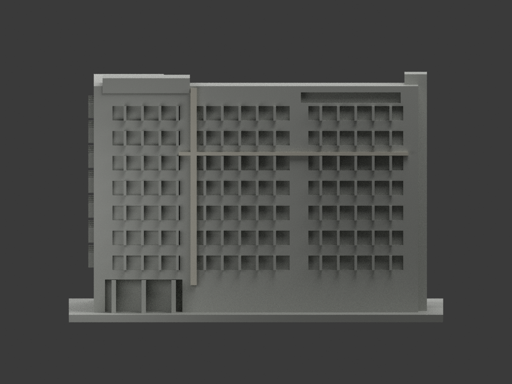
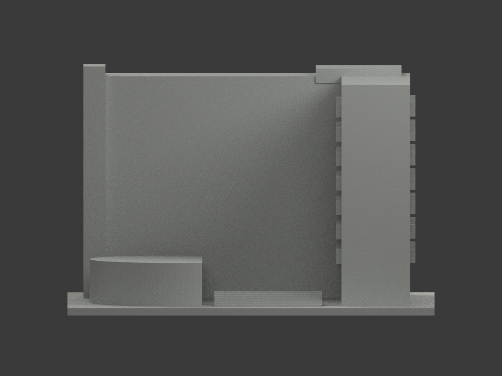
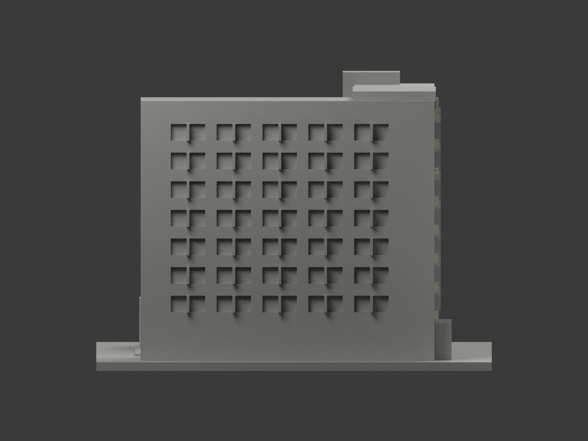
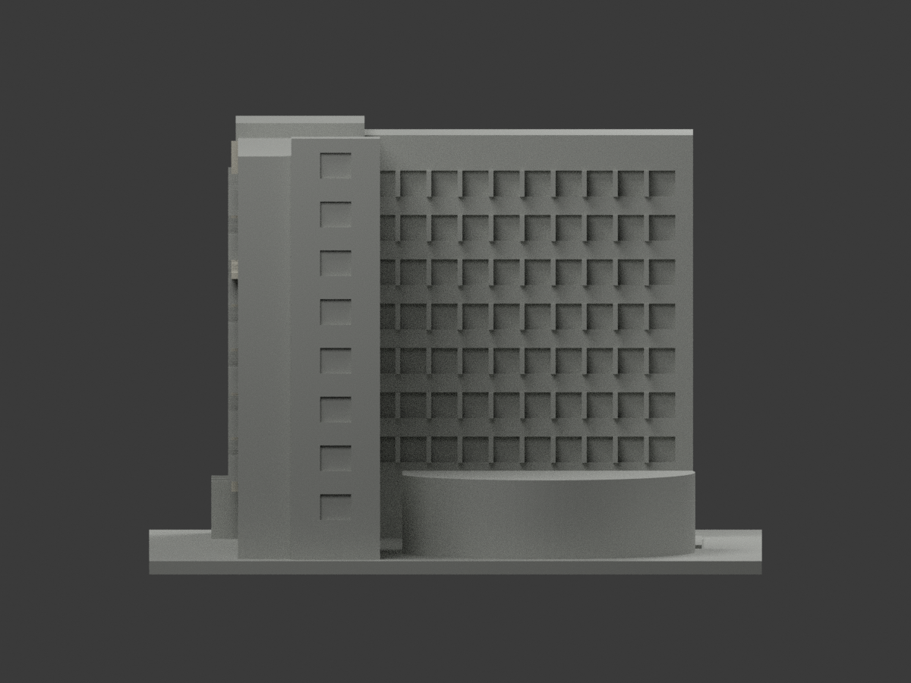
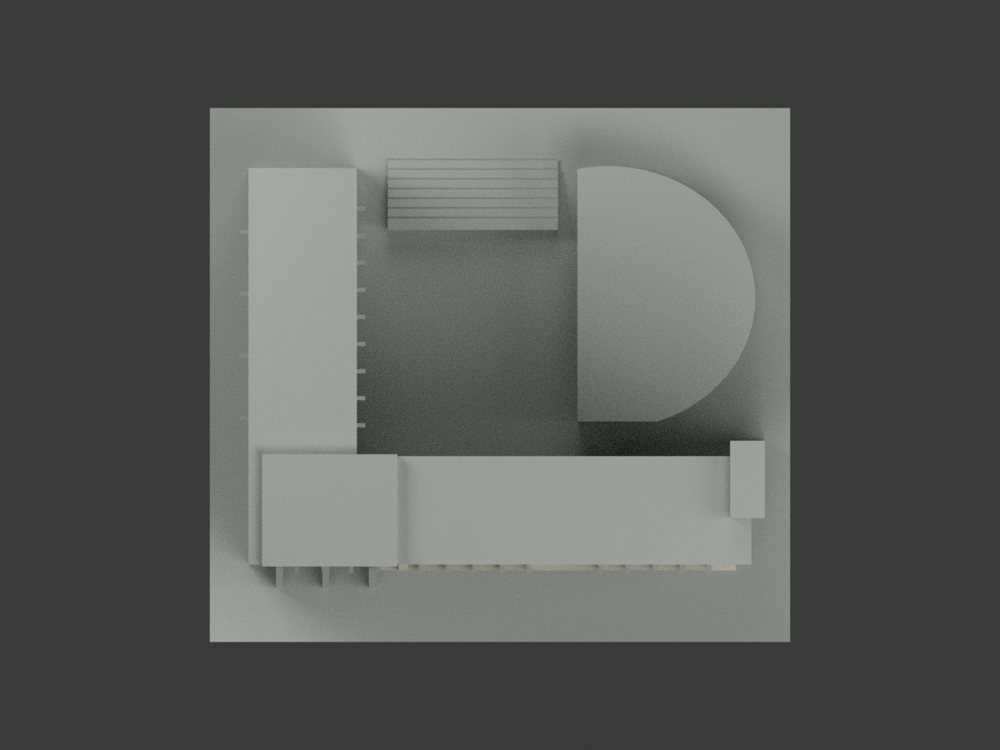
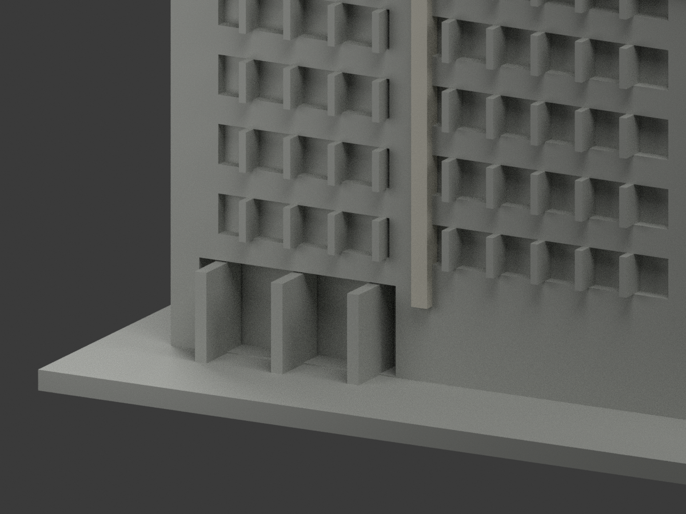
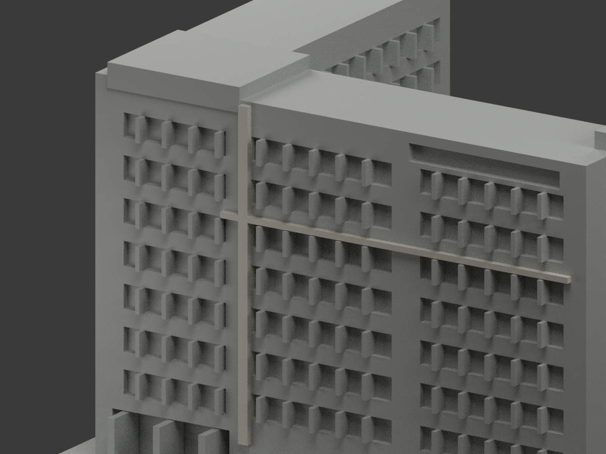
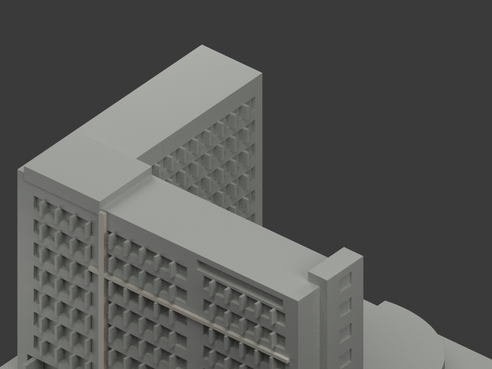

# 清華工程一館｜偏心框正面與同構件側返補色

**粉白混材主牆、窗格、塔、曲翼與屋頂未完成分色。** `partial_color_incomplete=true`、`fully_colored_exterior=false`。保留偏心直框與上橫框正面的淺灰白，並以同一框構件材質連續性推定延伸至其側返、頂底及凹窗內露出的框背；不是整棟全色完成。

| 總覽 | 背側 | 正面 |
|---|---|---|
||||
||||
||||
||||

## 材色範圍
同 `nthu-engineering-i` 原項目，same-item、count_delta=0。**原6520三角面、STL、OBJ與build_model.py字節不變**；無切面／新孔／新增幾何。
- 偏心直框 x−26.25..−23.75、z14..93，與上橫框 x−31..61、z66..67.4 的外向 y−50.5 平面，共10原面淺灰白；包含交會的完整連續面，不分割面內材色。
- 同一框構件明確邊界內的66個原側返／頂底／框背面沿用正面淺灰白；這是明確標示的合理推定，並非每一面皆有實景獨立確認。連同正面10面共76面補色，沒有跨到相鄰主牆、窗梃或窗背。
- 其餘6444面中性：粉白交錯但無完整材界的大主牆、厚簡化窗梃與窗背、塔的粉磚／淺線、低曲翼混材、紅階／白邊混材階梯、入口柱、屋頂、側後與基座。相鄰其他構件仍保持中性，不據此宣稱整棟外牆已確認。
- 共面連通域同材，0候選撤色。色／中性界是照片證據與原拓撲的限制，不是真實材接縫，不以任意三角楔形假造粉白邊界。
- 保留原照片近似幾何；補色不追認原外觀尺寸、窗型或曲翼形狀。四張官方照片仍作正面材色參考；新側返色另標示為推定。

## 來源／日期與權利
四張清華官方校園景點外觀照逐一參照，拍攝日期未知。1998完工是建物沿革，不是照片日期；不套用另一棟化工館的整修前後年代。
原照私有保存，不公開或作貼圖；未確認CC／再散布授權，不保證商用。HEX是近似材色族，非校準色票或2026現況精測。

## 格式與列印
[原STL](model.stl) · [原OBJ](model.obj) · [材色3MF](appearance.3mf) · [Blender](scene.blend) · [原說明](ORIGINAL-MONOCHROME-README.zh-TW.md)
150×138mm照片近似展示底座，非精測比例。STL不含色；3MF與Blender是真逐面材質。兩材質標籤不是已驗證兩色／四色耗材切片；**未實際列印**，無切片路徑。

## 重建與 QA
原 `build_model.py` → `colorize_model.py` → `export_appearance.py` → `validate_color.py`；Blender執行 `render_color.py` 與 `verify_color_scene.py`。
原字節／三角multiset、閉合正體積、3MF面材、完整隔離原build＋color重建、scene重開、十圖1200×900及圖文hash皆核，程序不取代來源人工判讀。
原單色previews/render/validation保留歷程，不冒稱新QA，沒有刪除原檔。

本次同框側返補色的幾何與材色檢查見 `FRAME-RETURN-COLOR-QA.json`，相機及無字預覽檢查見 `FRAME-RETURN-SCENE-QA.json`。原 `INDEPENDENT-COLOR-VISUAL-QA.json`、`FREEZE-MANIFEST.json`、`hash-manifest.json` 是先前版本的審核／凍結快照，保留歷史，不代表此次76面版本的現行校驗值；本次獨立審核與檔案清單另見 `FRAME-RETURN-INDEPENDENT-QA.json`、`FRAME-RETURN-FREEZE-MANIFEST.json`。原幾何驗證及前版色彩QA亦保留。
