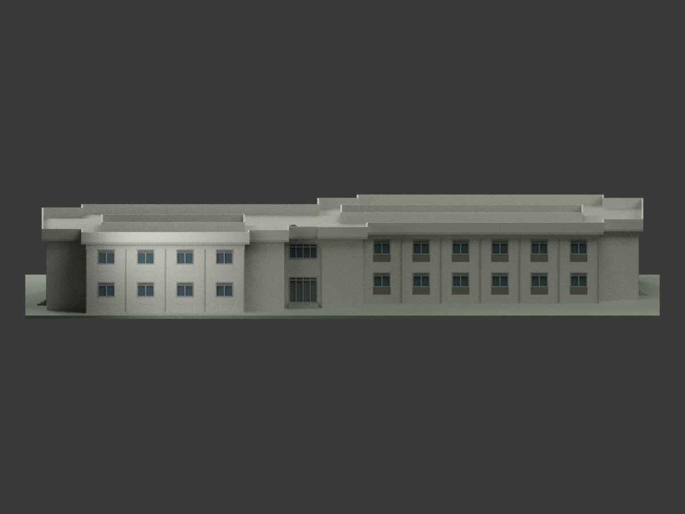
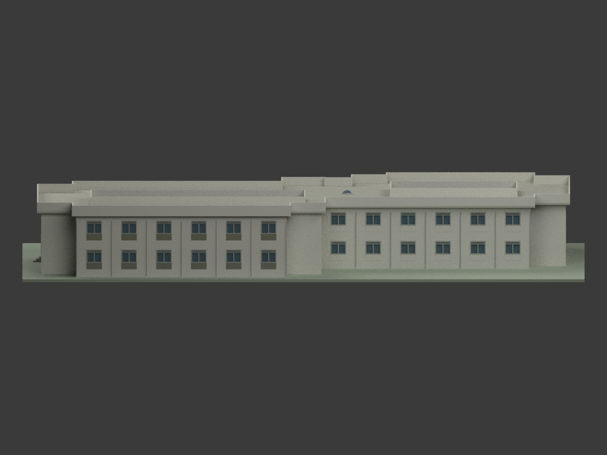
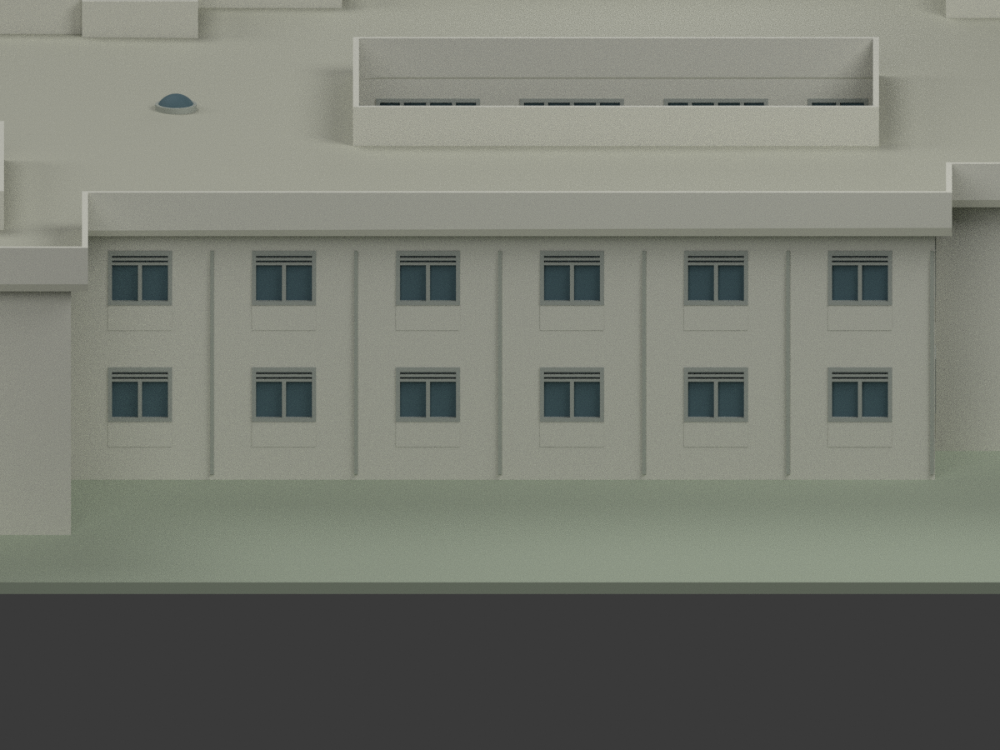
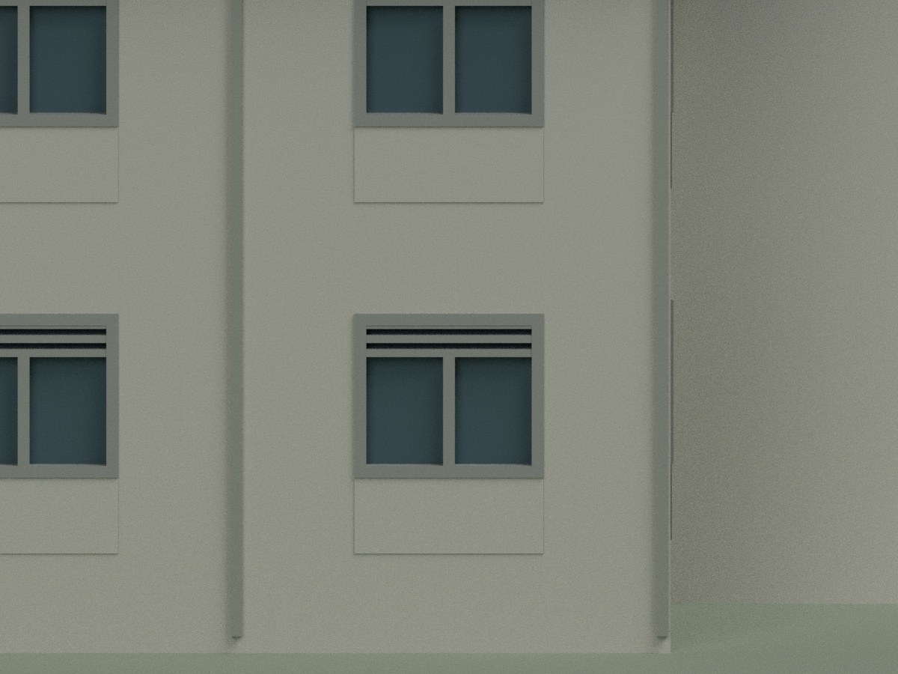
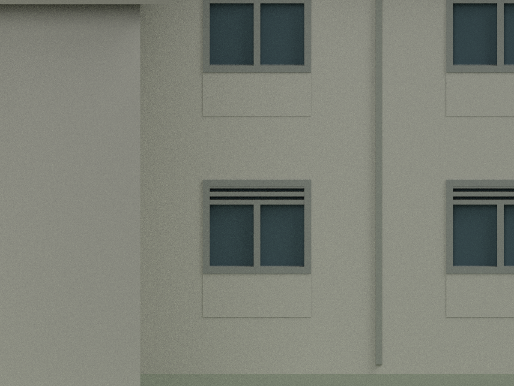

# 清華女生宿舍1980設計版｜南左八窗下板局部白漆延伸

本次只將南左四窗×兩層的八個完整窗下板正面16原三角，由示意材7改既有設計白0（#D1D1C7）。保留原北左24面，合計40面已作這項設計白修訂；白族總2445面、原示意深色族剩408面，仍是23818原三角和八材。其餘23802面指派及原幾何不變，不切面。

A5正向立面明註「1:3水泥粉刷 油漆二度 白色」，引線穿左四窗下板兩層。只取外向正面，不延伸厚側、窗框、玻璃、其他窗下板或整材7。來源A0日期69.4為1980年4月；A5日期空白，不宣稱各張同日、竣工、今日實色或現名慧齋。名義色族不是校準色票。

其餘原八材指派明示為歷史示意，不因本次追認；保留原窗1.6/2.6歧異、R44屋罩近似、未知水箱及製造限制。未試印、非四色切片認證。原掃描只私人研究，CC BY-NC限制不改。

SOUTH-APRONS-SOURCE-QA保留來源階段pending快照；完成品終審另檔。qa/south-aprons-previous與original-version原樣保留。以下24面等數字僅原版本歷史，不代表本次最終數量。

## 原版歷史說明

# 清華女生宿舍CHPT260｜1980設計窗下板局部白漆

**局部設計色修訂：僅北左六窗×兩層的12完整窗下板正面24原三角，由原示意材7改既有設計白族0。其餘面尚未分色校核：保原8示意材的其他指派，不追認深色馬賽克或今日實色。非竣工驗證、非現況採色，未確認今日名稱。** partial_color_incomplete=true、fully_colored_exterior=false。nthu-female-dormitory-chpt260-1980-design，同項count_delta=0；NTHU Female Dormitory CHPT260 1980 Design partial color。

| 北斜視 | 南斜視 | 南面 |
|---|---|---|
|  |  |  |
|  |  |  |
|  |  |  |
|  | | |

## 材色範圍

A5明註「1:3水泥粉刷 油漆二度 白色」，引線跨北左兩層六窗下板。名義設計白沿原palette0 #D1D1C7，不是色票或現地測色。取原whole y38.8 plane全24面，再按原opening/apron公式獨推x中心(5.4+3.6i−27)×5、寬8mm，z5.75..9與20.75..24，各26mm²完整2三角、exact共享邊12component。不得只套舊faceID。原3MF實際指派與原mesh精確一致，這24原材7改0，其他23794面指派逐面不變。白族總2429、原深示意族剩424；不是整mat7重染。全部23818原三角不變，5104共面域中所選12域完整，不擴窗框、玻璃、板側厚或其他窗下板。

此處保其餘原示意色不是把未知當已證。原洗白族已有設計依據也不抹掉；本次新增認證範圍僅24面。8材非已試印四色切片專案，不造新幾何或新建築。原source權利/圖像CC BY-NC限制仍保，原掃描不公開。

## 原件作用域與限制

完整36原檔含原8材3MF/mesh/palette/scene、十圖和全部QA逐byte保original-version/，私存original-remote；舊QA只驗該原子包，不綁新圖與新色。根model.stl/build_model.py原bytes不改，原清單無OBJ不捏造。PREVIEW-TRANSITION.md記同項設計色修訂，不稱原包單色。原完整README含尺寸/勘誤/列印限制亦原樣保留。

CHPT260單棟雙院落，漢光事務所/館藏作者漢寶德；A0民國69.4=1980年4月，A5日期空白，不宣全案各張同日或竣工。現名「慧齋」未核。排除原有宿舍、曬衣場、外牆與其他棟；交誼廳有屋頂不是第三天井。比例1:200、原translate(-27,-16.425,+.30)×5已在STL，不重施。

主牆54m、24.10m半深、8.75m錯位/32.85m牆心域與33.85m推導簷域保；不採A4總3210或把完面當牆心。原一般窗採1.60×1.40m名義圖量±.10，A2算式2.6×1.4未消解，未取得A10表、不保採光合規。原淺罩88cm口徑/25cm帽升與R44不完全相容，不改半球。屋頂水箱僅平面/12cmRC壁，蓋360×850×100不當箱高，未知箱體不造。展示底座非測量地形、實心玻璃/內部/12cm屋皮/排水坡概化/15cm加厚女兒牆和簡化階均原樣保。

新QA只原幾何identity、精確隔離重建、24設計色變更、3MF/reopen/身份/10圖，不追認全部原幾何與printability。未切片、未實印、非2026完整現況。

NTHU Female Dormitory CHPT260 1980 Design partial color. Exactly24 original north-left apron outward triangles change from originalmaterial7 to existingwhitefamily0 #D1D1C7. Twelve complete rectangles, six bays on two floors, whole y38.8 plane; all other23794 material assignments and original geometry stay unchanged. Original eight illustrative families remain, not newly certified photographic/current colors. Not a monochrome baseline or full-color completion.

All36 original files are byte-identical under original-version/, including original eight-material3MF,mesh,palette,scene,tenviews andQA. HistoricalQA applies only there. No originalOBJ.1980-04 is A0design date; A5blank,not same-day/asbuilt/current. One connected two-courtyard building,count0. Original1.6vs2.6window discrepancy,R44 shallowcap conflict,unknownwaterbox and fabrication approximations retained. Colorreview does not reapprove original fullgeometry/printability. Unprinted; original private scans excluded.
