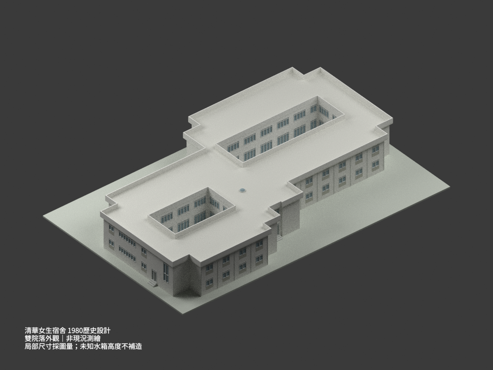
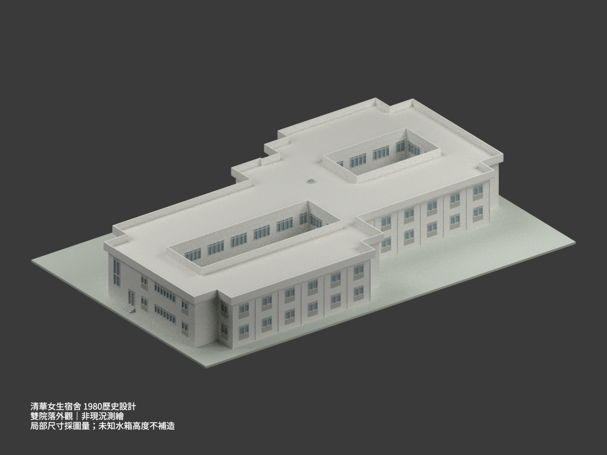
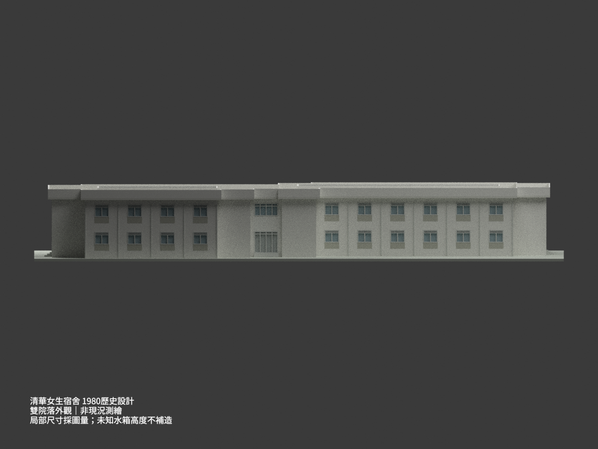
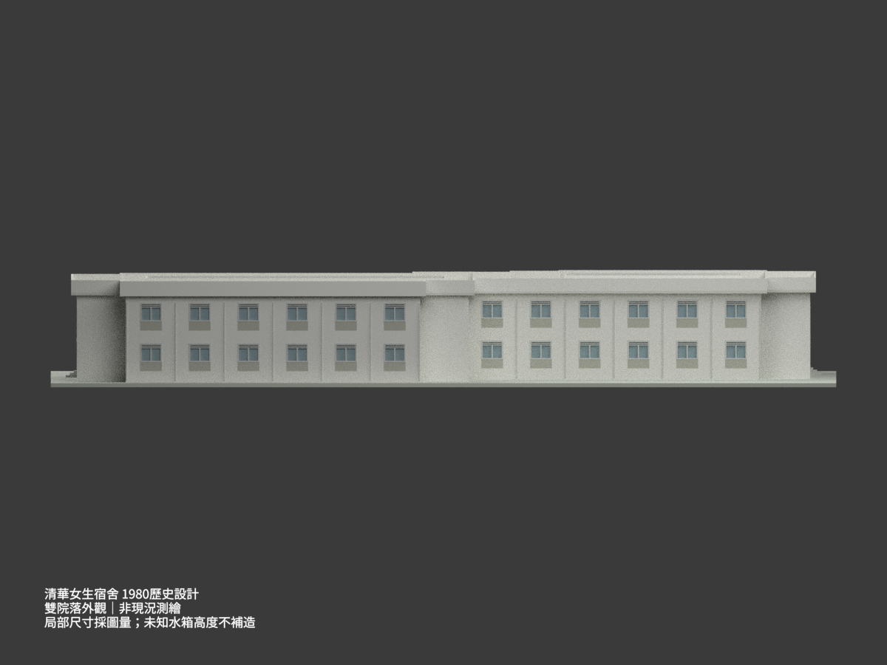
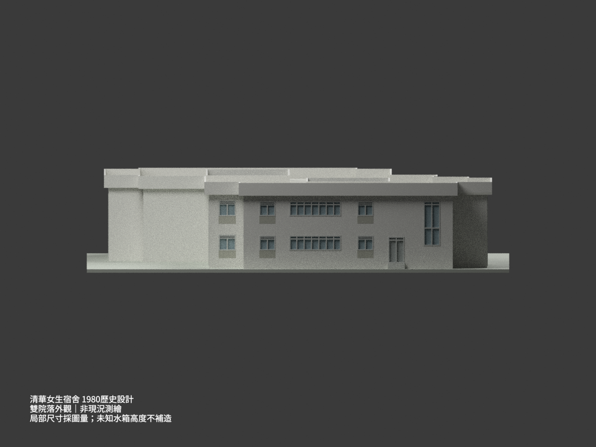
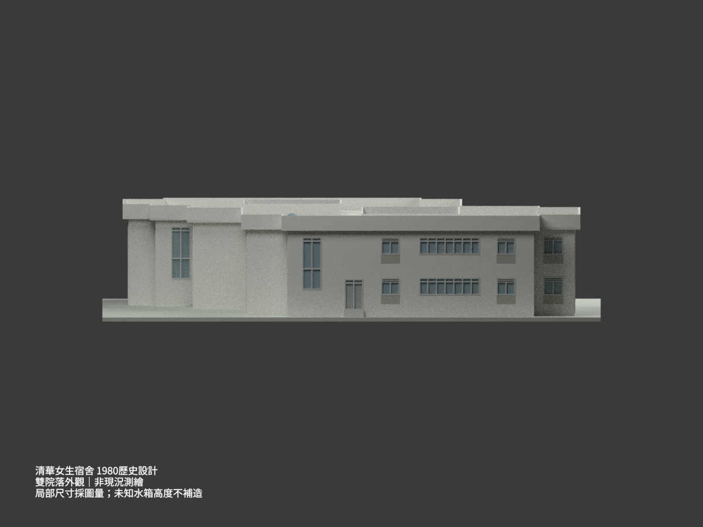
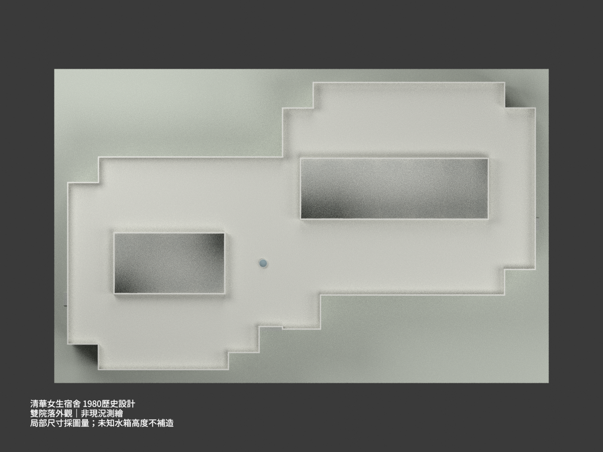
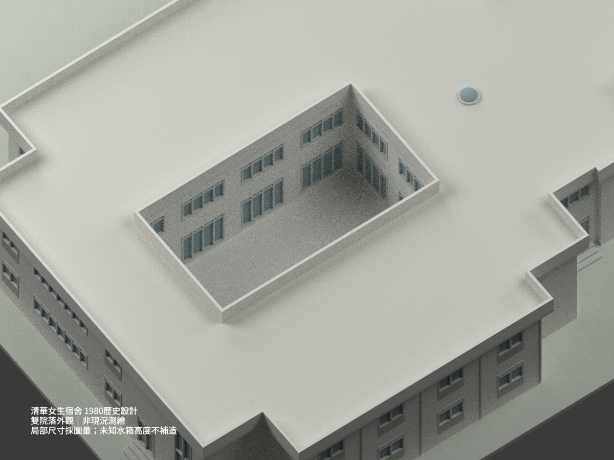
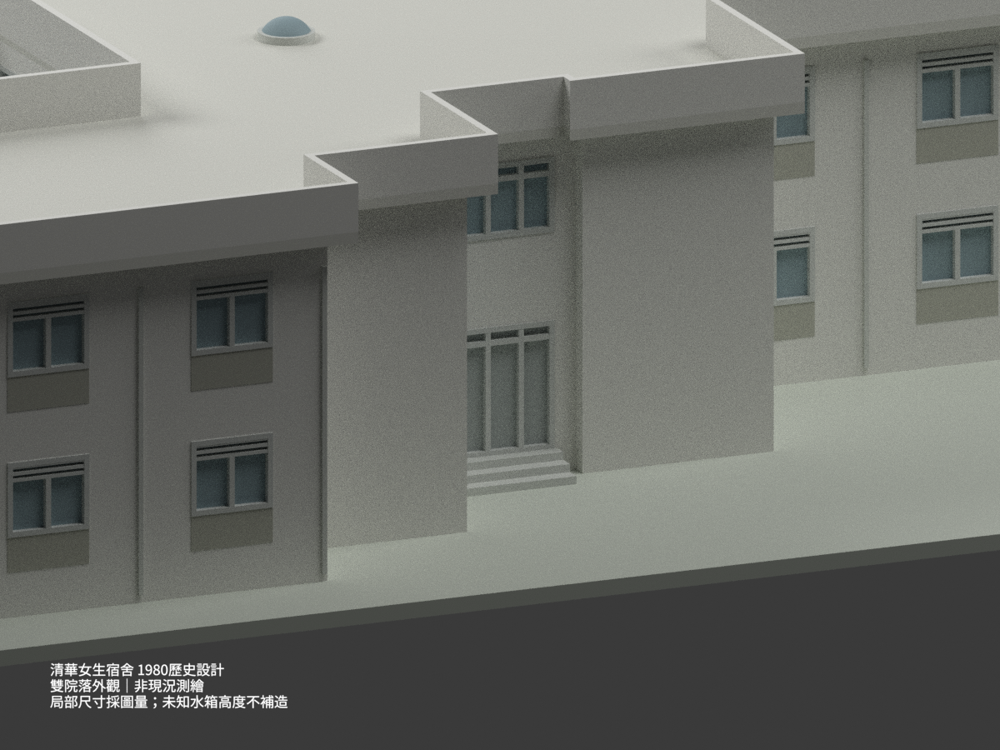
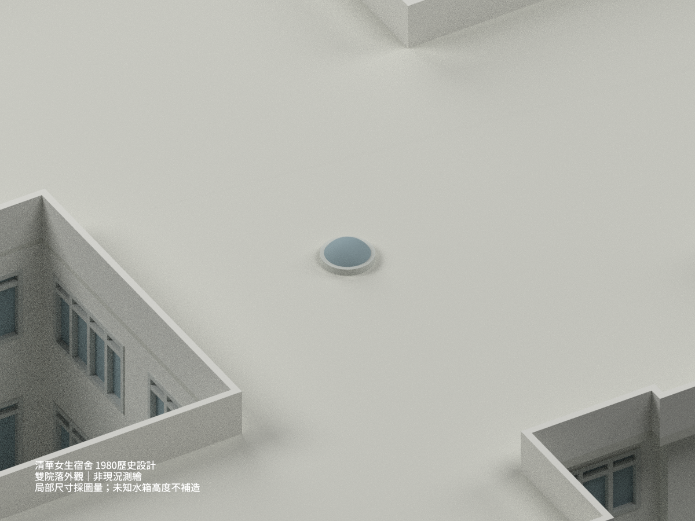

# 清華女生宿舍｜1980 年歷史設計外觀

依漢光建築師事務所歷史圖說重建單棟雙院落宿舍；**非現況測繪、非竣工驗證，未確認今日宿舍名稱**。局部尺寸有圖面差異，採取下述有據圖量解讀，不宣稱施工級精度。

## 模型預覽（10 張實際渲染）

| 視圖 | 視圖 | 視圖 |
|---|---|---|
|  |  |  |
|  |  |  |
|  |  |  |
|  | — | — |

## 身份與範圍

館藏 CHPT260「國立清華大學女生宿舍新建工程」，A0 圖欄標69.4（1980年4月），漢光建築師事務所，館藏作者漢寶德。其餘同案A1–A8日期欄多空白，不假稱每張皆同日或竣工圖。不冠以未核實的現名「慧齋」。

模型是一棟連通、兩層、兩處露天天井的歷史外觀，不將雙院計為兩棟。排除旁側「原有宿舍」、曬衣場／外圍圍牆及其他校園建築。交誼廳二樓挑空仍有屋頂，不挖第三個露天院落。隱蔽室內、臥室配置、管線與設備不重建。

屋頂水箱只知平面與12cmRC壁註，水箱蓋的360×850×100不能直接當箱高；未取得剖面高度，且立面未確立高出女兒牆的箱體。因此**不虛構突出水箱**，不將100擅改10cm或100mm。

## 直接控制與尺寸勘誤

- 主牆基準長 **54.00m**，15跨×3.60m；主要牆心半深 **24.10m=7.00+10.10+7.00**。A2/A3兩圖的半體錯位 **8.75m=7.00+1.75**，所以整體牆心尺寸鏈控制域為 **32.85m**，不是完成面包圍盒。
- A8牆心到外簷50cm（7.5+42.5），故屋簷控制域 **33.85m**是推導值，不是A4直接可靠總註。屋頂自身25.10m半深=24.10+兩側0.50，並無矛盾；真正不符的是A4錯位700與總3210。優先兩層平面一致的分段牆心鏈，再由剖面加入屋簷，並由圖形比例交叉驗證，不平均、拉伸或任選方案。
- 輪廓依原圖保留多段凹凸：左端／右端服務區內縮3.00m，入口與梯間前側按A1 D/E/F及兩層平面互核。不是54×32.85的矩形盒。
- GL=0、1FL=+0.50m、2FL=+3.50m、RF=+6.50m、女兒牆頂=+7.50m，兩層層高各3.00m。模型底座不是精測地形。
- 小院淨域約12.85×7.00m，大院約21.90×7.00m；小院A7的1440鏈只含左側140+7.5及右壁半厚，右走道175在下一段，不能扣兩邊同寬。大院左右廊不同寬，局部以平面圖量校準±0.10m。**不採A1面積公式的15.18/24.18×9.07當院落尺寸**。

## 必須保留的局部不確定性

**一般W1窗：** A2採光算式寫2.6×1.4=3.64，但A2平面與A5立面的窗／3.6m開間比例均約45–47%，支持約1.60–1.70m，並非2.6m所需72%。本外觀採名義**1.60m寬、1.40m高**並保留±0.10m圖量容許；未取得A10門窗表，不能稱精確W1規格，也未證實原採光算式一定錯誤。模型不檢驗採光合規。

**交誼廳採光罩：** A7可讀88cm淨口、左右8cm座寬；板底到座頂30cm、板厚12cm，所以座頂相對RF約+18cm。R44註記與所畫淺弧不完全相容，不能同時當精確半圓。本模型採88cm口徑、名義25cm帽升的圖示淺弧帽，**不是精確R44曲面、不是整顆半球**；其高度屬圖量重建。基座及罩沒有超出7.50m女兒牆。

## 模型化與列印限制

- 比例 **1:200**；含作者展示底座約290×184.25×39mm。**未實際列印**，懸挑、院內框格及小罩需自行切片與支撐檢查。
- 主牆採代表性15cm厚度，屋簷按牆心外50cm，不重複加牆半厚。女兒牆加厚至15cm便於列印，不能當源圖薄壁的施工尺寸；窗框10cm在模型約0.50mm。
- 玻璃是不透明凹面，內部採實心；院內一樓保留落地玻璃外觀。兩院地面以圖示+20cm作平整表達，未復原逐點排水坡或地下構造。
- 屋頂按1/100排水箭頭作分片坡面示意，向院落方向低，圖示高差封頂10cm；非測量屋面或推定RC結構。薄屋皮採12cm顯示厚度，坡面與封閉體交疊以維持列印網格。
- 入口保留圖示+45cm及三階外觀，門框下緣微交疊1cm以避免退化接縫，不改地坪基準；兩側低階採圖量簡化，不宣稱精確踏步表。顏色僅表達洗石／粉刷與框格區分，非現場採色。
- 隱蔽水箱高度、內部設備與真實場地不補造。後續資料更正應更新同一模型，不能因勘誤增加建築或方案計數。

## 檔案及重建

`model.stl`、`model.3mf`（毫米、分面色）、`scene.blend`、`mesh.npz`、程式、實際渲染與QA紀錄。場景說明文字不進入列印網格。

```bash
python -m pip install -r requirements.txt
python build_model.py
python export_3mf.py
python validate_model.py
blender -b --python render_model.py
blender -b --python verify_scene.py
```

## 來源與權利

九張來源見 [SOURCE_REGISTER.md](SOURCE_REGISTER.md)。館藏原圖標 **CC BY-NC**，只私人保存、未加入公開模型包；元資料若標CC BY不取代圖像授權。圖說作者及建築設計權利與本次程式／模型／渲染分開，不聲稱所有第三方權利已清除、不保證商用權利，也不把原圖授權擅改成整個模型的一般授權結論。
