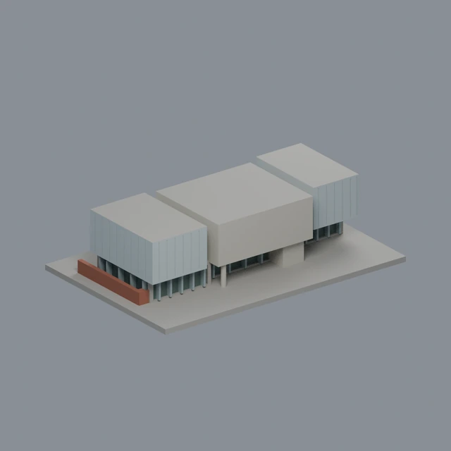
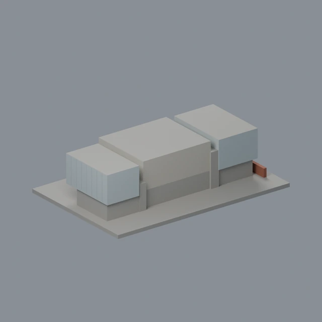
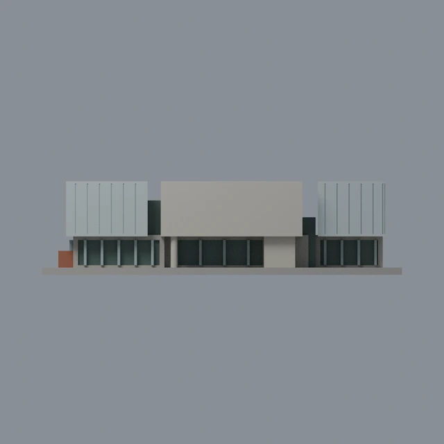
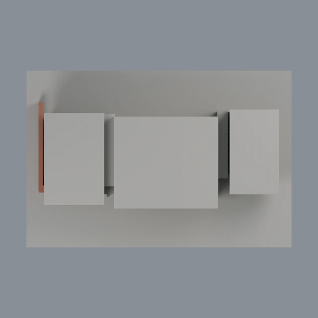

# 清華大學宏亮美術館｜現行彩色展示

## 模型預覽

| 模型預覽 | 模型預覽 | 模型預覽 |
| :---: | :---: | :---: |
|  正面 |  背面 |  正立面 |
|  頂視 |  |  |

四張全尺寸無失真 WebP 由現行六材質 Blender 場景核對重繪，點擊縮圖可放大。留用現行上層三座展廳盒體的 118 個側背牆同構件推估色面，不當成照片實證。屋頂、底面及未明下層牆保持原指派，本次沒有拓展補色。幾何與配色未變更。

[現行彩色 Blender](../appearance/scene.blend) · [彩色 3MF](../appearance/nthuhong-appearance.3mf) · [STL](../model.stl) · [OBJ](../model.obj) · [渲染驗證](render-proof.json) · [本頁校驗](SHA256SUMS)

[當前模型校驗](../PUBLIC-MODEL-SHA256SUMS) · [原模型與限制](../README.md) · [原外觀來源與證據](../appearance/README.md)。歷史圖、原 README 與工程資料均未改動。未實體試印。
