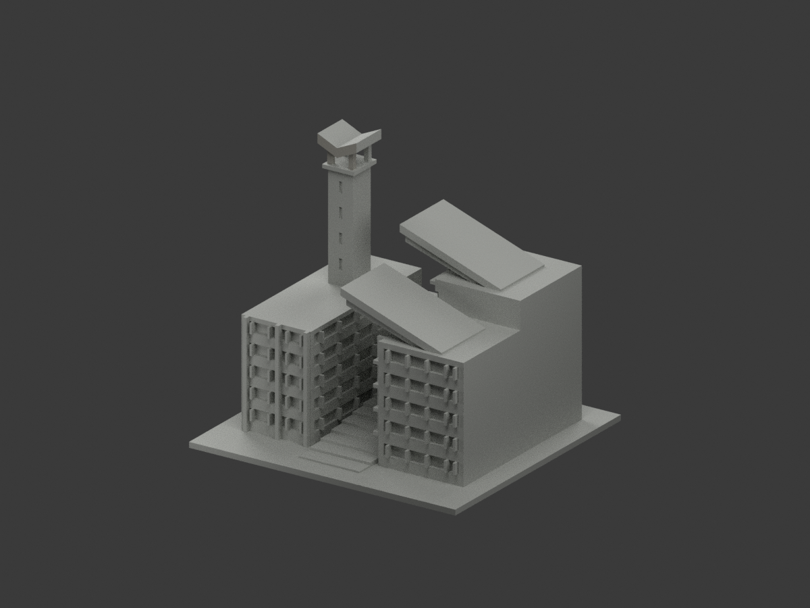
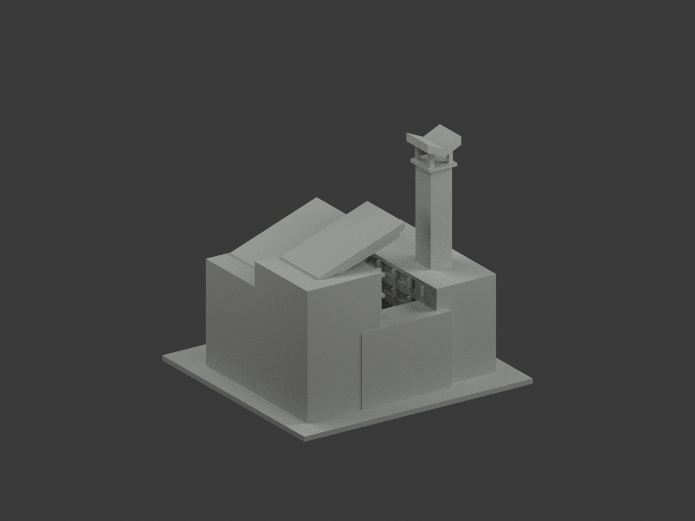
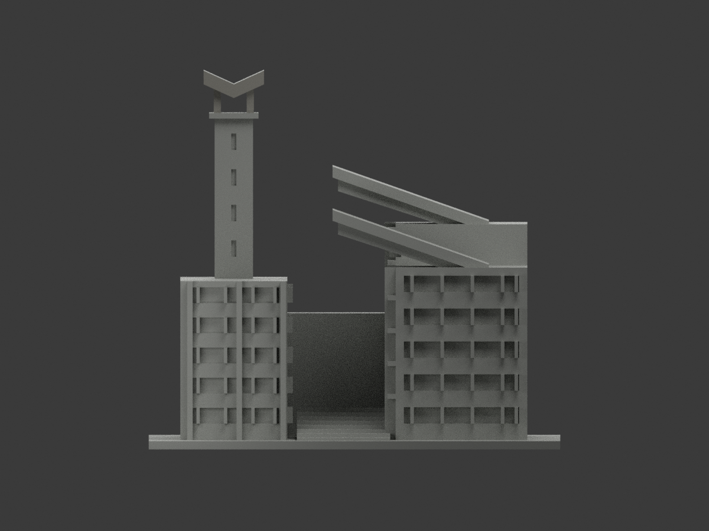
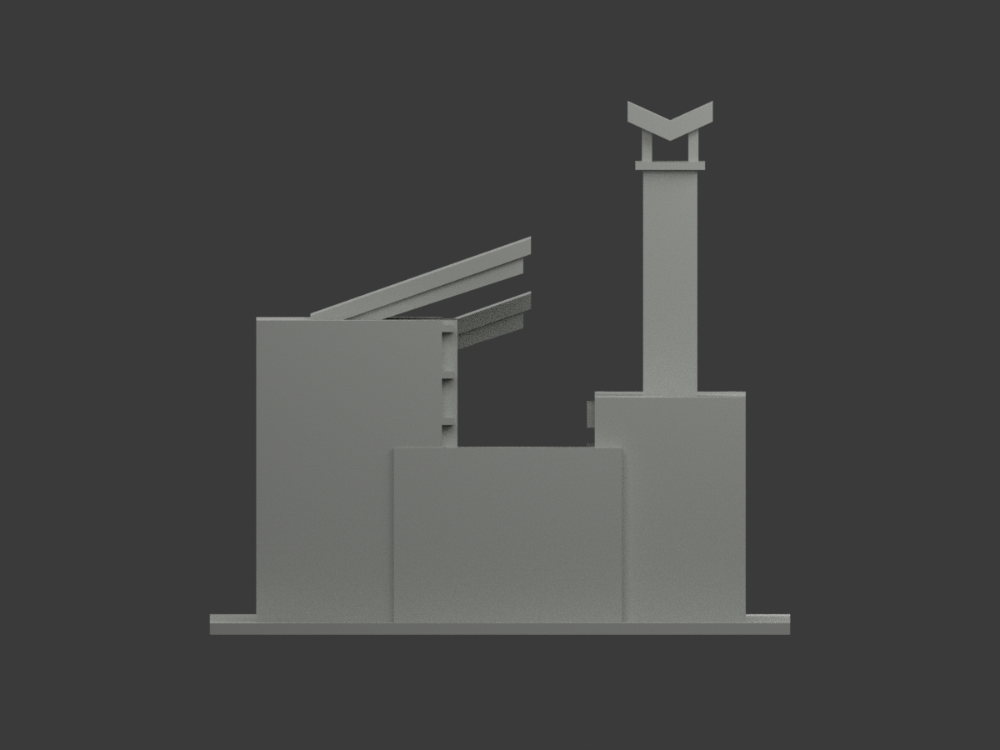
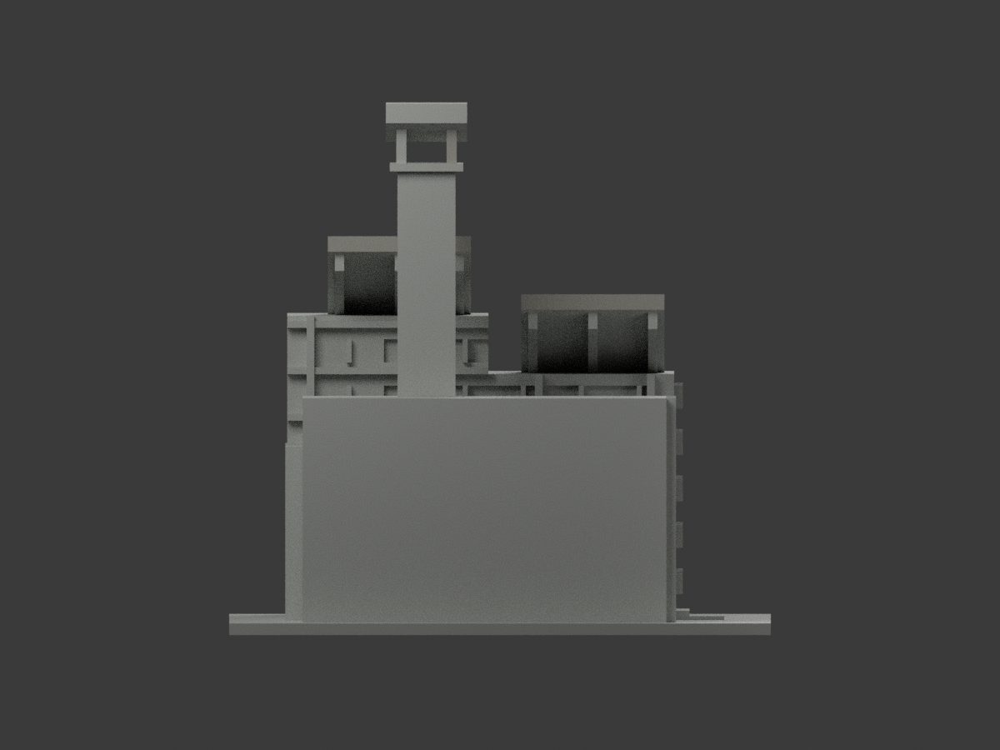
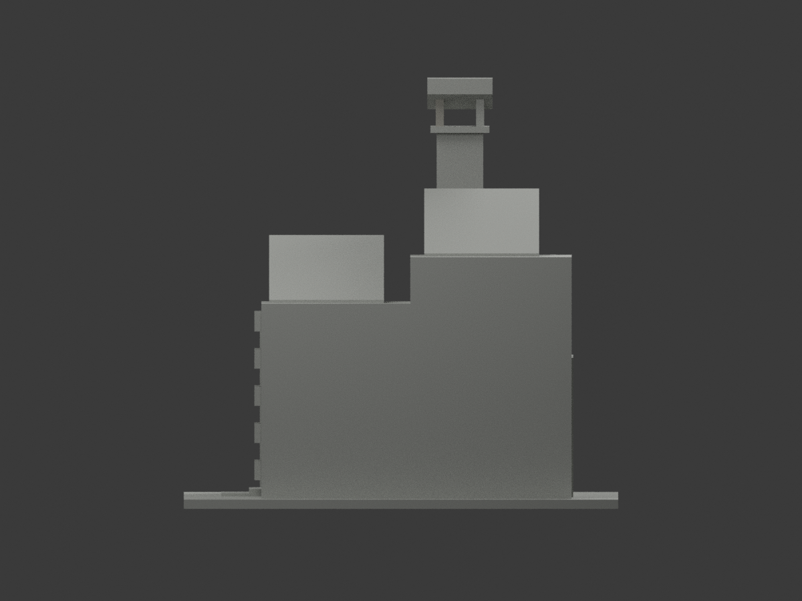
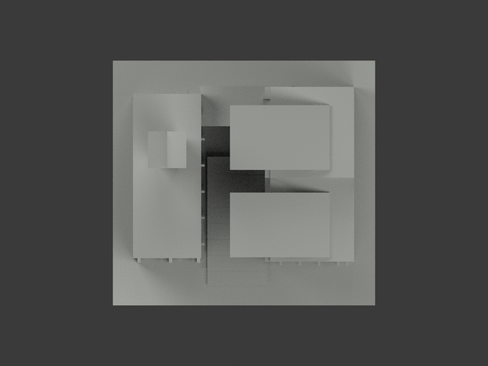
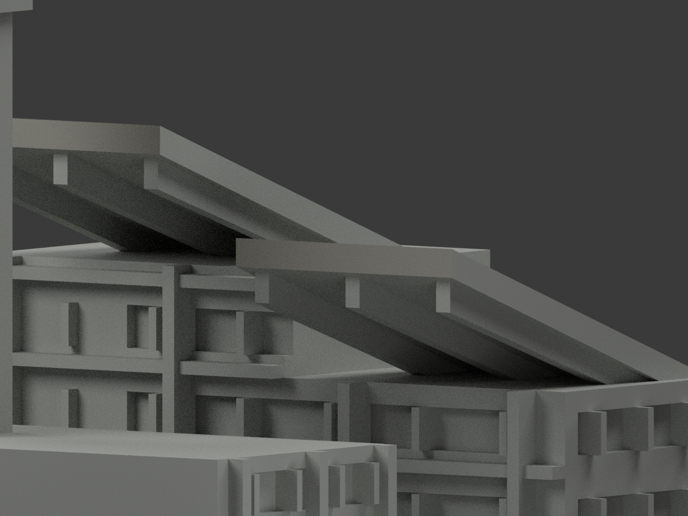
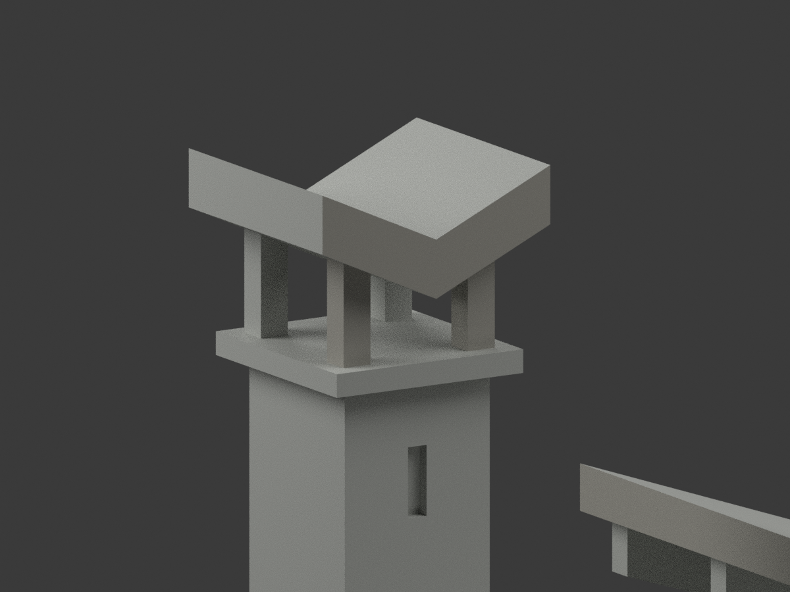
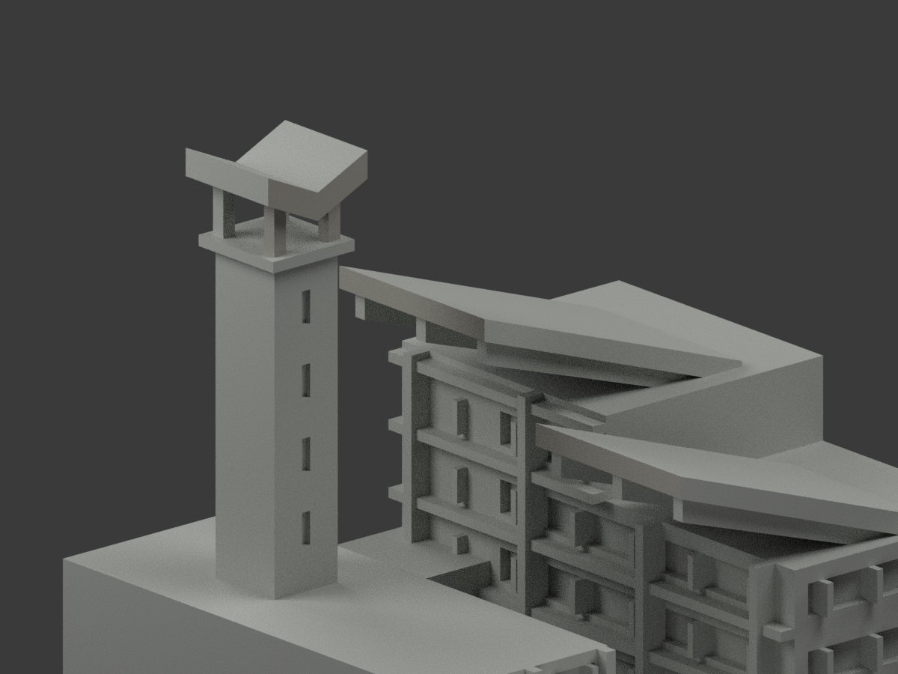

# 清華人社院｜前鐘亭柱有限返側補灰

**局部補色未完成：僅冠前、前鐘亭柱及兩斜檐鼻端灰色；塔身、主牆與其餘未知面未完成。跨年代外觀近似，非2026全貌。** `partial_color_incomplete=true`、`fully_colored_exterior=false`。同項目`nthu-humanities-social-sciences`／`count_delta=0`，不新增套數。

| 前斜視 | 後斜視 | 正面 |
|---|---|---|
|  |  |  |
|  |  |  |
|  |  |  |
|  | | |

## 材色範圍

保留原冠前 4 面、兩前鐘亭柱前面 4 面及兩斜檐鼻端 4 面，共 12 面。這次只在兩前鐘亭柱原有限盒體中，新增 12 個垂直側／背面，採同構件灰色連續推定。合計 24 面配色、4,182 面未知中性；不是逐一照片直接觀察或精測色票。

兩原柱中心 x=-50/-38、y=12.5，寬深 2.6、高程 z=121..133。每個三角所有頂點須落在完整有限盒體且屬四個垂直側面，共 16 柱面（含原 4 前面）。1,195 個共面連通域保持單材，無混域、無新切面。不延伸後兩柱、柱帽、鞍冠厚邊、斜檐頂底／回邊／托架；暗部只視為陰影，不當黑色材料。

全高塔身上灰下粉而原無材界，塔身與混粉灰翼牆全部保持中性。窗背混玻璃、空調、框、反光及植物，不一律染玻璃或綠。原厚鞍為抽象雕塑近似，不修改或追認其精度。台階、基地及未知背面不染。

原4206三角、尺寸、STL／OBJ／build字節保留，不新增切面、雕刻或幾何。分色與中性界線僅來源覆蓋，不是真實不同材界；色審不追認既有近似幾何，也不宣全色完成。

## 來源年代與權利

四張來源為校方教學外照、校史2020展覽舊影、校友遠景、承包商外部作品照，皆已實看；各原URL/hash見`COLOR-SOURCE-REGISTER.json`。**1990落成與2020刊登不是經認證拍攝日**；照片跨年代不得拼作2026單日完整現況。不使用室內與安全資料。

原照私存、不隨模型公開、不作貼圖；未見CC，不沿repo license推定照片自由商用。材色僅概略族群非測量色票，不保證商用授權。

## 檔案、重建及 QA

`appearance.3mf`含2展示材、`scene.blend`實際面材、`color-mesh.npz`保原頂點/三角/材索引。原STL無色，原OBJ和build字節保留。原單色README另存`ORIGINAL-MONOCHROME-README.zh-TW.md`（及原包有的README），舊previews/QA是歷程非本次色審。

依`requirements.txt`執行`python colorize_model.py`、`python export_appearance.py`、`python validate_color.py`；Blender跑`render_color.py`、`verify_color_scene.py`。原build+color完整隔離重建目錄保留不刪。格式/三角multiset/封閉正體積見`COLOR-*QA.json`，重開`SCENE-QA.json`，10張1200×900與hash綁定`DELIVERY-QA.json`。父另人工終審。

**未實際列印。** 2材展示不是已驗四色切片工程；材料映射、支撐與薄部強度另驗。

## 本次與歷史 QA
本次使用 `BELFRY-RETURN-SOURCE-QA.json`、COLOR-ASSIGNMENT / COLOR-FORMAT-GEOMETRY / SCENE QA。歷史程式、來源、文件與 QA 原樣副本位於 `qa/belfry-return-previous/`；其他舊獨立審核、FREEZE及交付紀錄只對應舊版，不能作本次放行。十圖及本次獨立審核完成後才凍結，尚未發布。

## English limitations
Retain all 12 originally colored faces. Add only 12 original bounded vertical return faces of the two front belfry posts, inferred continuous gray with the four observed front-post faces. Total 24 colored and 4,182 unknown-neutral triangles. Return colors are same-member inference, not direct individual photo confirmation. Rear posts, caps, crown returns, eave returns/tops/undersides/brackets and mixed tower/wing walls remain neutral. Shadow is not black material. Original 4,206 triangles and STL/OBJ/build bytes unchanged. The sculptural saddle remains an approximation. Cross-era references with unknown capture dates do not establish a 2026 current condition. Photos private, no texture redistribution. Not physically printed or validated multicolor slicing.
