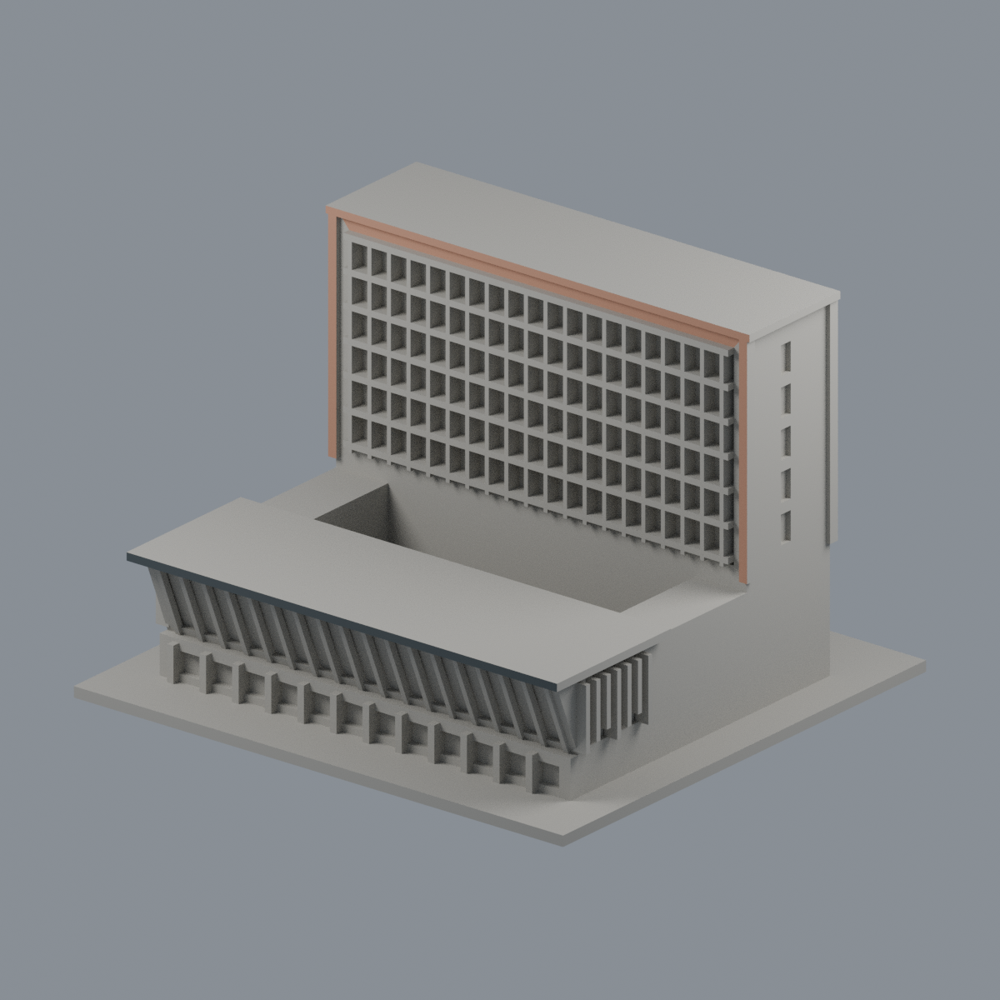
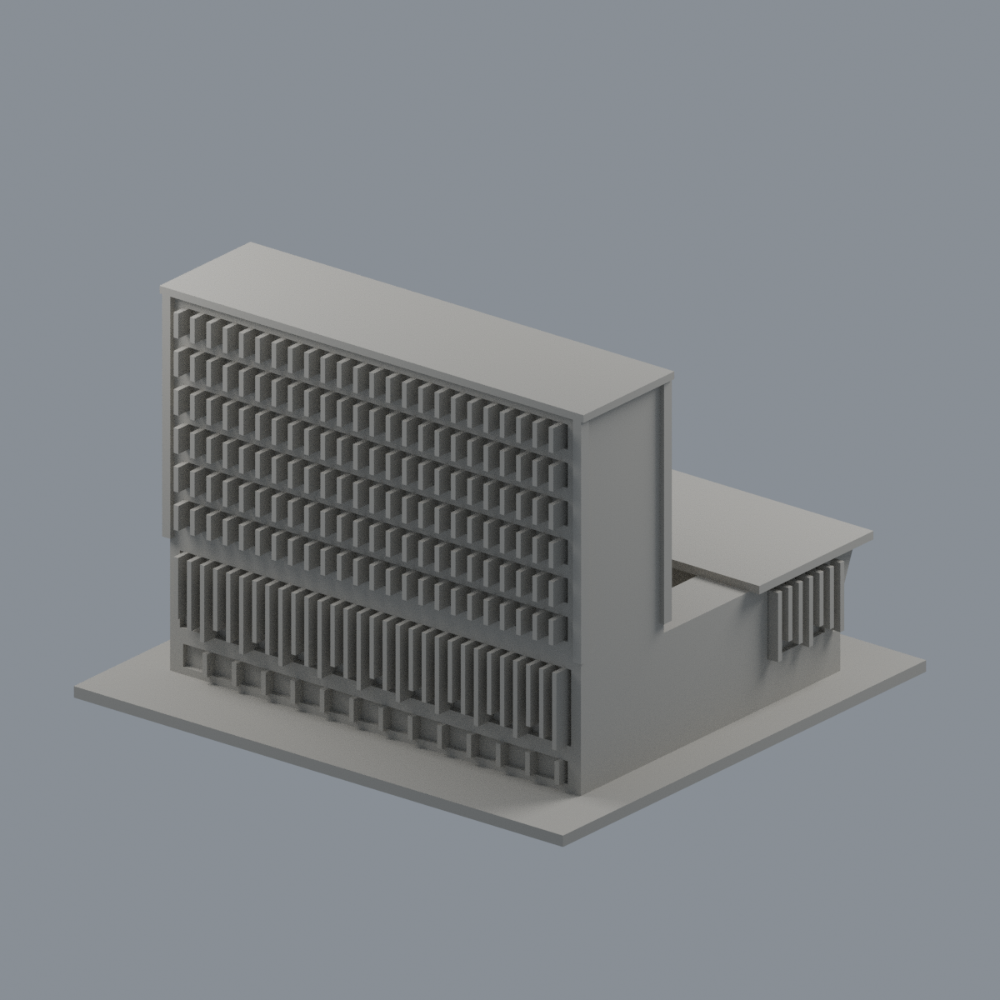
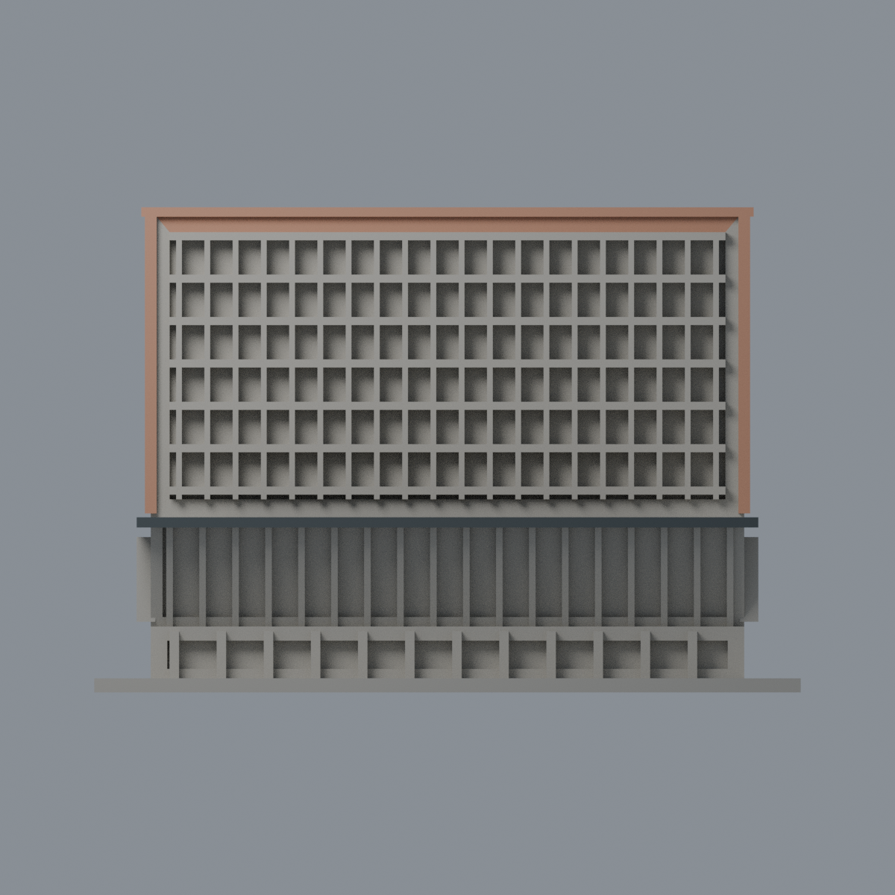
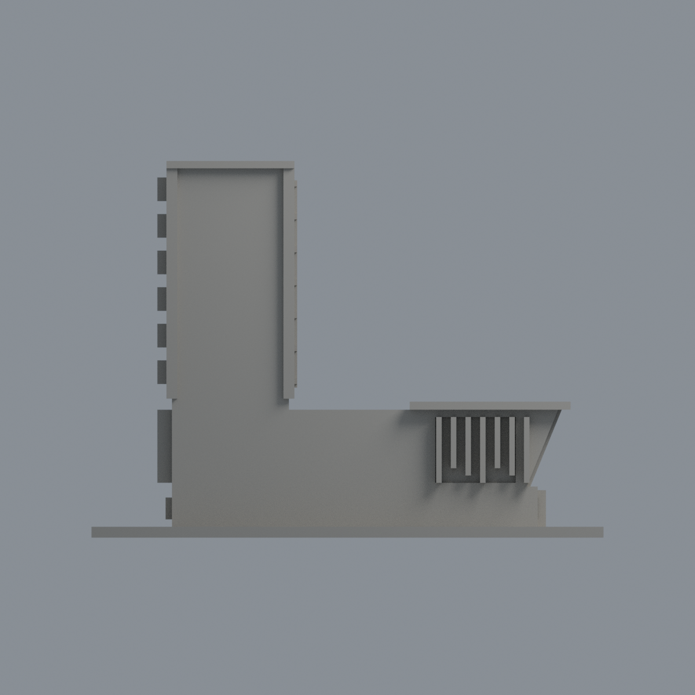
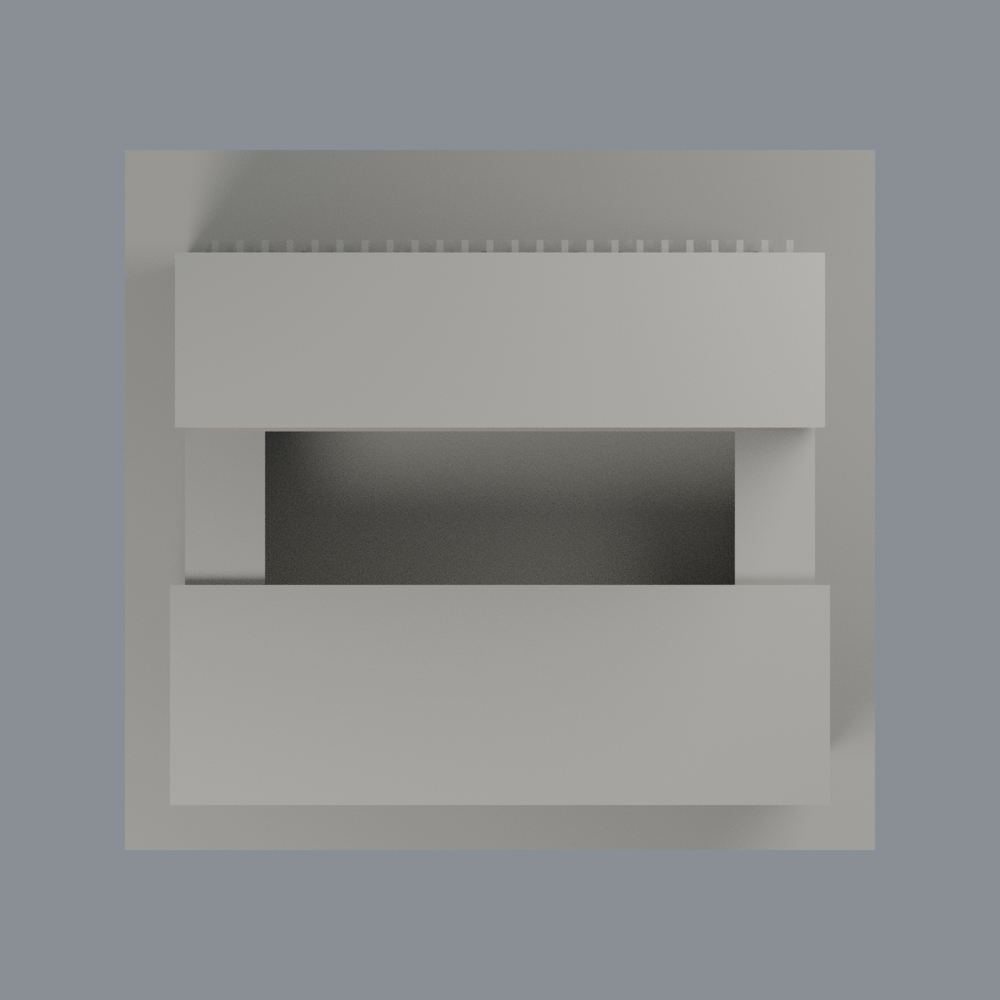

# 清華大學創新育成中心 — 限域外觀配色

本層是既有近似模型的附加材質，不是新建築套數、全棟材質復原或現況實測。原 STL、8666 三角與面序完全不變。依九典官方完工作品照片，只選可完整分離的湖側高棟磚框正向面 12 面（973.47537 mm²）與低翼深灰簷板前臉 2 面（290.40009 mm²），合計 1263.87546 mm²。

**磚框配色刻意不完整**：內退角面、內側窄框與其他未確證範圍維持中性，不能把這份配色視為完整磚牆位置圖。玻璃、彩色葉片、草頂、水平簷頂／底、側背及下層未知面全部中性。未補磚紋、細金屬收邊或玻璃透明材質；鄰清華實驗室、台積館及跨棟空橋均不屬本模型。

色票 #B7866D 與 #424A4D 是未經儀器測色的視覺代理，不是施工規範。來源照片拍攝日未知；作品 2011–2016、URL 2024/11 與 XMP toolkit 2012/02/06 皆不是拍攝日期。

既有兩翼深度、低層邊界、梯形斜玻璃、平蓋屋頂與減量加粗遮陽葉片皆為歷史近似；本批不修幾何。未做實體列印或重算歷史製造 QA。

## 檔案與重建
- [彩色 3MF](nthu-innovation-incubation-appearance.3mf)：原三角完整面材質，可編輯。
- [Blender 原生場景](scene.blend)、[色票](palette.json)、[面對照](face-materials.json)。
- 五圖：[正斜視](previews/front.png)、[後斜視](previews/rear.png)、[前立面](previews/elevation.png)、[側面](previews/side.png)、[頂面](previews/top.png)。
- [來源](SOURCES.md)、[許可說明](LICENSE-NOTICE.md)。

| 模型預覽 | 模型預覽 | 模型預覽 |
| :---: | :---: | :---: |
| 正斜視  | 後斜視  | 前立面  |
| 側面  | 頂面  |  |

將原 model.stl 與 appearance 資料夾置於同一父層；Python（numpy、lib3mf）執行 source/build_appearance.py、source/verify_exchange.py、source/verify_material_boundaries.py；Blender 4.3.2 執行 source/render_appearance.py 與 source/verify_scene.py。獨立乾淨重建需驗 3MF、maps、五張 PNG bytes 相同；Blend 驗語義而不宣稱二進位確定性。

## 2026-11-14 淺前簷底有限補色（重新建置版）

僅原面8253與8259，由中性改既有磚族1（#B7866D、粗糙度0.78）。完整前側淺簷底z101、x±61.75、y14.5–16，面積185.25mm²；兩側耳部維持各自未修改面域。原8666三角面、座標、順序與幾何不變。現版仍3個顯示材質，指派數8650／14／2；上方舊14個已配色面等敘述及舊QA屬歷史版，本版為16面。

來源為[建築師完成案](https://www.bioarch.com.tw/work/清華大學創新育成中心/)及其完整外觀照片；拍攝日期未知，專案年代、網址日期與軟體metadata不等於拍攝日。既有未校準磚族僅有限近似，原深度與端點為粗代理，不認證磚種或精測色。不延頂面、側後簷、深幕牆、玻璃或低翼；保留原工程、製造、未試印與未知立面限制。照片不隨包散布。

本版由當前公開模型重新建置，不是尋回或恢復已遺失的舊草稿。模型與五個原生視角圖沿用此次完成候選的原bytes，相機與48samples不變。完整研究與獨審留在本地，不新增公開廣泛審核清單。PUBLIC-MODEL-SHA256SUMS僅核所列當前產品，舊checksum與QA不代表新版。

### 現版重建

ZIP含原STL、既有build_appearance.py與render_appearance.py、三支明確的現版包裝/驗證程式及本說明。使用NumPy與Blender4.3.2，在解包根目錄執行：

1. `python -B appearance/source/build_current.py`
2. `python -B appearance/source/verify_current.py`
3. `blender -b -t 4 --python-exit-code 1 --python appearance/source/render_current.py`

請以現版命令取代上方歷史建置命令；直接執行舊builder會重建歷史配色。新程式只使用本地模型，寫出當前材質/3MF/五張PNG/scene與本地核驗報告；渲染包裝程式會暫存並還原既有歷史render-manifest，若原不存在則移除該次暫產的歷史檔名報告。不進行網路或憑證操作。
