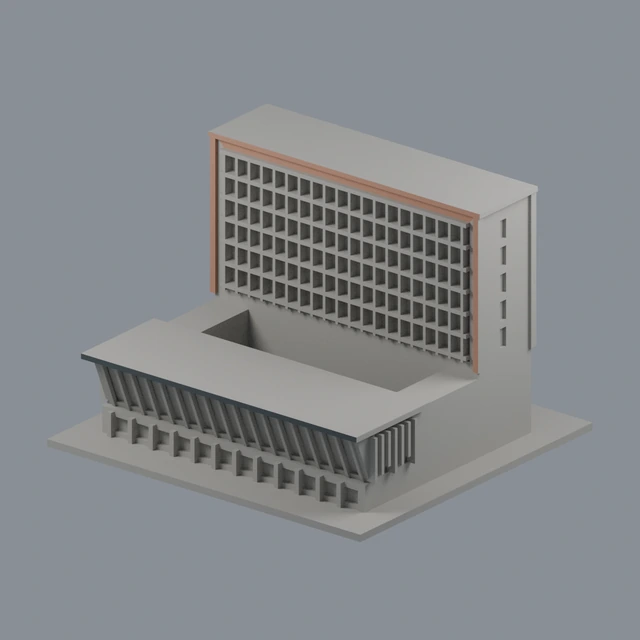
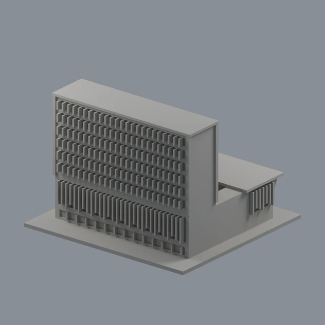
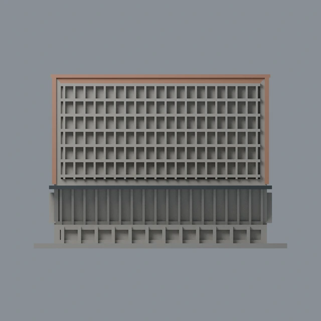
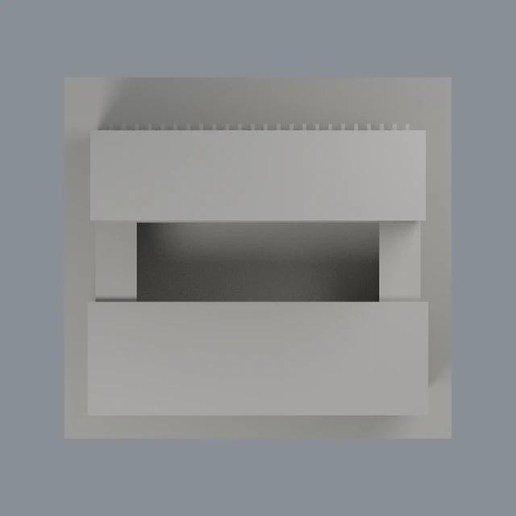
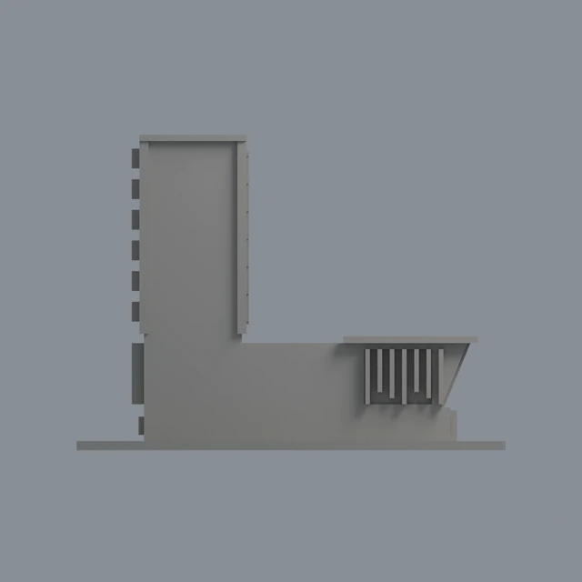

# 清華大學創新育成中心｜磚框與簷面限域配色・現行彩色展示

## 模型預覽

| 模型預覽 | 模型預覽 | 模型預覽 |
| :---: | :---: | :---: |
|  正面 |  背面 |  正立面 |
|  頂視 |  側面 | |

五張全尺寸無失真 WebP 由現行三材質 Blender 場景核對重繪，點擊縮圖可放大。保留既有 18 面磚框與 2 面低翼簷前臉材色，包括既有四個磚框淺內返三角。不把未核對的側背、屋頂或玻璃染色。此為限域外觀材色，非整棟上色或現況實測。幾何與配色未變更。

[現行彩色 Blender](../appearance/scene.blend) · [彩色 3MF](../appearance/nthu-innovation-incubation-appearance.3mf) · [STL](../model.stl) · [OBJ](../model.obj) · [渲染驗證](render-proof.json) · [本頁校驗](SHA256SUMS)

[當前模型校驗](../PUBLIC-MODEL-SHA256SUMS) · [原模型與限制](../README.md) · [原外觀來源與證據](../appearance/README.md)。歷史 hash-manifest 的 README 校驗屬前版，現行工程校驗另列；驗證紀錄明列既有差異。歷史圖、原 README 與工程資料均未改動。未實體試印。
