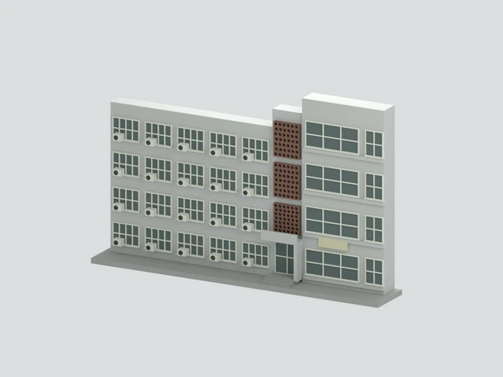
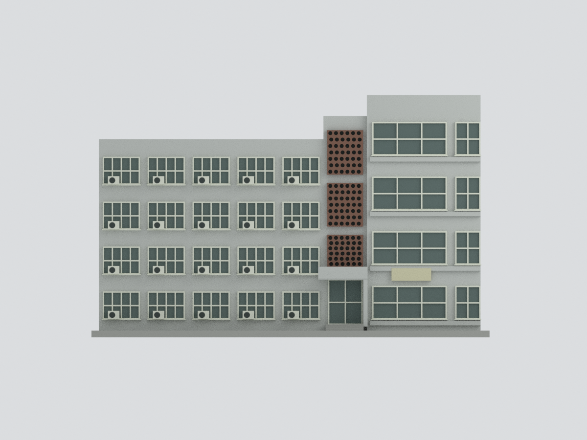
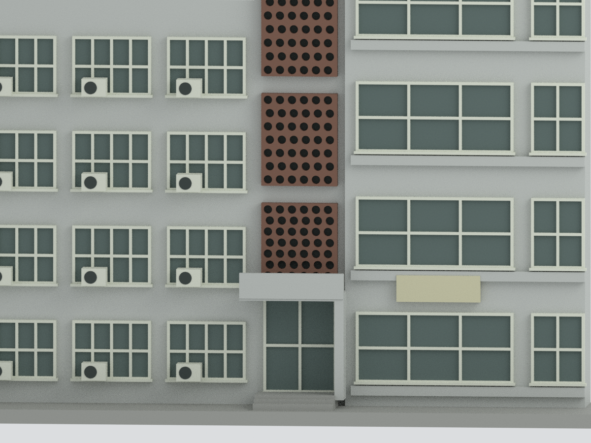
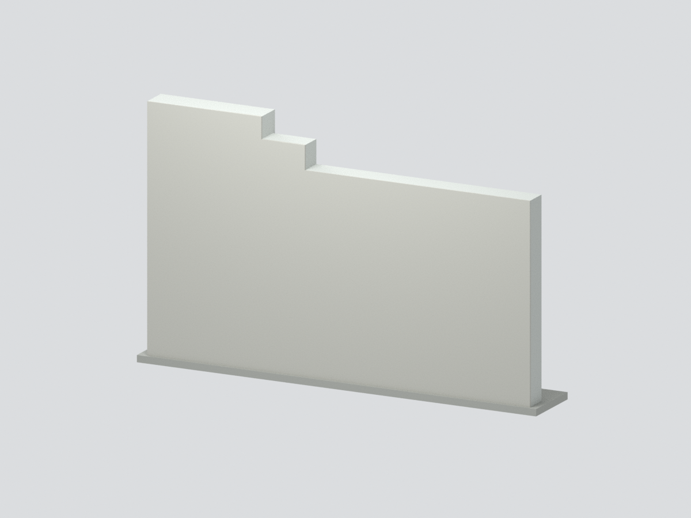
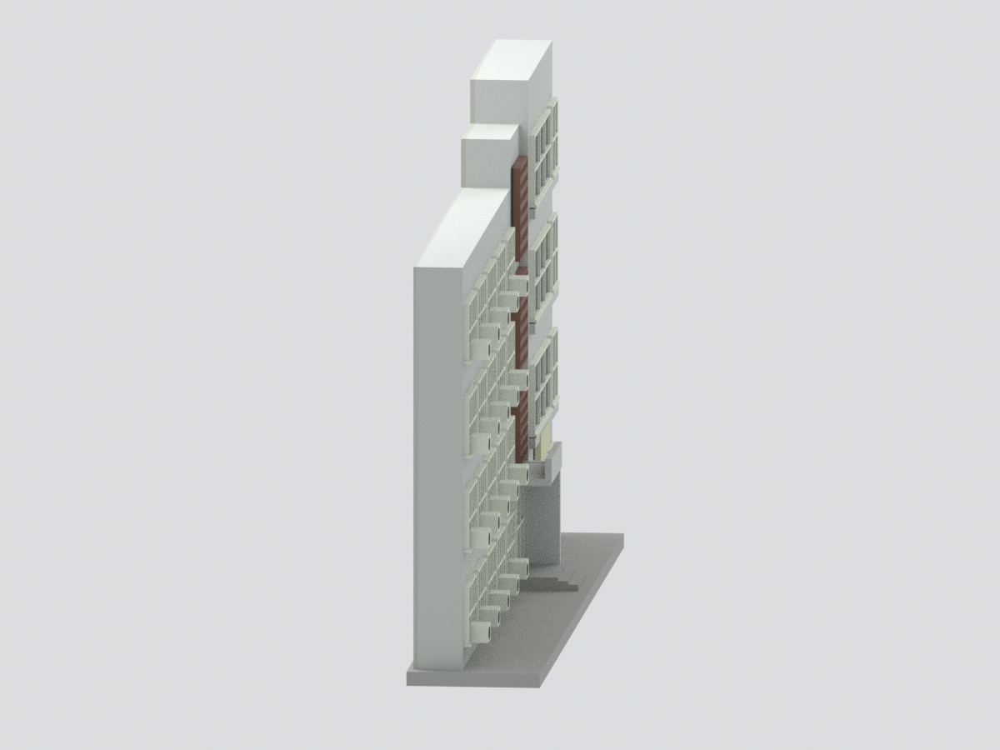
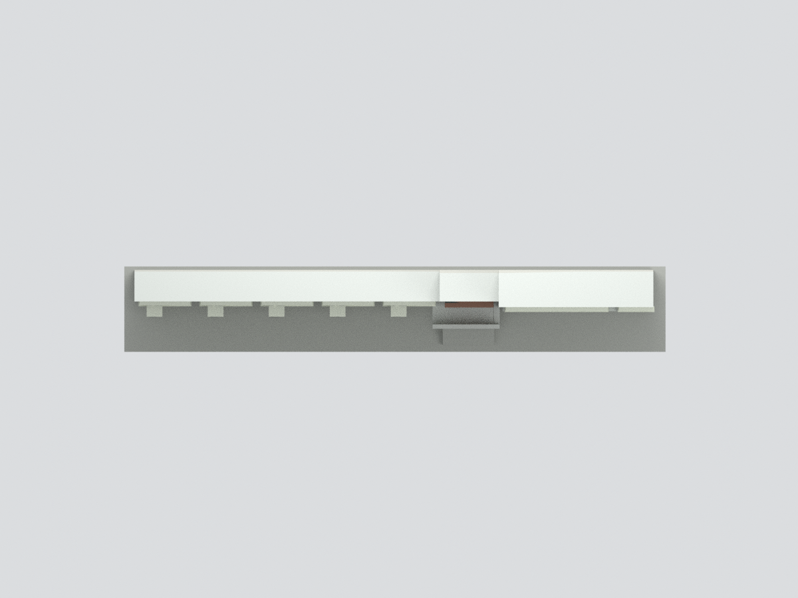

# 國立清華大學禮齋｜正門與兩側可見立面截段

## 模型預覽

六張 WebP 大圖是現版模型渲染，與保留的 PNG 解碼像素一致。這不是整棟禮齋，也不是建築現場照片。

|  |  |  |
| :---: | :---: | :---: |
| 正面斜視 | 正立面 | 圓孔屏與正門 |
|  |  |  |
| 人工背截面 | 左端切面 | 人工截深俯視 |

背面與端、頂封口為模型截切支承，不代表實際背立面或屋頂。原件未試印。

[原模型與範圍](../README.md) · [STL](../model.stl) · [彩色 3MF](../model.3mf) · [可編輯 Blender](../scene.blend) · [重建](../REBUILD.md) · [QA](../QA.md) · [原交付校驗](../SHA256SUMS)

[展示校驗](SHA256SUMS) · [影像核對](RENDER-PROOF.json)

原 PNG、六份相機渲染回條、模型、來源說明及重建檔均保留在原路徑。
