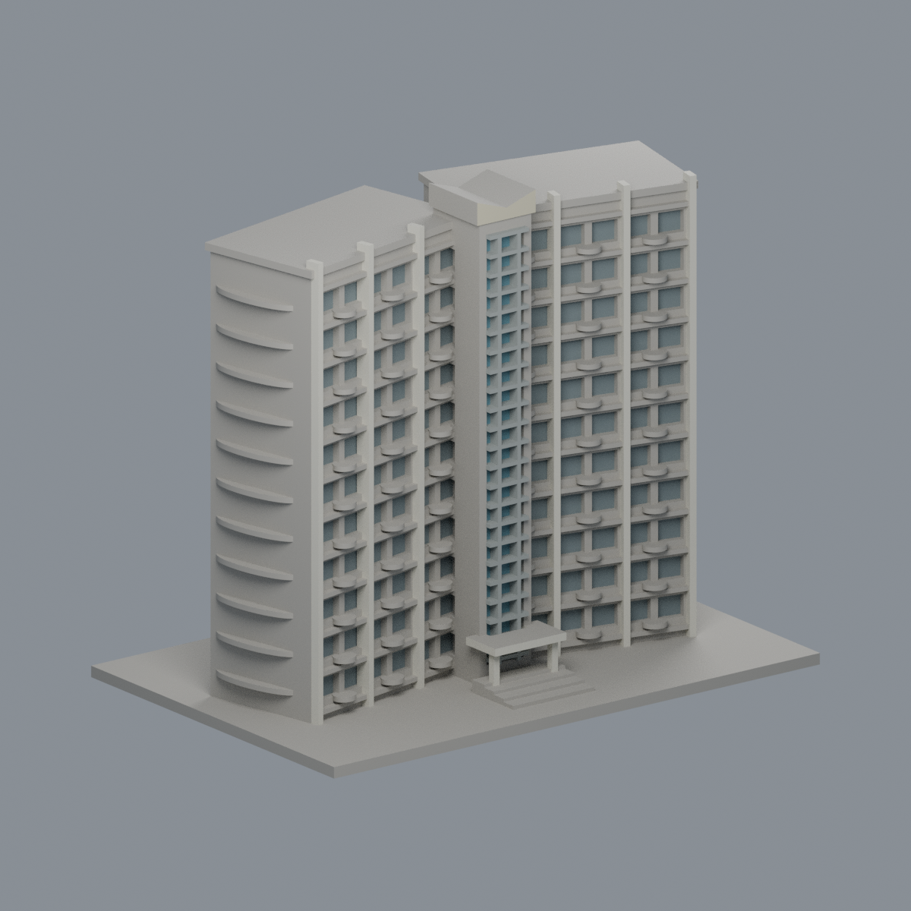
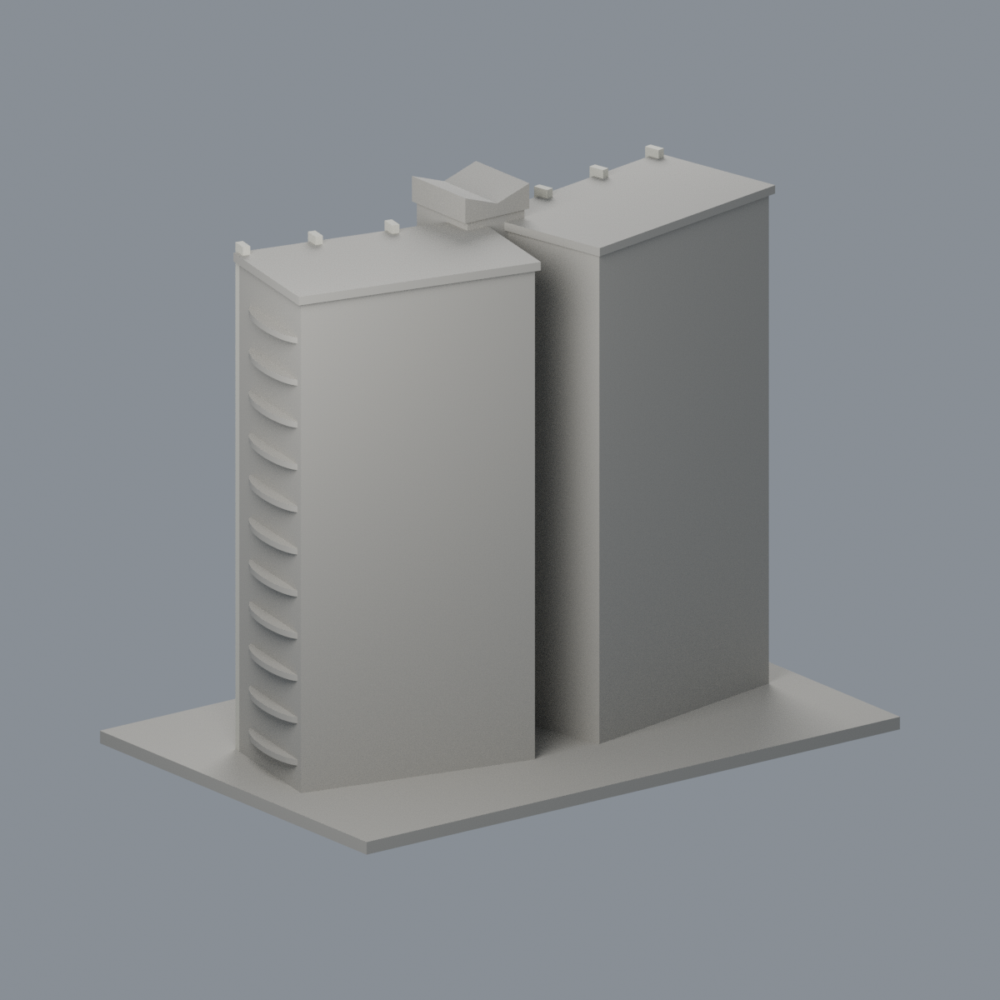
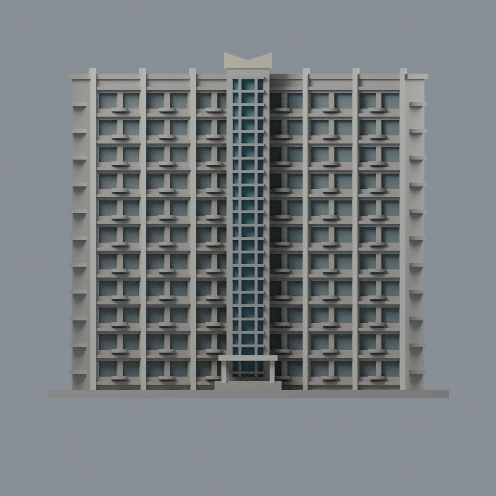
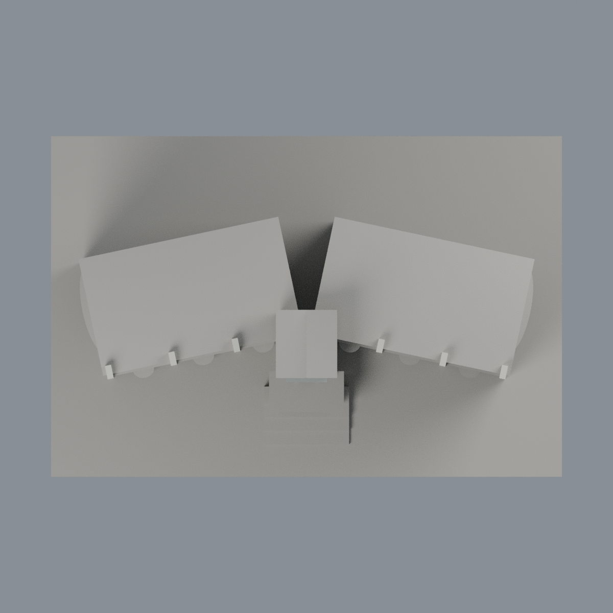

# 清華清齋 AB 中央玻璃與結構有限配色：五材質外觀版

沿用原 **33,320 三角面／16,658 頂點**，不改原 STL 位元、座標、面序或幾何；這是既有模型外觀改版，不增加模型包數。

| 模型預覽 | 模型預覽 | 模型預覽 |
| :---: | :---: | :---: |
| 正面  | 背面保持中性  |  |
|  |  |  |

[表面色 3MF](nthuqing-appearance.3mf) · [可編輯 Blender](scene.blend) · [材質色表](palette.json) · [逐面指派與依據](face-materials.json) · [原 STL](../model.stl)

## 來源與配色邊界

本件僅清齋 **A／B 雙翼前部的中央玻璃與結構有限配色**，不是整群宿舍全彩。親看住宿組三張完整公開外觀、原單色網格與生成器；以第三張下方 A／B 標示註冊本件，不把前兩張更寬的玻璃塔套到此窄中縫。[精確來源與分列日期](qa/source-review.json)。nested EXIF Original 為 2026-07-15，相機自報、未獨立認證；不把頁面更新或修改欄冒稱拍攝日。照片私有研究，不入包。

- 原中央窄玻璃凹背採低飽和藍灰，已分橫直金屬梃銀灰；兩翼大直肋淡象牙，完整構件側面有界延伸。僅離散窗洞背採灰藍代理，不重建個別簾色、空調或室內。
- 兩翼主牆實景含寬灰窗裙與米白磁磚，但原薄凸線不對應完整灰帶界，因此整片主牆中性，細水平線也不拿來宣稱完整灰裙。配色沒有改面或切出斜線假邊界。
- 原小圓弧平台不是來源的黑欄杆獨立幾何，保持中性，不把整個平台染黑；中頂折帽、屋頂、未知外端與後側中性，不外推其他寬玻璃塔的綠頂色。
- 入口棚僅可見邊／底與柱採淡色，未見頂面中性。字牌、個人物品、設備與保全／室內細節均不加入；原層數／尺度／窗格與欄杆簡化不因顏色而改善。

[原幾何與歷史來源限制](../README.md)

## 重建與核驗

安裝 [依賴](source/requirements.txt)，Blender 使用 4.3.2。由本資料夾上層提供原 model.stl：

1. `python appearance/source/build_appearance.py`
2. `python appearance/source/verify_exchange.py`
3. `blender -b -t 3 --python-exit-code 1 -P appearance/source/render_appearance.py`
4. `blender -b -t 3 --python-exit-code 1 -P appearance/source/verify_scene.py`

[獨立重建 ZIP](rebuild-source.zip)含原 STL、四支程式及依賴，不含第三方照片；不取代原建模腳本。[逐檔 SHA256](SHA256SUMS)

[交換／拓撲 QA](qa/exchange-validation.json)核對原座標與面序、全部面材質、單連通、有向水密邊、頂點 link 單環、正體積與零退化／重複面；lib3mf 嚴格讀取零警告，實際編輯單材質再存讀，其他材質及面指派不變。SDK 六位小數量化誤差另列。

[Blender 存讀與編輯](qa/scene-validation.json) · [渲染記錄](qa/render-manifest.json) · [獨立重建](qa/rebuild-validation.json)

## 製造限制照舊

尺寸仍為 150 × 100 × 129 mm；原 STL、建模程式、場景及歷史 QA 保留。原層檢與薄特徵檢查本次未重跑，不能由材質 QA 代替。

3MF 是同一網格的表面色，不是各材質各自封閉的分色實體、切片專案、噴頭映射或 G-code。切片 GUI、多材料路徑與實體列印未測；柱頭、屋簷、窗框及薄邊仍須評估材料、支撐及拆除風險，沒有保證可印或免支撐。

## 2026-11-14 有限外觀修正（重新建置交付版）

# A/B crown background approximation

This is a fresh reconstruction from the recorded repository baseline, not recovery of a lost build. Only three original complete front V-crown triangles (33143,33153,33155) change from neutral to new material 5 AB_crown_light_khaki_background_approximation, #C6C1A7 and roughness 0.88. All five original shaders and the other 33317 face indices remain unchanged. STL, topology and face order remain unchanged.

The 81 mm² modeled polygon is a coarse pale-khaki background proxy, not a claim that the real component is homogeneous. The photographed gray curved border/soffit, fine divisions and exact proportions are not built. No back, side, underside, other tower or other window is extended. Camera EXIF is self-reported, not authenticated. Original engineering and manufacturing limitations remain. Historical QA files and original README stay byte-preserved and are not claimed as current verification.

Rebuild: install appearance/source/requirements-current.txt with your package manager, run python -B appearance/source/build_current.py, then python -B appearance/source/verify_current.py, then blender -b --python appearance/source/render_current.py. Four original cameras and CPU48 samples are retained.

# Public reference links

- https://sthousing.site.nthu.edu.tw/var/file/254/1254/img/1333/IMG_2047.jpg
- https://sthousing.site.nthu.edu.tw/var/file/254/1254/img/1333/IMG_2188.jpg
- https://sthousing.site.nthu.edu.tw/var/file/254/1254/img/1333/IMG_2180.jpg
- https://sthousing.site.nthu.edu.tw/p/404-1254-43329.php?Lang=zh-tw

Official housing photographs: only image 2 (IMG_2180) registers the A/B narrow central crown; other wider glazed towers do not supply its material. Camera metadata date is self-reported, unverified and not current-condition authentication. Photos and private evidence are not redistributed.

現版共 6 個顯示材質（含未知中性色）。上方原材質數、面域與QA描述為歷史版本，僅由本節有限範圍更新。本版是重新建置，不是尋回遺失草稿；不新增幾何或擴充補色範圍。

本節提及原ZIP/QA/校驗數目屬歷史記錄，不是現版ZIP清單。現版ZIP僅含原STL、必要舊建置與渲染程式、三支現版包裝／驗證程式、requirements-current.txt與本README及授權說明（如原有）。完整來源研究、照片、私人審核與廣泛校驗清單不公開。PUBLIC-MODEL-SHA256SUMS僅核當前交付產品；原QA不替代當前驗證。

現版命令：`python -B appearance/source/build_current.py`、`python -B appearance/source/verify_current.py`、`blender -b -t 4 --python-exit-code 1 --python appearance/source/render_current.py`。依requirements-current.txt安裝必要依賴。直接執行舊builder會重建歷史配色。包裝程式僅執行固定本地舊程式，新增材質時只替換新材質粗糙度運算；寫模型、材質、場景、原視角PNG與當前本地QA。歷史報告先保存再還原；原不存在時只刪該次產生的舊名報告。不進行網路或憑證操作。
