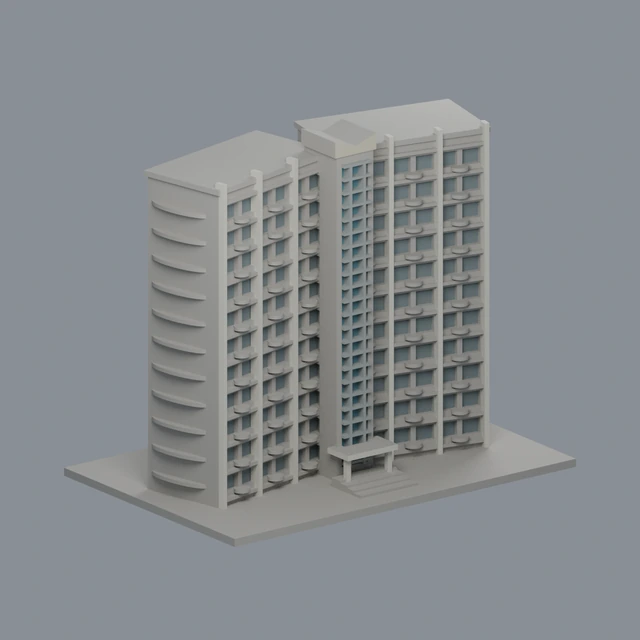
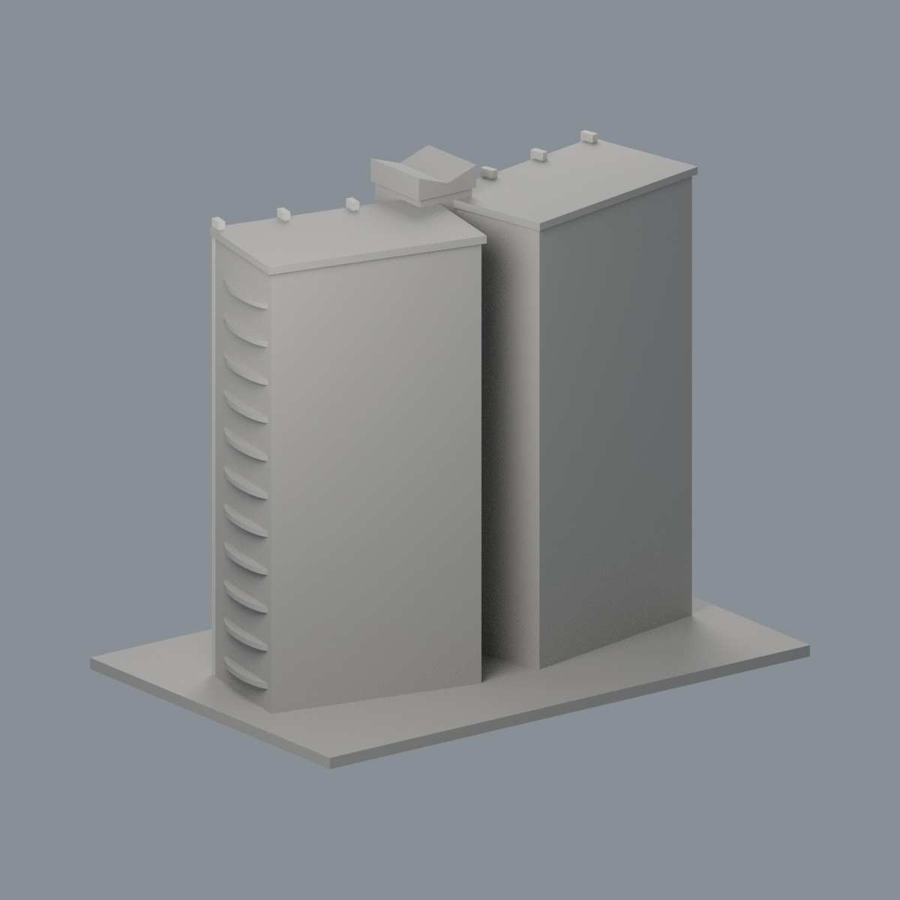
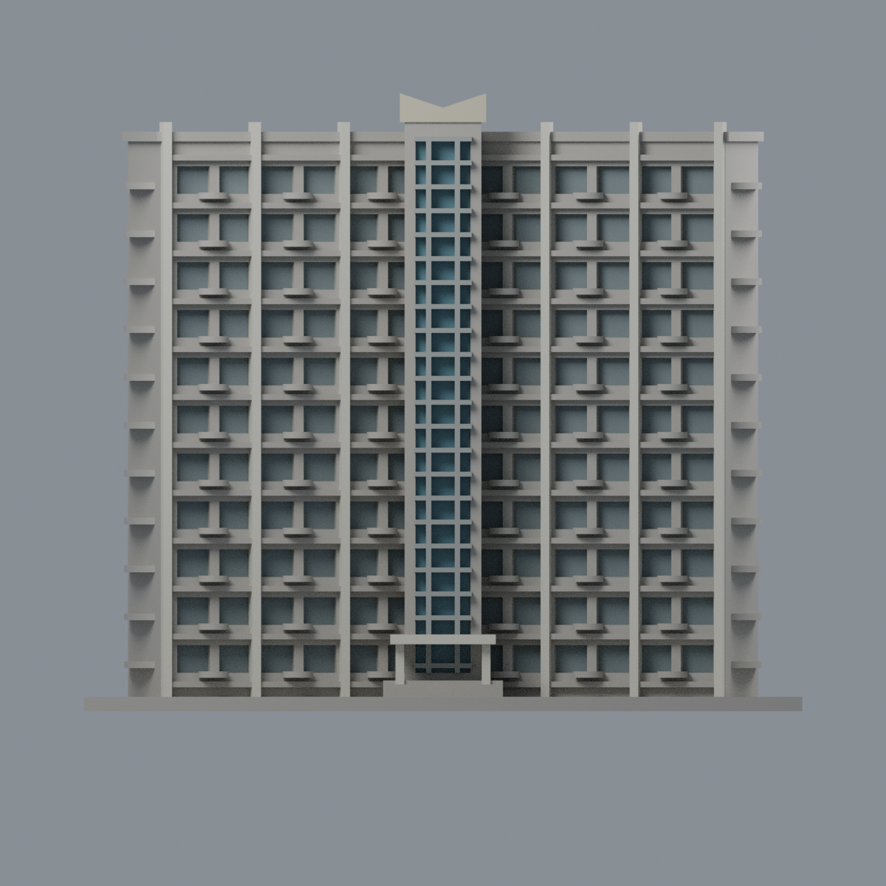
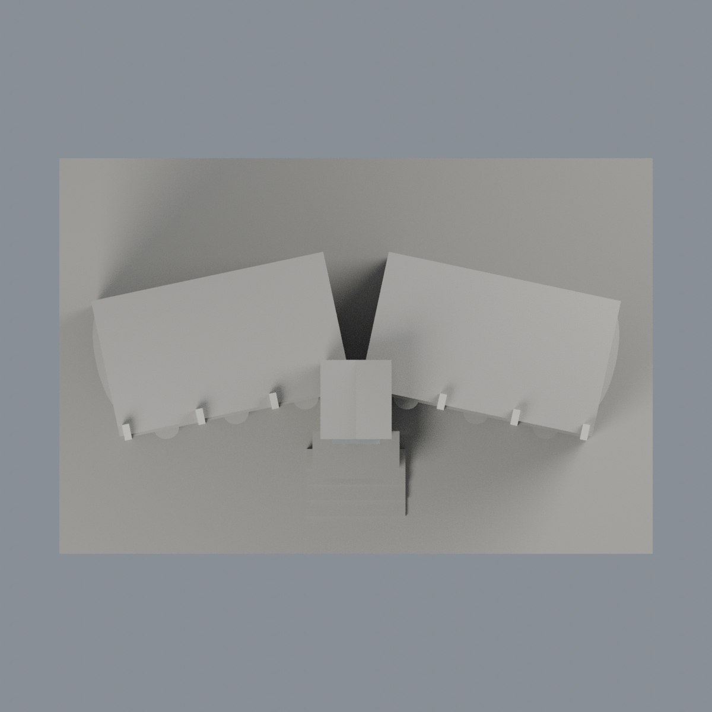

# 國立清華大學清齋 A／B｜局部外觀展示

四張原相機 WebP 與現行彩色 PNG 的解碼 RGB 完全相同。模型只涵蓋 A／B 雙翼外觀群，並非整個清齋。

|  |  |  |
| :---: | :---: | :---: |
| 正面 | 模型背側（中性） | 正立面 |
|  | | |
| 頂視 | | |

沿用現行 A／B 中央窄玻璃與框架、前側肋、個別窗口及 V 形冠部三面的有限配色。兩翼有跨材質的原面或無法對到照片邊界的地方、屋頂與未見背側保持中性代理，不代表實景灰色。這次只加展示，沒有新補色、改模型或試印。

[模型與原範圍](../README.md) · [當前材色、來源及重建](../appearance/README.md) · [STL](../model.stl) · [彩色 3MF](../appearance/nthuqing-appearance.3mf) · [可編輯 Blender](../appearance/scene.blend) · [當前產品校驗](../PUBLIC-MODEL-SHA256SUMS)

[展示校驗](SHA256SUMS) · [展示影像核對](RENDER-PROOF.json) · [歷史外觀校驗](../appearance/SHA256SUMS)

原 PNG、工程資料與歷史外觀文件留於原路徑。歷史校驗不取代當前產品校驗。
