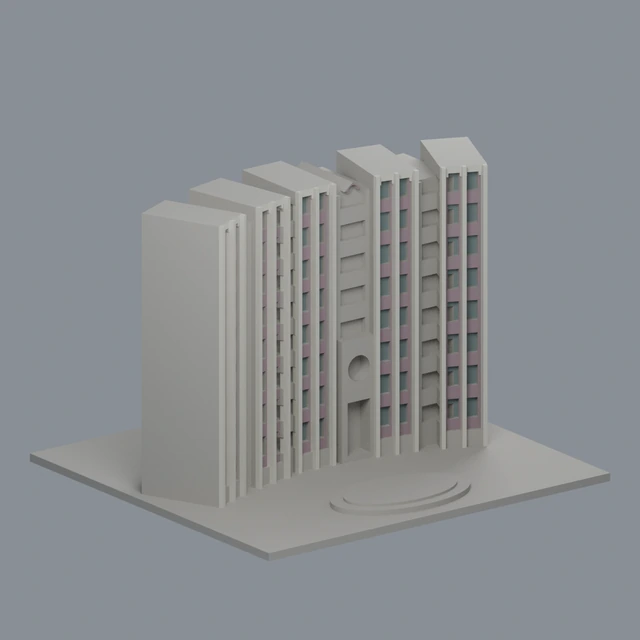
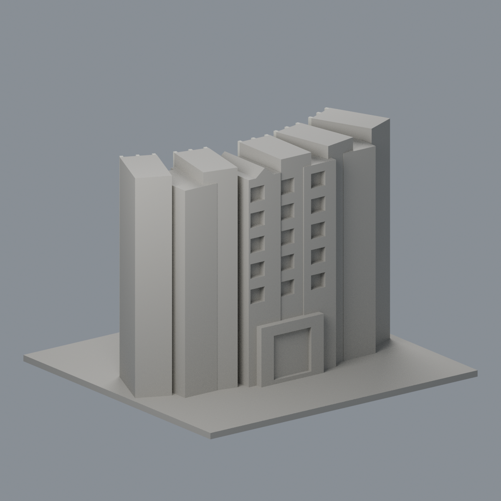
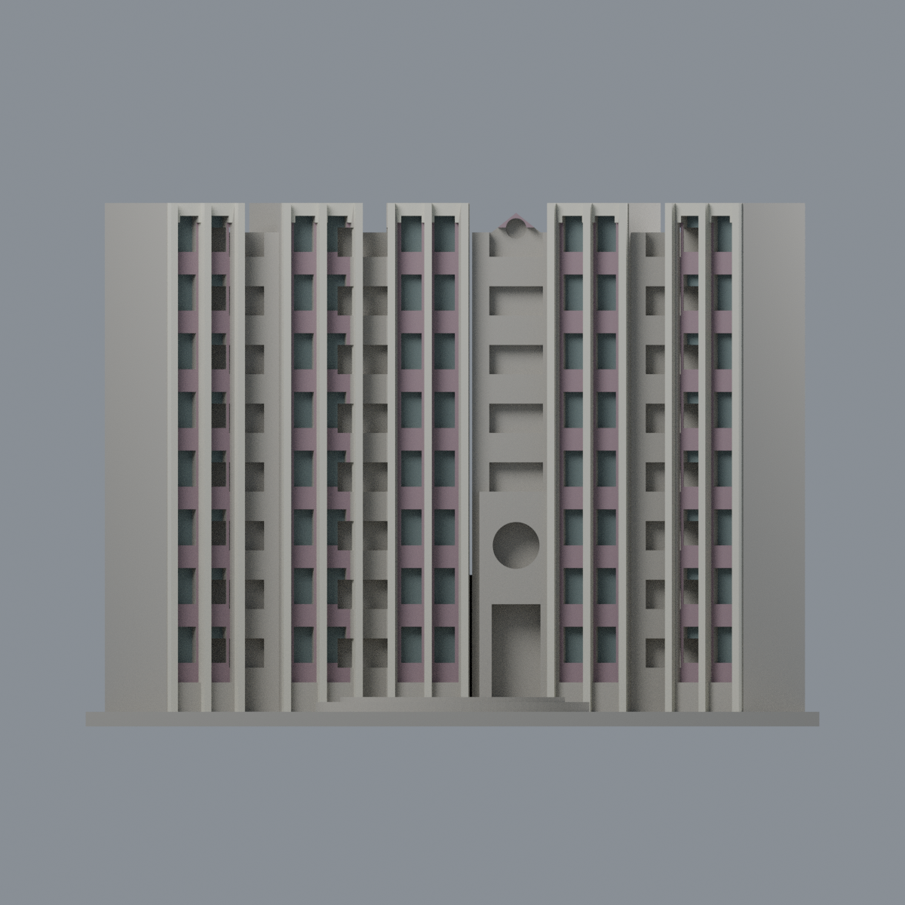
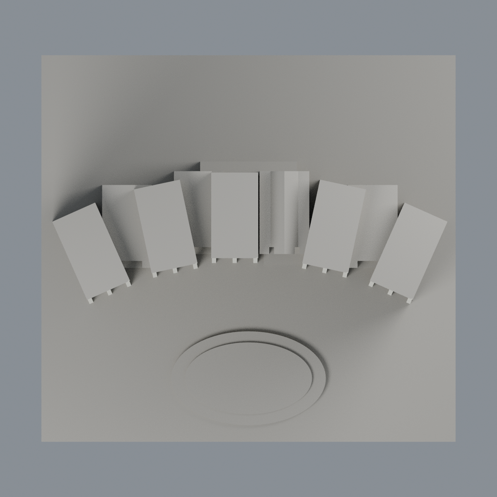

# 國立清華大學新齋｜五折前立面四材質展示

## 模型預覽

四張 WebP 取自現行四材質 Blender 場景，與保留的彩色 PNG 解碼像素一致。這是來源支持的有限補色，不是整棟外觀的實測復原。

|  |  |  |
| :---: | :---: | :---: |
| 正面 | 模型背側 | 正立面 |
|  | | |
| 頂視 | | |

保留既有五折前面與上山牆局部材色；未證實的反側、屋面及混合牆面仍是中性代理，並非實景灰色斷言。未試印。

[模型與原範圍](../README.md) · [當前材色與重建說明](../appearance/README.md) · [STL](../model.stl) · [彩色 3MF](../appearance/nthuxin-appearance.3mf) · [可編輯 Blender](../appearance/scene.blend) · [當前產品校驗](../PUBLIC-MODEL-SHA256SUMS)

[展示校驗](SHA256SUMS) · [展示影像核對](RENDER-PROOF.json) · [歷史外觀校驗](../appearance/SHA256SUMS)

原 PNG、工程資料與歷史外觀文件留在原路徑。歷史校驗只描述舊版，不取代當前產品校驗。
