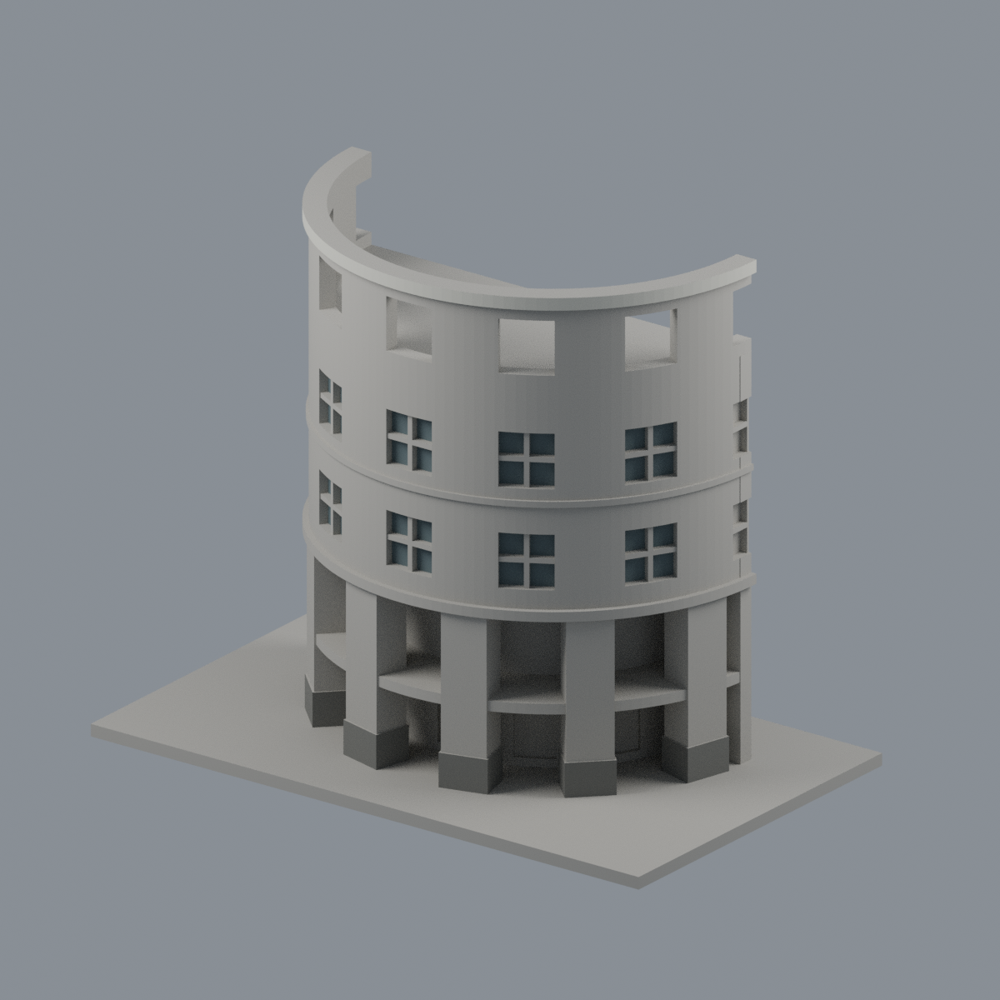
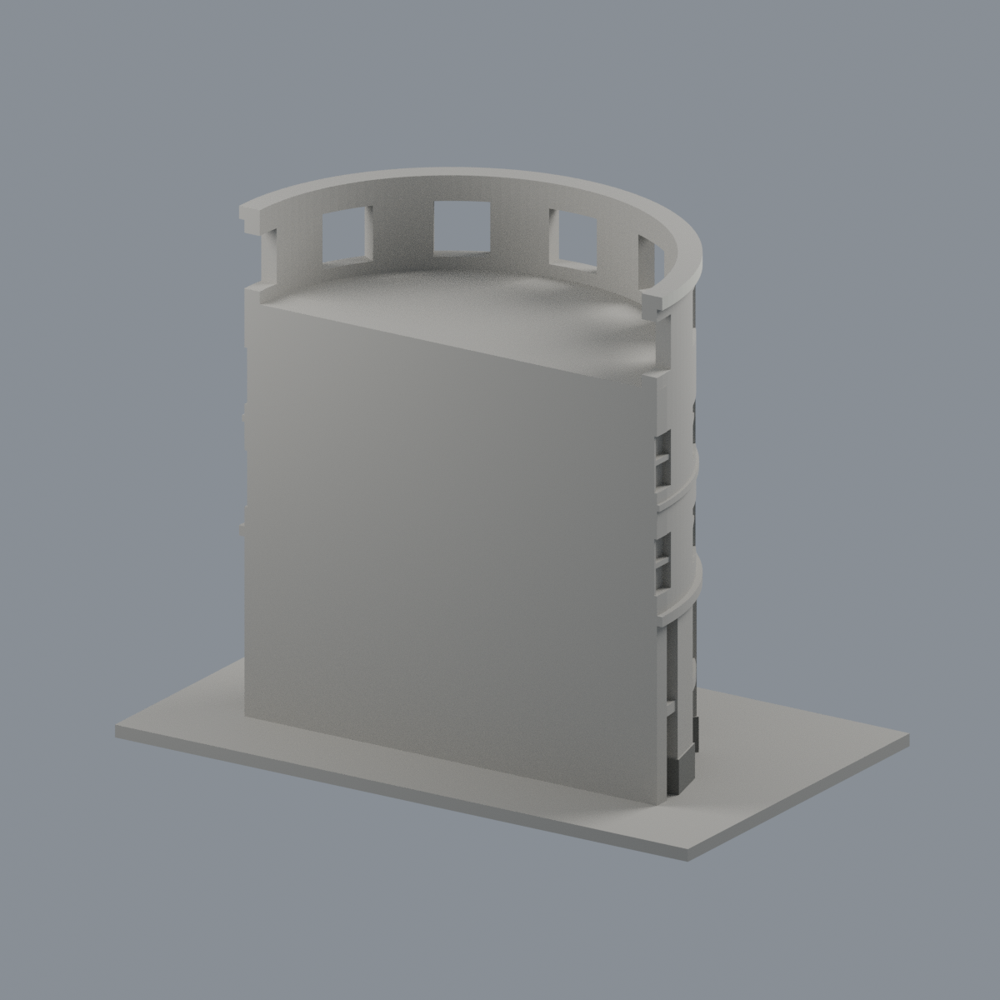

# 國立澎湖科技大學｜圖書資訊大樓圓弧入口前段

## 模型預覽


| 模型預覽 | 模型預覽 | 模型預覽 |
| :---: | :---: | :---: |
| 前段有限配色<br> | 人為截斷背面維持中性<br> |  |

## 本次六個灰柱腳的朝內垂直面延色

僅延色六個原灰柱腳各自第四個朝內垂直面，共 12 個原三角 [1858,1861,1892,1893,1925,1927,1958,1959,1988,1989,2022,2023]，由未確認材質 0 延用既有灰柱腳材質 2。原 80 玻璃、36 灰柱腳、144 淡冠環面全保留；現 4650 未確認、80 玻璃、48 灰柱腳、144 冠環面。其餘 4910 面的材料與理由、全部原色盤 bytes、4922 面／2429 點、150×90×122 mm 外包、原 STL bytes、座標、面序、繞向全部不變。

每柱腳角度為 −165、−135、−105、−75、−45、−15 度。在各自徑向／切向座標中，新增朝內面位於徑向 45.4 mm、切向 −5.8…5.8 mm、z=3…11.3 mm，法線向圓心。每個完整矩形為原兩三角、完整共面連通域及原四角，解析 11.6×8.3=96.28 mm²；總解析 577.68 mm²，原網格約 577.680044701 mm²，各域面積容差 0.0001 mm²。每個內面的兩條垂直邊都全高 8.3 mm 鄰接原灰側面。原柱腳盒底 z=2.8…3 埋在底座內，本次不補造、不重新露出。

已親看澎科大校方正面與側拍原圖：分立柱腳為中灰，柱身與柱腳上方薄頂唇為淡色。朝內面延續同一個灰柱腳，屬有界同構件材料推論，不宣稱六個朝內面都各自有直接照片。頂唇、柱腳頂面／底面、上方淡柱身、圓弧主體、原窗框／窗背、雨棚、冠環與 y=0 人工後裁面全不染，不能以同色理由推成全柱或整個背面。既有塊狀柱腳是比例近似，不新增石材接縫或貼圖。

來源為校方圖書資訊大樓導覽 https://www.npu.edu.tw/tour/Details.aspx?Parser=13%2C4%2C34%2C%2C%2C%2C4 與原正／側照片（原 SOURCES.md 保留）。導覽頁 2018-08-29 為異動日期，不是拍攝日期；照片拍攝日期未知，不宣稱 2026 現況，未色卡校準。私人原照片不加入公開包。

原幾何製造限制、裁切範圍及歷史 QA 保留。本次 strict 3MF／封閉流形與精確交換 PASS 不是實體試印、全域壁厚或支撐保證。root 的 STL、OBJ、scene、生成器、預覽與歷史校驗檔完全不動。新彩色版本在 appearance；歷史 appearance/qa、原 source 程式、rebuild-source.zip、SHA256SUMS、SOURCES 等原樣保留，仍記錄原版本。palette 的歷史 scope 也保留，新增範圍以本段及 appearance/qa-continuous-plinth 為準。

新 mesh-data.npz、face-materials.json、npu-library-rotunda-front-appearance.3mf、scene.blend 及十張 previews 經精確交換、Blender 獨立材質／頂點編輯再存重開、原 scene 重渲染逐 bytes 核對。材料名稱、RGBA、shader 色與粗糙度保留。原五相機加左側、背立面、兩個低角度柱廊視角和底視，均完整框入局部模型；人工背截面不代表實景背立面。

新 QA 在 appearance/qa-continuous-plinth，當前 hashes 在 CONTINUATION-SHA256SUMS，兩份獨審及新輸出補核原樣納入。重建 python appearance/source/build_continuous_plinth.py，交換驗證 verify_continuous_exchange.py；Blender 執行 render_continuous_plinth.py 與 verify_continuous_scene.py。新 rebuild-continuous-source.zip 已隔離精確重建並重跑 strict 交換驗證。僅本地準備，不能解讀為已上傳。

本輪全部原物件屬性與完整材質定義皆保留，僅 12 個指定面的材質指派延伸；原 palette scope 保留歷史文字，現行範圍以本節為準。舊校驗表與 QA 保留歷史 bytes，根 PUBLIC-MODEL-SHA256SUMS 與 appearance/CONTINUATION-SHA256SUMS 為現行校驗。

## 前版說明與保留限制

## 圓弧入口前段有限配色（2026-10-22）

[配色五視角、來源與限制](appearance/README.md) · [表面色3MF](appearance/npu-library-rotunda-front-appearance.3mf) · [可編輯Blender](appearance/scene.blend)


僅五完整窗位×兩列的80個窗背原面，以及六個既有柱腳外側36面配色。原幾何未分出實景藍綠遮棚，連續簷線保持中性、不整圈染色；其餘4806面中性。局部身份、4922原三角面、全部STL bytes與歷史QA不變，不增套數，不擴成全館。官方照片拍攝日期未知，不代表2026現況。3MF是單網格表面色、不是分色封閉實體或切片G-code；支撐與橋接限制保留，未實體試印。官方照片不再散布。


**局部模型，不是全館。** 本件僅涵蓋向校內廣場突出的圓弧入口前段，後侧主館、樓梯塔、兩翼、連通廊道均不在範圍。背面 y=0 mm 為人為截斷素面，不是真實背立面。攝影日期未知的官方導覽照片、樓層配置圖與2026會議附件共同支持外觀；不宣稱2026全館最新現況或工程測繪。


正立面（歷史檔案留存，不作本頁預覽） · 頂視（歷史檔案留存，不作本頁預覽） · [STL](model.stl) · [可編輯Blender網格](scene.blend)


## 依據與取捨
- 兩列玻璃窗以凹窗加加粗十字框表現，前弧每列7個窗位（5個完整窗＋直徑截面左右端各半窗，不是7個完整窗），最上列是全深開口，未填成玻璃或淺凹框。
- 官方四樓平面列示整圈12柱分布，前半6支大柱與上下兩層柱廊保留。門窗細框不算主柱。
- 圓弧柱廊向內退約17 mm；這是依照片比例估算的模型深度，並非真實丈量。
- 冠環高於內側屋面；屋面高程、退縮與厚度是依照片的近似估计，非有尺寸的工程圖。保留頂部開放空間，沒有捏造通至地面的內院。後側截斷面不加未知窗組。
- 2026-02-26校園規劃會議核准後側塔樓基地台看板／棚架方案，未取得竣工證據，且該塔不在本局部範圍。未將方案當成完工現況。
- 英文字、磁磚小縫、雨管、植栽及過細欄杆省略。窗框加粗至1.2 mm、實際牆體連接加深，避免零厚接觸。

## 列印
尺寸150 × 90 × 122 mm，含3 mm底座；毫米為單位，底座朝下。各建物獨立比例。模型有柱廊、水平門窗上緣和冠環開口，需自行於切片器確認支撐與橋接；建議先試切片局部。數位幾何檢查不是實體試印或Cura／Prusa工具路徑驗證，不保證免支撐或任意印表機都可印。

## 自主重建及檢查
Python 3.12，依 requirements.txt 安裝後執行：

```sh
python build_model.py
blender -b -t 4 -P render_preview.py
python validate_model.py
python check_contour_validity.py
python check_thin_features.py
python check_recess_rays.py
```

參數腳本自建基本體並以Manifold布林結合，未下載第三方模型。scene.blend為交付STL匯入的可編修網格；圖片亦直接由該STL渲染。Blender驗證版本4.3.2。

## QA
- [validation.json](validation.json)：原始STL法向、面繞序、非退化、每邊2面、vertex-link單環、水密、單一表面殼、正體積、150 mm上限、獨立重建SHA、Blend／STL幾何一致。
- [contour-validity-check.json](contour-validity-check.json)：從z=0.071 mm以0.2 mm逐層，610層節點degree2、閉合、每個Polygon和合成Polygon皆valid；invalid直接失敗，未修補。
- [thin-feature-check.json](thin-feature-check.json)：同樣610層以0.8 mm参考寬度opening篩查，最高面積損失0.2459%，無一層超過1%。此項不是全面最小壁厚或噴嘴路徑分析。
- [recess-ray-check.json](recess-ray-check.json)：9項原STL射線驗證柱廊退深、兩排凹窗、冠環透空、屋面與冠環高差、截斷背面。
- [QA方法](QA.md) · [來源](sources.json)。原始參考影像未再散布。

[窗柱同範圍計數](scope-count-check.json)：12全圓柱位只取前6柱，兩窗列每列5整窗＋2半窗，冠環相同；不把整圓數塞到半圓。
