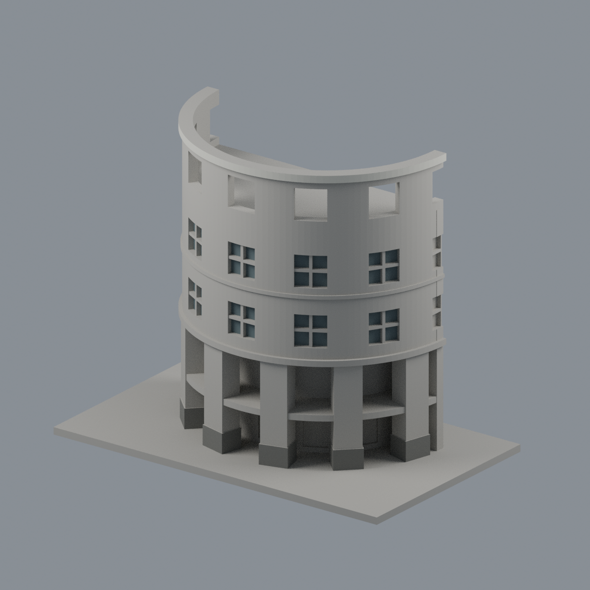
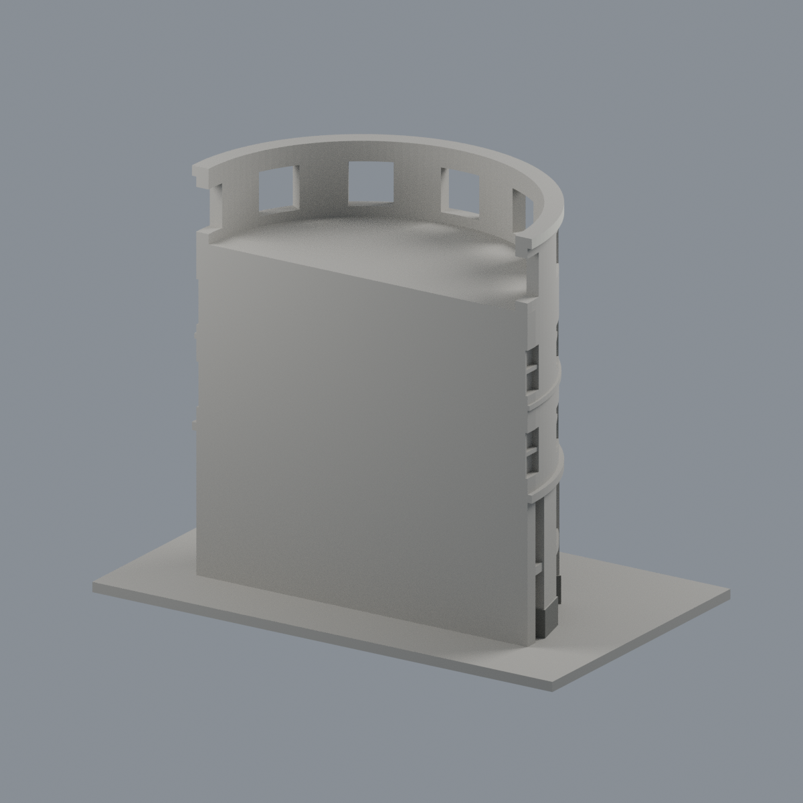
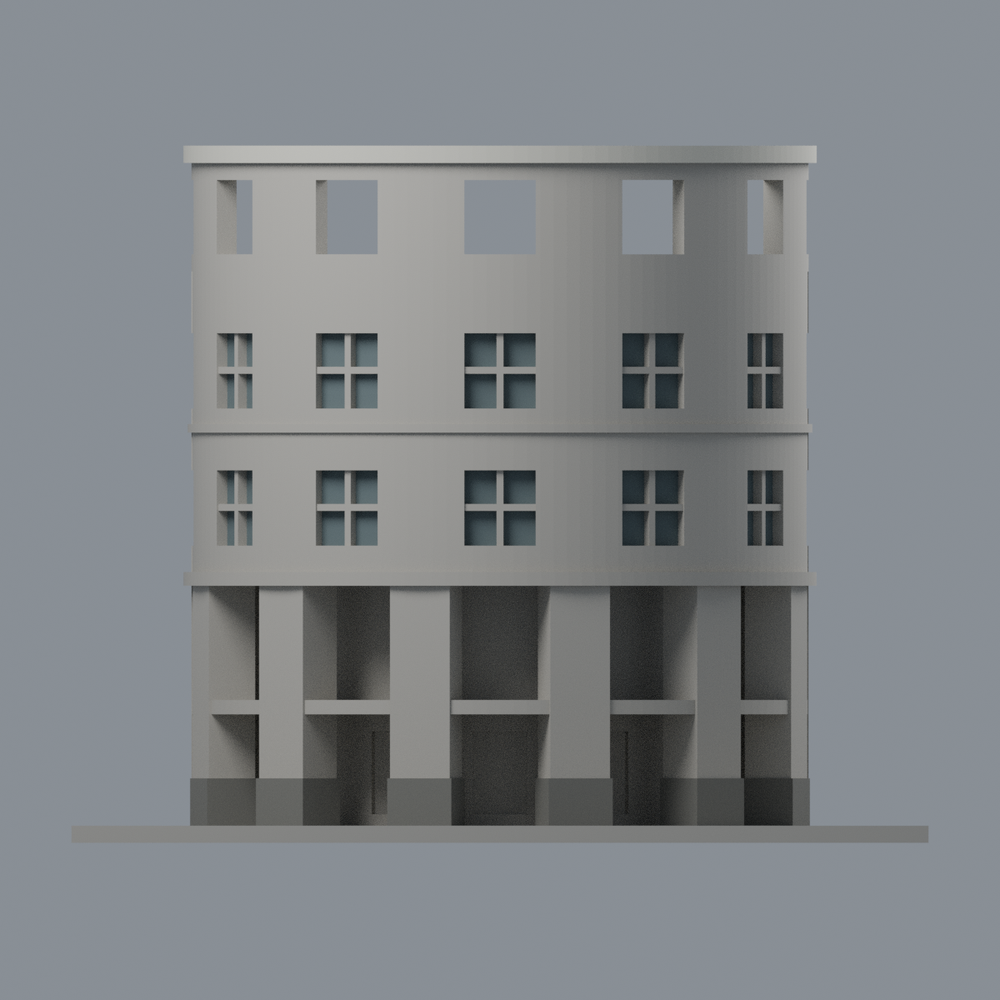
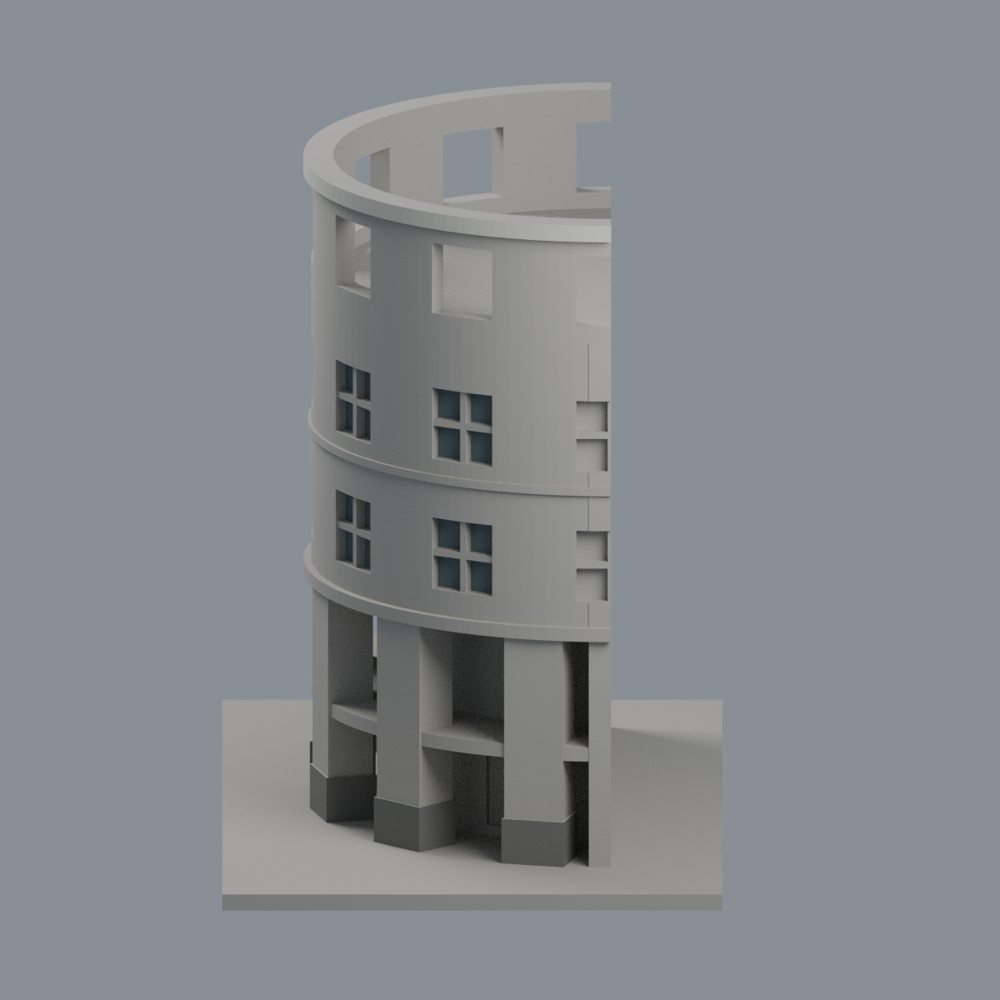

# 國立澎湖科技大學｜圖書資訊大樓圓弧入口前段有限配色

| 前斜視 | 後斜視 | 正立面 |
|---|---|---|
|  |  |  |

## 本次六個灰柱腳的朝內垂直面延色

僅延色六個原灰柱腳各自第四個朝內垂直面，共 12 個原三角 [1858,1861,1892,1893,1925,1927,1958,1959,1988,1989,2022,2023]，由未確認材質 0 延用既有灰柱腳材質 2。原 80 玻璃、36 灰柱腳、144 淡冠環面全保留；現 4650 未確認、80 玻璃、48 灰柱腳、144 冠環面。其餘 4910 面的材料與理由、全部原色盤 bytes、4922 面／2429 點、150×90×122 mm 外包、原 STL bytes、座標、面序、繞向全部不變。

每柱腳角度為 −165、−135、−105、−75、−45、−15 度。在各自徑向／切向座標中，新增朝內面位於徑向 45.4 mm、切向 −5.8…5.8 mm、z=3…11.3 mm，法線向圓心。每個完整矩形為原兩三角、完整共面連通域及原四角，解析 11.6×8.3=96.28 mm²；總解析 577.68 mm²，原網格約 577.680044701 mm²，各域面積容差 0.0001 mm²。每個內面的兩條垂直邊都全高 8.3 mm 鄰接原灰側面。原柱腳盒底 z=2.8…3 埋在底座內，本次不補造、不重新露出。

已親看澎科大校方正面與側拍原圖：分立柱腳為中灰，柱身與柱腳上方薄頂唇為淡色。朝內面延續同一個灰柱腳，屬有界同構件材料推論，不宣稱六個朝內面都各自有直接照片。頂唇、柱腳頂面／底面、上方淡柱身、圓弧主體、原窗框／窗背、雨棚、冠環與 y=0 人工後裁面全不染，不能以同色理由推成全柱或整個背面。既有塊狀柱腳是比例近似，不新增石材接縫或貼圖。

來源為校方圖書資訊大樓導覽 https://www.npu.edu.tw/tour/Details.aspx?Parser=13%2C4%2C34%2C%2C%2C%2C4 與原正／側照片（原 SOURCES.md 保留）。導覽頁 2018-08-29 為異動日期，不是拍攝日期；照片拍攝日期未知，不宣稱 2026 現況，未色卡校準。私人原照片不加入公開包。

原幾何製造限制、裁切範圍及歷史 QA 保留。本次 strict 3MF／封閉流形與精確交換 PASS 不是實體試印、全域壁厚或支撐保證。root 的 STL、OBJ、scene、生成器、預覽與歷史校驗檔完全不動。新彩色版本在 appearance；歷史 appearance/qa、原 source 程式、rebuild-source.zip、SHA256SUMS、SOURCES 等原樣保留，仍記錄原版本。palette 的歷史 scope 也保留，新增範圍以本段及 qa-continuous-plinth 為準。

新 mesh-data.npz、face-materials.json、npu-library-rotunda-front-appearance.3mf、scene.blend 及十張 previews 經精確交換、Blender 獨立材質／頂點編輯再存重開、原 scene 重渲染逐 bytes 核對。材料名稱、RGBA、shader 色與粗糙度保留。原五相機加左側、背立面、兩個低角度柱廊視角和底視，均完整框入局部模型；人工背截面不代表實景背立面。

新 QA 在 qa-continuous-plinth，當前 hashes 在 CONTINUATION-SHA256SUMS，兩份獨審及新輸出補核原樣納入。重建 python appearance/source/build_continuous_plinth.py，交換驗證 verify_continuous_exchange.py；Blender 執行 render_continuous_plinth.py 與 verify_continuous_scene.py。新 rebuild-continuous-source.zip 已隔離精確重建並重跑 strict 交換驗證。僅本地準備，不能解讀為已上傳。

本輪全部原物件屬性與完整材質定義皆保留，僅 12 個指定面的材質指派延伸；原 palette scope 保留歷史文字，現行範圍以本節為準。舊校驗表與 QA 保留歷史 bytes，根 PUBLIC-MODEL-SHA256SUMS 與 appearance/CONTINUATION-SHA256SUMS 為現行校驗。

## 前版說明與保留限制

**既有局部模型，不是全館。** 同一模型的附加外觀層，不增加套數、不改首頁固定代表。150 × 90 × 122 mm；4922原三角面及面序、座標和原STL bytes不變。後塔、兩翼、樓梯塔、連通廊道不在本件範圍，y=0為人為截斷面而非真實背立面。

[表面色3MF](npu-library-rotunda-front-appearance.3mf) · [可編輯Blender](scene.blend) · [逐面表](face-materials.json) · [色表](palette.json) · [來源](SOURCES.md)

## 最小有據配色
- 五個完整窗位 × 兩列，只選凹入窗背共80個完整原面，低飽和灰藍為玻璃展示代理；照片內含窗簾、不同反射與細框，不表示精確室內、窗簾或透明玻璃。左右端半窗保留中性。
- 六個原本已加大的柱腳，只選外向與兩側的垂直原面共36面，中灰；排除內向面、頂部平台、底面與上柱，不以任意高度切面。
- 其餘4806面保留中性：原十字框與外皮未另推定精確材質。中性是未確證代理，不表示實景同色。
- **藍綠遮棚HOLD**：照片有柱間分段遮棚，但原幾何是連續樓板／簷線，未具分段及下斜邊界。故不切面、不整圈亂染。冠環頂排透空，不塗成玻璃；退縮低廊無真實門框，不當整面玻璃。
- 全部判界要求三頂點同在既有邊界；不使用重心色帶、不改幾何、不加照片貼圖或不存在細節。

## 五個實際網格視角
相機名稱不是地理方位；均由交付3MF與逐面材質渲染，非AI效果圖。


| 模型預覽 | 模型預覽 | 模型預覽 |
| :---: | :---: | :---: |
| 側視<br> | 頂視<br> |  |

## 可攜重建
將原model.stl置於appearance上層，依source/requirements.txt安裝依賴，Blender 4.3.2：

```
python appearance/source/build_appearance.py
python appearance/source/verify_exchange.py
python appearance/source/verify_material_boundaries.py
blender -b -t 4 --python-exit-code 1 -P appearance/source/render_appearance.py
blender -b -t 4 --python-exit-code 1 -P appearance/source/verify_scene.py
```

lib3mf strict零警告並實際改單色、存檔重開；Blender實際改材質、存檔重開，核其他材質與原幾何不變。SDK另存六位小數的誤差於QA明載，該測試暫存檔不交付。乾淨重建3MF／色表／逐面表／五PNG須byte一致，Blend只核語義一致，不宣稱二進位確定性。

## 原製造及史料限制
官方照片拍攝日期未知，頁面異動日期不是拍攝日，不宣稱2026現況。原模型尺寸、比例、退深17 mm、屋面高程及厚度皆近似估算，頂環與窗框為列印加粗代理，未做工程測繪。原610層閉合／多邊形有效性、0.8mm開運算薄篩及凹入射線QA歷史證據保留；本次僅配色，不重算製造QA。

底座朝下，柱廊、水平門窗上緣及冠環開口可能需支撐／橋接，先試切片局部。3MF僅單網格表面色，不是分色封閉實體、噴頭映射、切片工程或G-code。FFF GUI、材料路徑、支撐移除及實體試印未測，不保證免支撐或任意機器可印。

[逐檔雜湊](SHA256SUMS) · [權利說明](LICENSE-NOTICE.md)

原STL SHA256：e0ea088d1f0731101ec94be59c75105435bcfb5ba3c80fc0429eec612dbc6b3e


## 2026-11-13 有限外觀修正｜模型交付版
# 澎科圖書資訊大樓前圓廳頂冠外垂直緣近似背景

官方導覽：https://www.npu.edu.tw/tour/Details.aspx?Parser=13,4,34,,,,4
正面原圖：https://www.npu.edu.tw/df_ufiles/034/s_圖書資訊大樓外觀正面.jpg
側拍原圖：https://www.npu.edu.tw/df_ufiles/034/s_圖書資訊大樓側拍(1).jpg

兩官照可辨頂冠窄外垂直緣連續淺灰米背景，與風化底面及透空開口有界。僅原144邊圓柱前半環72個完整外向facet，z119..122，共144面由0至新3 #C6C5B9/.88；非精測色或石種識別。不塗頂/底/內環/開孔返面、人為後截面、連續遮棚、柱與窗。端部斜視區為同構件有界近似，未建縫線/風化或實際尺寸，不聲稱逐點標定。

原模型僅前圓廳，不含全館後塔兩翼；y0人為截面非真後牆。照片日期未知，2018網頁異動非拍攝年/2026現況證明，後塔會議看板亦非本案範圍。原4922面、3材與4778其他indices保持，製造歷史QA未重認證，支撐/切片/實印限制保留。新ZIP只用公開URL說明替代歷史SOURCES，原來源證據保留不重傳。
模型與原生視角圖沿用完成候選的原bytes；不改幾何、不增加分界、不稱全棟精確配色或實體試印通過。公開預覽只含模型，不含新增圖片文字。原來源年代、工程及列印限制仍適用。先前敘述與審核屬其原版本，本段僅更新上述局部範圍。
本次只交付模型、必要重建輸入/腳本、預覽與此說明；完整研究與獨立審核紀錄另行保留，不在本批公開。PUBLIC-MODEL-SHA256SUMS只核本次所列公開產品，舊校驗與QA不代表本次新版。
