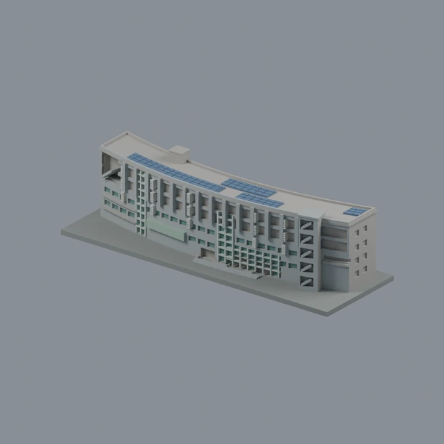
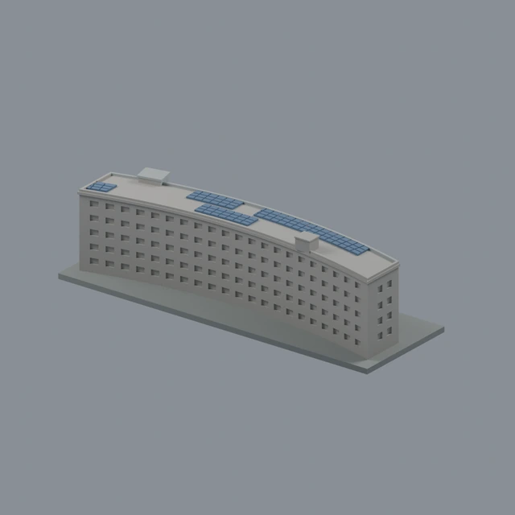
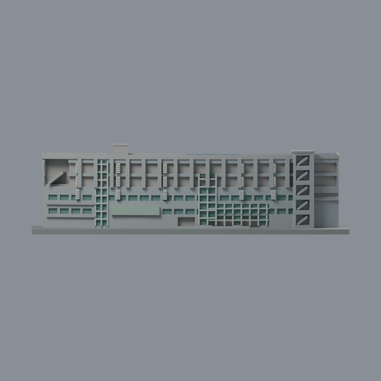
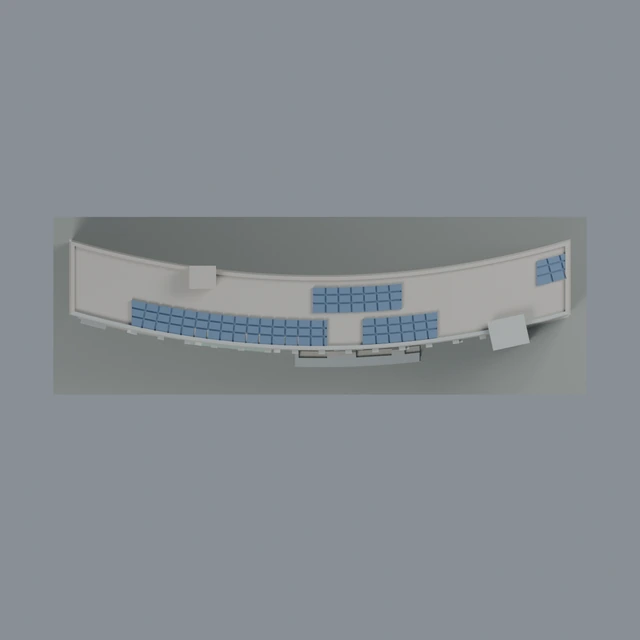

# 八甲 B2 電子工程館｜現行彩色展示

## 模型預覽

| 模型預覽 | 模型預覽 | 模型預覽 |
| :---: | :---: | :---: |
|  正面 |  背面 |  正立面 |
|  頂視 |  |  |

四張全尺寸無失真 WebP 由現行八材質 Blender 場景核對重繪，點擊縮圖可放大。僅延用現行已核對的正面及四組既有屋頂光伏板材料，未見的短端、背面及其他屋頂面維持中性；原上層連槽不足以區分黃色牆面與窗戶，未一律染成玻璃。此處不改幾何或擴大補色。

[現行彩色 Blender](../appearance/scene.blend) · [彩色 3MF](../appearance/nuub2-appearance.3mf) · [STL](../model.stl) · [渲染驗證](render-proof.json) · [本頁校驗](SHA256SUMS)

[原模型與限制](../README.md) · [原外觀來源與證據](../appearance/README.md)。歷史圖、原 README 與工程資料均未改動。未實體試印。
