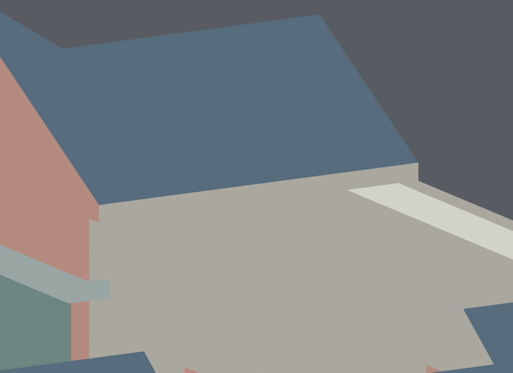

# 八甲 M6 第六宿舍｜中塔右側檐口補色（2026-11-20）

此變體只補中央山牆塔右側、藍灰坡瓦下的窄直立檐口。以原模型正面朝 -Y 為基準，目標是外法向 +X、x=11 mm 的完整原矩形（y=24–44 mm、z=77–78 mm，兩個原三角面，共 20 mm²）。原中性槽改用既有的灰窗楣／雨棚材質槽 `#99A5A3`，是近似灰色而非從照片取樣或色度校正；並非推斷實際材質、漆色或現況。

| 校正前（局部） | 校正後（局部） |
| :---: | :---: |
|  |  |

[校正前整體](before-overview.png) · [校正後整體](after-overview.png) · [色彩 3MF](model-colored.3mf) · [可編輯 Blender](scene.blend) · [原 STL](../model.stl) · [新檔校驗](SHA256SUMS)

## 對位及未改範圍

[聯大華語中心斜角照片](https://clc.nuu.edu.tw/var/file/48/1048/pictures/33/part_42215_6353294_02617.jpg) 與 [聯大秘書室相簿斜視照片](https://secretary.nuu.edu.tw/var/file/3/1003/gallery/16/1116/gallery_1116_3619700_95853.jpg) 可見同一 U 形紅磚宿舍的中央高塔。兩張在右露側都能分辨藍灰坡瓦、其下方狹長淺灰檐口與更下方粉磚。前景圓廳是另一棟；新建 M10／M11 不是本模型。公開照片未重製於此包；兩張照片的精確拍攝日期與現況未經獨立核實。

- 未推估相反邊、斜瓦、背側、女兒牆或塔身牆面；既有四個背女兒牆補色面保持。
- 未整片處理右側長牆。照片的低層格柵與受遮擋區域不能可靠對應原網格的材質界。
- 六個既有材質和 7,000 個原三角面均保留；無新增或移動任何頂點。根頁原代表圖仍為同一檔案；本頁圖片只是校驗用配對渲染。
- 尺寸仍只為微縮估計；沒有新切片或實體試印。

## 讀取與重建

- [原外觀版本](../appearance/README.md) 與它的 [有效公開檔案校驗](../PUBLIC-MODEL-SHA256SUMS) 不變；這份補色有單獨校驗清單。歷史 `appearance/SHA256SUMS` 記錄較早版位元組，不用它驗證新版。
- [確切面域及原檔 SHA-256](domain.json)、[格式與材質 QA](verification.json) 與 [畫面差異 QA](visual-QA.json)。
- 使用 Blender 4.3.2，由原 `appearance/scene.blend` 執行 [補色程式](apply_gable_fascia.py)；加 `-- --qa-renders` 可重建配對渲染。以 Python 3 執行 [3MF 重建](rebuild_exchange.py)。
