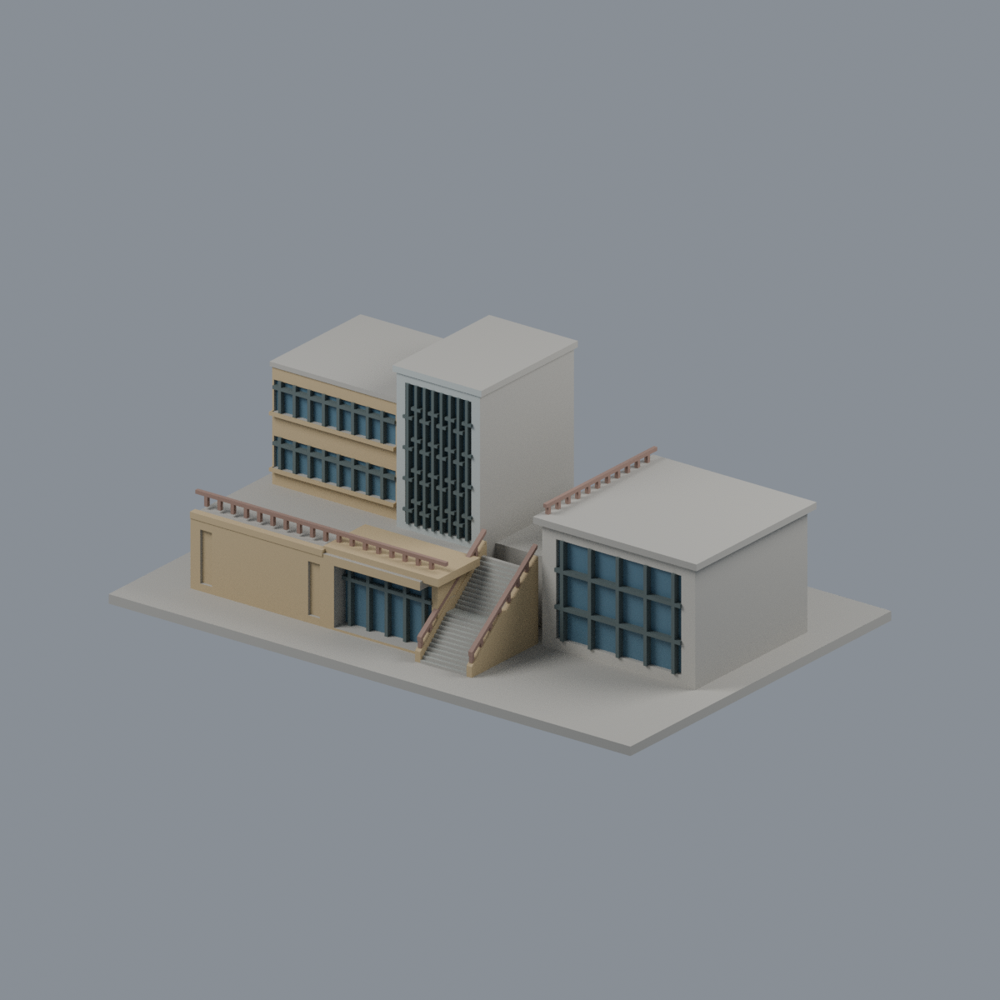
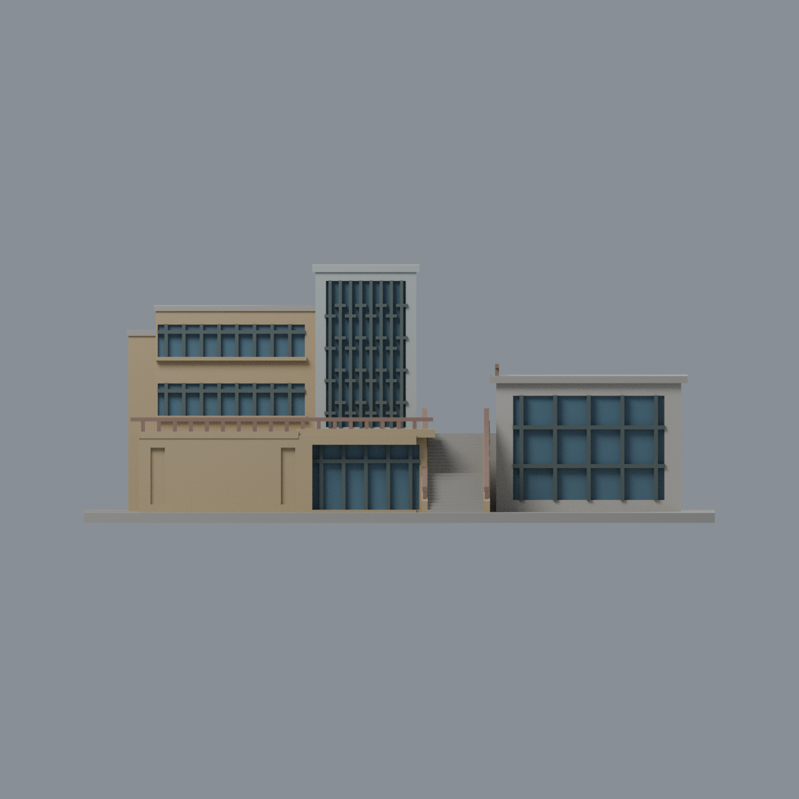
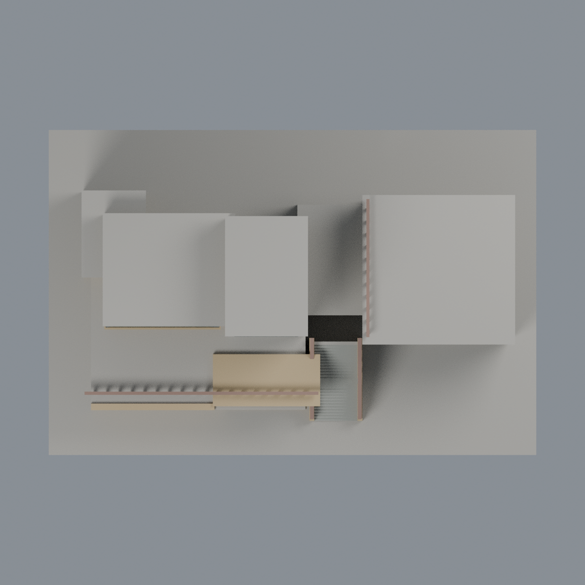

# 聯大八甲 Q1 藝文教學中心：八材質外觀版

沿用原 **4,300 三角面／2,100 頂點**，不改原 STL 位元、座標、面序或幾何；這是既有模型外觀改版，不增加模型包數。

| 模型預覽 | 模型預覽 | 模型預覽 |
| :---: | :---: | :---: |
| 正面<br> | 背面保持中性<br> |  |
|  |  |  |

[表面色 3MF](nuuq1-appearance.3mf) · [可編輯 Blender](scene.blend) · [材質色表](palette.json) · [逐面指派與依據](face-materials.json) · [原 STL](../model.stl)

## 來源與配色邊界

親自核對官方 [藝文教學中心相簿](https://secretary.nuu.edu.tw/p/132-1003-1123.php?Lang=zh-tw) 的 [照片 1](https://secretary.nuu.edu.tw/var/file/3/1003/gallery/23/1123/gallery_1123_337665_71876.jpg)、[照片 2](https://secretary.nuu.edu.tw/var/file/3/1003/gallery/23/1123/gallery_1123_5642611_71877.jpg)，以及 [官方校史航照](https://nuuarchives.nuu.edu.tw/var/file/97/1097/img/828/06image051.jpg)。近照 EXIF DateTimeOriginal **2025-02-25 12:17:55／12:18:20**；航照無可確認拍攝日，是歷史環境佐證，不是 2026 現況。EXIF 日期與時區未獨立核實；照片不隨包散布。

- 已見正面主牆、露台腰帶與入口門楣淡赭色；高玻璃塔的正面框與上緣冷淺灰。樓層間實牆不是玻璃，不添加原模型沒有的馬賽克壁畫、金屬字、裝飾、雨痕或設備。
- 只對原塔窗、左翼橫窗、下入口的凹背配低彩度灰藍玻璃，既有錯列窗梃深灰。原樓層與窗梃間距為近似，不能靠配色補正；凹背仍封實，不宣稱透明室內。
- 右側廳舍的淺色正面與深窗基於**未定年歷史航照**的有限配色代理，非以近照看不到的部分冒稱當下實景。原估計窗格數保留，未見屋頂／背面中性。
- 原露台、外梯及右廳側邊的加厚欄杆採灰紅褐色；踏面灰色、實梯側牆淡赭色。欄杆與實景不完全等比例，這不是無障礙尺寸或列印安全承諾。
- 未見外側背面、屋頂及不能登錄的交界中性；不加入後方 D1／D2 等鄰棟。原 STL／面序／座標不變，不增加模型數，不宣稱物理列印成功。

[原幾何與來源限制](../README.md) · [來源覆核](qa/source-review.json)

## 重建與核驗

安裝 [依賴](source/requirements.txt)，Blender 使用 4.3.2。由本資料夾上層提供原 model.stl：

1. `python appearance/source/build_appearance.py`
2. `python appearance/source/verify_exchange.py`
3. `blender -b -t 3 --python-exit-code 1 -P appearance/source/render_appearance.py`
4. `blender -b -t 3 --python-exit-code 1 -P appearance/source/verify_scene.py`

[獨立重建 ZIP](rebuild-source.zip)含原 STL、四支程式及依賴，不含第三方照片；不取代原建模腳本。[逐檔 SHA256](SHA256SUMS)

[交換／拓撲 QA](qa/exchange-validation.json)核對原座標與面序、全部面材質、單連通、有向水密邊、頂點 link 單環、正體積與零退化／重複面；lib3mf 嚴格讀取零警告，實際編輯單材質再存讀，其他材質及面指派不變。SDK 六位小數量化誤差另列。

[Blender 存讀與編輯](qa/scene-validation.json) · [渲染記錄](qa/render-manifest.json) · [獨立重建](qa/rebuild-validation.json)

## 製造限制照舊

尺寸仍為 150 × 100 × 61 mm；原 STL、建模程式、場景及歷史 QA 保留。原層檢與薄特徵檢查本次未重跑，不能由材質 QA 代替。

3MF 是同一網格的表面色，不是八個封閉分色實體、切片專案、噴頭映射或 G-code。切片 GUI、多材料路徑與實體列印未測；柱頭、屋簷、窗框及薄邊仍須評估材料、支撐及拆除風險，沒有保證可印或免支撐。


## 2026-11-14 有限外觀修正（新接續交付版）

僅中央塔樓原凹口上緣內側底面九個完整窄帶，共18面，由未知中性色改用既有冷灰2（#B3BAB7，roughness .78）。原8材質及其他4282面不變。外頂、側回折、背玻璃及其他門窗不納入。八支粗略凸出細柱分割原平面；真實玻璃上方灰背帶沒有對應原幾何界線，未修復或把玻璃改灰。塔樓截切深度、框比例、窗節奏不是逐件測量。背面/屋頂不鏡像補色；右側禮堂歷史航照近似不擴大，D1/D2不納入。

顏色僅外觀材料家族近似，不是校準色或材種鑑定。公開照片不證明2026現況。原STL、幾何、順序、代表圖與原視角保持；浮點面域差異保留，非宣稱零誤差。歷史QA與製造限制仍適用。
# Official references

- https://secretary.nuu.edu.tw/p/132-1003-1123.php?Lang=zh-tw
- https://secretary.nuu.edu.tw/var/file/3/1003/gallery/23/1123/gallery_1123_337665_71876.jpg
- https://secretary.nuu.edu.tw/var/file/3/1003/gallery/23/1123/gallery_1123_5642611_71877.jpg
- https://nuuarchives.nuu.edu.tw/var/file/97/1097/img/828/06image051.jpg

Sources0/1 tower underside primary; source2 undated historical context only.

現版共 8 個顯示材質（含未知中性色）。上方原材質數、面域與QA描述為歷史版本，僅由本節有限範圍更新。本版是新接續建置，不是尋回遺失草稿；不新增幾何或擴充補色範圍。

本節提及原ZIP/QA/校驗數目屬歷史記錄，不是現版ZIP清單。現版ZIP僅含原STL、必要舊建置與渲染程式、三支現版包裝／驗證程式、requirements-current.txt與本README及授權說明（如原有）。完整來源研究、照片、私人審核與廣泛校驗清單不公開。PUBLIC-MODEL-SHA256SUMS僅核當前交付產品；原QA不替代當前驗證。

現版命令：`python -B appearance/source/build_current.py`、`python -B appearance/source/verify_current.py`、`blender -b -t 4 --python-exit-code 1 --python appearance/source/render_current.py`。依requirements-current.txt安裝必要依賴。直接執行舊builder會重建歷史配色。包裝程式僅執行固定本地舊程式，新增材質時只替換新材質粗糙度運算；寫模型、材質、場景、原視角PNG與當前本地QA。歷史報告先保存再還原；原不存在時只刪該次產生的舊名報告。不進行網路或憑證操作。


## 2026-11-18 最高右內返：兩個原三角的有限延色

只將中央塔窗**右內返最高一條**原面 672、677，由未知 0 延用既有冷灰 2（#B3BAB7）。其餘 4,298 面、8 個舊材質與節點值、全網格座標／面序／物件變換／原場景與相機設定保留；既有 18 個頂部內底面不重做。新面數分布為 `[585,521,126,408,1792,752,52,64]`。

完整原矩形位於 x=1.5、朝 −X，y=-13..-11.8999996、z=51.8499985..57.2999992，面積 5.995002918 mm²。原橫梃自然截出這一條，不沿三角對角線另造材界；原 1.1 mm 深度與橫梃節奏都是簡化代理，並非實測深度或實景材質接縫。其他四條右內返、左內返、塔外側、玻璃、金屬、外頂和下層入口均不擴塗。

兩張官方照片直接支持最高右內返的灰材族連續，照片內灰框／玻璃／金屬邊可分；配色不是精確測色。照片 EXIF 自報 2025-02-25，未獨立驗證拍攝日期與時區，不聲稱 2026 現況。上方玻璃後的實景灰背帶沒有相應原幾何界線，本版不藉配色修復。原始照片只私人留存，不隨公開包散布。

### 格式、精確性與可重建性

[表面色 3MF](nuuq1-appearance.3mf)、[原生 Blender](scene.blend)、[逐面資料](face-materials.json)、[新增表面色 NPZ](surface-colors.npz)、[原 STL 同位元副本](model.stl)。NPZ 是本次從原 scene 全序匯出的新交換檔，不冒稱舊版已有。原 building root `model.stl` 不變。

3MF 僅兩面各 p1/p2/p3 共六個屬性改值；原座標文字與 object fallback 保留。Blender 完整 RNA 僅六個面材表示及兩個必要來源／範圍屬性改變，沒有孤立材保存旗標變更。原幾何、原材質、燈光、世界、隱藏狀態與相機均保留。原四視角 1200×1200、Cycles 48 samples 重渲，無新增場景展示物件。

[固定基準清單](baseline-inputs.json)、[自足基準 ZIP](baseline-rebuild-inputs.zip)、[SHA 鎖定修正程式](rebuild_top_reveal.py)、[原視角渲染程式](render_q1_views.py)、[更動清單](top-reveal-change.json)、[來源與界限](TOP-REVEAL-SOURCE-SCOPE.json)、[驗證摘要](QA-summary.json)。固定來源 ref 為 `8f90ae2478f00cce6832a07de537f7d333f6dbc0`。

解開基準 ZIP 後，在 Blender 4.3.2（含 NumPy）執行：

```sh
blender -b --python-exit-code 1 -P rebuild_top_reveal.py -- baseline output
blender -b --python-exit-code 1 -P render_q1_views.py -- output
```

所有輸入 SHA 不符即停止；不需照片、網路或憑證。隔離重建、lib3mf strict 零警告、3MF 私有改材保存重讀，以及 Blender 私有改頂點／面材保存重讀均另驗，測試副本不交付、不改公檔。原製造與粗化限制保留，不等於實際列印測試。

### 儲存庫映射

本包全部檔案映射至 `國立聯合大學/buildings/bajia-q1-arts-teaching-center/appearance/`，包括新增 STL 同位元副本、NPZ、基準 ZIP、程式及 QA。不可鋪至 building root；上文原 `../model.stl` 相對連結仍有效。本包只本地製作，發布需由協調者另外執行。
