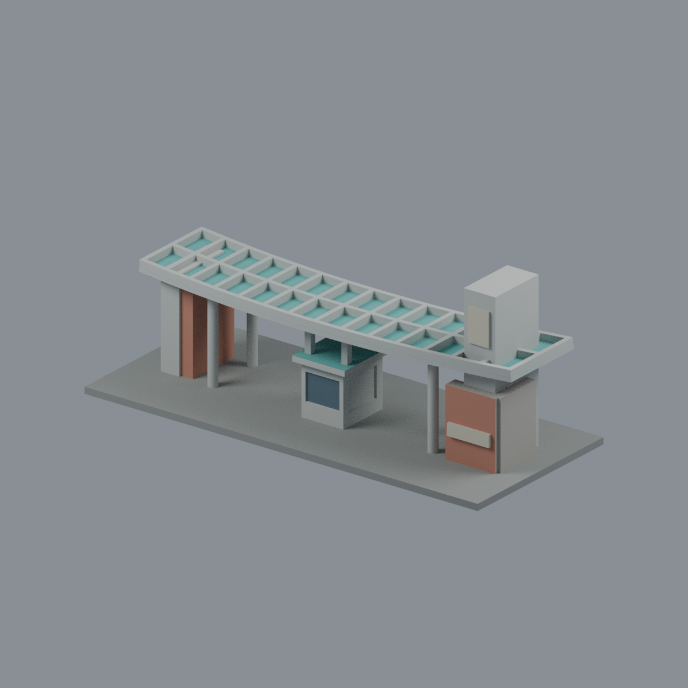
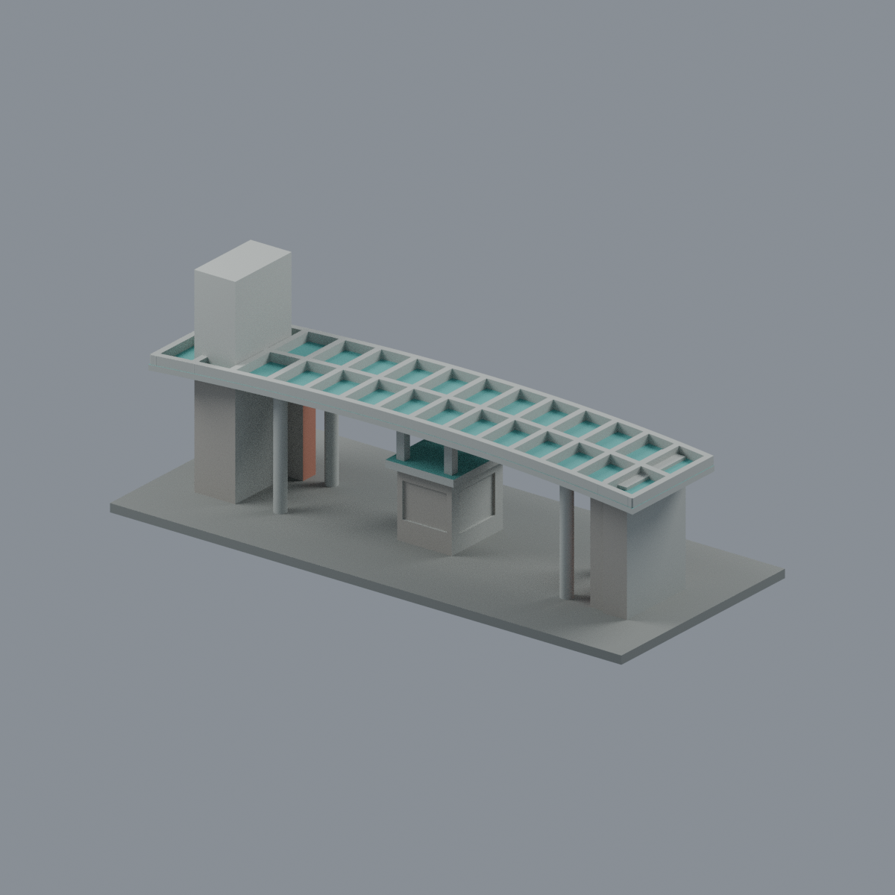
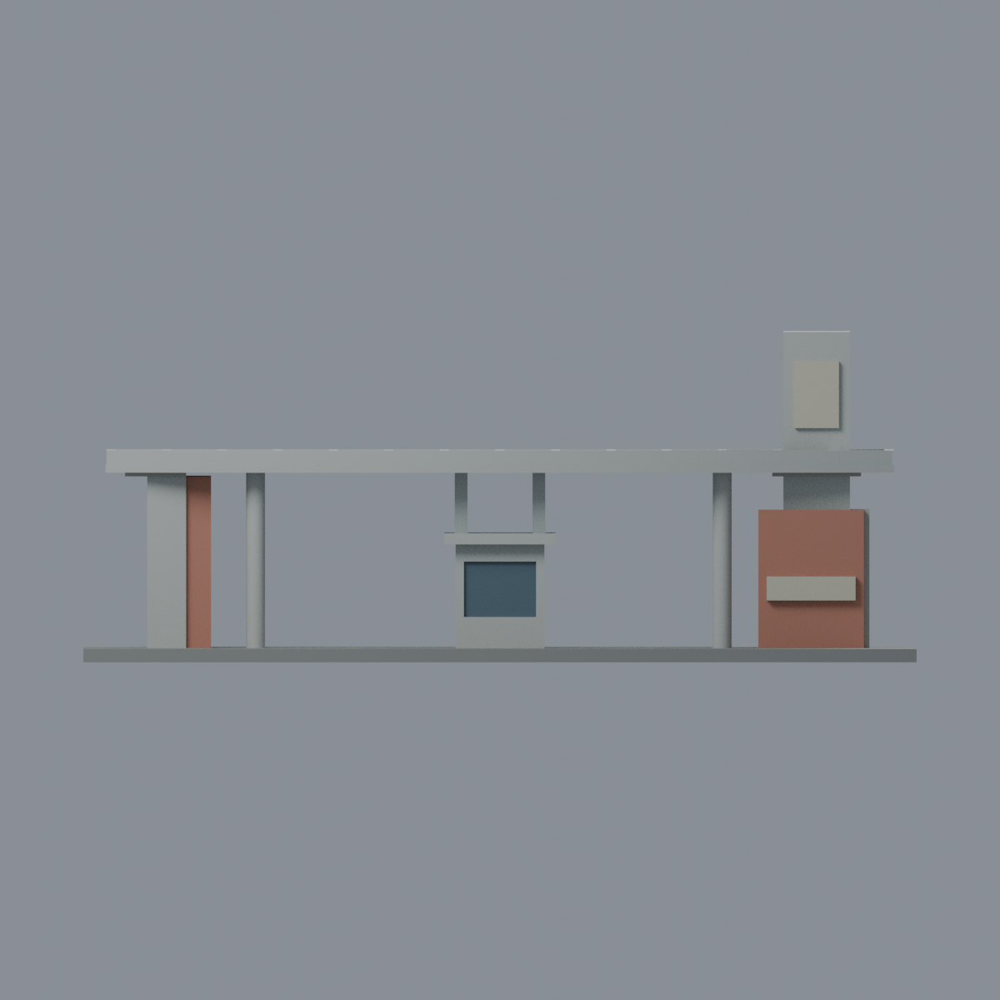
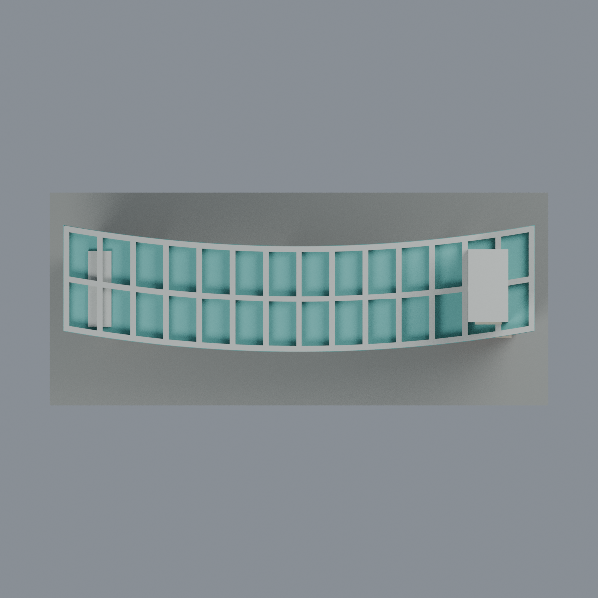

# 聯大八甲北門與中央警衛室：現版七材質外觀（2026-11-14）

較原外觀只改既有後塔上段五個三角面，幾何不變。四張公開圖片及點開的大圖均為同一份無失真 WebP；[現版渲染證據](../render-proof.json)。

沿用原 **3,832 三角面／1,900 頂點**，不改原 STL 位元、座標、面序或幾何；這是既有模型外觀改版，不增加模型包數。

| 模型預覽 | 模型預覽 | 模型預覽 |
| :---: | :---: | :---: |
| 正面  | 背牆窗面中性／支撐構件材質有界延伸  |  |
|  |  |  |

[表面色 3MF](nuugate-appearance.3mf) · [可編輯 Blender](scene.blend) · [材質色表](palette.json) · [逐面指派與依據](face-materials.json) · [原 STL](../model.stl)

## 來源與配色邊界

親自查看聯大官方 [北大門相簿](https://secretary.nuu.edu.tw/p/132-1003-1091.php?Lang=zh-tw) 的 [第 6 張斜俯視](https://secretary.nuu.edu.tw/var/file/3/1003/gallery/91/1091/gallery_1091_5510997_24417.jpg)。內嵌 EXIF DateTimeOriginal **2025-03-02 15:01:54**，並非修改日 2025-03-10；拍攝時區／日期未獨立核實，不宣稱 2026 現況。照片不隨包散布。

- 沿用「北門＋中央亭」一個原組合，不將 T3 警衛室和北門重複計數。高塔、外側牆、圓柱及頂蓋肋側為灰石色代理，右前低牆和左內窄牆的已見平面為鮭紅磚色；**不把高塔整座染磚色**。
- 只在原水平凹格底與中央亭帽頂部使用青綠防水面代理，格梁、帽側仍灰色，不把青綠烘焙到梁肋或立柱。原凹格薄底保持不變，不宣稱精確防水材料規格。
- 中央亭僅原前窗凹背使用低彩度灰藍玻璃；原窗沒有來源照片的全部細窗梃，本版不添加。未登錄的背窗與其他窗背保持中性。
- 已見柱／支撐與肋的同一構件使用灰色連續代理，**其圓周隱蔽面是有限材質延伸，不是逐面看見**。後牆與頂蓋未見底面中性；不把一張俯視當成完整後面證據。
- 原兩塊浮凸牌保持空白淡色，不補校名、英文字、標誌；照片牌面與高塔刻字和原簡化浮牌並不完全一致，本版不宣稱文字還原。
- 原道路、底板只作展示；不增添車、柵欄、號誌、攝影機、管線或人物。所有色值未校準，原彎曲頂蓋、牆厚、亭比例仍為原近似幾何。

[原幾何與來源界線](../README.md) · [本次來源覆核](qa/source-review.json)

## 重建與核驗

解壓 [獨立離線重建 ZIP](rebuild-source.zip)。依 ZIP 的 appearance/source/requirements-current.txt 安裝依賴後，從解壓根目錄執行現版 build_current.py、verify_current.py、render_current.py（Blender 4.3.2）。[現版校驗](../PUBLIC-MODEL-SHA256SUMS)；[早期外觀校驗](https://github.com/hplin50643/taiwan-buildings-3d/blob/aedc01f56772525b942a46a0cf63eee23adee46e/%E5%9C%8B%E7%AB%8B%E8%81%AF%E5%90%88%E5%A4%A7%E5%AD%B8/buildings/bajia-t3-north-gate-guardhouse/appearance/SHA256SUMS)是不可變歷史。

[交換／拓撲 QA](qa/exchange-validation.json)核對原座標與面序、全部面材質、單連通、有向水密邊、頂點 link 單環、正體積與零退化／重複面；lib3mf 嚴格讀取零警告，實際編輯單材質再存讀，其他材質及面指派不變。SDK 六位小數量化誤差另列。

[Blender 存讀與編輯](qa/scene-validation.json) · [前版渲染記錄](https://github.com/hplin50643/taiwan-buildings-3d/blob/aedc01f56772525b942a46a0cf63eee23adee46e/%E5%9C%8B%E7%AB%8B%E8%81%AF%E5%90%88%E5%A4%A7%E5%AD%B8/buildings/bajia-t3-north-gate-guardhouse/appearance/qa/render-manifest.json) · [獨立重建](qa/rebuild-validation.json)

## 製造限制照舊

尺寸仍為 150 × 64 × 59.3 mm；原 STL、建模程式、場景及歷史 QA 保留。原層檢與薄特徵檢查本次未重跑，不能由材質 QA 代替。

3MF 是同一網格的表面色，不是七個封閉分色實體、切片專案、噴頭映射或 G-code。切片 GUI、多材料路徑與實體列印未測；柱頭、屋簷、窗框及薄邊仍須評估材料、支撐及拆除風險，沒有保證可印或免支撐。

## 2026-11-14 有限外觀修正（新接續交付版）

僅原高塔後向上段 y15 完整六面域，其中五個未知中性面改用既有石灰1，385面原灰保持；原7材質逐值不變。不延前面、側面、頂面、下塔、簷底、警衛室或另一門。後向照片為直接材料證據，前向角度不能替代。石板縫、風化不逐項重建；照片近棚淺色斜凸翼原未建，矩形塔深寬及棚肋交會只是粗代理。只作後塔石族背景近似，不宣稱真牆全域均質，也不修復缺失凸翼。原無字標牌保持，不新增文字。完整域按原箱體扣棚與肋計算，非裁面營造安全小域。

僅外觀材料家族近似，非校準色或石種鑑定，不把影子烘成材質。公開照片非2026現況認證。原STL、幾何、面序、原視角與代表圖保持；面域非零浮點外逸/反缺如實保留。原歷史QA及製造限制仍適用。
# Official references

- https://secretary.nuu.edu.tw/p/132-1003-1091.php?Lang=zh-tw
- https://secretary.nuu.edu.tw/var/file/3/1003/gallery/91/1091/gallery_1091_2217130_24417.jpg
- https://secretary.nuu.edu.tw/var/file/3/1003/gallery/91/1091/gallery_1091_8417783_24417.jpg
- https://secretary.nuu.edu.tw/var/file/3/1003/gallery/91/1091/gallery_1091_7586668_24417.jpg
- https://secretary.nuu.edu.tw/var/file/3/1003/gallery/91/1091/gallery_1091_2090367_24417.jpg
- https://secretary.nuu.edu.tw/var/file/3/1003/gallery/91/1091/gallery_1091_9856431_24417.jpg
- https://secretary.nuu.edu.tw/var/file/3/1003/gallery/91/1091/gallery_1091_5510997_24417.jpg
- https://secretary.nuu.edu.tw/var/file/3/1003/gallery/91/1091/gallery_1091_3663150_24418.jpg
- https://secretary.nuu.edu.tw/var/file/3/1003/gallery/91/1091/gallery_1091_6873705_24418.jpg
- https://secretary.nuu.edu.tw/var/file/3/1003/gallery/91/1091/gallery_1091_4217440_24418.jpg

Source0 rear tower primary; source1 rear context. Front views do not replace rear evidence.

現版共 7 個顯示材質（含未知中性色）。上方原材質數、面域與QA描述為歷史版本，僅由本節有限範圍更新。本版是新接續建置，不是尋回遺失草稿；不新增幾何或擴充補色範圍。

本節提及原ZIP/QA/校驗數目屬歷史記錄，不是現版ZIP清單。現版ZIP僅含原STL、必要舊建置與渲染程式、三支現版包裝／驗證程式、requirements-current.txt與本README及授權說明（如原有）。完整來源研究、照片、私人審核與廣泛校驗清單不公開。PUBLIC-MODEL-SHA256SUMS僅核當前交付產品；原QA不替代當前驗證。

現版命令：`python -B appearance/source/build_current.py`、`python -B appearance/source/verify_current.py`、`blender -b -t 4 --python-exit-code 1 --python appearance/source/render_current.py`。依requirements-current.txt安裝必要依賴。直接執行舊builder會重建歷史配色。包裝程式僅執行固定本地舊程式，新增材質時只替換新材質粗糙度運算；寫模型、材質、場景、原視角PNG與當前本地QA。歷史報告先保存再還原；原不存在時只刪該次產生的舊名報告。不進行網路或憑證操作。
