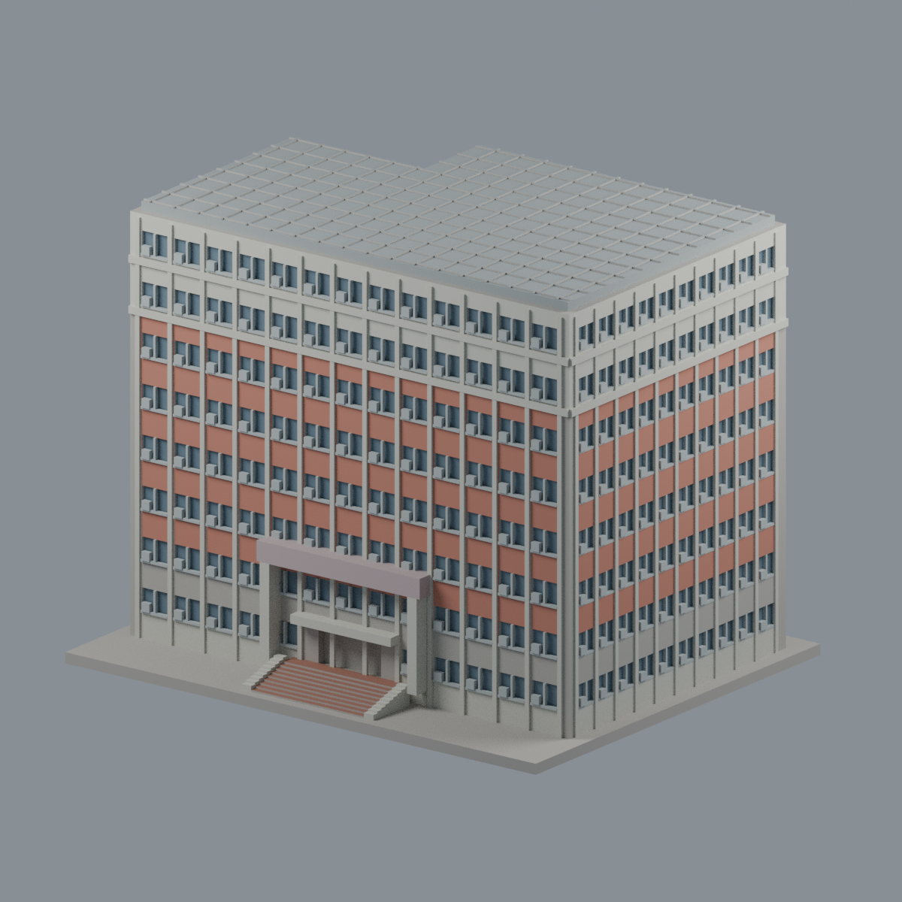
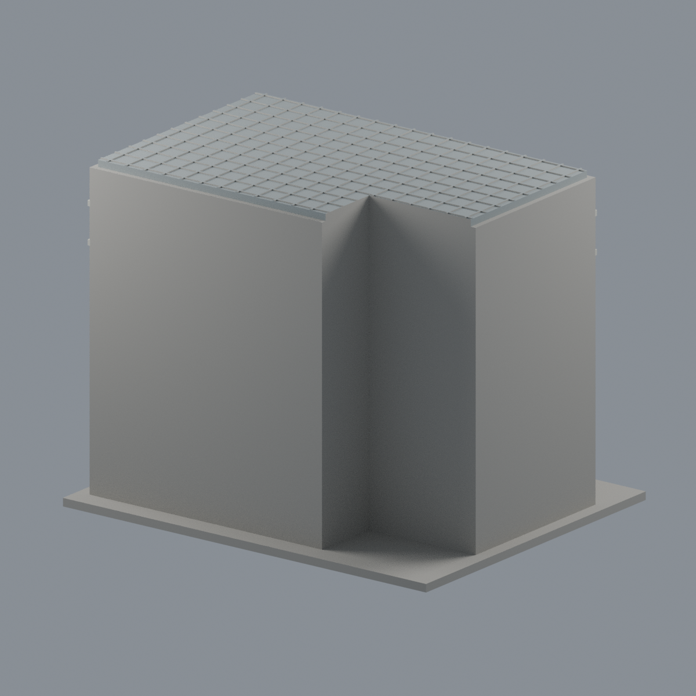

# 二坪山校區 C1 立德樓（管理學院）

## 模型預覽

| 模型預覽 | 模型預覽 | 模型預覽 |
| :---: | :---: | :---: |
| 正面與來源支持區域  | 未見外側背面中性  |  |

## 本次原加厚金屬棚外緣同灰延伸（推估）

將既有屋頂棚四個最外垂直輪廓面（包含原淺凸縫端頭）共 268 個原中性三角，延續既有棚頂灰金屬材 7。原 18,685 著色面及所有未變更面理由完整保留，其餘 20,978 面不變。原 21,246 面／10,419 點、八色表、STL bytes、座標及面序不變。現中性 2,293、陶紅 878、象牙 2,573、銀框設備 11,306、灰藍窗 846、灰粉門楣 138、紅褐階 48、金屬棚 3,164。

選取僅原 x=−68、+68、y=−41、+47 mm 的四個朝外有限垂直平面，z=117…119.9 mm；分別 40／100／76／52 面，解析面積 162.34／223.12／344.68／238.12 mm²。所有選中三角完整、唯一，不切面；交角及原 boolean 截斷保留，無任何推估凹口 x=−26 或 y=23 共面三角。屋頂水平面、內部細縫、牆及後凹口都不變，不把相連長牆染成金屬。

本輪親看官方未定年校史照，屋頂可見灰金屬遮棚，不是光電板證據。**真棚為薄金屬與開放支撐，原模型為便於列印採厚實底與加厚網格**；本次只對這個原有簡化量體外緣採同金屬族代理色，並非實景棚邊厚度、構造層或金屬材質逐面量測，也不修復模型。校史照未定年，既有近照 EXIF 日期時區亦未獨立核實，非 2026 現況；未實體試印。第三方照片只私人研究，不入公開包。混合紅白長牆維持保守中性，不藉三角斜切補色。

新版 QA 在 `appearance/qa-continuous-walls/`；歷史 QA 保留，新增 `PUBLIC-MODEL-SHA256SUMS`。重建外觀 `python appearance/source/build_continuous_walls.py`；交換驗證 `python appearance/source/verify_continuous_exchange.py`；渲染 `blender -b --python appearance/source/render_continuous_walls.py`；場景驗證 `blender -b --python appearance/source/verify_continuous_scene.py`。ZIP 含原 STL、原 `generate_model.py` 與本次外觀程式／有限域，不含照片；獨立重建驗證是從原 STL 重建外觀，不宣稱重算歷史製造驗證。

## 前版說明與保留限制

## 8 材質外觀版（2026-10-20）

[來源界線與四視角](appearance/README.md) · [表面色 3MF](appearance/nuuc1-appearance.3mf) · [可編輯場景](appearance/scene.blend)

來源支持的中段陶紅、上部淺色與原立柱、灰藍窗凹及銀灰設備簡化塊、灰粉門楣與紅褐梯面；屋頂是灰金屬棚，未宣稱光電。跨色長面及未知背面保守中性。 原 STL 與歷史 QA 不變；這是外觀改善，不是新增幾何。原單色正面（歷史檔案留存，不作本頁預覽）／原單色背面（歷史檔案留存，不作本頁預覽）

依國立聯合大學官方公開外觀照片製作的近似外觀模型，非測繪模型。這是二坪山的立德樓，不是八甲校區行政大樓，也不是 H1 產研創新暨推廣大樓。

## 檔案

- `model.stl`：毫米單位、整體連通的單件列印網格
- `generate_model.py`：可重建網格的參數化 Python 原始檔
- `scene.blend`：實際 STL 匯入後的預覽場景；攝影棚地面不屬於列印物
- `render_preview.py`：從 STL 重建預覽圖
- `validation.json`：數位網格檢查結果

## 已觀察與近似範圍

已逐張檢視官方正面照及官方相簿的正面、右側斜視、入口近照。模型保留八層主要窗列、正面約十三開間、右側窗列、連續凸出柱帶、外掛空調凸塊、上方兩層的淺浮雕水平帶、兩層高入口門廊與大招牌、入口階梯及屋頂大面積分格棚板。

沒有可靠的實測長寬或立面施工圖。長寬高及窗間距按照片透視估計；底座最長邊固定為 150 mm，與其他模型並非共同比例尺。模型尺寸以 validation.json 為準。

- 官方示意校園地圖顯示後側凹入輪廓，但相簿未提供可完整核對的背面。本模型的後側凹口尺寸與位置屬低信心推定；後側立面保留素面，不虛構窗列。未完成四面外觀考證。
- 八層以上的屋頂棚架以貼合實心背襯的分格板簡化，沒有重現細桿、空隙或確切面板系統。
- 以平底座代替現地坡地；地下層、側坡與地形未精確重現。
- 上方兩層白色外牆與中段紅色外牆的色差，轉譯為淺水平浮雕，屬單色列印的辨識性簡化，並非實測突出尺寸。
- 空調、窗框與階梯已加厚或簡化；不重現每台空調位置差異。微小中文字未刻印，避免脆弱或不可列印筆畫。
- 不包含樹木、車輛、行人、周邊棟舍及場址尺寸。不要將素面背側或推定凹口視為已查證的真實立面。

## 列印建議與檢查

建議以底座朝下、0.4 mm 噴嘴、0.16–0.20 mm 層高、至少三道外牆及約 12–18% 填充起印。最小裝飾凸條約 0.6–0.8 mm；建議保留目前尺寸，縮小需重新檢查。入口招牌／門廊下方具有局部懸挑及橋接，請在切片軟體檢查並視需要使用局部支撐；請勿直接當作完全免支撐模型。

網格檢查涵蓋密閉性、面向一致、單一連通體、邊／頂點流形、正體積、平底與 150 mm 尺寸。這些是數位檢查，尚未實際試印，也不等於已驗證所有細節的最小厚度或支撐需求。

## 公開資料來源

查閱日期：2026-10-11。

1. [國立聯合大學秘書室：C1 管理學院官方照片相簿（8 張）](https://secretary.nuu.edu.tw/p/132-1003-1101.php?Lang=zh-tw)，正面、右側與入口細部的主要依據。
2. [官方校史：校園規劃](https://nuuarchives.nuu.edu.tw/p/404-1097-27990.php?Lang=zh-tw)；[立德樓正面照片](https://nuuarchives.nuu.edu.tw/var/file/97/1097/img/828/06image012.jpg)。
3. [官方二坪山校區地圖](https://www.nuu.edu.tw/p/426-1000-10.php?Lang=zh-tw)，只作位置及示意輪廓參考，不當作測量圖。
4. [官方建築／教室代碼](https://nss.nuu.edu.tw/p/412-1037-5747.php)，確認 C1 立德樓（管理學院）。

原始參考照片不包含於模型交付物，只提供來源連結；公開可讀不等於已取得照片再散布或改作授權。上述圖像之權利仍屬原權利人。預覽圖由本模型實際網格重新渲染，沒有使用來源照片作貼圖。

## 重建方式

使用 Python 3 與 `requirements.txt` 所列套件執行 `python generate_model.py`，即可重新產生 STL。執行 `python validate_model.py model.stl --longest-edge 150 --output validation.json` 重新檢查。使用 Blender 4.3 以上執行 `blender -b -t 6 -P render_preview.py` 可重建兩張預覽及場景檔。建模程式不會下載原始照片，也不需任何帳號。
