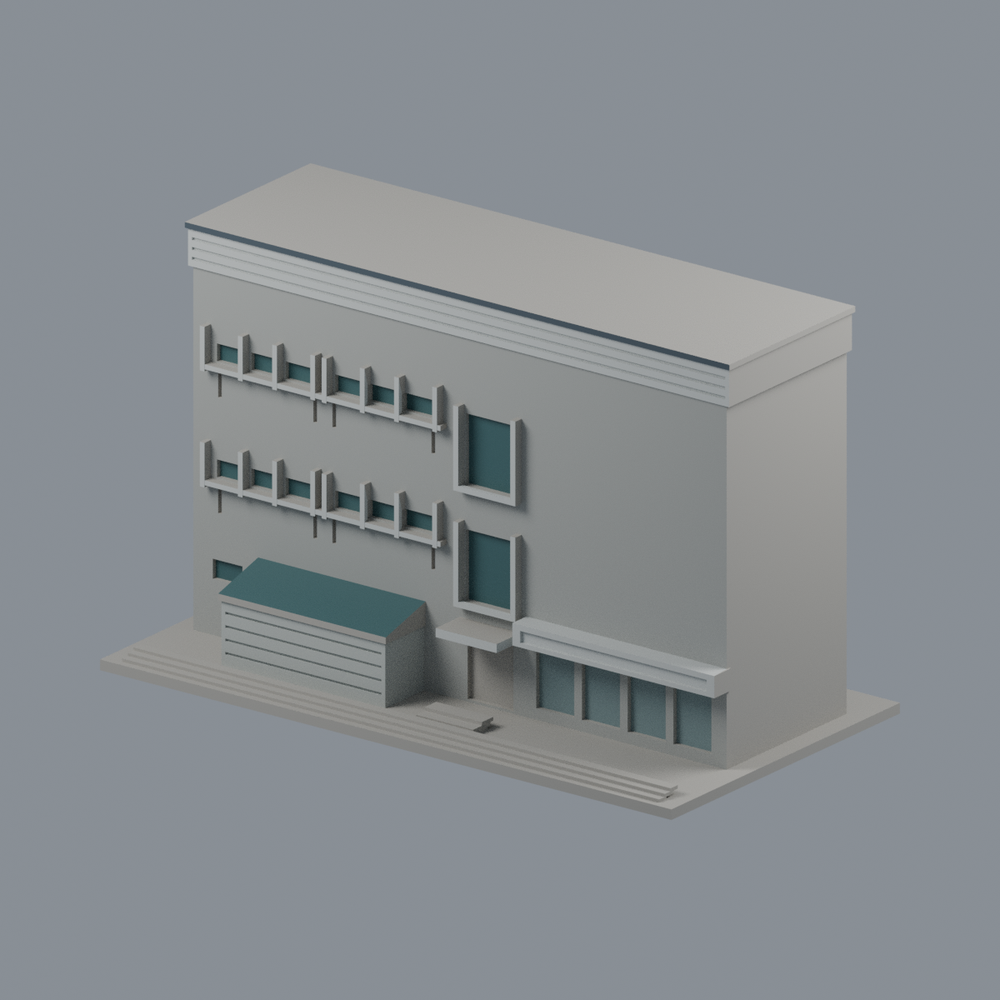
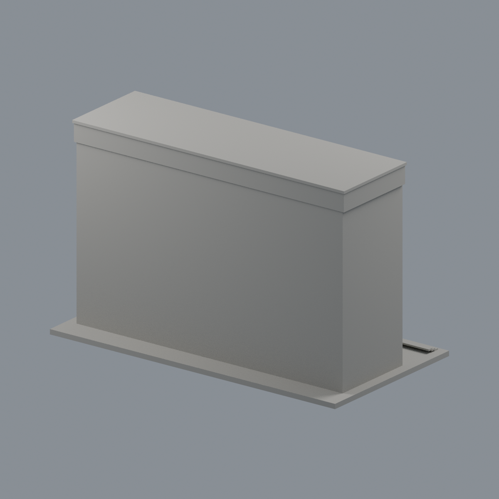
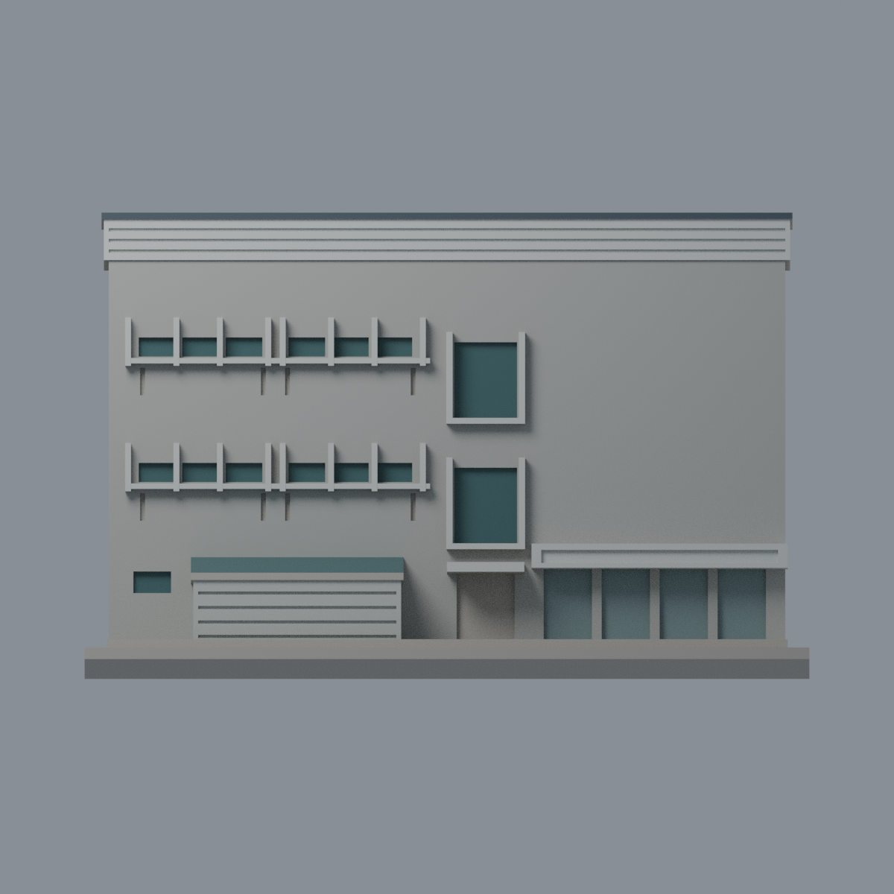
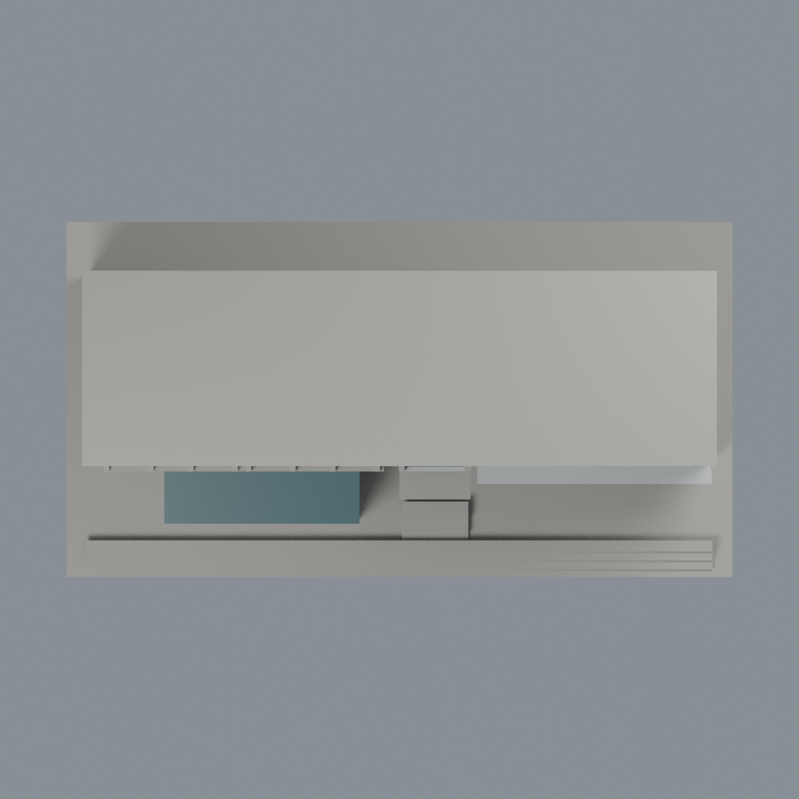

# 聯大二坪 F1 建築一館：七材質外觀版

沿用原 **1,524 三角面／764 頂點**，不改原 STL 位元、座標、面序或幾何；這是既有模型外觀改版，不增加模型包數。

| 模型預覽 | 模型預覽 | 模型預覽 |
| :---: | :---: | :---: |
| 正面  | 背面保持中性  |  |
|  |  |  |

## 本次中央入口雨庇兩端淡灰延伸（推估）

將既有中央入口雨庇兩側垂直短端共 4 個原三角，延續已發布前帶的淡灰材 2。原 709 個著色面及所有未變更理由保留，特別保留 1408／1409 前帶及其 `bounded_F1_central_canopy_front_pale_background` 原理由，不倒退至舊分類器。原 1,524 面／764 點、七色表、STL 位元、座標與面序不變。現中性 811、混凝土灰 314、淡框 287、青綠代理 32、暗屋緣 2、附屋灰 70、商店窗代理 8。

僅 x=0 的 1411／1413 與 x=16 的 1418／1420，限定 y=−22.5…−14、z=19…21 mm；每側完整原矩形面積 17 mm²。雨庇頂底、左附屋青綠斜頂、商店招牌、門框、臺階與其他側背牆不變，不切面或增面。

本輪親看官方正面和斜面兩張照片，入口小雨庇前帶與側上緣灰白，頂部深暗／風化。**真雨庇是內凹頂盤與邊牆，原模型卻是 2 mm 實板**；兩端僅沿該原簡化量體作同構件色推估，不稱還原真實雨庇結構，不把頂部髒污延到側面，亦不烘入陰影。原中央入口斜坡被簡化為階梯的限制保留，不修復幾何。照片 EXIF 指向 2025-02-28，日期時區未獨立核實，非 2026 現況；未實體試印。原公開來源限度及七色代理意義保留，照片只私人研究，不入公開包。

新版 QA 在 `qa-continuous-walls/`，歷史 QA 留存，更新 `PUBLIC-MODEL-SHA256SUMS`。重建 `python appearance/source/build_continuous_walls.py`（沿用 `build_current.py` 保護既有前帶）；交換驗證 `python appearance/source/verify_continuous_exchange.py`；渲染 `blender -b --python appearance/source/render_continuous_walls.py`；場景驗證 `blender -b --python appearance/source/verify_continuous_scene.py`。ZIP 含原 STL、原建模程式與必要歷史分類器，不含照片。

## 前版說明與保留限制

[表面色 3MF](nuuf1-appearance.3mf) · [可編輯 Blender](scene.blend) · [材質色表](palette.json) · [逐面指派與依據](face-materials.json) · [原 STL](../model.stl)

## 來源與配色邊界

親自核對官方 [F1／F2 建築館相簿](https://secretary.nuu.edu.tw/p/132-1003-1100.php?Lang=zh-tw) 的 F1 [正面](https://secretary.nuu.edu.tw/var/file/3/1003/gallery/0/1100/gallery_1100_885303_26747.jpg)與[斜面](https://secretary.nuu.edu.tw/var/file/3/1003/gallery/0/1100/gallery_1100_604034_26747.jpg)完整照片。EXIF 分別為 2025-02-28 10:26:40／10:25:39；時區與拍攝日期未獨立核實，不代表 2026 現況。來源照片不隨包散布。

- 正面灰色混凝土、上沿淡銀灰既有凹槽飾帶、深灰前屋緣；照片旁邊粉色 H1 及紅磚 F2 不在模型內，不混入其材質。
- 既有小橫窗凹背深青綠，凸窗柱／帶淡灰。中央高窗實景有玻璃及不透明綠板混合，原模型未分隔，整凹背只作均勻青綠代理，**不聲稱整片透明玻璃**。
- 原左下附屋採灰色磁磚量體，既有水平凹槽不是玻璃；只有斜頂上表面採來源青綠，厚側邊不延伸綠色。
- 右下既有商店窗凹背灰藍，投射招牌留淡色空白，不加品牌、商標、文字或海報。中央混合材質門洞未能逐格配準，保守中性，不加門片。
- 未見側／背面與大面平屋頂保持中性；不加空調、管線、球場、人物、鄰棟。原 STL／面序／座標不變，不增加模型數，不宣稱物理列印成功。

[原幾何與來源限制](../README.md) · [來源覆核](qa/source-review.json)

## 重建與核驗

安裝 [依賴](source/requirements.txt)，Blender 使用 4.3.2。由本資料夾上層提供原 model.stl：

1. `python appearance/source/build_appearance.py`
2. `python appearance/source/verify_exchange.py`
3. `blender -b -t 3 --python-exit-code 1 -P appearance/source/render_appearance.py`
4. `blender -b -t 3 --python-exit-code 1 -P appearance/source/verify_scene.py`

[獨立重建 ZIP](rebuild-source.zip)含原 STL、四支程式及依賴，不含第三方照片；不取代原建模腳本。[逐檔 SHA256](SHA256SUMS)

[交換／拓撲 QA](qa/exchange-validation.json)核對原座標與面序、全部面材質、單連通、有向水密邊、頂點 link 單環、正體積與零退化／重複面；lib3mf 嚴格讀取零警告，實際編輯單材質再存讀，其他材質及面指派不變。SDK 六位小數量化誤差另列。

[Blender 存讀與編輯](qa/scene-validation.json) · [渲染記錄](qa/render-manifest.json) · [獨立重建](qa/rebuild-validation.json)

## 製造限制照舊

尺寸仍為 150 × 80 × 93.8 mm；原 STL、建模程式、場景及歷史 QA 保留。原層檢與薄特徵檢查本次未重跑，不能由材質 QA 代替。

3MF 是同一網格的表面色，不是七個封閉分色實體、切片專案、噴頭映射或 G-code。切片 GUI、多材料路徑與實體列印未測；柱頭、屋簷、窗框及薄邊仍須評估材料、支撐及拆除風險，沒有保證可印或免支撐。

## 2026-11-14 有限外觀修正（新接續交付版）

僅原中央入口棚前方完整垂直矩形兩面1408/1409，由未知0改用既有淺灰2（#C3C7C4，roughness .78）；原7材質不變。不延左右側、頂、底或門框。右端鄰招牌局部遮擋僅同一前帶有限延續，不稱每點直接可見。真棚為內凹頂盤/邊牆，原模型為實板；只近似前帶淺灰背景，未建黑內盤、風化條紋、薄金屬與排水，不修幾何。原16寬、2高、8.5露深及位置比例非測繪。真入口是斜坡，原三階錯近似保留且不補灰；前庭長階插階/轉折未建，不套此棚證據。僅F1，排除左F2及右後H1，不新增商標文字。

僅外觀材料家族近似，非校準色或石種鑑定，不把影子烘成材質。公開照片非2026現況認證。原STL、幾何、面序、原視角與代表圖保持；面域非零浮點外逸/反缺如實保留。原歷史QA及製造限制仍適用。
# Official references

- https://secretary.nuu.edu.tw/p/132-1003-1100.php?Lang=zh-tw
- https://secretary.nuu.edu.tw/var/file/3/1003/gallery/0/1100/gallery_1100_885303_26747.jpg
- https://secretary.nuu.edu.tw/var/file/3/1003/gallery/0/1100/gallery_1100_604034_26747.jpg

Source1 canopy front primary; source0 front context. Side and top surfaces excluded.

現版共 7 個顯示材質（含未知中性色）。上方原材質數、面域與QA描述為歷史版本，僅由本節有限範圍更新。本版是新接續建置，不是尋回遺失草稿；不新增幾何或擴充補色範圍。

本節提及原ZIP/QA/校驗數目屬歷史記錄，不是現版ZIP清單。現版ZIP僅含原STL、必要舊建置與渲染程式、三支現版包裝／驗證程式、requirements-current.txt與本README及授權說明（如原有）。完整來源研究、照片、私人審核與廣泛校驗清單不公開。PUBLIC-MODEL-SHA256SUMS僅核當前交付產品；原QA不替代當前驗證。

現版命令：`python -B appearance/source/build_current.py`、`python -B appearance/source/verify_current.py`、`blender -b -t 4 --python-exit-code 1 --python appearance/source/render_current.py`。依requirements-current.txt安裝必要依賴。直接執行舊builder會重建歷史配色。包裝程式僅執行固定本地舊程式，新增材質時只替換新材質粗糙度運算；寫模型、材質、場景、原視角PNG與當前本地QA。歷史報告先保存再還原；原不存在時只刪該次產生的舊名報告。不進行網路或憑證操作。
