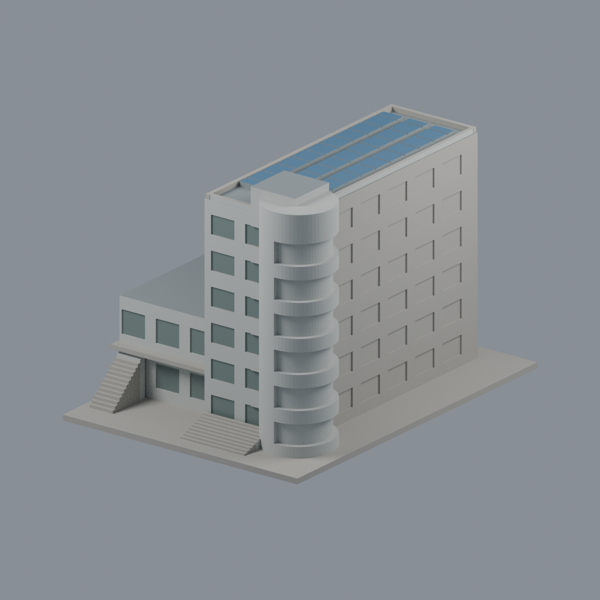
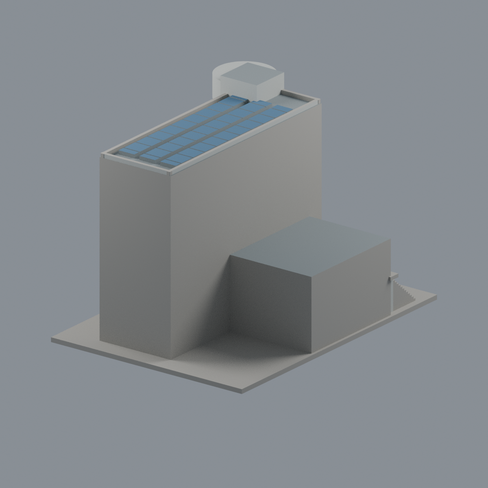

# 國立聯合大學 二坪山教職員宿舍可見建築群

## 模型預覽

| 模型預覽 | 模型預覽 | 模型預覽 |
| :---: | :---: | :---: |
| 正面與來源支持區域  | 女兒牆外側推估補色，其餘背面中性  |  |

## 本次屋頂女兒牆外側灰白補色（推估）

將既有屋頂四道女兒牆的外側垂直表面，共 20 個原三角延續正面灰白骨材牆色 1；其餘 4,220 面與原 2,934 個著色面、理由皆保留。原 4,240 面／2,108 點、STL bytes、座標、面序及五色表不變。現中性 1,286、灰白牆 2,366、玻璃代理 36、藍集熱器頂 68、灰屋頂及設備邊 484。

範圍為原 z=93.3…95.3 mm 的四個有限朝外平面：x=−5.85、33.85、y=−50.85、64.85；交叉女兒牆與樓梯頭造成原有中斷，選取完整原三角，四組面積約 225.2、187.6、39.6、73.2 mm²。女兒牆內側、頂面、短端、主屋面、設備及原窗凹全部不變，不切面、不新增幾何。

本輪親看官方空拍與近景兩張。前側女兒牆外表呈灰白，與原牆同族；**屋內側較暗且有風化，故不一併塗灰白**。未單獨看見的後段外側仍是同構件延伸推估，不是背面照片確證。原照片 EXIF 指向 2025-03-02，日期時區未獨立核實，非 2026 現況。原陽台與窗框混合、圓弧樓梯及未建管線的簡化不變；藍色集熱設備不改稱已確證太陽光電。未實體試印，照片留私人研究不入公開包。

新版 QA 在 `appearance/qa-continuous-walls/`，原歷史 QA 與根 `SHA256SUMS` 留存，本次新增 `PUBLIC-MODEL-SHA256SUMS`。由根目錄重建 `python appearance/source/build_continuous_walls.py`；交換驗證 `python appearance/source/verify_continuous_exchange.py`；渲染 `blender -b --python appearance/source/render_continuous_walls.py`；場景驗證 `blender -b --python appearance/source/verify_continuous_scene.py`。ZIP 包含原 STL、建模程式及選取域，不含照片。

## 前版說明與保留限制

## 5 材質外觀版（2026-10-21）

[來源界線與四視角](appearance/README.md) · [表面色 3MF](appearance/nuufac-appearance.3mf) · [可編輯場景](appearance/scene.blend)

可見灰白立面、原矩形窗背及三排藍色集熱／集能板；未確認為光伏 PV，圓弧開放外廊不是玻璃，未知長側與背面中性。 原 STL 與歷史 QA 不變；這是外觀改善，不是新增幾何。原單色正面（歷史檔案留存，不作本頁預覽）／原單色背面（歷史檔案留存，不作本頁預覽）

依官方外觀照片製作的近似列印模型。最長邊獨立設定150 mm，並非全校統一縮尺或實測模型。正面朝-Y。只建外觀，不建內部配置。

## 外形與來源
長條高宿舍翼、前端圓弧樓梯塔及逐層半圓外廊、左側較低相接翼、外階梯及三列屋頂板。

官方相簿：https://secretary.nuu.edu.tw/p/132-1003-1103.php?Lang=zh-tw

完整照片標題與原圖來源見evidence.json。照片只用於研究，未收入交付檔。預覽直接渲染實際STL；顏色為材質，STL無顏色。

## 證據限制
現行地圖統稱P1，但歷史P1與P2精確界線無法由相簿確定。因此本件僅是一個「已拍攝宿舍群」模型，不宣稱P1/P2兩棟各自完成。背面及部分翼部相接處簡化；旁邊泳館排除。
所有長寬高、深度與樓層比例均為照片估計，未見部分不視為可靠復原；相簿發布／拍攝年代不等於2026現況。

## 列印
圓弧帶厚約2.8 mm、屋頂欄邊1.7 mm；圓弧層板及外凸平台需要支撐；外梯實心。
建議0.4 mm噴嘴、0.16–0.20 mm層高、底座平放、先在切片器檢查支撐與橋接。布林合併為單一封閉連通實體，保留外露孔洞／廊道。不含封閉內腔殼。未做實際列印或切片驗證。

## 內容與重建
- build_model.py：原創參數化外觀來源，Python 3.11+
- model.stl：毫米單位可列印網格
- scene.blend：與STL一致的可編輯網格場景（另含攝影棚地面）
- previews/front.png、rear.png：實際STL全幅前後視圖
- validate_model.py、validation.json：原始法線、邊、頂點連結、連通與尺寸檢查
- rebuild-check.json、blender-stl-agreement.json、SHA256SUMS：重建與交付核對

安裝requirements.txt後執行python build_model.py；再執行python validate_model.py model.stl --longest-edge 150 --output validation.json。Blender 4.3.2執行blender -b -t 2 -P render_preview.py可重建預覽與場景。

## 實際模型尺寸
110.0 × 150.0 × 103.3 mm（X × Y × Z，含底座）。
