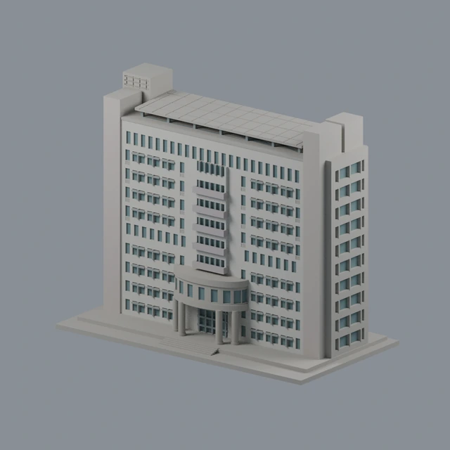
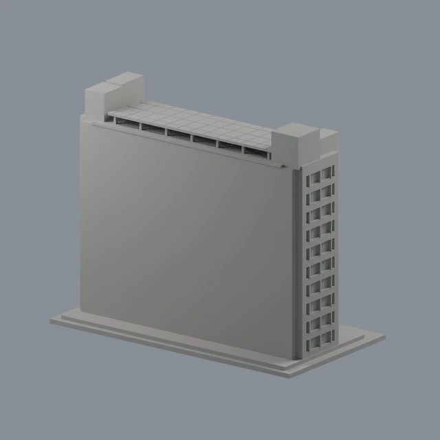
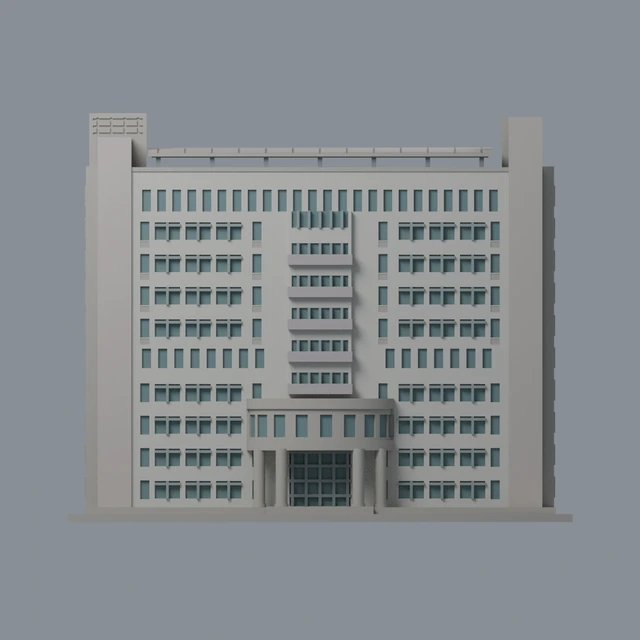
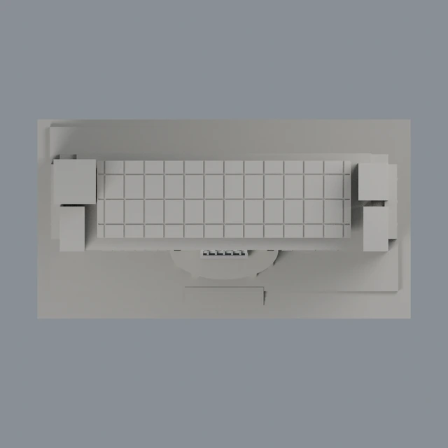

# 二坪山 H1 產研創新暨推廣大樓｜現行彩色展示

## 模型預覽

| 正面 | 背面 | 正立面 |
| :---: | :---: | :---: |
|  |  |  |
|  | | |

四張全尺寸無失真 WebP 由現行八材質 Blender 場景核對重繪，點擊縮圖可放大。僅保留有來源支持的右側離散窗凹背配色，未證實的左側、背面及棚頂維持中性。此處不改幾何或擴大補色。

[現行彩色 Blender](../appearance/scene.blend) · [彩色 3MF](../appearance/nuuh1-appearance.3mf) · [STL](../model.stl) · [渲染驗證](render-proof.json) · [本頁校驗](SHA256SUMS)

[原模型與限制](../README.md) · [原外觀來源與證據](../appearance/README.md)。歷史圖、原 README 與工程資料均未改動。未實體試印。
