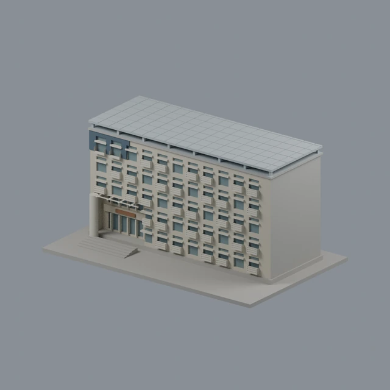
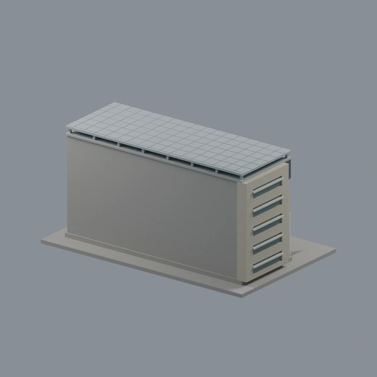
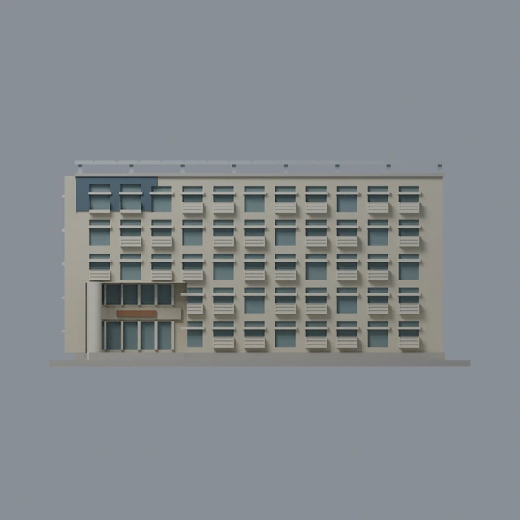
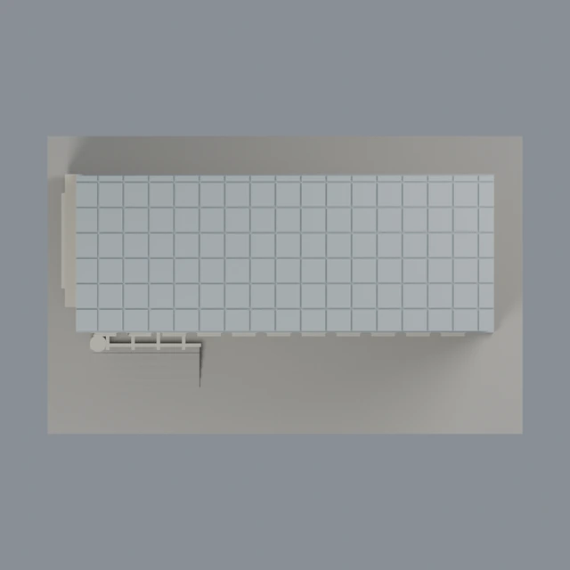

# 二坪 M5 第五宿舍（恕先樓）｜現行彩色展示

## 模型預覽

| 模型預覽 | 模型預覽 | 模型預覽 |
| :---: | :---: | :---: |
|  正面 |  背面 |  正立面 |
|  頂視 | | |

四張全尺寸無失真 WebP 由現行七材質 Blender 場景核對重繪，點擊縮圖可放大。延用現行有界正面配色與銀灰屋頂代理色；未證實頂面為光伏，未見右側與背面保持中性。此處不改幾何或擴大補色。

[現行彩色 Blender](../appearance/scene.blend) · [彩色 3MF](../appearance/nuum5-appearance.3mf) · [STL](../model.stl) · [渲染驗證](render-proof.json) · [本頁校驗](SHA256SUMS)

[原模型與限制](../README.md) · [原外觀來源與證據](../appearance/README.md)。歷史圖、原 README 與工程資料均未改動。未實體試印。
