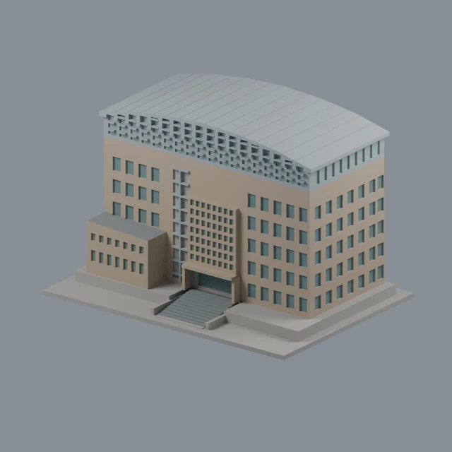
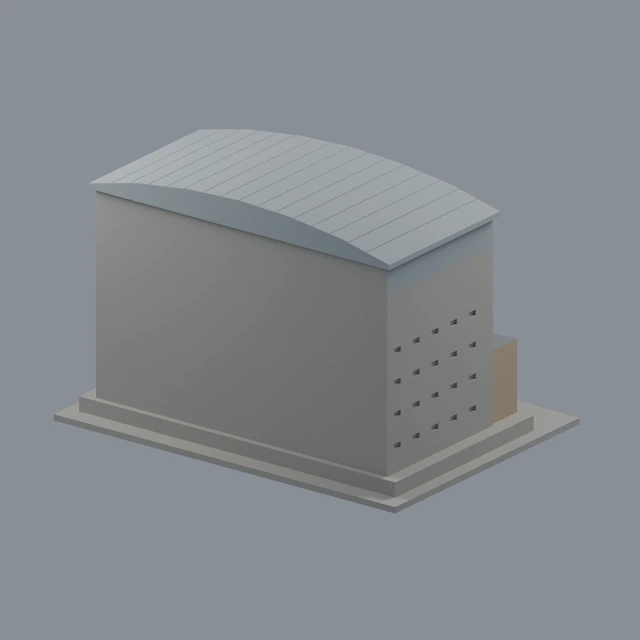
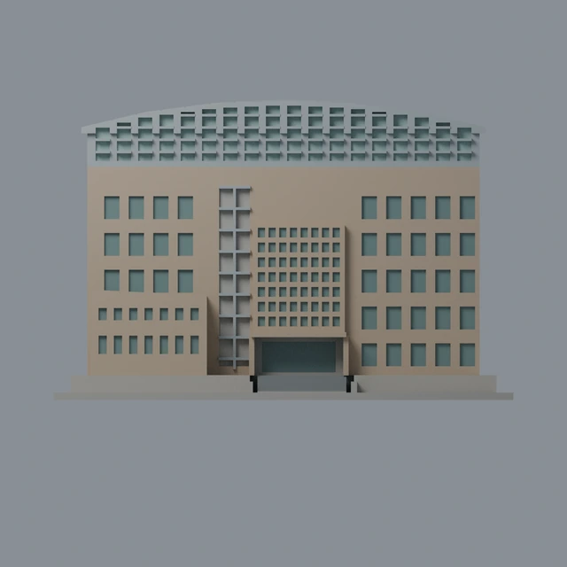
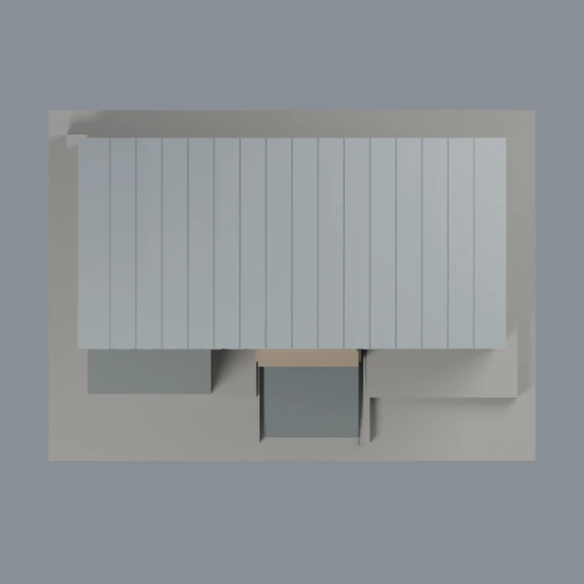

# 二坪山 M8 第八宿舍（國鼎館）｜現行彩色展示

## 模型預覽

| 模型預覽 | 模型預覽 | 模型預覽 |
| :---: | :---: | :---: |
|  正面 |  背面 |  正立面 |
|  頂視 |  |  |

四張全尺寸無失真 WebP 由現行六材質 Blender 場景核對重繪，點擊縮圖可放大。保留既有六材質。未見外牆維持中性；銀灰弧頂是保守展示，模型原屋面沒有足夠分片邊界，因此未用整片藍色表示實景光電板。幾何與配色未變更。

[現行彩色 Blender](../appearance/scene.blend) · [彩色 3MF](../appearance/nuum8-appearance.3mf) · [STL](../model.stl) · [渲染驗證](render-proof.json) · [本頁校驗](SHA256SUMS)

[原模型與限制](../README.md) · [原外觀來源與證據](../appearance/README.md)。歷史圖、原 README 與工程資料均未改動。未實體試印。
