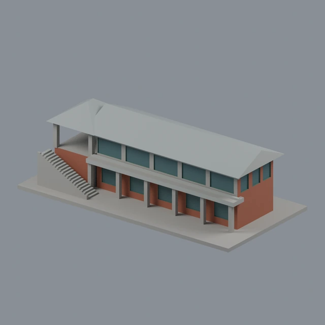
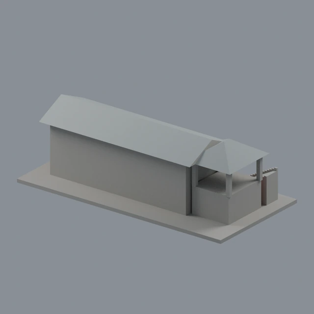
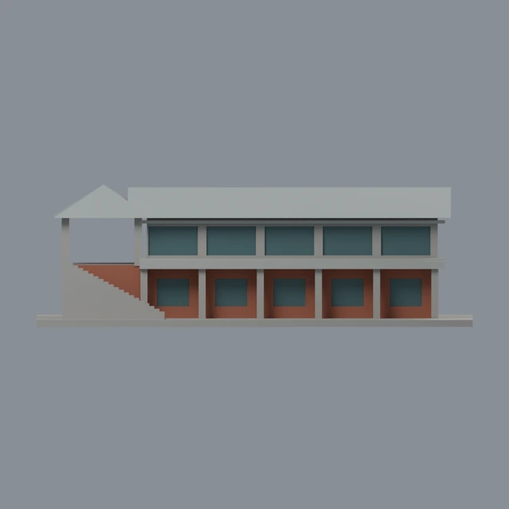
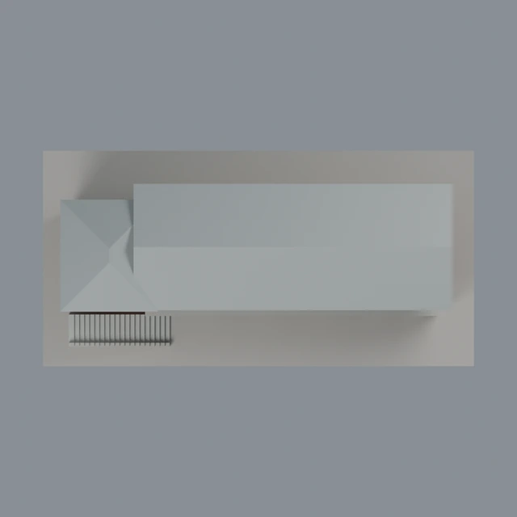

# 二坪 V1 景觀餐廳｜現行彩色展示

## 模型預覽

| 正面斜視 | 背面斜視 | 正立面 |
| :---: | :---: | :---: |
|  |  |  |
|  | | |

四張無失真展示圖由同一份六材質 Blender 場景重繪。大小較小的縮圖可點擊放大；模型及材色不變。

[可編輯 Blender](../appearance/scene.blend) · [彩色 3MF](../appearance/nuuv1-appearance.3mf) · [STL](../model.stl) · [渲染驗證](render-proof.json)

[原模型與來源勘誤](../README.md)及[原外觀、來源與限制](../appearance/README.md)保留原始預覽與校驗。原 PNG 和技術檔未移除或覆寫。本模型為二坪 V1，不是八甲 V2。
